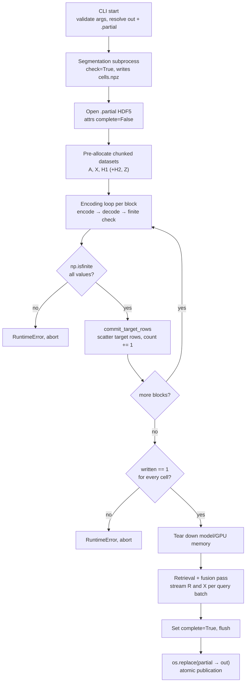
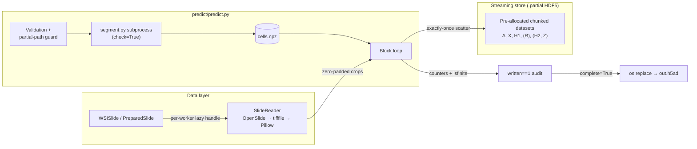

A whole-slide inference run can involve hundreds of thousands of cells and millions of gene values — far more than you want to hold in RAM, and far too expensive to lose to a crash at minute 90. This page explains how Morph2Mol's inference CLI (`predict/predict.py`) solves both problems with a single design: results are **streamed into a pre-allocated, chunked HDF5 staging file** under strict *exactly-once* write discipline, and the final result is **published atomically** only after every invariant has passed. We walk through the write pipeline, the once-only commit protocol, the fail-fast guards, the I/O fallback chain, and the resource lifecycle — everything that lets a long-running prediction fail loudly and cheaply, or succeed cleanly.

Sources: [predict.py](predict/predict.py#L19), [predict.py](predict/predict.py#L145-L168)

## The Staged Write Pipeline

The `--out` argument is documented as "Output .h5ad; matrices are streamed to disk", and the implementation backs that promise with a two-phase commit. The CLI immediately resolves the output path and derives a sibling staging path — `results.h5ad` becomes `results.h5ad.partial` — and refuses to start if either file already exists unless you pass `--overwrite`. All writes during the run go to the `.partial` file; the real output path is never touched by an incomplete run.

Sources: [predict.py](predict/predict.py#L19), [predict.py](predict/predict.py#L45-L49)

Inside the staging file, every result matrix is **pre-allocated before any GPU work begins**. A `matrix()` helper creates fixed-shape HDF5 datasets with explicit chunking (`chunks=(min(n,128), min(shape[1],512))`) and lossless `lzf` compression, so a 300,000-cell × 5,000-gene `layers/A` never exists in memory as one array — it lives on disk in ~128×512 tiles. The datasets created up front are `layers/A` (the direct NB-head predictions), `X` (the fused output), `obsm/X_morph2mol_phase1` (retrieval keys, float16 to halve I/O), and optionally the stage-2/SE(2) embeddings when `--save-embeddings` is set. During the encoding loop, each target/context block is processed, validated, and scattered into these pre-allocated arrays row-group by row-group; nothing accumulates.

Sources: [predict.py](predict/predict.py#L126-L141), [predict.py](predict/predict.py#L144-L159)

The full lifecycle is one directed pipeline with a single publication gate:

Sources: [predict.py](predict/predict.py#L126-L168), [predict.py](predict/predict.py#L169-L201)

## The Exactly-Once Row Commit Protocol

Streaming writes are only safe if every cell lands in the output **exactly once** — and the block structure makes that nontrivial, because each block carries *target* cells (owned, must be written) plus *halo context* cells (borrowed for the decoder, must never be written). The commit function `commit_target_rows` in `morph2mol/spatial_context.py` encodes this contract. It takes the block's index array and the `n_targets` prefix length, and enforces three guards in order: the target prefix must be non-empty and well-formed, the owned indices must be unique *and* never previously written (`counts[owned] == 0` before the scatter), and every model payload must cover the full batch — a shorter prediction array than the block's index list is a hard error rather than a silent partial write. Only after all scatters succeed does it increment the per-cell write counters.

Sources: [morph2mol/spatial_context.py](morph2mol/spatial_context.py#L64-L78), [morph2mol/spatial_context.py](morph2mol/spatial_context.py#L42-L47)

The main loop complements this with an end-of-run audit. A `uint8` counter array of length *n* is allocated alongside the loader, incremented by each successful commit, and finally checked with `np.all(written == 1)` — if any cell was written zero times or more than once, the run aborts instead of publishing a silently incomplete `.h5ad`. This is defense in depth: the per-commit guard catches a bad block immediately, and the global audit catches any gap the per-block checks could miss (for example, a partition that fails to cover the slide).

Sources: [predict.py](predict/predict.py#L142-L144), [predict.py](predict/predict.py#L159), [predict.py](predict/predict.py#L167-L168)

> [!TIP]
> The same `commit_target_rows` function is shared by reference calibration and deployed inference (`prediction_protocol()` pins `output_policy='targets_once_only'`), so the once-only guarantee is a *protocol*, not a per-script convention — metadata written into `uns/morph2mol.spatial_context` lets any consumer verify it.

Sources: [morph2mol/spatial_context.py](morph2mol/spatial_context.py#L42-L47), [morph2mol/spatial_context.py](morph2mol/spatial_context.py#L81-L91)

## Atomic Publication and the Completion Flag

Three mechanisms cooperate so that a reader can never observe a half-written result. First, the staging file opens with the attribute `complete=False`, which is flipped to `True` only after all post-processing (fusion metadata, `beta`/`covered` gene flags, spatial coordinates, provenance `uns`) has been written and flushed. Second, the file itself is renamed into place with `os.replace(partial, out)` — an atomic filesystem operation on POSIX systems, so the output path transitions from *absent* to *fully valid* in one step. Third, the startup guard rejects a run when either the output or a stale `.partial` exists, preventing a new run from silently mixing its rows into someone else's leftover file.

Sources: [predict.py](predict/predict.py#L126-L127), [predict.py](predict/predict.py#L192-L200), [predict.py](predict/predict.py#L45-L49)

The most expensive preprocessing stage gets its own durability story. Automatic segmentation runs as a **separate subprocess** launched with `subprocess.run(..., check=True)`, writing a self-contained `cells.npz` (centroids, polygon vertices, cell IDs) next to the eventual output. Two consequences follow: if segmentation crashes, the Python process aborts *before* creating any output files (no orphaned GPU state, no partial HDF5); and because the `.cells.npz` survives a crashed or completed run, you can restart cheaply by passing it explicitly via `--cells`, skipping re-segmentation entirely.

Sources: [predict.py](predict/predict.py#L52-L71), [predict/segment.py](predict/segment.py#L17-L23)

## Fail-Fast Validation and Runtime Guards

The design philosophy is to **fail before the expensive work begins, and loudly the moment invariants break**. Argument validation runs first — microns-per-pixel must be a positive physical scale, batch sizes and worker counts must be sane, `--cells` is rejected with `--prepared` — followed by data-level checks the moment inputs are opened: empty inputs, duplicate cell identifiers, and gene panels that are empty, duplicated, or absent from the model's gene head all raise before the model loads. Then, *during* the GPU loop, each block's decoded predictions are checked with `np.isfinite(...).all()`, so a numerical blow-up kills the run at the offending block instead of poisoning thousands of rows downstream.

Sources: [predict.py](predict/predict.py#L39-L48), [predict.py](predict/predict.py#L86-L105), [predict.py](predict/predict.py#L152-L153)

The same philosophy extends through the toolchain with actionable error messages rather than stack traces. The segmentation stage validates `--mpp`, window/overlap/channel parameters up front, warns when `--overlap` is small enough to risk cutting nuclei at window seams, and if a slide yields zero nuclei it exits with a diagnostic naming the two usual suspects (`--channel`, `--mpp`). Slides lacking physical-resolution metadata are refused with an explicit instruction to pass `--mpp`, rather than silently guessing a scale.

Sources: [predict/segment.py](predict/segment.py#L118-L128), [predict/segment.py](predict/segment.py#L172-L173), [predict.py](predict/predict.py#L56-L58)

The following matrix maps each anticipated failure to its detection mechanism and the user-visible behavior:

| Failure scenario | Detection mechanism | Behavior | Recovery path |
|---|---|---|---|
| Crash mid-run (OOM, power loss) | `.partial` staging file never renamed | Output path stays clean; `complete` flag stays `False` | Fix cause, rerun; reuse `cells.npz` via `--cells` |
| Stale output/partial exists | Startup `FileExistsError` guard | Run refuses to start | Choose new path or pass `--overwrite` |
| NaN/Inf from the decoder | Per-block `np.isfinite().all()` | `RuntimeError` naming the block | Investigate input patch; abort beats silent corruption |
| Partition misses or double-hits a cell | `commit_target_rows` counters + final `written == 1` audit | `RuntimeError`; `.partial` never promoted | Library bug, not user error — report with the input |
| Missing slide resolution metadata | MPP check before model load | `ValueError` instructing `--mpp` | Supply `--mpp` in µm/pixel |
| TIFF without OpenSlide installed | Lazy backend fallback with install hints | `RuntimeError` naming `pip install tifffile` / OpenSlide | Install the suggested package |
| Segmentation finds no nuclei | `SystemExit` with hint | Process exits before prediction starts | Check `--channel` (3 = blue for H&E) and `--mpp` |
| Crop extends past slide edge | Zero-padded `region()` read | Cell kept, rows stay aligned | None needed — order always matches input |

Sources: [predict.py](predict/predict.py#L39-L58), [predict.py](predict/predict.py#L152-L153), [predict.py](predict/predict.py#L167-L168), [predict/slide_io.py](predict/slide_io.py#L45-L62), [predict/segment.py](predict/segment.py#L172-L173), [predict/slide_io.py](predict/slide_io.py#L76-L88)

## I/O Backend Fallbacks and Worker Isolation

Reading whole-slide imagery is inherently environment-dependent, so `SlideReader` degrades gracefully rather than hard-failing. It tries **three backends in order** — OpenSlide (SVS/NDPI/MRXS/pyramidal TIFF), tifffile (OME/plain TIFF), then Pillow (PNG/JPEG) — with all imports deferred until needed, so a PNG-only user never needs OpenSlide installed and an SVS user who lacks it gets an error message naming the exact package to install instead of an opaque decode failure. When a crop extends beyond the slide boundary it is **zero-padded rather than dropped**, which preserves the invariant that output row order always matches input cell order — a quiet but essential precondition for the scatter-based commit protocol.

Sources: [predict/slide_io.py](predict/slide_io.py#L1-L11), [predict/slide_io.py](predict/slide_io.py#L16-L24), [predict/slide_io.py](predict/slide_io.py#L45-L62), [predict/slide_io.py](predict/slide_io.py#L76-L88)

Concurrency introduces its own failure class: DataLoader worker processes fork the parent, but **slide file handles are not fork-safe**. `WSISlide` therefore never opens the slide eagerly — it stores the path and opens a private `SlideReader` lazily inside each worker process on first use. Each worker owns its handle, so a worker crash or restart cannot corrupt another worker's file position, and crop loading proceeds in parallel (`--workers`) without shared mutable I/O state.

Sources: [predict/inputs.py](predict/inputs.py#L43-L47)

## Resource Reclamation Between Phases

Inference runs in two memory-heavy phases: block-wise encoding (model on GPU, image batches streaming through) followed by retrieval and gated fusion (a reference bank resident on the device, queries batched by `--query-batch`). Between the two, the pipeline **deliberately tears down everything it no longer needs** — the model and batch tensors are deleted, the parent's slide reader handle is closed, `gc.collect()` reclaims Python objects, and `torch.cuda.empty_cache()` returns GPU memory to the driver. On a large slide this is the difference between the fusion pass fitting comfortably and an out-of-memory death at the 99% mark; the final audit has already passed, so everything in the staging file at that point is valid.

Sources: [predict.py](predict/predict.py#L167-L174), [predict.py](predict/predict.py#L177-L188)

> [!TIP]
> Because the fusion pass reads `H1` back *from the staging file* in query batches and writes `R`/`X` rows as it goes, peak memory during fusion is `query_batch × g` — independent of slide size. If you hit GPU limits on the *encoding* phase, lower `--enc-chunk` and `--query-batch`; slide size itself does not set the memory ceiling.

Sources: [predict.py](predict/predict.py#L181-L188), [predict.py](predict/predict.py#L136-L141)

## How Long Jobs Stay Observable

Fault tolerance includes knowing a job is alive. Every progress printer uses `flush=True` — output is never trapped in a buffer you can't see when tailing a log over SSH or inside a container — and both phases report at fixed intervals: the segmentation subprocess prints a per-window heartbeat every 20 windows (with elapsed time and running nuclei count), the encoding loop prints `[A] blocks k/N` every 20 blocks, and the fusion pass prints `[retrieval + fusion] cells/n` per query batch. A stalled log line is therefore a genuine stall signal, not a buffering artifact.

Sources: [predict/segment.py](predict/segment.py#L167-L168), [predict.py](predict/predict.py#L165-L166), [predict.py](predict/predict.py#L186-L188)

## Putting It Together

The module interactions behind one streaming prediction look like this:

The takeaway for operators: a successful run publishes atomically and carries a machine-checkable `complete` flag; a failed run costs you at most the time since the last block, always leaves the output path untouched, and usually leaves you a reusable `cells.npz`. The takeaway for developers extending the pipeline: any new per-cell output should ride the same contract — add a payload to `commit_target_rows`, extend the `written` audit, and never write outside the `.partial` file.

Sources: [predict.py](predict/predict.py#L45-L49), [morph2mol/spatial_context.py](morph2mol/spatial_context.py#L64-L78), [predict.py](predict/predict.py#L192-L201)

## Where to Go Next

For how the block structure that the commit protocol depends on is constructed — target ownership, halo context, and the deterministic partition — continue with [Spatial Context Blocking](19-spatial-context-blocking). For how the segmentation subprocess produces the `cells.npz` you can reuse across reruns, see [Nuclei Segmentation with Cellpose-SAM](18-nuclei-segmentation-with-cellpose-sam). To interpret the datasets this pipeline streams into the final `.h5ad` (including the `complete` flag, `layers/A` vs `layers/R` vs `X`, and provenance metadata), read [Reading Prediction Outputs](4-reading-prediction-outputs), and for verifying that a downloaded release is intact before you point `--release` at it, see [Release Integrity Verification](21-release-integrity-verification).