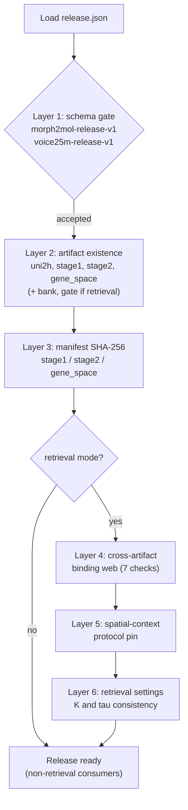
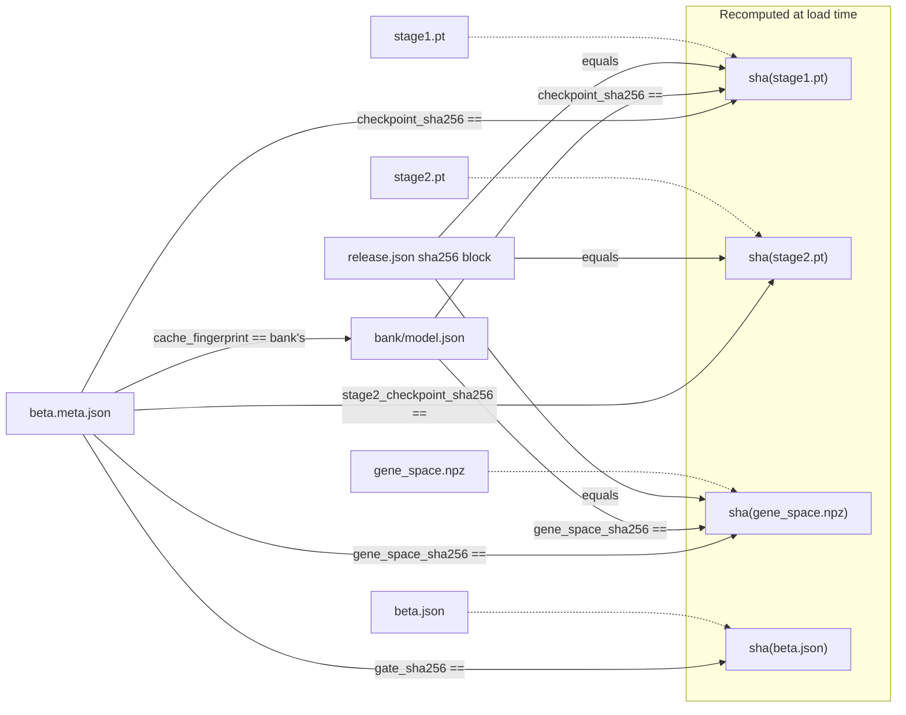
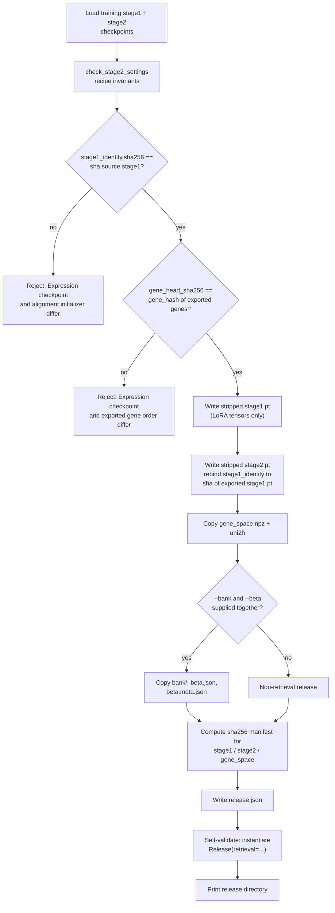
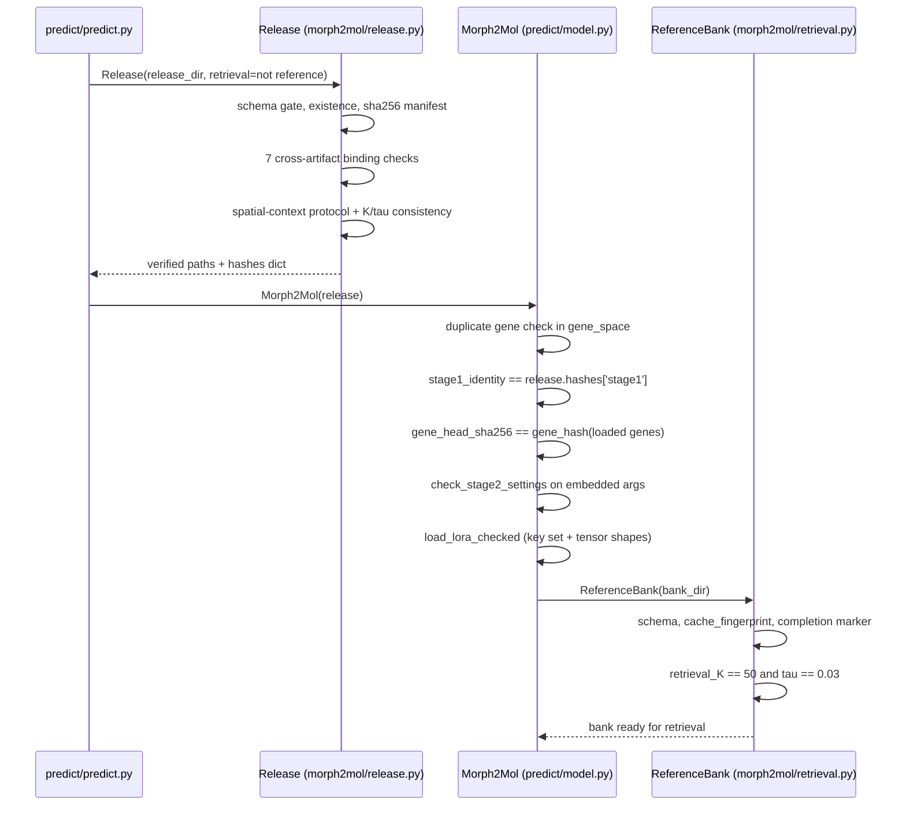

A deployed Morph2Mol release is a directory of independently produced artifacts: frozen encoder weights, a Stage-1 alignment checkpoint, a Stage-2 expression checkpoint, a gene space, and — optionally — a retrieval reference bank plus a fusion gate. This page explains the **release integrity verification** system: the mechanism that proves, at load time and without any access to the training corpus, that every artifact in a release directory belongs to the same training run, the same gene ordering, and the same calibration protocol. The design goal is that a mixed, stale, or hand-edited release cannot load silently; it fails fast with a specific error.

Sources: [release.py](/morph2mol/release.py#L1-L4)

## The Problem the System Solves

Because artifacts are produced at different points in the lifecycle (training, bank building, gate fitting, export), a release directory can fail in ways that would be invisible to a generic loader: a Stage-2 head trained against a different Stage-1 initializer, a bank whose embeddings live in another gene space, a fusion gate calibrated under an older spatial-blocking revision, or a `beta.json` edited after calibration. Morph2Mol's answer is to make every artifact *self-describing* — each checkpoint and sidecar carries SHA-256 identities of everything it depends on — and to have the loader cross-examine those identities against the bytes actually on disk.

The verification logic is deliberately concentrated in one portable class, `morph2mol.release.Release`, whose docstring states the contract: portable release paths and identities, no training corpus required at inference. Everything downstream — the inference CLI, the model constructor, the retrieval bank — either consumes the verified `Release` object or re-derives the same checks itself.

Sources: [release.py](/morph2mol/release.py#L1), [model.py](/predict/model.py#L1-L2)

## The Manifest Contract: release.json

Every release directory is anchored by a `release.json` manifest. The very first check is a **schema gate**: the manifest's `schema` field must be one of two whitelisted values (`morph2mol-release-v1` or `voice25m-release-v1`); anything else aborts with `Unsupported release.json schema`. This ensures the loader never interprets an unknown directory layout as a release. The dual schema support mirrors the dual key namespaces tolerated in prediction outputs (`morph2mol` / `voice25m`), so legacy releases remain loadable.

The manifest then declares relative paths for each artifact, and the loader resolves and **existence-checks** each one — the four mandatory artifacts (`uni2h`, `stage1`, `stage2`, `gene_space`) plus `bank` and `gate` when retrieval mode is requested. A missing artifact raises `FileNotFoundError` naming the exact path, so incomplete copies fail before any weights are touched.

Sources: [release.py](/morph2mol/release.py#L10-L20), [prediction_io.py](/morph2mol/prediction_io.py#L4-L7)

The example manifest shows the full field inventory an export produces:

| Manifest field | Points to | Role in verification |
|---|---|---|
| `schema` | — | Format whitelist; rejects foreign directories |
| `uni2h` | `uni2h/` | Frozen encoder directory; existence-checked |
| `stage1` | `stage1.pt` | Alignment LoRA tensors; hashed, bound to Stage-2 |
| `stage2` | `stage2.pt` | Expression weights; carries its own identities |
| `gene_space` | `gene_space.npz` | Gene ordering; hashed and semantically bound |
| `bank` | `bank/` | Reference bank; verified inside `ReferenceBank` |
| `gate` | `beta.json` | Fusion weights; bound via its `.meta.json` sidecar |
| `xenium_genes` | `xenium_genes.tsv` | Optional panel export; presence-conditional |
| `sha256` | — | Raw-file checksums for `stage1`, `stage2`, `gene_space` |

Sources: [release.example.json](/configs/release.example.json#L1-L11)

## The Verification Stack

Conceptually, `Release.__init__` runs six verification layers in order, each cheap enough to execute on every load and each failing with a targeted message. The first three layers guard the manifest and the files; the remaining three apply only in retrieval mode and guard the *relationships* between artifacts.

Layers 1–3 run for every consumer; notably, gate fitting itself instantiates `Release(retrieval=False)` precisely to reuse layers 1–3 while the bank and gate are still being *produced*. Layers 4–6 run for deployment, where all artifact families must cohere.

Sources: [release.py](/morph2mol/release.py#L7-L26), [fit_beta.py](/train/fit_beta.py#L28)

## The Cross-Artifact Binding Web

The core of the system is a **binding web**: seven pairwise identity comparisons that tie the four artifact families into one provably co-produced set. The loader recomputes raw-file SHA-256 digests for the three tensor artifacts, reads the bank's `model.json`, the gate (`beta.json`), and its sidecar (`beta.meta.json`), then asserts every recorded identity matches the bytes on disk. Any single mismatch aborts with `Model checkpoints, genes, reference bank and fusion weights do not match` — intentionally a single error for the whole web, since any violation means the release is not a unit.

Each edge of the web catches a distinct failure mode:

| # | Recorded identity vs. recomputed digest | Failure caught |
|---|---|---|
| 1 | `bank.checkpoint_sha256` vs `sha(stage1.pt)` | Bank built from a different alignment checkpoint |
| 2 | `bank.gene_space_sha256` vs `sha(gene_space.npz)` | Bank embeddings in a foreign gene space |
| 3 | `gate_meta.checkpoint_sha256` vs `sha(stage1.pt)` | Gate calibrated on a different Stage-1 model |
| 4 | `gate_meta.stage2_checkpoint_sha256` vs `sha(stage2.pt)` | Gate calibrated against a different expression head |
| 5 | `gate_meta.gene_space_sha256` vs `sha(gene_space.npz)` | Gate fitted under a different gene ordering |
| 6 | `gate_meta.cache_fingerprint` vs `bank.cache_fingerprint` | Gate and bank describe different bank builds |
| 7 | `gate_meta.gate_sha256` vs `sha(beta.json)` | `beta.json` swapped or edited after calibration |

The web closes with two protocol-level consistency checks: the gate metadata's `spatial_context` record must exactly equal the runtime `prediction_protocol()` (a dict covering blocking mode, revision, cell counts, halo radius, seed, and output policy), and the gate's retrieval constants `K` and `tau` must equal the bank's `retrieval_K` and `tau`. Together these guarantee that the fusion weights were fitted under the *same* blocking behavior and *same* neighborhood geometry that inference will use.

Sources: [release.py](/morph2mol/release.py#L27-L45), [spatial_context.py](/predict/spatial_context.py#L81-L90)

## Hash Primitives: Raw Bytes vs Canonical Identity

The system uses two classes of hashing, and the distinction matters. **Raw-file hashes** digest bytes, making them tamper-evident but sensitive to any serialization change. **Canonical hashes** digest a normalized JSON representation, making them stable identity statements about *content* rather than file encodings. Four primitives implement this:

| Primitive | Digests | Canonicalization | Primary consumers |
|---|---|---|---|
| `sha(path)` | Raw file bytes, streamed in 8 MiB blocks | none (byte-exact) | Manifest, binding web, `gate_sha256` |
| `gene_hash(genes)` | Gene symbol list | `json.dumps` of the list | `gene_head_sha256` in Stage-2, gate `fit_signature` |
| `fingerprint(value)` | JSON-serializable dict | `json.dumps` with sorted keys | Bank `cache_fingerprint` |
| `checkpoint_identity(path)` | Raw checkpoint bytes | wrapped as `{'sha256': ...}` | `stage1_identity` embedded in checkpoints |

The streaming implementation matters for the raw hashes: checkpoints and gene spaces are large, so `sha` reads in fixed 8 MiB blocks rather than loading files into memory — verification adds no memory pressure regardless of model size. Canonical hashing is what makes the gene-order binding robust: `gene_head_sha256` inside the Stage-2 checkpoint is compared against `gene_hash` of the gene list *as loaded from the npz*, so a gene space whose rows were reordered — even if the file were re-serialized identically otherwise — cannot pass.

Sources: [retrieval.py](/morph2mol/retrieval.py#L16-L21), [training_contract.py](/morph2mol/training_contract.py#L39-L49), [bank_io.py](/morph2mol/bank_io.py#L30-L31)

## Where Bindings Are Born: Export-Time Verification

Integrity is not only checked at load — it is *constructed* at export. `train/export_release.py` runs its own input-side checks before writing anything, then manufactures the identities that the load-time web will later verify. The export refuses to write into a non-empty directory, eliminating the possibility of stale artifacts mixing into a fresh release.

> [!TIP]
> Notice the identity rebinding at export: the exporter verifies the *training* Stage-2 checkpoint against the *training* Stage-1 file, but then writes a **stripped** `stage1.pt` (LoRA tensors only, no optimizer state) and re-embeds `stage1_identity` as the hash of the *stripped* file. Since removing optimizer state changes the bytes, the training-time hash would fail every downstream check — the chain must be re-anchored to the artifact that actually ships.

The final step is a fail-fast self-validation: the exporter constructs a full `Release` object against the directory it just wrote, so an export that would fail at load time fails at export time instead. The gate-pairing rule (`--bank` and `--beta` must be supplied together or not at all) prevents half-connected retrieval releases from ever existing.

Sources: [export_release.py](/train/export_release.py#L18-L33), [export_release.py](/train/export_release.py#L45-L64)

## Defense in Depth at Inference Time

Verification executes at three moments during a deployment load, and each layer re-derives checks rather than trusting the previous layer. The CLI entry point first constructs `Release` (layers 1–6). The model constructor then re-checks the *internal* identities of the checkpoints themselves — identities that live inside the `.pt` files and are therefore invisible to manifest-level hashing. Finally, the bank constructor self-verifies when retrieval is initialized.

The model-constructor layer is the subtle one. `Morph2Mol.__init__` re-asserts that the Stage-2 checkpoint's embedded `stage1_identity` equals the release's recomputed Stage-1 hash — catching a swapped `stage1.pt` even if the manifest were regenerated — and re-derives `gene_hash` from the gene space it actually loaded. It then applies **structural** verification to the LoRA adapters: `load_lora_checked` validates that adapter tensor keys are a subset of the encoder's `.A`/`.B` parameters (exactly equal when `complete=True` for Stage-1) and that every tensor shape matches the live module, rejecting checkpoints built for a different adapter configuration before any state is copied.

Sources: [predict.py](/predict/predict.py#L60-L61), [model.py](/predict/model.py#L14-L34), [training_contract.py](/morph2mol/training_contract.py#L68-L77)

## The Reference Bank as a Self-Verifying Artifact

Because the bank directory is copied wholesale into the release, its integrity is maintained independently of the manifest through a construction protocol in `ReferenceBank.__init__`. The checks run in a strict order: schema whitelist; a **content fingerprint** — `cache_fingerprint` is the `fingerprint()` of the entire `model.json` minus the fingerprint field itself, so any edit to the bank's description (objects, hyperparameters, protocol ids) invalidates it; fixed retrieval constants (`target_size == 100`, `retrieval_K == 50`, `tau == 0.03`); an exact object count; and a **completion marker** — `bank_complete.json` must exist, report the same object count, and carry the same cache fingerprint, which makes partially built or partially copied banks detectable at load.

Per-object feature files are bound separately by `validate_feature`, which requires each object's metadata `checkpoint_sha256` and `feature_protocol_id` to match the bank model's, enforces the 1536-dimensional raw Phase-1 feature contract, and rejects anything that is not the `phase1` output field — preventing Stage-2 expression vectors from being ingested as retrieval keys.

Sources: [retrieval.py](/morph2mol/retrieval.py#L82-L100), [bank_io.py](/morph2mol/bank_io.py#L58-L65)

## Closing the Loop: Calibration-Time Evidence

The binding web only works because the gate-fitting stage manufactures its side of the web under verification itself. `train/fit_beta.py` instantiates `Release(retrieval=False)` for the model side, then manually binds the *source* bank to the release by comparing `model.json`'s checkpoint and gene-space hashes against the release hashes — the same edges the load-time web will later assert. Reference slides used for calibration must themselves be verifiable: each calibration input's stored prediction metadata (read via `prediction_metadata`, tolerating both key namespaces) must carry a `spatial_context` record equal to the runtime protocol and `stage1_sha256` / `stage2_sha256` values equal to the release hashes — meaning **slide outputs double as evidence artifacts** that testify which model produced them.

The emitted gate is stamped with `fit_signature.genes = gene_hash(genes)`, and the sidecar `beta.meta.json` records everything the binding web will consume: `gate_sha256`, all three checkpoint hashes, the bank's `cache_fingerprint`, the retrieval constants, and the full spatial-context protocol. This is the genesis of every edge in the web — nothing at load time is trusted that was not written under a verified identity at fit time.

Sources: [fit_beta.py](/train/fit_beta.py#L28-L35), [fit_beta.py](/train/fit_beta.py#L50-L56), [fit_beta.py](/train/fit_beta.py#L86-L99), [prediction_io.py](/morph2mol/prediction_io.py#L4-L7)

## Coverage and Residual Risk

No verification design is total, and this one makes its trade-offs explicit. The table below maps each artifact family to its mechanism, the strength of the guarantee, and what remains outside the guarantee:

| Artifact family | Mechanism | Guarantee strength | Explicitly not covered |
|---|---|---|---|
| `stage1.pt`, `stage2.pt`, `gene_space.npz` | Manifest sha256 + checkpoint-embedded identities | Byte-tamper-evident where manifest entries exist | Manifest entries are optional — absent entries skip the file check |
| `uni2h/` encoder directory | Existence check only | Path presence | No content hash; contents assumed immutable |
| `bank/` directory | Content fingerprint + completion marker + per-object `validate_feature` | Build-level and description-level integrity | Individual matrix files are not byte-hashed |
| `beta.json` | `gate_sha256` in sidecar meta | Byte-exact binding | The sidecar itself is bound only indirectly |
| `release.json` | Schema gate | Format safety | The manifest is unsigned — it must originate from the exporter |

> [!TIP]
> The manifest's `sha256` block is enforced only for entries that are present (`if expected and expected != ...`). This is why the design layers *checkpoint-embedded* identities (Stage-2's `stage1_identity`, `gene_head_sha256`) on top of the manifest: a tampered or hand-written manifest cannot make mismatched tensors load, because the tensors carry their own binding evidence inside the file bytes.

Sources: [release.py](/morph2mol/release.py#L21-L26), [model.py](/predict/model.py#L21-L27)

## Failure Catalog

Because every check fails with a specific message, verification failures are diagnosable from the error text alone. The catalog below maps each message to the check that raised it and the most likely operational cause:

| Error message | Raised by | Likely cause |
|---|---|---|
| `Unsupported release.json schema` | Schema gate | Pointing at a non-release directory or a foreign format |
| `Missing release artifact <key>: <path>` | Existence check | Incomplete copy; artifact renamed or omitted |
| `Release checksum mismatch: <key>` | Manifest sha256 | Artifact regenerated or replaced after export |
| `Model checkpoints, genes, reference bank and fusion weights do not match` | Binding web (any of 7 edges) | Mixing artifacts from different runs |
| `Fusion calibration and spatial prediction settings differ` | Protocol pin | Gate fitted under a different blocking revision |
| `Fusion weights and reference bank retrieval settings differ` | K/tau consistency | Gate fitted against a bank with other retrieval constants |
| `Stage-2 was trained with another Stage-1 initializer` | `stage1_identity` re-check | Swapped `stage1.pt` |
| `Stage-2 gene order mismatch` | `gene_head_sha256` | `gene_space.npz` from another run |
| `Stage-2 gene-head order differs from this run` / LoRA key/shape mismatch | Training-side contract checks | Cross-run checkpoint reuse during training |
| `Bank model fingerprint mismatch` | `cache_fingerprint` | Hand-edited `model.json` |
| `Bank has not completed all objects` | Completion marker | Partially built or partially copied bank |

Sources: [release.py](/morph2mol/release.py#L10-L45), [model.py](/predict/model.py#L19-L34), [retrieval.py](/morph2mol/retrieval.py#L88-L100), [training_contract.py](/morph2mol/training_contract.py#L61-L77)

## Where to Go Next

The verification system sits at the boundary between several subsystems, and each has a dedicated page: see how the artifacts themselves are produced in [Model Export and Release Packaging](17-model-export-and-release-packaging), how the gate side of the binding web behaves mathematically in [Gated Fusion Weights](12-gated-fusion-weights), what the pinned spatial-context protocol controls in [Spatial Context Blocking](19-spatial-context-blocking), and how the bank's retrieval constants are used at query time in [Cluster Retrieval Mechanics](11-cluster-retrieval-mechanics). For how prediction outputs become the evidence artifacts consumed at calibration, continue to [Streaming Output and Fault Tolerance](20-streaming-output-and-fault-tolerance).