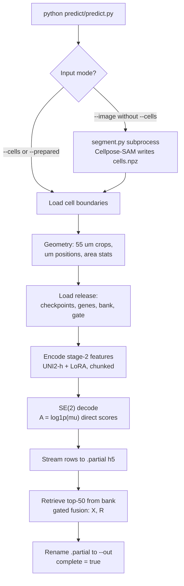
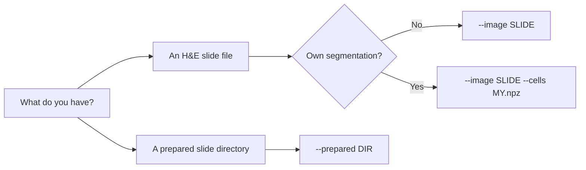

This page is the complete operator's manual for Morph2Mol's single inference command, `predict/predict.py`. It documents every command-line argument, the validation rules the tool enforces, the files it reads and writes, and the progress messages you will see in the terminal. You do not need to understand the model internals to use this page — it is written for running predictions from an H&E image to a finished `.h5ad` file. For a hands-on walkthrough with a real slide, start with [Quick Start](2-quick-start); for interpreting the result matrix afterward, continue to [Reading Prediction Outputs](4-reading-prediction-outputs).

Sources: [predict/predict.py](predict/predict.py#L1-L9), [README.md](README.md#L44-L53)

## Running the command

Morph2Mol is a Python package without a console-script entry point, so the CLI is invoked directly as a script from the repository root:

```bash
python predict/predict.py --image /path/to/slide.svs --release models/morph2mol --out results/prediction.h5ad
```

The project requires Python 3.10 or later, and the dependencies come from `requirements.txt` (`pip install -r requirements.txt`). If your slide is in SVS, NDPI, or MRXS format, you additionally need the OpenSlide system library and `openslide-python`; PNG, JPEG, and TIFF images work without it. Because the script resolves its own parent directory at import time, it can be launched from any working directory, but relative paths in `--image`, `--release`, and `--out` are resolved against wherever you run it — keeping the repo root as your working directory avoids surprises.

Sources: [pyproject.toml](pyproject.toml#L5-L16), [README.md](README.md#L15-L23), [predict/predict.py](predict/predict.py#L8)

## What one invocation does

A single call to `predict.py` chains the whole inference pipeline: automatic nuclei segmentation (unless you supply boundaries), cell-centered crop extraction, image encoding, spatial decoding, reference-bank retrieval, gated fusion, and streaming disk output. The command needs no measured expression and no precomputed features for the target slide — everything is derived from the image plus the downloaded model release.



The pipeline runs in two passes over the same open output file: first a per-block loop encodes images and writes the direct prediction layer `A` (printing `[A] blocks k/total`), then the model and slide handles are released from memory and a second loop performs retrieval and fusion in batches, writing the `R` and fused `X` matrices. The two-phase memory release — deleting the model, closing the slide reader, and emptying the CUDA cache — is why a single process can predict large slides without holding both the network and the reference bank resident at once.

Sources: [predict/predict.py](predict/predict.py#L52-L71), [predict/predict.py](predict/predict.py#L126-L174), [predict/predict.py](predict/predict.py#L175-L201), [README.md](README.md#L55-L66)

## Required arguments

Two arguments are always mandatory, plus exactly one input source. The source flags `--image` and `--prepared` form a mutually exclusive required group: argparse rejects the command if neither — or both — are given.

| Argument | Required | Purpose |
| --- | --- | --- |
| `--image PATH` or `--prepared DIR` | One of the two | Input slide (WSI/TIFF/PNG/JPEG) or prepared slide directory |
| `--release DIR` | Yes | Portable model directory containing `release.json`, checkpoints, gene space, fusion weights, and the reference bank |
| `--out PATH` | Yes | Destination `.h5ad`; matrices are streamed to disk as they are computed |

The `--release` directory is the model folder downloaded from Hugging Face. It must contain `release.json` plus the artifacts it references (`stage1.pt`, `stage2.pt`, `gene_space.npz`, the UNI2-h checkpoint, `beta.json`, and `bank/`); the loader resolves every relative path from `release.json` and fails fast with a named artifact if one is missing. Keeping all files together is essential — the loader additionally cross-checks checksums between checkpoints, gene space, bank, and fusion weights before any GPU work starts.

Sources: [predict/predict.py](predict/predict.py#L13-L19), [weights/README.md](weights/README.md#L5-L29), [morph2mol/release.py](morph2mol/release.py#L10-L26)

## Choosing the input source

The CLI accepts three input styles, and the `open_slide` dispatcher picks the reader purely from which flags you passed: `--prepared` alone wins, otherwise `--image` plus `--cells` must both be present.



| Flag | Input consumed | Segmentation | Typical use |
| --- | --- | --- | --- |
| `--image slide.svs` | Whole-slide image | Automatic (Cellpose-SAM subprocess) | Fresh slides, quickest start |
| `--image slide.svs --cells seg.npz` | Image + boundary file | Skipped | You have masks from your own pipeline |
| `--prepared slide_dir/` | Pre-cut crops + `patch_cell_boundaries.npz` + `manifest.csv.gz` | Already done | Training/benchmark layout, repeated runs |

Passing `--cells` together with `--prepared` is rejected at argument-parsing time with `--cells applies only to --image`, because a prepared directory already carries its own boundaries. When you supply your own `cells.npz` for a whole-slide image, it must follow the segmentation file contract: `y_pixel` and `x_pixel` centroid arrays, an `indptr` offset array into `vertex_x`/`vertex_y` polygon vertices, and optionally `cell_id` and `mpp`. Coordinates live in full-resolution source-image pixels, and cell identifiers must be unique — the loader raises `Cell identifiers must be unique` otherwise.

Sources: [predict/predict.py](predict/predict.py#L13-L16), [predict/predict.py](predict/predict.py#L43-L44), [predict/inputs.py](predict/inputs.py#L116-L122), [predict/segment.py](predict/segment.py#L17-L23), [predict/inputs.py](predict/inputs.py#L14-L33), [predict/inputs.py](predict/inputs.py#L67-L91)

## Physical resolution: `--mpp`

Morph2Mol reasons in micrometers, not pixels: every cell gets a crop covering the fixed **55 µm** training field of view, so the tool must know your slide's microns-per-pixel (mpp) value. When omitted, the CLI reads `--mpp` from slide metadata in this order: first your explicit flag, then the OpenSlide properties (`openslide.mpp-x`, `aperio.MPP`, or `tiff.XResolution`), then the `mpp` key stored inside a `cells.npz`. If none of these yield a positive finite value, the run stops with `Image has no physical resolution metadata. Supply --mpp (um/pixel)` — plain PNG/JPEG files never carry this metadata, so they always need the flag.

```bash
python predict/predict.py --image /path/to/image.png --mpp 0.25 \
  --release models/morph2mol --out results/prediction.h5ad
```

Two guardrails protect you from nonsense values: argparse-time validation rejects any `--mpp` outside the range `0 < mpp < 100`, and the geometry helper independently rejects non-positive or non-finite resolutions. The mpp you supply directly controls the crop size in source pixels (`55 µm ÷ mpp`), so a wrong value silently misplaces the field of view — double-check scanner specifications before overriding metadata.

Sources: [predict/predict.py](predict/predict.py#L17), [predict/predict.py](predict/predict.py#L39-L40), [predict/predict.py](predict/predict.py#L52-L59), [predict/slide_io.py](predict/slide_io.py#L64-L74), [predict/inputs.py](predict/inputs.py#L25-L29), [predict/geometry.py](predict/geometry.py#L6-L16), [README.md](README.md#L61-L66)

## Gene panel selection: `--genes`

The `--genes` flag controls how many of the model's output genes are materialized in the `.h5ad`. It accepts exactly three kinds of values:

| Value | Behavior |
| --- | --- |
| `all` (default) | Predict all 18,580 model genes |
| `xenium` | Restrict to the Xenium panel listed in the release (`xenium_genes.tsv`); fails if the release does not ship one |
| `path/to/genes.txt` | Predict an ordered list of gene symbols, one per line, read from your file |

Custom lists are validated strictly: the requested symbols must be nonempty, unique, and all present in the model's gene head — otherwise the run aborts with `Requested genes must be nonempty, unique, and present in the model gene head`. Row order in the output `var` table preserves your file's order, and each retained gene is mapped to its index in the model head internally. Narrower panels shrink both VRAM traffic and output file size proportionally to the gene count.

Sources: [predict/predict.py](predict/predict.py#L21), [predict/predict.py](predict/predict.py#L94-L105), [README.md](README.md#L68-L74), [weights/README.md](weights/README.md#L29)

## Organ-tuned fusion: `--tissue`

`--tissue` selects which set of fusion weights blends the direct prediction with retrieved reference expression. The value is either an organ name (`lung`) or an explicit organ/width group (`lung/wide`); omitting it or passing an unrecognized name falls back to global weights fitted across the entire reference set. Width keywords carry a precise meaning: `narrow` groups were fitted on references with fewer than 1,000 measured model genes, `wide` groups on references with at least 1,000. Supplying an organ alone lets the tool pick the width automatically from how many genes you requested, while an explicit group pins that choice.

The released model ships weights for all 15 reference organs — bone, brain, breast, cervix, colon, heart, kidney, liver, lung, lymph_node, ovary, pancreas, prostate, skin, and tonsil — packaged in a combined `beta.json` that prediction loads automatically. The gate loader validates that the requested gene set is compatible with the selected gate before inference begins, so panel/gate mismatches surface immediately rather than as garbage scores. The mechanics of how β weights are computed and applied are covered in [Gated Fusion Weights](12-gated-fusion-weights).

Sources: [predict/predict.py](predict/predict.py#L20), [predict/predict.py](predict/predict.py#L109-L112), [README.md](README.md#L84-L88)

## Hardware and performance flags

CUDA is the default device and bf16 the default autocast precision. Autocast only engages on CUDA — on CPU the flag is inert, which is why the README prescribes the explicit pairing `--device cpu --amp fp32` for CPU inference. Memory pressure is tuned through two independent knobs: `--enc-chunk` slices each block's images into encoder sub-batches, and `--query-batch` sizes the retrieval/fusion batches in the second pass.

| Flag | Default | Effect |
| --- | --- | --- |
| `--device` | `cuda` | Compute device; use `cpu` when no GPU is available |
| `--amp` | `bf16` | Autocast dtype on CUDA: `bf16`, `fp16`, or `fp32` (disable mixed precision) |
| `--enc-chunk` | `64` | Images per encoder forward chunk; lower to cut transient GPU memory |
| `--query-batch` | `256` | Cells per retrieval + fusion batch; lower for memory-constrained GPUs |
| `--workers` | `4` | CPU DataLoader workers that load cell crops; `0` disables multiprocessing |
| `--save-embeddings` | off | Additionally persist stage-2 and SE(2) embeddings to `obsm` |

Validation rejects non-positive `--enc-chunk`/`--query-batch` or a negative `--workers` before any model is loaded, so typo-level mistakes fail in milliseconds. When combined with `--device cpu`, the segmentation subprocess is also launched with its `--cpu` flag, keeping the whole pipeline on CPU rather than silently falling back mid-way.

Sources: [predict/predict.py](predict/predict.py#L22-L27), [predict/predict.py](predict/predict.py#L41-L42), [predict/predict.py](predict/predict.py#L68-L69), [predict/model.py](predict/model.py#L56-L57), [README.md](README.md#L77), [README.md](README.md#L80)

## Segmentation flags

When `--image` is given without `--cells`, the CLI launches `predict/segment.py` as a subprocess with the resolved mpp and your chosen window parameters, writing the result beside the output as `<out-stem>.cells.npz`. Three flags tune this step from the parent command:

| Flag | Default | Effect |
| --- | --- | --- |
| `--segment-window` | `2048` | Window side in slide pixels; the slide is processed window by window |
| `--segment-overlap` | `128` | Context margin around each window so nuclei on seams are segmented completely |
| `--segment-model` | official `cpsam` | Path to local Cellpose-SAM weights instead of the auto-downloaded checkpoint |

The first segmentation run downloads the official `cpsam` checkpoint from the `mouseland/cellpose-sam` Hugging Face repository; point `--segment-model` at a local file to work offline or with fine-tuned weights. You can also run `predict/segment.py` standalone with `--image`, `--out`, and `--mpp` to produce a reusable segmentation file and inspect it before committing to a full prediction. The segmentation algorithm's windowing rule and quality considerations are detailed in [Nuclei Segmentation with Cellpose-SAM](18-nuclei-segmentation-with-cellpose-sam).

> [!TIP]
> After segmentation, segment.py prints the median nucleus diameter in pixels and micrometers. Healthy H&E nuclei land around 6–12 µm — if your printout is far from that range, your `--mpp` or color channel assumption is wrong, and it is cheaper to fix now than after a full prediction.

Sources: [predict/predict.py](predict/predict.py#L28-L30), [predict/predict.py](predict/predict.py#L60-L70), [predict/segment.py](predict/segment.py#L54-L58), [predict/segment.py](predict/segment.py#L99-L115), [predict/segment.py](predict/segment.py#L187-L191), [README.md](README.md#L55)

## Identity, privacy, and reference exclusion

Retrieval can accidentally return cells from the very slide you are predicting (or from related samples), which leaks the answer and inflates apparent quality. The CLI prevents this by default: the target's `--sample-id` is always excluded from the reference bank, and `--exclude` removes additional donor/block identifiers given as space-separated names. If `--sample-id` is omitted, it defaults to the basename of your `--image` or `--prepared` input, which is how the training/benchmark layout stays leak-free without extra flags.

The identifiers you pass are matched against the bank's object names, and the actually-excluded subset is recorded in the output metadata (`excluded_objects`) alongside the retrieval settings (`K=50` neighbors, `tau=0.03`, cluster target size 100) and the bank fingerprint — giving you an auditable record of exactly which references influenced the run. Retrieval accuracy itself — clustering, similarity search, and coverage — is explained in [Cluster Retrieval Mechanics](11-cluster-retrieval-mechanics).

Sources: [predict/predict.py](predict/predict.py#L31-L32), [predict/predict.py](predict/predict.py#L107-L108), [predict/predict.py](predict/predict.py#L178-L179), [predict/predict.py](predict/predict.py#L189-L191), [README.md](README.md#L78)

## Output path control and safe reruns

The CLI treats your output path transactionally. All matrices are written to a hidden sibling file named `<out>.partial` first; only after the completion flag is set does the tool atomically rename it to the final `--out` path with `os.replace`. This means a crashed or killed run can never leave a half-written file pretending to be valid at `--out`.

The flip side is rerun protection: if either the final output **or** a leftover `.partial` exists and you have not passed `--overwrite`, the command raises `FileExistsError` immediately. The same guard applies to the auto-generated `cells.npz` — if a previous segmentation file sits next to your output, you must either point `--cells` at it explicitly (to reuse the segmentation) or pick a new output path. The design intent is that resuming from an existing artifact is always an explicit, visible choice rather than a silent overwrite.

> [!TIP]
> If a run died mid-way, a stale `<out>.partial` will block your rerun with `Output/partial exists`. Delete it, or pass `--overwrite` — but remember `--overwrite` also triggers re-segmentation if the `cells.npz` is absent, so keep the segmentation file when you only want to re-run the model stages.

Sources: [predict/predict.py](predict/predict.py#L19), [predict/predict.py](predict/predict.py#L33), [predict/predict.py](predict/predict.py#L45-L49), [predict/predict.py](predict/predict.py#L60-L62), [predict/predict.py](predict/predict.py#L198-L201)

## Files the command writes

| Path / field | Trigger | Contents |
| --- | --- | --- |
| `<out>.partial` → `--out` | Always | Final `.h5ad` (layers `A`, `R`, matrix `X`, `obsm['spatial']`, provenance in `uns['morph2mol']`) |
| `<out-stem>.cells.npz` | Automatic segmentation | Centroids, polygon vertices, cell IDs, mpp — reusable via `--cells` |
| `obsm['X_morph2mol_stage2']`, `obsm['X_morph2mol_se2']` | `--save-embeddings` | Stage-2 and SE(2) embeddings as float16 |
| `obsm['X_morph2mol_phase1']` | Kept only with `--save-embeddings` | Stage-1 retrieval embedding; computed always for retrieval but deleted at the end unless you ask to keep it |

Inside the `.h5ad`, `obs` carries per-cell `x_pixel`/`y_pixel` (source-image pixels) and `x_um`/`y_um` (micrometers), while `var` records which `global_gene_id` each output row maps to, the applied `beta` fusion weight, and per-gene `covered` flags. The provenance block in `uns['morph2mol']` stores the model name, checkpoint SHA-256 hashes, mpp, tissue choice, gate source, and scale conventions — so any prediction file can be traced back to the exact release that produced it. Field-by-field interpretation continues in [Reading Prediction Outputs](4-reading-prediction-outputs).

Sources: [predict/predict.py](predict/predict.py#L60), [predict/predict.py](predict/predict.py#L114-L122), [predict/predict.py](predict/predict.py#L136-L141), [predict/predict.py](predict/predict.py#L192-L197), [README.md](README.md#L92-L109)

## Progress lines and what they mean

The CLI prints flush-through progress so long runs stay observable; every line is prefixed with a bracketed stage tag.

| Message | Stage | Meaning |
| --- | --- | --- |
| `[slide] ... mpp=... -> window scale ...` | Segmentation | Slide dimensions, reader backend, and rescale factor for Cellpose |
| `[plan] Nx x Ny = M windows ...` | Segmentation | Total segmentation windows over the slide |
| `window k/total N nuclei (t s)` | Segmentation | Running window count and nuclei found so far |
| `[predict] N cells; G genes; B target/context blocks` | Prediction start | Confirms cell count, panel size, and spatial blocking plan |
| `[A] blocks k/B` | Direct pass | Encode + decode progress; printed every 20 blocks |
| `[retrieval + fusion] e/N cells` | Fusion pass | Cells fused with reference expression so far |
| `[done] out.h5ad` | Finish | Partial file was atomically renamed; prediction is complete and valid |

The target/context block count reported at start reflects the spatial blocking protocol — up to 128 target cells and 64 context neighbors within 137 µm per block, with every cell output exactly once. Blocking internals live in [Spatial Context Blocking](19-spatial-context-blocking) and the exactly-once write contract in [Streaming Output and Fault Tolerance](20-streaming-output-and-fault-tolerance).

Sources: [predict/predict.py](predict/predict.py#L123), [predict/predict.py](predict/predict.py#L165-L166), [predict/predict.py](predict/predict.py#L188), [predict/predict.py](predict/predict.py#L201), [predict/segment.py](predict/segment.py#L124-L133), [predict/segment.py](predict/segment.py#L188-L191), [README.md](README.md#L57)

## Validation errors and how to fix them

The CLI fails fast with explicit messages before or during inference. Each row below pairs a real error string from the code with its cause and remedy.

| Error message | Cause | Fix |
| --- | --- | --- |
| `--mpp must be positive microns per pixel` | mpp outside `(0, 100)` | Pass a realistic scanner resolution, e.g. `0.25` |
| `Batch sizes must be positive and workers nonnegative` | Zero/negative `--enc-chunk`, `--query-batch`, or `--workers` | Use positive batch sizes, workers ≥ 0 |
| `--cells applies only to --image` | Combined `--prepared` with `--cells` | Drop `--cells`; prepared dirs carry their own boundaries |
| `Output/partial exists: ...` | Previous run's file or leftover `.partial` | New `--out` path, or `--overwrite` |
| `Image has no physical resolution metadata. Supply --mpp` | PNG/JPEG or metadata-free slide | Pass `--mpp` explicitly |
| `... exists. Pass it explicitly with --cells ...` | Auto-segmentation file already beside output | Reuse via `--cells`, change `--out`, or `--overwrite` |
| `No cells in input` | Empty or failed segmentation | Check `--channel`/`--mpp`; inspect the standalone segment run |
| `Cell identifiers must be unique` | Duplicate IDs in supplied `cells.npz` | Regenerate the segmentation file with unique `cell_id`s |
| `Missing release artifact <key>: ...` | File referenced by `release.json` absent | Restore the complete model directory |
| `Release checksum mismatch: <key>` | Artifact does not match its recorded hash | Re-download the corrupted file |
| `Model checkpoints, genes, reference bank and fusion weights do not match` | Bank/gate built from a different release | Use a consistently exported release set |
| `Release does not provide xenium_genes` | `--genes xenium` on a release without the panel | Use `--genes all` or a custom gene file |
| `Requested genes must be nonempty, unique, and present in the model gene head` | Bad custom gene list | Deduplicate and spell-check against the model gene symbols |
| `Nonfinite direct prediction` | Numerical fault (often extreme inputs/precision) | Try `--amp fp32`, verify slide is real H&E at expected mpp |
| `Prediction must write each target cell exactly once` | Internal write-coverage invariant violated | Report the input; this should never trigger in normal use |

Most of these checks run before any GPU work: argument validation first, then release integrity verification (schema, artifact presence, cross-artifact checksums between stage-1/stage-2, gene space, bank, and gate). Release verification mechanics are covered in [Release Integrity Verification](21-release-integrity-verification).

Sources: [predict/predict.py](predict/predict.py#L39-L48), [predict/predict.py](predict/predict.py#L57-L62), [predict/predict.py](predict/predict.py#L87-L90), [predict/predict.py](predict/predict.py#L97-L104), [predict/predict.py](predict/predict.py#L152-L153), [predict/predict.py](predict/predict.py#L167-L168), [morph2mol/release.py](morph2mol/release.py#L10-L45), [predict/slide_io.py](predict/slide_io.py#L50-L60)

## Where to go next

With the CLI mastered, the natural reading path is: generate a first prediction following [Quick Start](2-quick-start), then learn to load and interpret the output tensors in [Reading Prediction Outputs](4-reading-prediction-outputs). When you are ready to go deeper, the segmentation options you just met are dissected in [Nuclei Segmentation with Cellpose-SAM](18-nuclei-segmentation-with-cellpose-sam), the blocking behavior behind the `target/context blocks` counter in [Spatial Context Blocking](19-spatial-context-blocking), the fusion weights behind `--tissue` in [Gated Fusion Weights](12-gated-fusion-weights), and the pre-flight checks behind `--release` in [Release Integrity Verification](21-release-integrity-verification). The repo-level input format specification — image geometry, the prepared-slide layout, and `cells.npz` contract — lives in [docs/formats.md](docs/formats.md).
