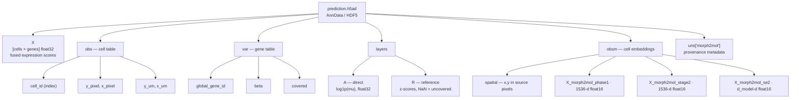
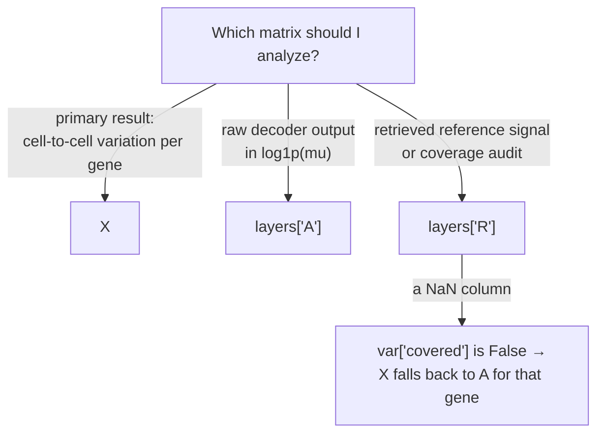
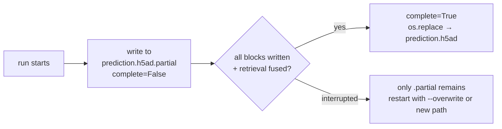

This page explains everything Morph2Mol writes to disk when a prediction finishes. After reading it you will be able to load a result file, identify every field inside it, interpret the three score matrices correctly, and verify that a run completed cleanly. The output is a single AnnData `.h5ad` file — the standard single-cell Python container — so the same file works with scanpy, anndata, and any HDF5 tool.

## Loading the Result File

A prediction run invoked with `--out results/prediction.h5ad` produces exactly one primary artifact. Loading it requires only the `anndata` package that ships with Morph2Mol's dependencies:

```python
import anndata as ad
prediction = ad.read_h5ad("results/prediction.h5ad")
```

The returned `AnnData` object is a table of cells (rows in `obs`) by genes (columns in `var`), with extra matrices attached alongside. Every cell from your slide appears exactly once as a row — the pipeline processes cells in spatial blocks of up to 128 targets with halo context cells, but only target predictions are saved, and each cell is written precisely once.

Sources: [README.md](README.md#L94-L114), [docs/formats.md](docs/formats.md#L52-L59), [predict/predict.py](predict/predict.py#L113-L116)

## Anatomy of the Output File

The diagram below maps the complete field layout as written by the prediction pipeline. Matrices marked *optional* only exist when the corresponding CLI flag was used.



Predictions and reference scores are stored as `float32`; stored embeddings are compressed to `float16`. Large matrices are written incrementally into chunked, LZF-compressed HDF5 datasets, so output size scales with cell count × requested genes rather than requiring the whole result in memory at once.

Sources: [README.md](README.md#L101-L111), [docs/formats.md](docs/formats.md#L52-L54), [predict/predict.py](predict/predict.py#L126-L141)

## Three Score Matrices and What Each One Means

The file holds up to three related matrices, and choosing the right one is the most common beginner question:



**`layers['A']`** — the direct predictions, in `log1p(mu)` scale, produced by the Negative-Binomial expression decoder from image features alone. **`layers['R']`** — expression scores retrieved from the reference bank of cells with *measured* expression, standardized as a per-reference population z-score of `log1p(counts)`. A gene may contain `NaN` here, which means the reference bank has no measured coverage for that gene. **`X`** — the final combined score:

```text
X = beta * A + (1 - beta) * R
```

where `beta` is a per-gene fusion weight in `[0, 1]` fitted offline from reference data — no target expression is read at inference time. Genes with no reference coverage (or no fitted weight) automatically use the direct prediction, because the fusion code forces `beta = 1.0` wherever `R` is missing. This fallback lives in `apply_gate`, which also blocks non-finite weights from silently blanking a gene's column.

> [!TIP]
> The `NaN` values in `layers['R']` are intentional, not an error: `ReferenceBank.configure` marks a gene as covered only if it appears in at least one reference-bank panel, and uncovered queries return an all-`NaN` block. Always pair `R` with `var['covered']` when auditing coverage.

An important interpretation rule: combined scores describe **variation across cells within each gene** — they are not molecule counts, and columns are not comparable to each other as absolute abundance. The exact scale description is self-documented inside the file in `uns['morph2mol']['X_scale']`, alongside `A_scale` and `R_scale`.

Sources: [README.md](README.md#L113-L114), [predict/predict.py](predict/predict.py#L121-L122), [predict/predict.py](predict/predict.py#L183-L188), [morph2mol/gate.py](morph2mol/gate.py#L88-L105), [morph2mol/retrieval.py](morph2mol/retrieval.py#L168-L177)

## Cell Coordinates: Pixels vs Microns

Spatial positions are stored twice, and they use different conventions:

| Field | Units | Coordinate order | Meaning |
| --- | --- | --- | --- |
| `obsm['spatial']` | source-image pixels | **x, y** | Scanpy-compatible centroids (`spatial_order: "x,y in source pixels"`) |
| `obs['x_pixel']`, `obs['y_pixel']` | source-image pixels | per-column | Same centroids, individual columns |
| `obs['x_um']`, `obs['y_um']` | microns | per-column | Physical positions derived from `mpp`, usable for cross-slide comparisons |

The `obsm['spatial']` matrix follows the x-major convention that plotting tools like scanpy's spatial viewers expect, while the micron columns are derived using the microns-per-pixel value recorded in the metadata. If you supply `--mpp`, that exact value is what the micron columns are based on.

Sources: [predict/predict.py](predict/predict.py#L114-L116), [predict/predict.py](predict/predict.py#L194), [docs/formats.md](docs/formats.md#L52-L53)

## Gene Metadata: `beta` and `covered`

The `var` table identifies each output gene and records how its final score was produced. `var_names` are the gene symbols you requested (all 18,580 model genes by default, or a narrower panel via `--genes xenium` or a custom list), and `global_gene_id` maps each symbol to its index in the full model gene head.

| Column | Type | Meaning |
| --- | --- | --- |
| `global_gene_id` | int64 | Position of the gene in the model's 18,580-gene output head |
| `beta` | float32 | Applied fusion weight in `[0, 1]`; `1.0` means pure direct prediction |
| `covered` | bool | Whether the reference bank provides measured expression for this gene |

A `beta` close to 1 means the image decoder dominated that gene's score; a `beta` close to 0 means retrieved reference expression dominated. `covered == False` always coincides with `beta == 1.0` in that column's fusion, because the transferred weight cannot apply where `R` is absent.

Sources: [predict/predict.py](predict/predict.py#L113-L113), [predict/predict.py](predict/predict.py#L192-L193), [README.md](README.md#L106-L107), [morph2mol/gate.py](morph2mol/gate.py#L97-L105)

## Provenance Metadata in `uns`

Every result file carries a `uns['morph2mol']` dictionary that makes the run self-describing and reproducible. It records the model identity, SHA-256 hashes of the loaded checkpoints, the spatial blocking configuration, and the fusion settings.

| Key | Example / meaning |
| --- | --- |
| `model` | `"Morph2Mol-25M-scGPT"` |
| `stage1_sha256`, `stage2_sha256`, `gene_space_sha256` | Checkpoint integrity hashes for reproducibility audits |
| `mpp`, `crop_um` | Source resolution used; fixed 55 µm cell crop |
| `spatial_context` | Blocking plan: `mode='target_context'`, `max_target_cells`, `max_context_cells`, `context_radius_um`, seed, and `output_policy='targets_once_only'` |
| `gate_source`, `tissue` | Which fusion-weight group was applied (e.g. `lung/wide`, or `direct` if global) |
| `source` | Input kind (auto-segmented image, supplied cells, or prepared slide) |
| `K`, `tau`, `cluster_target_size` | Retrieval settings: 50 neighbors, temperature 0.03, 100-cell clusters |
| `bank_fingerprint`, `excluded_objects` | Which reference bank was used and which donors/blocks were excluded |
| `A_scale`, `R_scale`, `X_scale` | Self-documenting scale descriptions for each matrix |

> [!TIP]
> To verify you are comparing results produced under identical conditions, check `uns['morph2mol']['spatial_context']` and the three `*_sha256` fields: the partition is deterministic for a given sample ID and seed, and matching hashes guarantee the same model weights were used.

Sources: [predict/predict.py](predict/predict.py#L117-L122), [predict/predict.py](predict/predict.py#L189-L191), [predict/spatial_context.py](predict/spatial_context.py#L42-L47)

## Completion Guarantees and `.partial` Files

Prediction matrices are streamed to disk block by block into a temporary `<output>.partial` file. Only after every cell has been written, the reference retrieval and fusion pass finishes, and the final metadata is committed, does the writer set the HDF5 root attribute `complete = True` and atomically rename the file with `os.replace`. This means a file appearing under your `--out` path is always a finished result.



Two practical consequences for reading outputs. First, if a run is interrupted, only the `.partial` file survives — the real output will not exist, and rerunning without `--overwrite` will raise `FileExistsError` until you remove the leftovers or choose a new path. Second, because each cell is committed exactly once (enforced both per block by `commit_target_rows` and globally by a final `written == 1` check), you never need to de-duplicate rows after loading.

Sources: [predict/predict.py](predict/predict.py#L126-L127), [predict/predict.py](predict/predict.py#L144-L168), [predict/predict.py](predict/predict.py#L195-L201), [docs/formats.md](docs/formats.md#L57-L59), [predict/spatial_context.py](predict/spatial_context.py#L64-L78)

## Optional Embeddings

By default the file keeps only what is needed downstream: the phase-1 retrieval embeddings are computed during the run but deleted from the file after retrieval completes, unless you passed `--save-embeddings`. With that flag, three additional `obsm` matrices are kept:

| Key | Shape / dtype | Produced by |
| --- | --- | --- |
| `obsm['X_morph2mol_phase1']` | [N, 1536] float16 | Stage-1 contrastive encoder — the features used for reference retrieval |
| `obsm['X_morph2mol_stage2']` | [N, 1536] float16 | Stage-2 image encoder output |
| `obsm['X_morph2mol_se2']` | [N, d_model] float16 | SE(2) spatial decoder embeddings |

These are useful for downstream analyses such as clustering cells by morphology, computing retrieval diagnostics, or debugging fusion behavior. They are stored in float16 to keep file size manageable; cast to float32 before doing arithmetic that needs the precision.

Sources: [predict/predict.py](predict/predict.py#L137-L141), [predict/predict.py](predict/predict.py#L157-L164), [predict/predict.py](predict/predict.py#L195-L196), [README.md](README.md#L109-L111)

## Reading Old Files and Troubleshooting

The `morph2mol.prediction_io` module provides two small helpers that read results produced by earlier releases: `prediction_metadata` accepts either the current `uns['morph2mol']` key or the legacy `uns['voice25m']`, and `phase1_features` accepts either `obsm['X_morph2mol_phase1']` or the legacy `obsm['X_voice_phase1']`.

| Symptom | Cause | Fix |
| --- | --- | --- |
| `FileExistsError: Output/partial exists` | Previous run finished or was interrupted at that path | Remove the old files, pass `--overwrite`, or choose a new `--out` |
| `.partial` file present, no `.h5ad` | Run was interrupted before completion | Restart the run; the partial file is never a valid result |
| `NaN` values in `layers['R']` | Reference bank has no measured coverage for that gene | Expected — `X` used the direct branch; check `var['covered']` |
| Scores look nothing like counts | Combined scores are per-gene relative measures, not molecule counts | Compare across cells within a gene; see `X_scale` in `uns['morph2mol']` |
| Unsure whether a file is complete | Atomic rename guarantees named outputs are complete | Optionally verify `complete == True` by opening the file with `h5py` directly |

Sources: [morph2mol/prediction_io.py](morph2mol/prediction_io.py#L1-L13), [predict/predict.py](predict/predict.py#L47-L49), [docs/formats.md](docs/formats.md#L57-L59)

## Where to Go Next

- To understand how these fields are produced end-to-end, continue to [Architecture Overview](5-architecture-overview).
- For the command-line flags that control what lands in the file (such as `--save-embeddings` and `--genes`), see [Inference CLI Reference](3-inference-cli-reference).
- To learn how the per-gene `beta` weights are fitted, read [Gated Fusion Weights](12-gated-fusion-weights).
- For the mechanics behind `layers['R']`, see [Cluster Retrieval Mechanics](11-cluster-retrieval-mechanics).
- If you need to audit the model files a prediction depends on, check [Release Integrity Verification](21-release-integrity-verification).
- For the engineering details of the streaming write path, see [Streaming Output and Fault Tolerance](20-streaming-output-and-fault-tolerance).