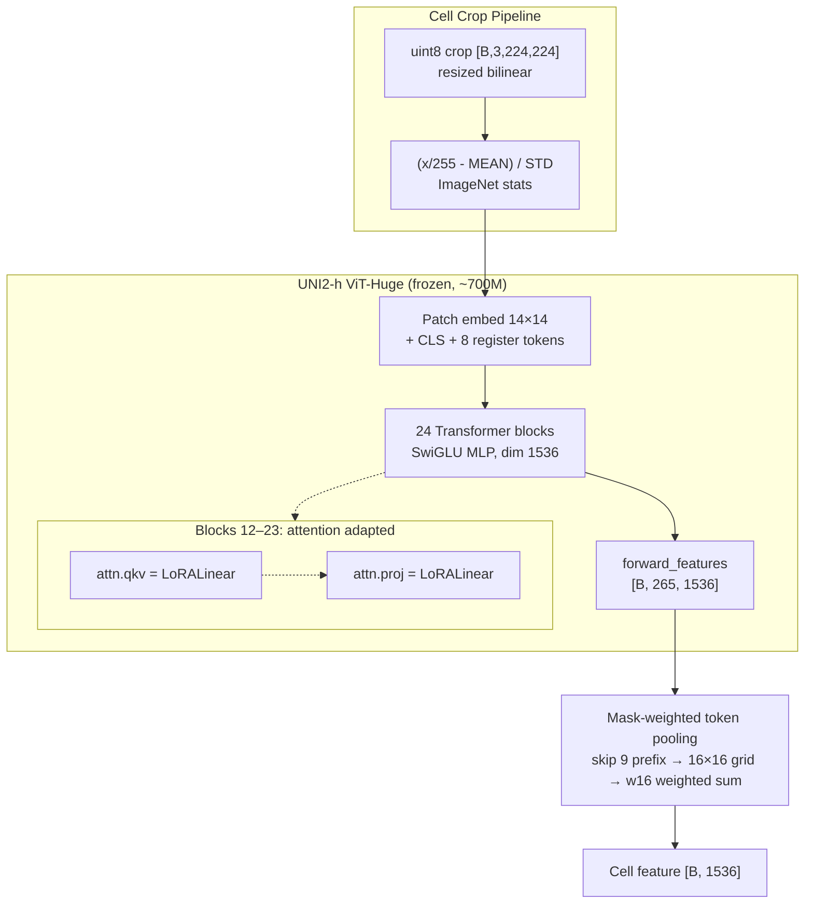
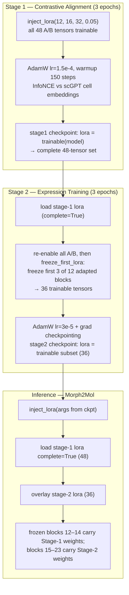

This page explains how Morph2Mol converts a 224×224 cell crop into a 1536-dimensional morphological feature vector. The design pairs a **completely frozen UNI2-h vision transformer** (~700M parameters) with a small set of **LoRA adapters** (roughly 1.77M trainable parameters) injected into its attention projections. You will learn how the backbone is constructed and verified, how the adapters are mathematically defined and injected, how patch tokens are pooled into per-cell vectors, and how adapter weights travel through the two-stage training pipeline into a release artifact that supports hot-swapping between the two trained adapter states.

Sources: [encoder.py](/morph2mol/encoder.py#L1-L41), [predict/model.py](/predict/model.py#L1-L48)

## Architecture at a Glance

The encoder subsystem follows a strict separation: the backbone is immutable, adaptation is confined to attention layers, and all parameter movement happens through explicit, shape-checked checkpoints. Every pixel-level decision (normalization constants, token prefix handling, mask pooling) lives in a single shared module used identically by training and inference — the module's own docstring states it provides "UNI2-h and LoRA utilities shared by training and inference" ([encoder.py](/morph2mol/encoder.py#L1)).



Two numbers anchor the parameter-efficiency story. The trainable surface consists of 12 adapted blocks × 2 projections × 2 matrices (A and B) = **48 adapter tensors**. With rank r=16 on `qkv` (1536→4608) and `proj` (1536→1536), each block contributes 147,384 parameters, giving 1,768,608 trainable parameters in Stage 1 — about 0.25% of the backbone.

Sources: [encoder.py](/morph2mol/encoder.py#L17-L21), [recipe.py](/morph2mol/recipe.py#L11-L19), [stage1.py](/morph2mol/training/stage1.py#L139-L141)

## The Frozen UNI2-h Backbone

The backbone is instantiated through `build_uni2_local`, which constructs a `vit_huge_patch14_224` from timm with UNI2-h's specific configuration and loads weights from a local directory — never from an online hub — using a **strict shape check** (`strict=True` in `load_state_dict`). This guarantees the release weights match the architecture bit-for-bit in shape before any adapter work begins. After loading, every parameter is set to `requires_grad = False` and the model is moved to the device in `eval()` mode, so the backbone can never drift during training or inference.

| Construction argument | Value | Meaning |
|---|---|---|
| `img_size` / `patch_size` | 224 / 14 | 14×14 grid = 256 patch tokens |
| `depth` / `num_heads` / `embed_dim` | 24 / 24 / 1536 | ViT-Huge capacity |
| `mlp_layer` / `act_layer` | `SwiGLUPacked` / `SiLU` | Gated SwiGLU feed-forward |
| `mlp_ratio` | 2.66667 × 2 | SwiGLU effective expansion (~5.33×) |
| `reg_tokens` | 8 | 8 register tokens alongside CLS |
| `init_values` | 1e-5 | Layer-scale initialization |
| `no_embed_class` / `dynamic_img_size` | True / True | Flexible input sizing support |

Three module-level constants complete the backbone contract: `MEAN`/`STD` hold ImageNet normalization statistics applied as `(x/255 - MEAN)/STD`, and `PREFIX = 9` counts the tokens skipped during pooling (1 CLS + 8 register tokens), leaving exactly the 256 patch tokens per crop.

Sources: [encoder.py](/morph2mol/encoder.py#L6-L8), [encoder.py](/morph2mol/encoder.py#L29-L40)

> [!TIP]
> The `strict=True` load in `build_uni2_local` is a deliberate integrity barrier: if the local `pytorch_model.bin` does not exactly match the timm architecture (including the 8 register tokens), construction fails immediately rather than producing a silently mis-aligned encoder downstream.

## LoRA Adapter Design

`LoRALinear` wraps any frozen `nn.Linear` and adds a low-rank residual path. The wrapper freezes the base weights at construction time (`p.requires_grad = False`), then registers two parameters: **A** of shape `(r, in_features)` initialized with Kaiming-uniform (a=√5), and **B** of shape `(out_features, r)` initialized to **zeros**. The forward pass is:

```
output = base(x) + (dropout(x) @ Aᵀ @ Bᵀ) × s,    where s = alpha / r
```

Because B starts at zero, the adapter contributes exactly nothing at initialization — the adapted model is numerically identical to the frozen backbone at the start of Stage 1, and gradients flow only through the low-rank path. With the recipe values alpha=32 and r=16, the scale factor is s = 32/16 = **2.0**, and dropout of 0.05 is applied to the adapter's input branch only.

The injection point is surgical: `inject_lora` replaces `attn.qkv` and `attn.proj` in the **last `nblocks` blocks only** (iterating `range(n - nblocks, n)`). All feed-forward layers, embeddings, and the first 12 blocks remain untouched — the model retains its pretrained visual semantics while the deepest attention layers gain capacity to specialize on histology-style crops.

| Projection | Base Linear | A shape (r=16) | B shape (r=16) | Adapter params |
|---|---|---|---|---|
| `attn.qkv` | 1536 → 4608 | 16 × 1536 | 4608 × 16 | 98,232 |
| `attn.proj` | 1536 → 1536 | 16 × 1536 | 1536 × 16 | 49,152 |
| **Per block** | — | — | — | **147,384** |
| **12 blocks (Stage 1)** | — | — | — | **1,768,608** |
| **9 blocks (Stage 2 trainable)** | — | — | — | **1,326,456** |

Sources: [encoder.py](/morph2mol/encoder.py#L9-L21), [recipe.py](/morph2mol/recipe.py#L11-L19)

> [!TIP]
> The zero-initialized B matrix is what makes the trainable-parameter digest meaningful: `stage1.py` hashes every `requires_grad` tensor at initialization (`init_hash`), and because adapters start at a deterministic identity state, this digest binds each checkpoint to its exact initialization — a mismatch aborts resume ([training_resume.py](/morph2mol/training_resume.py#L117-L118)).

## Mask-Weighted Token Pooling

The bridge from transformer tokens to a per-cell vector is `pooled_feat`, which implements what the code calls the "recipe cmask pool". It takes the full feature sequence `[B, 265, 1536]` from `forward_features`, discards the first `PREFIX = 9` tokens, reshapes the remaining 256 patch tokens into a 16×16 spatial grid (computed as `round(256 ** 0.5)`), and performs a **weighted average** against a per-cell mask weight tensor `w16` of shape `[B, 16, 16]` whose rows sum to 1. The result is one 1536-dimensional vector per cell, weighted toward the tokens covered by the cell's actual nucleus/membrane footprint rather than an uninformative global average.

The `w16` tensors are produced upstream by rasterizing each cell's polygon boundary at full crop resolution and area-averaging down to the 16×16 token grid, with a documented degenerate fallback: if a polygon rasterizes to an effectively empty mask (`w.sum() <= 1e-6`), a delta weight at the center token `(8, 8)` is substituted so pooling remains well-defined. This same pooling path serves both the contrastive tower path (`he_embed`) and the expression model path, guaranteeing identical spatial semantics in both training stages and at inference.

Sources: [encoder.py](/morph2mol/encoder.py#L22-L28), [contrastive.py](/morph2morph/../training/contrastive.py#L50-L64), [contrastive.py](/morph2mol/training/contrastive.py#L45-L48)

## Adapter Lifecycle: Stage 1 → Stage 2

The adapters are not trained once — they are trained **twice with different scopes**, and the checkpoint format records exactly which tensors each stage owns. This lifecycle is the single most important thing to understand about this subsystem.



In **Stage 1**, `inject_lora(model, 12, 16, 32, 0.05)` makes all 48 adapter tensors trainable, optimized with AdamW at lr 1.5e-4 (towers at 1e-3, weight decay 0.01) with linear warmup over the first 150 steps. Checkpoints store `lora=C.trainable(model)` — precisely the requires-grad set, i.e., the complete 48-tensor collection ([stage1.py](/morph2mol/training/stage1.py#L171-L176)).

In **Stage 2**, the encoder is rebuilt, the stage-1 checkpoint is validated as a *completed* three-epoch run, and its LoRA set is loaded with `complete=True` ([stage2.py](/morph2mol/training/stage2.py#L144-L148)). All 48 tensors are then re-enabled and `freeze_first_lora` immediately freezes `A`/`B` of the **first three** of the twelve adapted blocks — matching the recipe's `freeze_frac=0.2` (3/12). The remaining 36 tensors continue training at lr 3e-5 with gradient checkpointing enabled for memory. The stage-2 checkpoint therefore contains only the 36-tensor trainable subset: `lora={n: p.detach().cpu() for ... if p.requires_grad}` ([stage2.py](/morph2mol/training/stage2.py#L218-L223)).

| Property | Stage 1 | Stage 2 |
|---|---|---|
| Injected blocks | last 12 (indices 12–23) | last 12 (same geometry) |
| Trainable adapters | 48 (all A/B) | 36 (blocks 15–23; blocks 12–14 frozen) |
| Learning rate | 1.5e-4 | 3e-5 |
| Loss objective | InfoNCE (temperature 0.07) | Negative-binomial NLL + MSE |
| Checkpoint `lora` contents | complete 48-tensor set | 36-tensor trainable subset |
| Initialization binding | `init_hash` over trainable init | `stage1_identity` (sha256 of stage-1 ckpt) |

Sources: [stage1.py](/morph2mol/training/stage1.py#L139-L155), [stage1.py](/morph2mol/training/stage1.py#L193-L194), [stage2.py](/morph2mol/training/stage2.py#L98-L104), [stage2.py](/morph2mol/training/stage2.py#L150-L153), [stage2.py](/morph2mol/training/stage2.py#L167-L169), [recipe.py](/morph2mol/recipe.py#L22-L33), [contrastive.py](/morph2mol/training/contrastive.py#L41-L43)

> [!TIP]
> Because stage-2 checkpoints save only the 36-tensor trainable subset, inference must load in a fixed order: stage-1 first with `complete=True` (filling all 48), then stage-2 as an overlay. The code comments this explicitly — "Stage-2 saves only the trainable subset; frozen adapters still come from Stage-1" ([predict/model.py](/predict/model.py#L45-L46)) — so blocks 12–14 run with contrastive-alignment weights while blocks 15–23 carry expression-tuned weights.

## The LoRA Loading Contract

Every adapter load in the codebase — training resume, stage-2 initialization, and inference — funnels through one function: `load_lora_checked`. Its contract has four clauses, each with an explicit failure mode:

1. **Key whitelist**: every provided name must end in `.A` or `.B` and must exist among the encoder's parameters (`expected`); anything outside is rejected.
2. **Non-empty**: an empty tensor dict is rejected outright.
3. **Completeness flag**: with `complete=True`, the provided set must exactly equal the expected 48-name set — used when a stage claims to own the full adapter state.
4. **Shape equality**: each tensor's shape must match the live parameter exactly, catching rank/config drift before any weight is written.

Only after all checks pass does it call `load_state_dict(tensors, strict=False)`, which is safe precisely because the pre-validation already established a perfect key/shape match ([training_contract.py](/morph2mol/training_contract.py#L68-L77)).

At inference, `Morph2Mol.__init__` assembles this into a verification chain: the encoder is built and adapted using hyperparameters read from the stage-2 checkpoint's `args` (`nblocks`, `lora_r`, `lora_alpha`, `lora_dropout`), the fixed Morph2Mol-25M recipe is enforced via `check_stage2_settings` (which compares every recipe key against the checkpoint), the stage-2 checkpoint's `stage1_identity.sha256` is compared against the release's stage-1 hash to prove both stages came from the same lineage, and the gene head hash guards output-space consistency — then the two-phase LoRA load proceeds ([predict/model.py](/predict/model.py#L13-L41), [recipe.py](/morph2mol/recipe.py#L36-L39)).

The assembled model also supports **adapter hot-swapping**: `encode` accepts `which='stage2'` (default) or `which='phase1'`, and on switch it copies the retained stage-1 or stage-2 tensors into the live parameters ([predict/model.py](/predict/model.py#L50-L55)). This lets consumers extract either the expression-tuned geometry or the contrastive-alignment embedding space from a single loaded release. Encoding itself is chunked (default 64 crops per chunk) under autocast bf16/fp16, taking uint8 crops in `[N, 3, 224, 224]` layout and returning float32 `[N, 1536]` features ([predict/model.py](/predict/model.py#L56-L62)). A `Voice25M = Morph2Mol` alias preserves compatibility for existing inference adapters ([predict/model.py](/predict/model.py#L71-L73)).

Sources: [training_contract.py](/morph2mol/training_contract.py#L68-L77), [predict/model.py](/predict/model.py#L13-L62), [training_resume.py](/morph2mol/training_resume.py#L131-L135)

## Configuration Reference

The recipe module locks the adapter hyperparameters as fixed settings — callers may only supply runtime arguments (paths, workers, chunk size, save interval, resume), and any attempt to override a recipe key raises a `TypeError` at construction ([recipe.py](/morph2mol/recipe.py#L11-L19)).

| Parameter | Value | Applies to | Defined in |
|---|---|---|---|
| `nblocks` | 12 | Both stages | [recipe.py](/morph2mol/recipe.py#L15), [recipe.py](/morph2mol/recipe.py#L26) |
| `r` / `lora_r` | 16 | Both stages | [recipe.py](/morph2mol/recipe.py#L15), [recipe.py](/morph2mol/recipe.py#L26) |
| `alpha` / `lora_alpha` | 32 (scale s = 2.0) | Both stages | [recipe.py](/morph2mol/recipe.py#L15), [recipe.py](/morph2mol/recipe.py#L26) |
| `dropout` / `lora_dropout` | 0.05 | Both stages | [recipe.py](/morph2mol/recipe.py#L15), [recipe.py](/morph2mol/recipe.py#L26) |
| `lr_lora` (Stage 1) | 1.5e-4, warmup 150 | Stage 1 | [recipe.py](/morph2mol/recipe.py#L14) |
| `lr_lora` (Stage 2) | 3e-5, `grad_ckpt=True` | Stage 2 | [recipe.py](/morph2mol/recipe.py#L27) |
| `freeze_frac` | 0.2 (3 of 12 blocks) | Stage 2 | [recipe.py](/morph2mol/recipe.py#L27) |
| `PREFIX` / `MEAN` / `STD` | 9 / ImageNet stats | Pooling & normalization | [encoder.py](/morph2mol/encoder.py#L6-L8) |

## Where to Go Next

The 1536-d features produced here feed directly into the rest of the model: the [SE(2) Distance Attention Decoder](7-se-2-distance-attention-decoder) consumes them via a 1536→256 projection and spatial transformer, and the [Negative-Binomial Expression Head](8-negative-binomial-expression-head) maps the decoded cell states to gene expression. For the training objectives that shaped these adapters, see [Stage 1 Contrastive Alignment](14-stage-1-contrastive-alignment) and [Stage 2 Expression Training](15-stage-2-expression-training); for how adapter checkpoints become a verified release artifact, see [Model Export and Release Packaging](17-model-export-and-release-packaging).