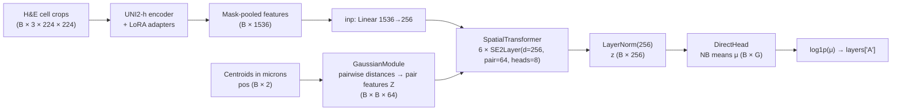
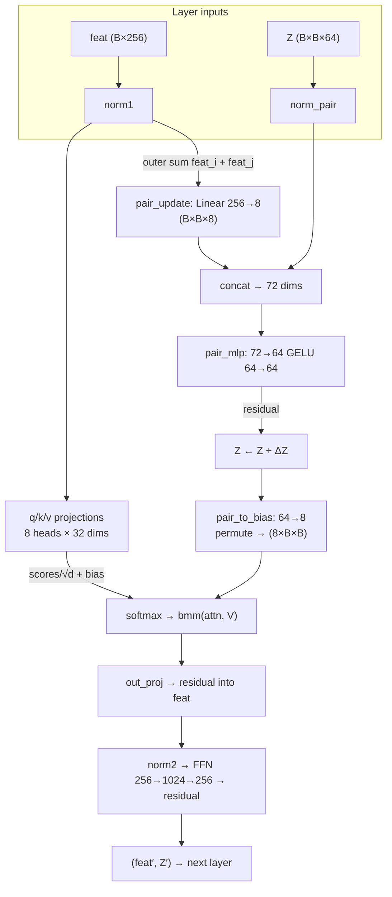

This page dissects the spatial decoder that sits between Morph2Mol's frozen image encoder and the negative-binomial expression head. The decoder — a six-layer stack that conditions attention on pairwise cell distances measured in microns — is what turns a bag of independent per-cell image embeddings into a spatially coherent set of cell representations. We cover its role in the pipeline, the block geometry that feeds it, the Gaussian distance basis, the layer internals, its geometric invariance properties, and the training/checkpoint contract that pins it to the released 25M checkpoint. Throughout, `B` denotes the number of cells in a block (targets + context), `N` is a generic cell count, `d_model = 256`, `d_pair = 64`, and `n_heads = 8`.

Sources: [se2.py](morph2mol/se2.py#L1-L22), [_se2_arch.py](_se2_arch.py#L1-L2), [recipe.py](morph2mol/recipe.py#L22-L33)

## Role in the Inference Pipeline

The released `Morph2Mol` class composes exactly three trainable stages after the encoder: a 1536→256 projection (`inp`), the `SpatialTransformer` (`se2`), and the `DirectHead` (`head`). The decoder consumes projected, mask-pooled UNI2-h features (one 256-dim token per cell) plus micron-resolution centroid coordinates, and emits one 256-dim spatial embedding per cell that the expression head converts into per-gene negative-binomial means. At inference, `decode()` returns both `log1p(mu)` (the direct prediction written to `layers['A']`) and the spatial embedding `z` (optionally persisted as `obsm['X_morph2mol_se2']`).

Sources: [model.py](predict/model.py#L36-L41), [model.py](predict/model.py#L64-L68), [predict.py](predict/predict.py#L149-L153)

Prerequisite: the diagram below shows the full decode path — all arrows into the decoder come from the encoder stage documented in [Image Encoder and LoRA Adapters](6-image-encoder-and-lora-adapters), and the arrow out goes to the head documented in [Negative-Binomial Expression Head](8-negative-binomial-expression-head).

Sources: [model.py](predict/model.py#L64-L68), [se2.py](morph2mol/se2.py#L7-L21), [predict.py](predict/predict.py#L139-L141)

> [!TIP]
> The decoder is invoked **per spatial block, never per slide**: `decode()` receives `pos_um[indices]` for one target+context block (≤192 cells), so the pairwise tensor is small and O(B²) attention is cheap — but the micron unit is load-bearing. Training converts pixel positions with `um_per_pixel_source` (`pos = pos_px * ums`), and inference multiplies source pixels by `mpp`; feed pixel coordinates instead and every normalized distance lands far outside the Gaussian basis's `[0, 137] µm` calibration, clamping to `1.0` and silently collapsing the distance signal.

Sources: [training/stage2.py](morph2mol/training/stage2.py#L40-L41), [covariates.py](predict/covariates.py#L35-L36), [_se2_arch.py](_se2_arch.py#L14)

## Spatial Block Geometry: Targets and Context Halos

The decoder never sees a whole slide at once. Both training and inference use the identical partitioning machinery from `full_coverage.py`: cells are assigned to blocks of at most 128 target cells, and each block is augmented with up to 64 context (halo) cells found within a 137 µm radius. The fixed recipe constants — `TARGET_CELLS = 128`, `CONTEXT_CELLS = 64`, `RADIUS_UM = 137.0` — are shared by both stages and are enforced at checkpoint load time, so the released model cannot be run with different block geometry.

Sources: [recipe.py](morph2mol/recipe.py#L4-L8), [recipe.py](morph2mol/recipe.py#L23-L27), [spatial_context.py](predict/spatial_context.py#L20-L26)

**Partitioning** (`partition_cells`) is deterministic and epoch-parameterized: cells are rotated by a random angle drawn uniformly from `[−π/4, π/4]`, projected onto a jittered square grid sized so that blocks average the target budget, then recursively bisected along their widest axis until every block holds ≤ 128 cells. An assertion verifies every cell is owned exactly once per epoch. Training re-partitions each epoch (seed + `epoch*1000003`), while inference pins `epoch=0` and derives the partition seed from `crc32(sample_id)`, making output partitioning a fixed function of the sample identity.

Sources: [full_coverage.py](morph2mol/full_coverage.py#L14-L40), [spatial_context.py](predict/spatial_context.py#L24-L26), [README.md](README.md#L57)

**Halo selection** (`halo_cells`) queries a `cKDTree` for the `k=16` nearest neighbors of each target, filters to candidates within the 137 µm radius that are not already targets, deduplicates, and takes the first 64. The block fed to the model is `targets ‖ context` — a single prefix-ordered index array where the first `n_targets` rows are owned targets and the remainder is context. Note that this halo is *nearest-neighbor-bounded*, not radius-guaranteed: if a target's 16 nearest neighbors all sit inside its own block, no halo cells arise from that target.

Sources: [full_coverage.py](morph2mol/full_coverage.py#L43-L52), [full_coverage.py](morph2mol/full_coverage.py#L113-L126), [spatial_context.py](predict/spatial_context.py#L32-L40)

## The Pair Distance Basis: GaussianModule

All geometric information enters the decoder through one tensor: the pairwise distance matrix `D[i,j] = ‖pos_i − pos_j‖`. `GaussianModule(d_pair=64, n_gaussians=128, max_dist=137.0)` converts distances into pair features in three steps. First, distances are divided by the 137 µm cutoff and clamped to `[0, 1]`. Second, each normalized distance is expanded against 128 learnable Gaussian basis functions with parameters `means ∈ [0,1]` (initialized as `linspace(0, 1, 128)`) and `log_stds` (initialized to zero, i.e. unit width, with a `1e-4` floor after exponentiation). Third, the 128-dim basis vector is linearly projected down to `d_pair = 64`. The basis configuration of the production checkpoint is `GaussianModule(64, 128, 137.0)` — 64 pair channels, 128 RBF centers, 137 µm saturation — exactly matching `RADIUS_UM`.

Sources: [_se2_arch.py](_se2_arch.py#L5-L17), [se2.py](morph2mol/se2.py#L10), [recipe.py](morph2mol/recipe.py#L7)

| Component | Shape / value | Initialization | Learnable |
| --- | --- | --- | --- |
| Input distances `D` | `B × B` | — | — |
| Normalized `D/max_dist` | `B × B`, clamped `[0,1]` | `max_dist = 137.0` | No |
| Gaussian means | 128 | `linspace(0, 1, 128)` | Yes |
| Gaussian log-stds | 128 | zeros (σ = 1) | Yes |
| Projection `proj` | 128 → 64 | — | Yes |
| Output pair features `Z` | `B × B × 64` | — | — |

Sources: [_se2_arch.py](_se2_arch.py#L6-L17), [se2.py](morph2mol/se2.py#L10)

## Anatomy of One SE2Layer

Prerequisite: each `SE2Layer(256, 64, 8)` maintains **two coupled tracks** — a node track `feat` (`B × 256`) and a pair track `Z` (`B × B × 64`). The pair track starts as pure geometry (Gaussian distance encoding) but is progressively rewritten: every layer lets cell appearance refine the pair state, then converts the refined pair state into per-head attention biases. The diagram traces one layer's forward pass.

Sources: [_se2_arch.py](_se2_arch.py#L41-L57)

Three design decisions deserve attention. First, the **pair update is content-conditioned**: `pair_update(norm(feat_i) + norm(feat_j))` projects the *sum of node features* into 8 channels, concatenated onto the 64 pair channels and pushed through a gated residual MLP (`pair_mlp`). Pair features therefore encode "distance + what the two cells look like", not distance alone. Second, the **attention bias path** projects the pair tensor to `n_heads` logits via `pair_to_bias` and adds them to scaled dot-product scores before softmax — structurally equivalent to Graphormer-style spatial biasing, but with a bias that is itself a learned, evolving function of both geometry and appearance. Third, the layer is fully **pre-normalized** (three LayerNorms: `norm1` on nodes entering attention and pair update, `norm_pair` on the pair tensor, `norm2` before the 4×-expanded GELU FFN), with residuals on both the node output projection and the FFN, which keeps the six-layer stack stable under the 1e-4 learning rate.

Sources: [_se2_arch.py](_se2_arch.py#L29-L39), [_se2_arch.py](_se2_arch.py#L43-L57)

> [!TIP]
> The pair tensor `Z` is **mutable state threaded through the whole stack** — `SpatialTransformer.forward` reassigns `x, Z = layer(x, Z)` six times, and `SE2Layer` returns the updated `Z` alongside the features. The `GaussianModule` only *initializes* this state; after layer one, the attention bias reflects accumulated geometry-appearance interactions, not raw distances. This is also why `broadcast_buffers=False` is safe during DDP training: there are no buffers to synchronize, and every parameter that matters is replicated and all-reduced through gradients.

Sources: [se2.py](morph2mol/se2.py#L15-L21), [_se2_arch.py](_se2_arch.py#L45-L47), [training/stage2.py](morph2mol/training/stage2.py#L172-L173)

## SpatialTransformer Composition and Cost

`SpatialTransformer` stacks six identical `SE2Layer(256, 64, 8)` modules — three in a `pre` list and three in a `post` list — executed back-to-back with no architectural difference between the groups, matching the recipe's `n_layers=6`. The forward pass computes the distance matrix once per block, initializes `Z`, runs the six layers, and applies a final `LayerNorm(256)`. Summing the projection shapes yields roughly **4.8M parameters** (≈ 801K per SE2 layer × 6, plus ≈ 8.5K for the Gaussian module and 512 for the output norm) — a small fraction of the 25M-parameter checkpoint, whose bulk lives in the UNI2-h LoRA adapters and the expression head.

Sources: [se2.py](morph2mol/se2.py#L7-L21), [recipe.py](morph2mol/recipe.py#L25-L26)

| Tensor | Where produced | Shape (block of B cells) |
| --- | --- | --- |
| Pooled image features | encoder + mask pooling | `B × 1536` |
| Projected node tokens | `inp` Linear | `B × 256` |
| Pairwise distances `D` | `forward` norm | `B × B` |
| Pair features `Z` (init) | `GaussianModule` | `B × B × 64` |
| Per-head attention logits | `pair_to_bias` | `8 × B × B` |
| Output embedding `z` | `norm_out` | `B × 256` |

Sources: [se2.py](morph2mol/se2.py#L15-L21), [_se2_arch.py](_se2_arch.py#L47-L54), [model.py](predict/model.py#L36-L38)

Cost scales with the square of block size. At the maximum block composition of 128 targets + 64 context (B = 192), the pair tensor holds 192 × 192 × 64 ≈ 2.4M activations, attention logits hold 8 × 192 × 192 ≈ 295K per layer, and every cell in the block — targets and context alike — attends to all 192 cells with no masking between the two populations. The encoder, by contrast, processes cells in independent chunks (`--enc-chunk`, default 64), so the decoder is the only component whose receptive field spans the block.

Sources: [full_coverage.py](morph2mol/full_coverage.py#L119-L121), [predict.py](predict/predict.py#L24-L25), [model.py](predict/model.py#L50-L62)

## Why "SE(2)": Geometric Invariance by Construction

SE(2) is the special Euclidean group of the plane — translations and rotations. The decoder earns its name because the **only** geometric quantity that influences attention is `‖pos_i − pos_j‖`, and the norm of a displacement vector is invariant under both translations and rotations of the coordinate frame. Slide the entire cell constellation to a new origin, or rotate the tissue, and every Gaussian basis activation, every pair feature, and consequently every attention bias is unchanged (up to feature-space effects via content-conditioned pair updates, which themselves are permutation-equivariant). The module docstring states the design directly: "Morph2Mol SE(2) distance attention, as used by the 25M checkpoint," over "Six spatial attention layers using pairwise distances in microns."

Sources: [_se2_arch.py](_se2_arch.py#L1), [se2.py](morph2mol/se2.py#L1)

The training data pipeline actively reinforces this invariance. Because `partition_cells` rotates all positions by a fresh random angle in `[−π/4, π/4]` every epoch before grid assignment, the decoder is trained on block compositions drawn from continuously re-rotated coordinate frames — the pairing of cells inside a block changes with rotation even though cell identity does not. Combined with the distance-only attention bias, this yields a decoder whose spatial behavior does not depend on the scanner's orientation convention, which matters when inference-time partitions (fixed at epoch 0, seeded by sample ID) are generated for arbitrarily oriented slides.

Sources: [full_coverage.py](morph2mol/full_coverage.py#L17-L26), [spatial_context.py](predict/spatial_context.py#L24-L26)

One subtlety: invariance applies to the *geometry pathway*, not the whole layer. The outer-sum pair update uses node features derived from H&E crops, which carry their own orientation statistics. The distance bias is frame-invariant; the appearance pathway is merely insensitive to cell order. This is a deliberate pragmatic trade — full equivariant message passing (steerable kernels, irreducible representations) would cost considerably more compute for a 6-layer, 256-dim stack.

Sources: [_se2_arch.py](_se2_arch.py#L44-L45)

## Training Dynamics and the Checkpoint Contract

During Stage 2, the decoder is part of `ExpressionModel` alongside `inp` and `DirectHead`, and trains under a distinct learning-rate group: the `rest` parameter group (everything except encoder LoRA) — which includes the entire `SpatialTransformer` — uses `lr = 1e-4`, matching the recipe's `lr_se2=1e-4`, while LoRA adapters move at `3e-5`. Weight decay is zero, gradients are globally clipped at norm 1.0, and forward/backward runs under `autocast` (the decoder receives `h.float()` projected features, so its own math is fp32 inside the autocast boundary of the encoder).

Sources: [training/stage2.py](morph2mol/training/stage2.py#L80-L91), [training/stage2.py](morph2mol/training/stage2.py#L167-L169), [recipe.py](morph2mol/recipe.py#L27), [training/stage2.py](morph2mol/training/stage2.py#L189-L200)

Supervision is prefix-masked: `supervised_sums` applies both the negative-binomial NLL and the `log1p`-scale MSE **only to the target prefix** of each block, while context cells participate fully in attention but contribute zero loss — they exist purely to inform the targets' spatial embeddings. The dataset returns an explicit boolean mask (`mask = arange(len(idx)) < len(targets)`, zeroed for invalid slots under multi-rank schedules), and per-epoch assertions verify that exactly `cells × epochs` targets were supervised.

Sources: [full_coverage.py](morph2mol/full_coverage.py#L119-L121), [full_coverage.py](morph2mol/full_coverage.py#L129-L138), [training/stage2.py](morph2mol/training/stage2.py#L191-L197), [training/stage2.py](morph2mol/training/stage2.py#L202-L208)

The released decoder is pinned by a multi-layer contract. Checkpoints store `se2=model.se2.state_dict()` next to `inp` and `head`; `check_stage2_settings` rejects any checkpoint whose args deviate from the fixed recipe on keys including `d_model=256`, `n_layers=6`, `max_dist=137.0`, `target_cells=128`, and `context_cells=64`; and `Morph2Mol.__init__` loads `inp`, `se2`, and `head` with `strict=True` after verifying the stage-1 initializer identity and gene-head hash. In short: a released checkpoint and the decoder code must agree on shapes, layer count, and distance calibration, or inference refuses to start.

Sources: [training/stage2.py](morph2mol/training/stage2.py#L218-L223), [recipe.py](morph2mol/recipe.py#L36-L40), [model.py](predict/model.py#L23-L29), [model.py](predict/model.py#L39-L41)

## Outputs, Observability, and Failure Guards

The decoder's output feeds two destinations. The primary path hands `z` to `DirectHead`, whose returned means are transformed to `log1p(mu)` and written to the `layers['A']` dataset of the streaming `.h5ad`; a nonfinite guard (`np.isfinite(direct).all()`) aborts the run rather than writing corrupt rows. The secondary path is diagnostic: with `--save-embeddings`, the raw 256-dim spatial embeddings are persisted as `obsm['X_morph2mol_se2']` in float16, alongside stage-2 image embeddings and phase-1 retrieval embeddings. At inference, `commit_target_rows` scatters **only the target prefix** of each block's decoder outputs into slide-global arrays exactly once, while context rows — predicted redundantly in overlapping blocks — are always discarded.

Sources: [model.py](predict/model.py#L65-L68), [predict.py](predict/predict.py#L150-L159), [spatial_context.py](predict/spatial_context.py#L64-L78), [README.md](README.md#L106-L107)

## Key Takeaways

The SE(2) decoder is best summarized as a Graphormer-shaped transformer whose positional encoding is a learnable Gaussian RBF over micron distances, wrapped in a content-conditioned pair track that mutates across six pre-norm layers. Its block-level operating regime (128 targets + 64 halo cells within 137 µm) is identical at train and inference time and enforced by the checkpoint contract; its spatial invariance comes from distance-only biasing plus per-epoch random partition rotations; and its ~4.8M parameters are optimized at `lr_se2=1e-4` against prefix-masked NB NLL + MSE losses.

Sources: [_se2_arch.py](_se2_arch.py#L5-L57), [recipe.py](morph2mol/recipe.py#L4-L8), [training/stage2.py](morph2mol/training/stage2.py#L167-L197)

| Property | Value | Where enforced |
| --- | --- | --- |
| Layers / width / heads | 6 × SE2Layer(256, 64, 8) | `se2.py` + `check_stage2_settings` |
| Distance calibration | 137 µm cutoff, 128 Gaussian bases | `GaussianModule(64, 128, 137.0)` |
| Block composition | ≤128 targets + ≤64 context | recipe constants + partition/halo code |
| Decoder parameters | ≈ 4.8M (derived from shapes) | module definitions |
| Supervision | target prefix only; NB NLL + MSE | `supervised_sums` mask |
| Output | `log1p(mu)` (A layer) + 256-dim `z` | `decode()` |

Sources: [se2.py](morph2mol/se2.py#L7-L21), [_se2_arch.py](_se2_arch.py#L5-L17), [recipe.py](morph2mol/recipe.py#L36-L40)

## Where to Go Next

To understand what the decoder's 256-dim output is *for*, continue to [Negative-Binomial Expression Head](8-negative-binomial-expression-head), which documents the `DirectHead` gene projection and area covariates. For the block-partition and halo machinery shared with fused inference, see [Spatial Context Blocking](19-spatial-context-blocking); for the training loop that optimizes the decoder, see [Stage 2 Expression Training](15-stage-2-expression-training); and for how the stage-2 embeddings branch into retrieval-based fusion, see [Cluster Retrieval Mechanics](11-cluster-retrieval-mechanics). The broader component layout is covered in [Architecture Overview](5-architecture-overview).
