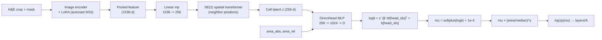
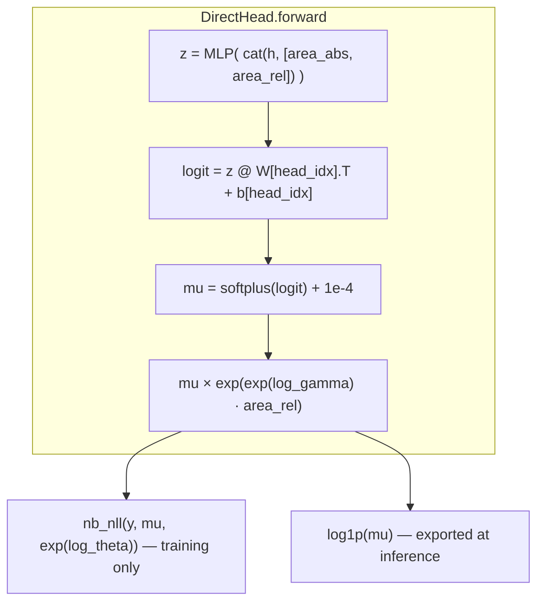
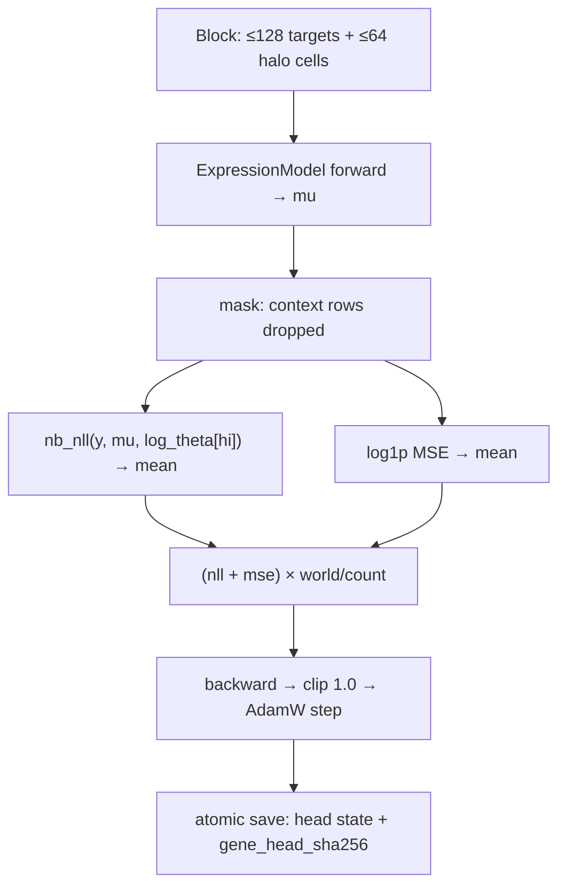

This page documents the expression head that converts SE(2) cell latents into per-gene expected counts under a negative-binomial observation model. It covers the `DirectHead` module, the `nb_nll` likelihood, the cell-area covariates that modulate predictions, and the contracts that keep this component identical during Stage-2 training and inference.

## Role in the Prediction Stack

The head is the last stage of the Morph2Mol prediction pipeline and the only component that emits expression values. Upstream, an H&E cell crop and its mask pass through the image encoder with LoRA adapters to yield a 1,536-d pooled feature; a linear projection compresses this to 256 dimensions, and the SE(2) spatial transformer mixes neighborhood positions into a cell latent `z`. The head then maps `z`, two scalar area covariates, and a gene-row selection into a vector of expected counts `mu`, which is exported as `log1p(mu)` in the `layers/A` matrix of the output `.h5ad`. Prerequisites: the diagram below assumes you know that pooled features come from the encoder and that the SE(2) decoder consumes micron positions — both are detailed in [SE(2) Distance Attention Decoder](7-se-2-distance-attention-decoder).

The same wiring appears twice in the codebase with identical semantics: `ExpressionModel` during training composes `enc → inp → se2 → head`, and the portable `Morph2Mol.decode` mirrors exactly `se2(inp(features), positions)` followed by the head call. This duplication is deliberate — inference never imports the training drivers.

Sources: [stage2.py](morph2mol/training/stage2.py#L80-L91), [model.py](predict/model.py#L64-L68), [predict.py](predict/predict.py#L121-L122), [head.py](morph2mol/head.py#L1)

## DirectHead Anatomy

`DirectHead` holds three kinds of state: **learnable gene rows**, a **covariate MLP**, and **area/dispatcher scalars**. Its docstring is a precise summary: "Learnable scGPT gene rows, cell area covariates and a global area exponent." The `E` buffer stores the frozen initial scGPT gene-embedding table `[G, D]`, while `W` is a same-shaped trainable parameter initialized as a clone of `E` — the recipe's `free_head=True, free_init='emb'` options. The per-gene bias `b` starts at zero, `log_gamma` is a scalar in log space controlling the global area exponent, and `log_theta` is a per-gene vector of log inverse-dispersion values.

| Parameter | Shape | Initialization | Trainable | Role |
| --- | --- | --- | --- | --- |
| `E` (buffer) | `[G, D]` | scGPT gene embeddings | No (frozen anchor) | Initial-value record; fixes `G` and `D` |
| `W` | `[G, D]` | Clone of `E` | Yes | Projection rows from cell latent to gene logit |
| `mlp` | 258→1024→D | LayerNorm + Linear + GELU + Linear | Yes | Fuses cell latent with two area covariates |
| `b` | `[G]` | Zeros | Yes | Per-gene bias on the logit |
| `log_gamma` | scalar | 0 | Yes | Log of the global area exponent γ |
| `log_theta` | `[G]` | Zeros | Yes | Log per-gene NB inverse dispersion |

Two dimensions are structural rather than learned: the MLP input width **258** is the recipe's `d_model` (256) plus exactly two area covariates, and `D` is taken from the scGPT gene-embedding table loaded from `gene_emb_scgpt.npz`. Stage-2 asserts that the table's gene order matches the model gene space before construction, so `W`'s rows are permanently bound to that ordering.

Sources: [head.py](morph2mol/head.py#L24-L34), [stage2.py](morph2mol/training/stage2.py#L154-L157), [recipe.py](morph2mol/recipe.py#L22-L33), [training.md](docs/training.md#L88-L96)

## Forward Pass: From Latent to Expected Counts

The forward pass is four steps, each with a deliberate numerical safeguard. First, the cell latent `h` is concatenated with the stacked `[area_abs, area_rel]` pair and pushed through the MLP to produce `z`. Second, only the rows of `W` and `b` selected by `head_idx` participate in the projection — during training `head_idx` maps the slide's measured gene symbols to global model-gene rows; at inference it is the user-requested panel. Third, the logit passes through `softplus` plus a `1e-4` floor, guaranteeing a strictly positive mean rate `mu` so downstream `log1p` and ratio terms stay finite. Fourth, a multiplicative size factor scales `mu` by `exp(exp(log_gamma) · area_rel)` per cell.

The row-selection design has a practical consequence: `W` and `b` span the full gene space, but a prediction of arbitrary width (all genes, the Xenium subset, or a custom list) touches only the requested rows, so panel size affects compute, not the model. The `softplus` choice means `mu` is smooth in the logit with non-vanishing gradients at zero counts, which matters because single-cell count matrices are extremely sparse.

Sources: [head.py](morph2mol/head.py#L36-L40), [stage2.py](morph2mol/training/stage2.py#L52-L59), [predict.py](predict/predict.py#L102-L105)

## Cell-Area Covariates and the Learned Size Law

Larger cells capture more transcripts, so raw expected counts must scale with segmented cell area. The head consumes two covariates derived from nucleus/cell polygon geometry: `area_abs = log(area + 1)` and `area_rel = log(area + 1) − log(median + 1)`, where the median is computed per slide over cells with positive area. During training, `cell_areas` reads `patch_cell_boundaries.npz`, converts polygon vertices to µm² using the `(55 / output_size)²` patch-frame scale, and applies the shoelace formula. Degenerate polygons (fewer than three vertices) are replaced by the slide median — never zero — which prevents a silently collapsed area signal.

The inference path computes the identical covariates in `predict/covariates.geometry`, whose docstring explicitly names the parity target: "the covariates expression_head.cell_areas / LiveStore build." The two implementations agree on scale conversion, log transforms, median estimation, and degenerate-polygon fallback, making the covariate contract symmetric across training and deployment.

| Property | Training (`cell_areas` / `LiveStore`) | Inference (`geometry`) |
| --- | --- | --- |
| Source geometry | `patch_cell_boundaries.npz` vertices in patch frame | Segmentation or prepared-slide polygons |
| Area units | Shoelace × `(55/output_size)²` µm² | Shoelace × `mpp²` µm² (rescaled to output frame) |
| Absolute covariate | `log(area + 1)` | `log(area + 1)` |
| Relative covariate | `log(area + 1) − log(med + 1)` | `log(area + 1) − log(med + 1)` |
| Degenerate polygons | Slide median replacement | Slide median replacement; 60 µm² default if none positive |

> [!TIP]
> At initialization `log_gamma = 0`, so the area factor reduces exactly to `exp(area_rel) = area/median` — the head *starts* with a linear area-scaling law and training only learns the exponent γ of the power law `mu ∝ (area/median)^γ`. This is why the docstring calls it a "global area exponent": one scalar governs all genes, initialized to the physically sensible linear regime.

Sources: [head.py](morph2mol/head.py#L7-L22), [stage2.py](morph2mol/training/stage2.py#L67-L69), [covariates.py](predict/covariates.py#L14-L36)

## The Negative-Binomial Likelihood

`nb_nll` implements the exact negative-binomial log-likelihood for observed count `y`, mean `mu`, and inverse dispersion `θ = exp(log_theta)`: `lgamma(θ) + lgamma(y+1) − lgamma(y+θ) + θ·log1p(μ/θ) + y·log1p(θ/μ)`. This is the standard NB negative log-likelihood after expanding the normalization constant — the two `log1p` terms are the rewritten log-probability masses `(θ/(θ+μ))^θ` and `(μ/(θ+μ))^y`. Unlike a Poisson head, the per-gene dispersion lets the model tolerate the over-dispersion of single-cell counts: low-`θ` genes get a flatter likelihood, which damps gradient pressure toward their noisy means.

Numerical discipline is baked into the call sites. The dispersion is clamped to `[1e-4, 1e4]` after exponentiation, and training indexes it by `head_idx` so only measured genes contribute their `log_theta` entries to the loss. Note the asymmetry of roles at deployment: `log_theta` shapes training gradients only — the exported quantity is `mu`, so dispersion never appears in prediction outputs, it exists purely to regularize how each gene's mean is learned.

| Loss ingredient | Feeds from head | Purpose |
| --- | --- | --- |
| NB NLL (primary) | `mu`, `log_theta[head_idx]` | Likelihood of raw integer counts; dispersion-aware |
| log1p MSE (auxiliary) | `mu` | Stabilizes optimization on log-scale targets; equal weight per recipe |
| Uniform cell weights | — | Placeholder vector; `wg.sum()` normalization in `supervised_sums` |

Sources: [head.py](morph2mol/head.py#L42-L45), [stage2.py](morph2mol/training/stage2.py#L187-L198), [full_coverage.py](morph2mol/full_coverage.py#L129-L138)

## Training Integration in Stage 2

Stage 2 wraps the head in `ExpressionModel` and trains it for three epochs with complete target-cell coverage. Each optimization step processes a spatial block of up to 128 owned target cells plus up to 64 halo context cells within 137 µm; a boolean mask marks the target rows so context cells participate in SE(2) attention but contribute zero loss — enforced inside `supervised_sums`, which slices both losses to masked rows and normalizes by the weight sum. The combined step loss is `nll·scale + mse·scale`, where `nll` and `mse` are block means over owned cells and `scale = world/count` rescales by the cross-rank supervised count.

Parameter grouping separates the head from the encoder: LoRA adapters train at `lr=3e-5` while the `rest` group — `inp`, `se2`, and every head parameter including `log_theta` and `log_gamma` — trains at `lr=1e-4` with zero weight decay. Checkpointing binds the head to the corpus through two hashes written into the checkpoint: `gene_head_sha256` (SHA-256 of the ordered gene symbol list) and the Stage-1 checkpoint identity, and resume restores `head` with `strict=True` so no parameter can silently drift.

The training recipe fixes every hyperparameter the head depends on — `d_model=256`, equal loss weights (`lam_aux=lam_mse=1.0`), `gene_emb='scgpt'`, `free_head=True`, `free_init='emb'` — and `check_stage2_settings` rejects any checkpoint that deviates, so released heads are guaranteed to be the Morph2Mol-25M configuration. The broader optimization loop, coverage rotation, and resume mechanics are covered in [Stage 2 Expression Training](15-stage-2-expression-training) and [Resume, Caching, and Reproducibility](16-resume-caching-and-reproducibility).

Sources: [stage2.py](morph2mol/training/stage2.py#L167-L169), [stage2.py](morph2mol/training/stage2.py#L187-L208), [stage2.py](morph2mol/training/stage2.py#L211-L223), [full_coverage.py](morph2mol/full_coverage.py#L108-L126), [recipe.py](morph2mol/recipe.py#L26-L39)

## Inference and Release Integration

The released model reconstructs the head without the training corpus, under a strict identity contract. `Morph2Mol.__init__` verifies that the Stage-2 checkpoint's recorded `stage1_identity.sha256` matches the release's Stage-1 hash, that `gene_head_sha256` matches the hash of the loaded gene space, and that all recipe settings pass `check_stage2_settings` — only then is a `DirectHead` constructed and its state loaded with `strict=True`. Any mismatch in gene order, adapter lineage, or recipe aborts before a single prediction is made.

> [!TIP]
> The head is instantiated as `DirectHead(np.zeros(ck['head']['E'].shape))` — at inference, the `E` buffer's *contents* are irrelevant; only its shape is needed to size the parameter set before the strict state-dict load overwrites everything. Combined with the `gene_head_sha256` binding, this makes gene-order drift structurally impossible rather than merely discouraged.

At decode time the head receives the SE(2) latent, the geometric covariates, and the panel row indices, returning `log1p(mu)` together with `z` for optional embedding export. The direct predictions stream into `layers/A` of the output `.h5ad` block by block, with a finiteness guard that hard-fails on any nonfinite value before disk write. The metadata records the scale explicitly (`A_scale: 'log1p(mu)'`), and downstream fusion reads `A` as the direct branch of `beta·A + (1−beta)·R` — that mechanism is documented in [Gated Fusion Weights](12-gated-fusion-weights), and the output format in [Reading Prediction Outputs](4-reading-prediction-outputs).

| Inference contract | Enforcement point |
| --- | --- |
| Stage-2/Stage-1 lineage | `stage1_identity.sha256` vs release hash |
| Gene ordering | `gene_head_sha256` vs `gene_hash(genes)` |
| Recipe identity | `check_stage2_settings` on saved args |
| State completeness | `load_state_dict(..., strict=True)` |
| Numeric validity | Per-block `np.isfinite(direct).all()` guard |

Sources: [model.py](predict/model.py#L21-L47), [predict.py](predict/predict.py#L117-L159), [training_contract.py](morph2mol/training_contract.py#L39-L40), [release.py](morph2mol/release.py#L22-L26)

## Design Summary

Three properties define this head's engineering character. **Positivity by construction**: softplus with a floor and a clamped dispersion mean the likelihood is always evaluable, even for degenerate cells or extreme logits. **Parity by duplication**: training and inference compute covariates through separate but semantically identical code paths, with the inference docstring naming the training implementation as its reference. **Identity by hashing**: the head's gene rows are welded to an ordered gene space via SHA-256, checked at every resume, export, and load. Together these let a 46-line module carry a production guarantee usually associated with far larger subsystems.

To continue through the model components, follow the natural dependency order: [SE(2) Distance Attention Decoder](7-se-2-distance-attention-decoder) for the latent producer, [scGPT RNA Embedding Backend](9-scgpt-rna-embedding-backend) for the source of the `E` initialization, then [Stage 2 Expression Training](15-stage-2-expression-training) for the full optimization context and [Model Export and Release Packaging](17-model-export-and-release-packaging) for how the head's checkpoint becomes a portable artifact.
