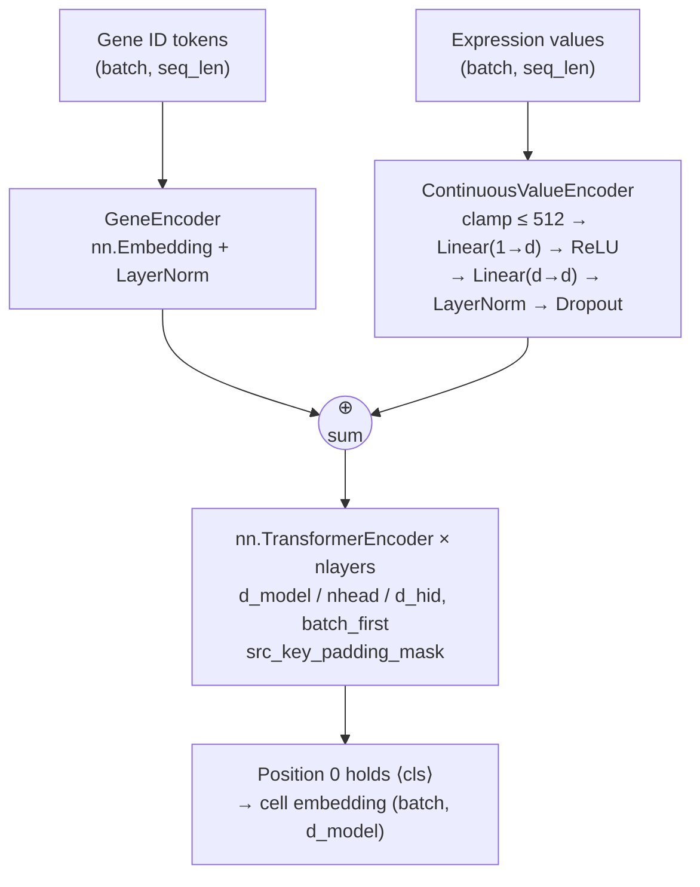
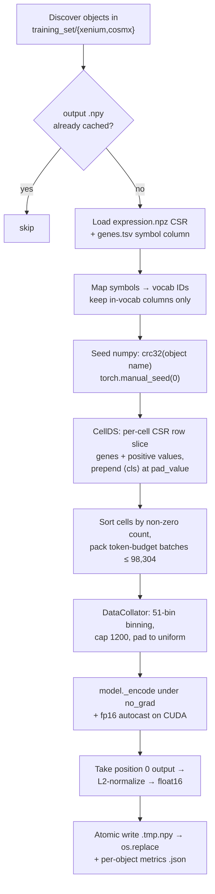

The scGPT RNA Embedding Backend is Morph2Mol's vendored, minimal re-implementation of the scGPT foundation model's encoder, used exclusively to **prepare RNA embedding targets for training** — it never loads during image inference. This page explains the three backend components (`model.py`, `preprocess.py`, `data_collator.py`), the checkpoint-bridging technique that loads pretrained scGPT weights into stock PyTorch layers, and the offline pipeline (`train/embed_scgpt.py`) that converts raw expression matrices into L2-normalized cell embeddings. Understanding this backend is prerequisite context for [Stage 1 Contrastive Alignment](14-stage-1-contrastive-alignment), where these embeddings serve as the alignment targets for the image pathway described in [Image Encoder and LoRA Adapters](6-image-encoder-and-lora-adapters).

Sources: [NOTICE.md](/morph2mol/scgpt_backend/NOTICE.md#L1-L6), [model.py](/morph2mol/scgpt_backend/model.py#L1-L2)

## Role in the System: An Offline Teacher, Not a Runtime Dependency

Morph2Mol predicts gene expression from morphology images, but to *train* that prediction it needs ground-truth RNA representations. Rather than aligning image embeddings directly against raw count vectors, the system first projects each cell's measured expression profile through a pretrained scGPT transformer, producing a semantically rich cell embedding in which genes are contextualized against the model's learned transcriptomic prior. These embeddings become the fixed, non-trainable "RNA side" of the contrastive objective.

The design deliberately isolates this role. The module docstring calls it an encoder used "to prepare Morph2Mol-25M RNA targets," and NOTICE.md states plainly that "image inference does not load scGPT." This isolation is enforced at the dependency level: `requirements-train.txt` contains no scGPT package — the needed components are vendored directly into `morph2mol/scgpt_backend/` under MIT license — so the lean inference environment never carries transformer-training baggage. Consequently, every artifact that ships to end users (the release model, prediction CLI) is free of this code path; only the training-preparation tooling touches it.

Sources: [model.py](/morph2mol/scgpt_backend/model.py#L1-L2), [NOTICE.md](/morph2mol/scgpt_backend/NOTICE.md#L1-L6), [requirements-train.txt](/requirements-train.txt#L1-L3)

## Module Anatomy and Licensing

The backend is deliberately compact — three source files plus attribution documents, 164 lines of Python in total:

| File | Lines | Responsibility |
|---|---|---|
| `model.py` | 67 | `GeneEncoder`, `ContinuousValueEncoder`, `TransformerModel` — the encode-only architecture |
| `preprocess.py` | 70 | Quantile `binning` of expression values into discrete bins |
| `data_collator.py` | 27 | Batch assembly: binning, length capping, subsampling, padding |
| `LICENSE` / `NOTICE.md` | 22 / 6 | MIT license from scGPT (Copyright 2022, suber / bowang-lab) and adaptation provenance |

NOTICE.md attributes the components to **scGPT 0.2.4** and records the two deviations that matter for auditing: the RNA embedding model and collator were adapted for training-target preparation, and the expression binning was retained to match scGPT's original discretization convention. The MIT license permits this vendoring without copyleft obligations on Morph2Mol itself.

Sources: [NOTICE.md](/morph2mol/scgpt_backend/NOTICE.md#L1-L6), [LICENSE](/morph2mol/scgpt_backend/LICENSE#L1-L2), [model.py](/morph2mol/scgpt_backend/model.py#L1-L67), [preprocess.py](/morph2mol/scgpt_backend/preprocess.py#L1-L70), [data_collator.py](/morph2mol/scgpt_backend/data_collator.py#L1-L27)

## Model Architecture: Two Embeddings, One Transformer

The architecture follows scGPT's signature pattern — each gene position in a cell's sequence carries two pieces of information: *which* gene it is (categorical identity) and *how much* of it is expressed (continuous magnitude). Two parallel encoders project these into a shared `d_model`-dimensional space, the projections are **summed element-wise**, and the fused token sequence flows through a standard transformer stack. A padding mask (`src_key_padding_mask`) keeps padded positions out of attention computations.

The two encoders embody contrasting inductive biases. `GeneEncoder` is a plain `nn.Embedding` lookup over the vocabulary followed by `LayerNorm`, with `padding_idx` bound to the vocabulary's pad token so pad positions receive a fixed null embedding. `ContinuousValueEncoder` is a small MLP that treats each scalar expression value independently: it clamps values at `max_value=512` (bounding outliers), projects the scalar through `Linear(1→d_model)` with ReLU, then `Linear(d_model→d_model)`, normalizes, and applies dropout.

Sources: [model.py](/morph2mol/scgpt_backend/model.py#L7-L23), [model.py](/morph2mol/scgpt_backend/model.py#L25-L52), [model.py](/morph2mol/scgpt_backend/model.py#L55-L67)

### Encode-Only by Design

`TransformerModel` exposes a single method, `_encode(src, values, src_key_padding_mask)`, and defines **no `forward`**. This is not an omission — it is a statement of scope. The full scGPT release ships generative heads and training objectives; Morph2Mol only ever needs contextual embeddings, so the vendored class stops at the transformer encoder's output. The constructor wires the scGPT checkpoint's hyperparameters straight through (`ntoken`, `d_model`, `nhead`, `d_hid`, `nlayers`, `dropout`, `pad_token`) and uses PyTorch's built-in `nn.TransformerEncoderLayer` with `batch_first=True` rather than a custom attention implementation — a choice whose consequences become central in the checkpoint-loading section below.

Sources: [model.py](/morph2mol/scgpt_backend/model.py#L55-L67), [train/embed_scgpt.py](/train/embed_scgpt.py#L22-L24)

## Expression Binning: From Counts to 51 Discrete Levels

scGPT does not feed raw expression magnitudes to the value encoder; it feeds **quantile-binned levels**, and Morph2Mol preserves that convention exactly. The vendored `binning(row, n_bins)` computes `n_bins - 1` quantile edges over the row and digitizes each value into one of `n_bins` levels. Because quantile edges can collide when data concentrates, the helper `_digitize` handles ties explicitly: it digitizes from both the left and right, then linearly interpolates with a uniform random draw and applies `ceil` — spreading identical values *uniformly across the tied bins* instead of dumping them all at one edge.

The function also hardens against degenerate inputs, with distinct behaviors worth knowing when inspecting binning diagnostics:

| Input condition | Behavior |
|---|---|
| Entire row is zero | Logs a warning; returns a zero row (preserving dtype) |
| Row contains zeros or negatives | Quantile edges computed over **non-zero values only**; zeros/negatives pinned to bin 0 |
| Strictly positive row | Quantile edges over all values |
| Values tied across a bin edge | Randomized `ceil` assignment between left/right digitize results |

Note the asymmetry in the zero-handling branch: only values above zero participate in quantile estimation, so an expression of 0 maps to level 0 regardless of the distribution of positive values — matching scGPT's semantics where zero expression is a distinct, absolute state.

Sources: [preprocess.py](/morph2mol/scgpt_backend/preprocess.py#L36-L70), [preprocess.py](/morph2mol/scgpt_backend/preprocess.py#L7-L34)

## The DataCollator Contract

`DataCollator` turns variable-length cell records into uniform tensors, applying four rules in sequence. It first caps the batch's sequence length at `min(1200, longest example in batch)` — a hard memory ceiling. It then bins the expression values into **51 levels**, but critically it applies binning to `values[1:]` only: position 0 is the reserved `<cls>` slot whose expression value is never discretized. For over-length examples, it subsamples by drawing a `randperm` over positions 1…L−1 and always concatenating position 0 first — the CLS token survives every subsample. Short examples are right-padded with the pad token ID and pad value.

| Step | Rule | Purpose |
|---|---|---|
| Length cap | `min(1200, max(len(genes)))` across batch | Bounded peak memory |
| Binning | `binning(values[1:], n_bins=51)` — skips index 0 | scGPT's 51-level discretization; CLS slot exempt |
| Subsampling | `randperm` over positions ≥ 1; position 0 always kept | Gene diversity per epoch; CLS anchor preserved |
| Padding | Append `pad_token_id` genes + `pad_value` expressions | Uniform `(B, L)` tensors |

The output dictionary — `{'gene': stacked ids, 'expr': stacked values}` — deliberately drops per-example identity information. That choice shapes the consumption code downstream: since the collator discards which cell came from which row, the pipeline must recover cell identity from the batch sampler's ordering, as shown in the pipeline section.

Sources: [data_collator.py](/morph2mol/scgpt_backend/data_collator.py#L8-L27), [data_collator.py](/morph2mol/scgpt_backend/data_collator.py#L1-L3)

> [!TIP]
> The CLS slot at index 0 is protected through the entire stack: it is excluded from 51-bin discretization, excluded from random subsampling, and seeded with `pad_value` as its expression. This invariant is what allows the embedding read-out to blindly take position 0's output as *the* cell representation.

## Checkpoint Loading: The QKV Bridge

The pretrained scGPT checkpoint (`best_model.pt`) was trained with a custom attention module whose fused query-key-value projection is named `Wqkv`. PyTorch's stock `nn.TransformerEncoderLayer` stores the same mathematics split as `in_proj_weight` and `in_proj_bias`. `load_model` bridges this gap with a one-line state-dict key rewrite — every key beginning `Wqkv.` is renamed to begin `in_proj_` — after which the weights slot directly into the PyTorch layer. Without this remap, a naive `load_state_dict` would silently skip *all* attention weights.

Because arbitrary checkpoint keys may not match, the loader uses `strict=False` with a shape-filtered intersection (only tensors whose names and shapes both match are accepted). This permissiveness is then fenced in by a hard completeness assertion: every key of the model's own state dict under `encoder.`, `value_encoder.`, or `transformer_encoder.` must appear among the loaded tensors, or the loader raises with the first five missing names. The net effect is a loader that tolerates checkpoint cruft (heads, buffers, aux modules) but cannot proceed with a partially-loaded encoder. Configuration comes from `args.json` (`embsize`, `nheads`, `d_hid`, `nlayers`, `dropout`, `pad_token`, `pad_value`) and `vocab.json`, with upfront assertions that the special tokens `<pad>`, `<cls>`, and `<eoc>` all exist in the vocabulary.

> [!TIP]
> The `strict=False` + completeness-assertion pattern is worth reusing: it converts "load whatever matches" from a silent-partial-load risk into an explicit, diagnostic-rich failure — you get the count of matched tensors logged, and a hard stop naming any missing encoder tensor.

Sources: [train/embed_scgpt.py](/train/embed_scgpt.py#L17-L34), [train/embed_scgpt.py](/train/embed_scgpt.py#L25-L33)

## The Embedding Pipeline: From CSR Matrix to Normalized Targets

`train/embed_scgpt.py` orchestrates the full conversion. It discovers every object directory under `dataset/training_set/{xenium,cosmx}/*/*` containing an `expression.npz`, skips already-cached outputs, supports `--only` filtering and `--shard/--nshard` splitting for parallel workers, and processes each object through the flow below.

Three implementation details inside this flow deserve attention. **Gene-space intersection**: each platform's measured panel is projected onto the scGPT vocabulary via `vocab.get(symbol, -1)`; genes outside the vocabulary are dropped column-wise before embedding, and the log line reports how many of the panel's genes survived. **Per-cell extraction**: `CellDS` reads one CSR row at a time, filters to strictly positive values, and prepends the `<cls>` token ID at position 0 with `pad_value` as its expression — the collator's binning of `values[1:]` then leaves this slot untouched. **Identity recovery**: because the collator discards cell IDs, the loop indexes into the precomputed `batches` list positionally (`batches[k]`) to map each returned embedding back to its cell row in the output matrix.

Sources: [train/embed_scgpt.py](/train/embed_scgpt.py#L93-L126), [train/embed_scgpt.py](/train/embed_scgpt.py#L51-L64), [train/embed_scgpt.py](/train/embed_scgpt.py#L65-L84)

### Token-Budget Batching

Rather than fixed-size batches, cells are sorted by their non-zero gene count (stable sort, empty cells filtered out) and greedily packed so that `(batch size) × (longest cell in batch)` never exceeds `max_tokens` (default 98,304). Each cell's contribution is bounded at `min(nnz, 1199) + 1` tokens — 1,199 genes plus the CLS slot — aligning with the collator's 1,200-token cap. Length-sorting minimizes padding waste within a batch, which is where fixed-size batching over heavy-tailed cell-gene distributions loses most of its throughput.

Sources: [train/embed_scgpt.py](/train/embed_scgpt.py#L65-L73), [data_collator.py](/morph2mol/scgpt_backend/data_collator.py#L10)

### Output Post-Processing and Persistence

After inference, each cell's CLS-position embedding is L2-normalized (rows with zero norm are left as zeros rather than divided by ~0) and cast to **float16**, halving storage for what will become training targets. Results are written per object as `{object}.npy` alongside a metrics JSON (`n_cells`, in-vocab gene count, non-zero statistics, cells that were subsampled, wall time). The write is atomic — save to `.tmp.npy`, then `os.replace` — which is what makes the cache-existence check in the main loop safe across interrupted runs and parallel shard workers.

The CLI surface is intentionally minimal:

| Flag | Default | Meaning |
|---|---|---|
| `--dataset` | required | Corpus root containing `training_set/{xenium,cosmx}` |
| `--scgpt-dir` | required | Checkpoint directory (`args.json`, `vocab.json`, `best_model.pt`) |
| `--out` | required | Output directory for per-object `.npy` + metrics `.json` |
| `--only` | *(all)* | Comma-separated object names; unknown names hard-fail |
| `--shard` / `--nshard` | 0 / 1 | Stride-based partitioning across parallel workers |
| `--max_tokens` | 98304 | Token budget per batch |
| `--workers` | 8 | DataLoader worker processes |

Sources: [train/embed_scgpt.py](/train/embed_scgpt.py#L76-L90), [train/embed_scgpt.py](/train/embed_scgpt.py#L106-L125), [train/embed_scgpt.py](/train/embed_scgpt.py#L94-L101)

## Determinism by Construction

Randomness enters this pipeline in exactly two places — the tie-spreading draws in `_digitize` and the `randperm` subsampling in the collator — and both are pinned. NumPy is seeded with `zlib.crc32(object_name)`, a choice annotated in the code itself: Python's built-in `str` hash is salted per process, so it cannot serve as a reproducible seed, whereas CRC32 is stable across processes and machines. Torch is seeded to 0. The consequence: re-running `embed_scgpt.py` on the same object reproduces bit-identical embeddings, which matters because these targets feed a contrastive objective where silent target drift between resume runs would corrupt alignment training. This complements the broader resume and caching machinery described in [Resume, Caching, and Reproducibility](16-resume-caching-and-reproducibility).

Sources: [train/embed_scgpt.py](/train/embed_scgpt.py#L61-L62), [preprocess.py](/morph2mol/scgpt_backend/preprocess.py#L28-L33)

## Design Decisions and Trade-offs

The backend's shape follows from a few deliberate engineering choices, summarized here:

| Decision | Rationale | Trade-off |
|---|---|---|
| Vendor 3 files instead of importing `scgpt` package | Zero heavyweight dependency; inference installs stay lean | Manual reconciliation against upstream scGPT releases |
| Stock `nn.TransformerEncoderLayer` | Standard weight layout, no custom attention to maintain | Requires the `Wqkv.` → `in_proj_` key remap at load time |
| Encode-only API (`_encode`, no `forward`) | Embeddings are read-only training targets | Cannot reuse the class for generative scGPT tasks |
| Per-object `.npy` + JSON sidecar | Row-aligned targets; embedded provenance metrics | Many small files rather than one consolidated store |
| float16 storage of targets | Halves disk footprint for large corpora | Negligible precision loss after L2 normalization |
| CRC32 object-name seeding | Process-stable, machine-stable reproducibility | Tied to object names; renaming changes subsampling |

Sources: [requirements-train.txt](/requirements-train.txt#L1-L3), [train/embed_scgpt.py](/train/embed_scgpt.py#L26-L33), [model.py](/morph2mol/scgpt_backend/model.py#L64-L66), [train/embed_scgpt.py](/train/embed_scgpt.py#L85-L90), [train/embed_scgpt.py](/train/embed_scgpt.py#L61-L62)

## Where the Embeddings Go Next

Each output `.npy` is row-aligned with the object's cells: row *i* of the embedding matrix corresponds to `expr_rows` entry *i* in the object's `patch_cell_boundaries.npz`, the contract that lets training join every image crop to its RNA target. From there, these frozen embeddings become the fixed anchor in Stage 1's contrastive objective — the image pathway learns to point at them.

For the natural reading progression from here:

- [Stage 1 Contrastive Alignment](14-stage-1-contrastive-alignment) — how image embeddings are trained against these RNA targets
- [Training Data Contracts](13-training-data-contrats → [Training Data Contracts](13-training-data-contracts)) — the exact row-alignment and crop-to-expression join semantics
- [Reference Bank Construction](10-reference-bank-construction) — how expression-derived geometry feeds retrieval at inference time
- [Model Export and Release Packaging](17-model-export-and-release-packaging) — why none of this backend ships to end users
