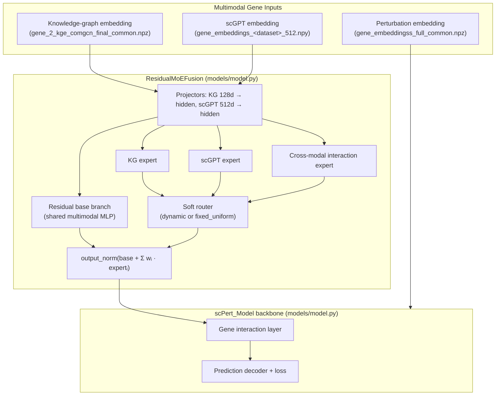

This page is the entry point to the DyMoE-Pert documentation. It explains what the project does, how its main idea works at a glance, and how the repository is organized, so that a first-time reader can decide exactly where to go next. Everything on this page is verified directly against the source code and README; deeper implementation details are left to the dedicated Deep Dive pages.

Sources: [README.md](README.md#L1-L10)

## What Problem Does DyMoE-Pert Solve?

DyMoE-Pert predicts how a genetic perturbation — switching a gene off or knocking it down — changes single-cell gene expression. The central challenge it addresses is **generalization to unseen perturbations**: wet-lab screens can never measure every single-gene or combinatorial intervention, so the model must estimate the effect of perturbations it has never observed during training. The README states this motivation explicitly and notes that predictions can help prioritize which new experiments to run.

Sources: [README.md](README.md#L1-L10)

The core insight of the method is that a perturbed gene is described by **two complementary information sources**: biological knowledge-graph embeddings (which encode functional relationships between genes) and representations from the single-cell foundation model **scGPT** (which encode learned genomic context). Instead of fusing these two signals with one fixed rule for every perturbation, DyMoE-Pert *learns* how much to trust each source on a per-input basis — this is the "Dynamic" in its name, implemented as a residual mixture-of-experts fusion module.

Sources: [README.md](README.md#L5-L10), [models/model.py](models/model.py#L99-L297)

## How the Method Works at a Glance

The following diagram shows the end-to-end flow verified in the code: two pretrained embedding tables are projected into a shared hidden space, passed through three experts plus a residual base branch, weighted by a soft router, and finally decoded into predicted post-perturbation expression.



A few verified facts worth anchoring before you read the code: the fusion module hard-requires **exactly 3 experts**, supports a `dynamic` router or a `fixed_uniform` control mode, and exposes four ablation modes (`full`, `base_only`, `no_interaction`, `experts_only`) that selectively freeze submodules during construction. An optional **balance loss** on router weights can be enabled with a configurable weight; it is automatically disabled when the router is fixed-uniform or in `base_only` mode.

> [!TIP]
> The router's final linear layer is initialized with near-zero weights (`std=1e-3`, zero bias), meaning training starts from an almost-uniform expert mixture and the routing specialization emerges gradually — a deliberate stabilizer you will see again in the router deep dive.

Sources: [models/model.py](models/model.py#L99-L297), [models/model.py](models/model.py#L299-L328), [models/model.py](models/model.py#L330-L400)

The published architecture figure provides a visual counterpart to the diagram above:


Sources: [README.md](README.md#L23-L27)

## Repository Tour

The repository is deliberately compact — a single `models/` package, two command-line scripts, and a directory of precomputed embedding files. It ships the **core runnable implementation only**: no expression datasets, no trained checkpoints, and no experiment logs are included. Expression data in GEARS format is downloaded automatically on first run.

```
DyMoE-Pert/
├── embeddings/          ← 7 precomputed gene embedding files (required at runtime)
├── figures/             ← architecture diagram shown above
├── models/              ← core library: model, data, training, inference
│   ├── model.py             ResidualMoEFusion + scPert_Model (nn.Module)
│   ├── scpert.py            scPert training/prediction wrapper class
│   ├── ProcePertdata.py     PertData: download, split, dataloaders
│   ├── data_utils.py        splitting logic, DE genes, dropout genes
│   ├── inference.py         evaluate, compute_metrics, deeper_analysis
│   └── utils.py             gene similarity networks, loss, helpers
├── scripts/
│   ├── train.py             CLI: train on one of 5 datasets
│   └── infer.py             CLI: predict one perturbation from a checkpoint
└── requirements.txt     ← validated with Python 3.8, PyTorch 2.3.0, PyG 2.6.1
```

| Component | File | Role |
| --- | --- | --- |
| MoE fusion module | `models/model.py` | `ResidualMoEFusion`: 3 experts + residual base + soft router + ablation modes |
| Model backbone | `models/model.py` | `scPert_Model`: embedding loading, gene interaction layer, decoder |
| Training wrapper | `models/scpert.py` | `scPert` class: training loop, checkpointing, multi-GPU, `predict()` API (seed 0 fixed at import) |
| Data pipeline | `models/ProcePertdata.py` | `PertData`: auto-downloads GEARS-format ZIPs, builds perturbation splits and dataloaders |
| Train entry point | `scripts/train.py` | CLI with single-GPU and multi-GPU (PyG `DataParallel` + `DataListLoader`) paths |
| Inference entry point | `scripts/infer.py` | CLI that loads `config.pkl` + `model.pt` and predicts one perturbation |

Sources: [README.md](README.md#L11-L22), [README.md](README.md#L29-L42), [models/scpert.py](models/scpert.py#L1-L30), [models/ProcePertdata.py](models/ProcePertdata.py#L26-L60), [scripts/train.py](scripts/train.py#L55-L100), [scripts/infer.py](scripts/infer.py#L1-L15)

## Supported Datasets and Embeddings

Five perturbation datasets are supported, named via `--data-name`; each maps to an auto-downloaded processed GEARS-format ZIP (containing `perturb_processed.h5ad`) and a dataset-aligned scGPT embedding file resolved from a hardcoded dictionary in both scripts:

| `--data-name` | Processed data ZIP | Dataset-aligned scGPT embedding |
| --- | --- | --- |
| `norman` | dataverse.harvard.edu 6154020 | `gene_embeddings_norman_512.npy` |
| `adamson` | dataverse.harvard.edu 6154417 | `gene_embeddings_adamson_512.npy` |
| `dixit` | dataverse.harvard.edu 6154416 | `gene_embeddings_dixit_512.npy` |
| `replogle_k562_essential` | dataverse.harvard.edu 7458695 | `gene_embeddings_replogle_k562_essential_512.npy` |
| `replogle_rpe1_essential` | dataverse.harvard.edu 7458694 | `gene_embeddings_replogle_rpe1_essential_512.npy` |

Sources: [README.md](README.md#L44-L56), [scripts/train.py](scripts/train.py#L12-L18), [scripts/infer.py](scripts/infer.py#L17-L23)

The `embeddings/` directory holds **seven files in total**: two *common* tables shared across all datasets — the knowledge-graph embeddings (`gene_2_kge_comgcn_final_common.npz`, loaded inside `scPert_Model`) and the common perturbation embeddings (`gene_embeddingss_full_common.npz`) — plus the five dataset-aligned 512-dimensional scGPT arrays listed above. Genes missing from the scGPT vocabulary received deterministic random fallback vectors. Note the path sensitivity: the model reads the two common files via paths **relative to the working directory**, so all commands must run from the repository root.

> [!TIP]
> If training crashes with a file-not-found on an embedding `.npz`, the cause is almost always the working directory — the common embedding paths in `scPert_Model.__init__` are hardcoded to `./embeddings/` rather than resolved from `--embedding-dir` (which only controls the dataset-aligned file).

Sources: [README.md](README.md#L29-L42), [README.md](README.md#L52-L56), [models/model.py](models/model.py#L330-L400)

## Minimal Usage Flow

Two commands cover the entire lifecycle. Training defaults mirror the main reported configuration (simulation split seed 77, 25 epochs, batch size 64, hidden size 64, dynamic routing, balance weight 0.0) and write `config.pkl` plus model weights into the save directory; prediction then loads that checkpoint, simulates a control-cell population, and writes `pred_dymoe_<perturbation>.npz` containing a mean vector plus 32 individual cell predictions:

| Step | Command | Output |
| --- | --- | --- |
| Train | `python scripts/train.py --data-name norman --device cuda:0 --batch-size 4 --model-save-name norman_dymoe` | Checkpoint dir with `config.pkl`, `model.pt` |
| Train (4 GPUs) | `python scripts/train.py --data-name norman --multi-gpu --device-ids 0,1,2,3 --model-save-name norman_dymoe` | Same, distributed across GPUs |
| Predict | `python scripts/infer.py --data-name norman --checkpoint norman_dymoe --perturbation CEBPA+ctrl --device cuda:0` | `pred_dymoe_CEBPA_ctrl.npz` |

Sources: [README.md](README.md#L58-L70), [README.md](README.md#L72-L79), [scripts/train.py](scripts/train.py#L20-L53), [scripts/infer.py](scripts/infer.py#L40-L52)

For `--perturbation`, single-gene interventions use the form `GENE+ctrl` and double-gene combinations use `GENE1+GENE2`; both gene names must exist in the selected dataset's perturbation vocabulary.

Sources: [scripts/infer.py](scripts/infer.py#L26-L30)

## Where to Go Next

The catalog follows a deliberate progression from runnable basics to architectural internals. If your goal is to get the code running, follow the Get Started path top to bottom; if you want to understand *why* the fusion works, jump to the Deep Dive after skimming the architecture overview.

| Your goal | Start here |
| --- | --- |
| Run training and prediction quickly | [Quick Start](2-quick-start) |
| Understand data download and embedding files | [Dataset and Embedding Setup](3-dataset-and-embedding-setup) |
| See exact CLI flags for every scenario | [Training and Prediction Commands](4-training-and-prediction-commands) |
| Understand the fusion mechanism | [Architecture Overview](5-architecture-overview) → [Residual Fusion Design](6-residual-fusion-design) → [Expert Specialization: KG, scGPT, Interaction](7-expert-specialization-kg-scgpt-interaction) |
| Reproduce ablation experiments | [Ablation Modes Framework](9-ablation-modes-framework) |
| Understand unseen-perturbation evaluation | [Perturbation Splits and Simulation Split](14-perturbation-splits-and-simulation-split) → [Unseen Perturbation Inference](17-unseen-perturbation-inference) |
