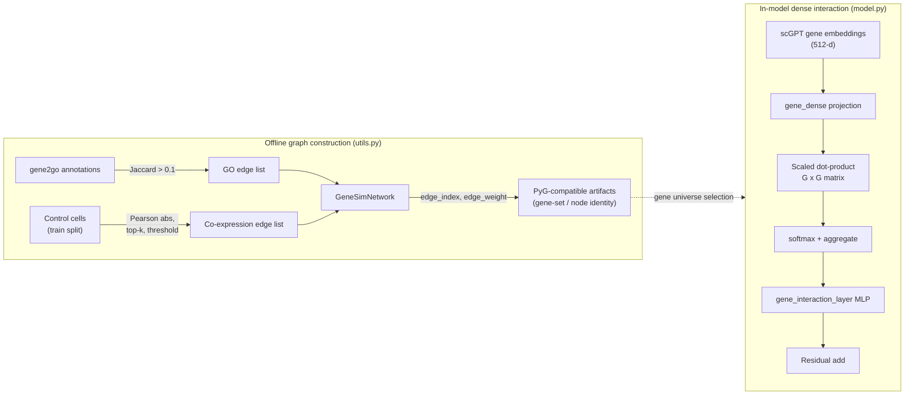

This page documents the gene-interaction machinery of DyMoE-Pert: how gene–gene relational structure is *constructed* offline (GO and co-expression graphs), and how it is *consumed* inside the `scPert_Model` backbone, which replaces classical sparse message passing with a dense, attention-style interaction block followed by a transformer stack. The model retains PyG-compatible graph artifacts for data-pipeline compatibility while computing interactions densely at run time — a deliberate architectural deviation from the GEARS lineage it inherits.

## Design Rationale: From Sparse Message Passing to Dense Interaction

The single most important verifiable fact about this subsystem: `models/model.py` imports only `torch`, `numpy`, `torch.nn`, `torch.nn.functional`, `logging`, and `hashlib` — there is **no `torch_geometric` import** in the model backbone itself, even though the data pipeline (`ProcePertdata.py`, `utils.py`) is heavily PyG-based. The forward pass accesses only `pert_data.x` (gene expression) and `pert_data.pert` (condition label), never `edge_index` or `pert_idx`.

Sources: [model.py](/models/model.py#L1-L7), [model.py](/models/model.py#L678-L693)

This means the "GNN" role in DyMoE-Pert is fulfilled by two cooperating mechanisms: (1) a **dense scaled dot-product interaction block** that computes an implicit, fully-connected gene adjacency per batch, and (2) an **8-layer transformer stack** whose attention matrices act as learned, content-dependent adjacency matrices over gene tokens. Pre-built graphs (GO, co-expression) still exist upstream in the data pipeline and shape which genes enter the graph, but message passing over their sparse `edge_index` is no longer part of the computation path.

Sources: [model.py](/models/model.py#L684-L693), [scpert.py](/models/scpert.py#L44-L56)

## Gene Interaction Graph Construction

Two relational sources can be materialized before training, both converging into the `GeneSimNetwork` container that converts a pandas edge list into PyG tensors. The `get_similarity_network` dispatcher selects between them via the `network_type` argument (`'co-express'` or `'go'`).

Sources: [utils.py](/models/utils.py#L241-L265), [utils.py](/models/utils.py#L162-L195)

| Property | GO Graph | Co-expression Graph |
|---|---|---|
| Similarity metric | Jaccard index of GO term sets | Absolute Pearson correlation of expression |
| Edge condition | `score > 0.1` | Top-k per gene AND `importance > threshold` (default 0.4) |
| Edge weight (`importance`) | Jaccard score | Pearson correlation magnitude |
| Data basis | `gene2go` annotation pickles (downloaded from Dataverse) | Control-condition cells in the training split |
| Computation | Parallelized per-gene via multiprocessing `Pool` | Vectorized `np_pearson_cor` + `argsort` top-k |
| Default K | 20 (`num_similar_genes_go_graph`) | 20 (`num_similar_genes_co_express_graph`) |

Sources: [utils.py](/models/utils.py#L197-L239), [utils.py](/models/utils.py#L267-L319), [scpert.py](/models/scpert.py#L250-L269)

The co-expression builder computes the Pearson correlation matrix over control cells from the *training split only* (preventing leakage), zeroes NaNs, takes absolute values, then retains the top `k+1` correlations per gene row and filters by threshold, caching the result as a CSV keyed by split/seed/threshold/k.

Sources: [utils.py](/models/utils.py#L293-L319), [utils.py](/models/utils.py#L41-L48)

`GeneSimNetwork.__init__` performs the final conversion: a `networkx.DiGraph` is built with `importance` edge attributes, all genes in `gene_list` are added as nodes (isolated nodes become legal), and edges are exported as `self.edge_index` (a `torch.long` tensor of `(src, dst)` pairs mapped through `node_map`) plus `self.edge_weight` (a float tensor of importance values). This container is what the GEARS-inherited pipeline would feed to PyG — in DyMoE-Pert it survives as a structural artifact and a gene-set selector.

Sources: [utils.py](/models/utils.py#L176-L195)



The diagram requires one clarification: the dashed arrow is an *indirect* coupling. The offline graphs and `set_pert_genes` logic determine the gene universe and perturbation vocabulary the dataset exposes; the in-model block then operates densely over that universe without touching sparse edges at run time.

Sources: [ProcePertdata.py](/models/ProcePertdata.py#L99-L120), [utils.py](/models/utils.py#L162-L195)

## The In-Model Interaction Block

Inside `scPert_Model.forward`, gene embeddings are materialized per sample, projected, and interacted in three steps. First, the shared 512-dimensional scGPT gene embedding matrix (`gene_emb`, registered as a buffer) is repeated `num_graphs` times and projected through `gene_dense` (Linear 512→hidden, LayerNorm, ReLU, Dropout 0.1), then reshaped to `(num_graphs, num_genes, hidden)`.

Sources: [model.py](/models/model.py#L382-L405), [model.py](/models/model.py#L684-L687)

Second, the interaction itself is a scaled dot-product over the gene axis:

```python
gene_interaction = torch.matmul(gene_emb, gene_emb.transpose(-2, -1)) / (self.hidden_size ** 0.5)
gene_interaction = F.softmax(gene_interaction, dim=-1)
gene_context = torch.matmul(gene_interaction, gene_emb)
```

This produces, for every sample independently, a `(num_genes × num_genes)` attention matrix — a dense, content-dependent surrogate for the sparse adjacency matrices that `GeneSimNetwork` would have supplied — followed by one-hop aggregation (`gene_context`) where each gene's representation becomes an importance-weighted mixture of all genes.

Sources: [model.py](/models/model.py#L689-L691)

Third, the aggregated context passes through `gene_interaction_layer` (Linear hidden→hidden, LayerNorm, ReLU, Dropout 0.1) and is added residually: `gene_emb = gene_emb + gene_context`. The residual form means a gene that receives no useful relational signal retains its raw projected embedding unchanged — soft degradation rather than information loss.

Sources: [model.py](/models/model.py#L393-L398), [model.py](/models/model.py#L692-L693)

| Tensor | Shape | Role |
|---|---|---|
| `gene_emb` (after `gene_dense`) | `(num_graphs, num_genes, hidden)` | Per-gene projected representation |
| `gene_interaction` | `(num_graphs, num_genes, num_genes)` | Implicit dense adjacency / attention |
| `gene_context` | `(num_graphs, num_genes, hidden)` | One-hop relational aggregation |

Sources: [model.py](/models/model.py#L684-L692)

> [!TIP]
> The interaction block is quadratic in gene count: `matmul` allocates a `(B × G × G)` matrix at fp32 precision. For the essential-gene panels used here (~5,000 genes) this is ~100 MB per 1,000-cell batch; scaling to genome-wide panels would require the chunked strategy used in the attention layers below.

## Transformer Backbone: Implicit Multi-Hop Propagation

One aggregation hop is insufficient to model indirect perturbation effects (A → B → C cascades). The backbone therefore stacks **8 `ImprovedTransformerLayer` modules**, each combining self-attention over the gene axis with a 4× expansion feed-forward network (GELU, Dropout 0.1) and pre-activation-style residual + LayerNorm. Conceptually, each attention layer performs one additional learned message-passing round whose edge weights are recomputed from current node states — a fully-connected, content-adaptive generalization of `GNNConv` layers.

Sources: [model.py](/models/model.py#L68-L93), [model.py](/models/model.py#L442-L445)

Two implementation details deserve attention. The attention itself, `MemoryEfficientMultiheadAttention` (8 heads), processes queries, keys, and values in slices of `chunk_size=256` along the sequence dimension, materializing only `(chunk × chunk)` attention blocks instead of the full `(G × G)` score matrix — bounding peak memory per layer independently of gene count. And the forward loop applies a fixed damping factor: `combined_emb = combined_emb + layer_output * 0.5`, halving each layer's contribution to stabilize deep stacking with BatchNorm/LayerNorm interactions.

Sources: [model.py](/models/model.py#L26-L66), [model.py](/models/model.py#L743-L745)

> [!TIP]
> The `0.5` output scaling combined with the final `layer_norm2` means the effective magnitude of the 8-layer stack is normalized after accumulation — you can tune depth without rescaling learning rates, but ablating the scaling factor will destabilize training at 8 layers.

Perturbation signals enter this gene graph *after* the interaction block: the fused perturbation embedding (MoE or concatenation path) is broadcast across all gene positions and summed with `gene_emb` under `layer_norm1` and dropout, so every downstream attention round mixes perturbation-conditioned node states. The decoder-side details are covered on the [Prediction Decoder and Loss](11-prediction-decoder-and-loss) page; the perturbation fusion itself on [Soft Router and Balance Loss](8-soft-router-and-balance-loss).

Sources: [model.py](/models/model.py#L695-L740)

The backbone terminates with `final_mlp` (three Linear+LayerNorm+ReLU+Dropout blocks shrinking 4×→2×→1× hidden size), a per-gene scalar `output_layer`, and a baseline residual: the prediction is `output + x`, meaning the network learns the *perturbation delta* over control expression rather than absolute expression — the same inductive bias GEARS uses.

Sources: [model.py](/models/model.py#L748-L757)

## Configuration Reference

The `tunable_parameters` API still exposes GEARS-era GNN knobs (`num_go_gnn_layers`, `num_gene_gnn_layers`) that flow into `model_initialize`'s config dict. Because the current backbone contains no PyG conv layers, these keys are accepted for compatibility with the data pipeline and experiment bookkeeping but do not instantiate any module — treat `hidden_size`, graph-construction thresholds, and MoE options as the operative controls.

Sources: [scpert.py](/models/scpert.py#L250-L269), [scpert.py](/models/scpert.py#L327-L349)

| Parameter | Default | Actual effect in current backbone |
|---|---|---|
| `hidden_size` | 64 | Width of `gene_dense`, interaction block, transformer stack |
| `num_go_gnn_layers` | 1 | Legacy config key; no module instantiated |
| `num_gene_gnn_layers` | 1 | Legacy config key; no module instantiated |
| `num_similar_genes_go_graph` | 20 | Shapes offline GO edge list (k-NN per gene) |
| `num_similar_genes_co_express_graph` | 20 | Shapes offline co-expression edge list |
| `coexpress_threshold` | 0.4 | Pearson cutoff for offline co-expression edges |
| Transformer depth | 8 (hard-coded) | Number of implicit message-passing rounds |
| Attention `chunk_size` | 256 (hard-coded) | Peak-memory bound for attention scores |

Sources: [scpert.py](/models/scpert.py#L271-L335), [model.py](/models/model.py#L442-L445), [model.py](/models/model.py#L27)

## Sparse GNN vs. Dense Interaction: Trade-off Analysis

For an advanced audience, the central architectural question is what is gained and lost by replacing GEARS' two-graph sparse message passing (GCN over GO + co-expression `edge_index`) with dense dot-product interaction plus transformer mixing.

Sources: [model.py](/models/model.py#L684-L693), [utils.py](/models/utils.py#L162-L195)

| Dimension | GEARS-style sparse GNN | DyMoE-Pert dense interaction |
|---|---|---|
| Topology constraint | Fixed k-NN graphs; no A↔B edge means no message | Fully connected; all pairs considered every forward |
| Edge weights | Static (`importance` from GO/co-expression) | Dynamic, recomputed from current representations |
| Compute scaling | `O(E·H)` in edges | `O(G²·H)` in gene pairs |
| Multi-hop | Depth = number of conv layers (typically 1–2) | 8 attention rounds with per-hop rewiring |
| Unknown-gene handling | Requires a node in the graph | No graph membership needed at run time |
| Inductive bias | Strong relational prior (biology-curated edges) | Weak prior; relational knowledge must be learned |

Sources: [utils.py](/models/utils.py#L267-L319), [model.py](/models/model.py#L689-L690), [model.py](/models/model.py#L743-L745)

The dense design trades the biological prior of curated edges for two practical wins relevant to this repository's goals: unseen perturbations and unseen genes need no graph edits (only the deterministic fallback embedding shown in [Knowledge-Graph and scGPT Embeddings](13-knowledge-graph-and-scgpt-embeddings)), and cross-dataset transfer avoids per-dataset graph rebuilding beyond the cached CSV artifacts. The cost is a quadratic interaction matrix and the loss of an explicit constraint that messages flow only between biologically related genes — which is precisely what the transformer's content-dependent attention is trusted to rediscover.

Sources: [model.py](/models/model.py#L636-L658), [utils.py](/models/utils.py#L285-L291)

## Next Steps

To continue along the model-backbone track, proceed to [Prediction Decoder and Loss](11-prediction-decoder-and-loss) for the output head, direction loss, and focal/weighted MSE terms built on top of this backbone's residual output. To understand what feeds the gene axis before the interaction block, see [Knowledge-Graph and scGPT Embeddings](13-knowledge-graph-and-scgpt-embeddings); for how perturbation signals are routed into `combined_emb`, see [Soft Router and Balance Loss](8-soft-router-and-balance-loss), and for the graph artifacts' role in train/test splits, see [Perturbation Splits and Simulation Split](14-perturbation-splits-and-simulation-split).
