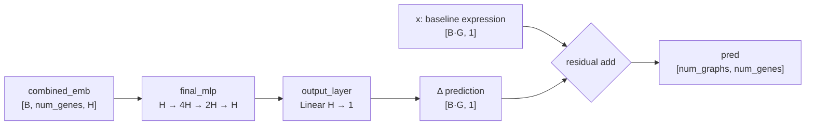
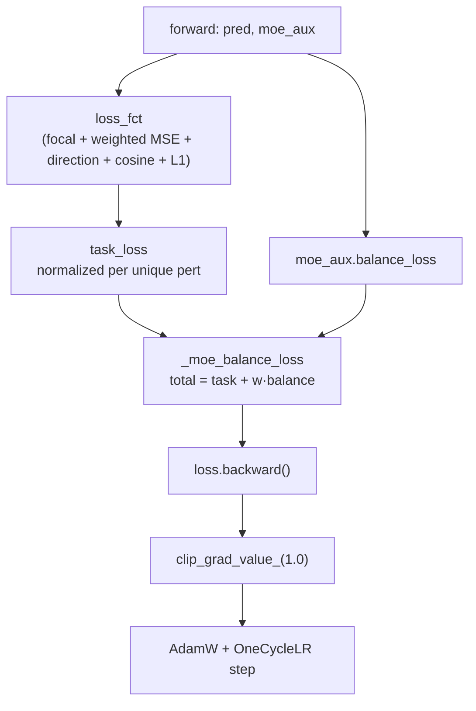
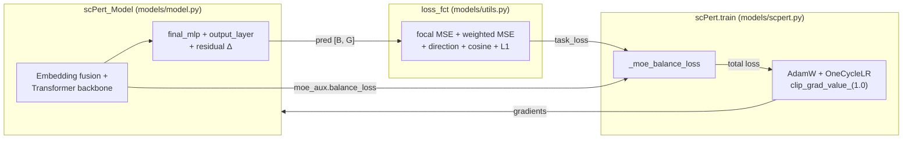

This page explains how DyMoE-Pert converts the backbone's fused gene-perturbation representation into per-gene expression predictions, and how the composite training loss supervises that conversion. It covers the decoder head (`final_mlp` + `output_layer`), the delta-prediction residual design, the five loss terms inside `loss_fct`, and the final loss assembly performed by the training loop. The router/balance internals themselves are covered in [Soft Router and Balance Loss](8-soft-router-and-balance-loss), while the upstream backbone that feeds this decoder is described in [Gene Interaction GNN Layers](10-gene-interaction-gnn-layers).

## Decoder Architecture: A Shared MLP Head with Scalar Projection

After the 8-layer transformer backbone produces `combined_emb` with shape `[batch, num_genes, hidden_size]`, the prediction head is applied uniformly to every gene token. The `final_mlp` first **expands** the representation to `4×hidden`, then contracts through `2×hidden` back to `hidden`, using LayerNorm + ReLU + Dropout at each intermediate stage. A final single-unit `output_layer` (`Linear(hidden_size, 1)`) collapses each gene's vector into one scalar — the predicted expression change for that gene.

Note that despite the config exposing a `decoder_hidden_size` parameter (a legacy of the GEARS/scPert lineage), the actual decoder geometry is derived entirely from `hidden_size` — every dimension in `final_mlp` and `output_layer` scales from `self.hidden_size`. The head is **shared across genes**: there are no gene-specific decoder weights, so all genes pass through identical transformations.

| Stage | Module | Shape transformation | Normalization / Activation |
|---|---|---|---|
| Head expansion | `final_mlp` block 1 | `H → 4H` | LayerNorm + ReLU + Dropout(0.1) |
| Head contraction | `final_mlp` block 2 | `4H → 2H` | LayerNorm + ReLU + Dropout(0.1) |
| Head core | `final_mlp` block 3 | `2H → H` | linear (no activation) |
| Scalar projection | `output_layer` | `H → 1` | linear |
| Residual recombination | `Δ + x` | `[B·G, 1] + [B·G, 1]` | none |

Sources: [model.py](models/model.py#L448-L460), [model.py](models/model.py#L749-L751)

## The Delta Paradigm: Predicting Perturbation Effects, Not Absolute Expression

The decoder does not predict raw expression values. Instead, the scalar produced by `output_layer` is interpreted as a **deviation from baseline**, added element-wise to the input expression `x` before the tensor is reshaped back into `[num_graphs, num_genes]` via `split`/`stack` plumbing. This design mirrors the GEARS-style formulation: the network only needs to model the perturbation-induced change, which is sparse and low-magnitude compared to absolute expression levels, so the burden of representing baseline biology is shifted entirely onto the input features.

> [!TIP]
> The single-scalar `output_layer` means the model predicts a per-gene Δ only — there is no variance head in this implementation. The `saved_logvar_sum` attribute inherited from the scPert base class exists but is never populated in this pipeline; any uncertainty-style outputs you see in ancestor projects are absent here.

This delta formulation also has a direct consequence for the loss design: since `pred ≈ y` in absolute space, loss terms that reference `ctrl` (focal weighting, direction loss) compare predictions against control expression to recover the *effect direction and magnitude*, not the raw value.

Sources: [model.py](models/model.py#L754-L757), [scpert.py](models/scpert.py#L234)

## Composite Loss: Five Terms Under One Per-Perturbation Loop

The entire supervision signal is produced by `loss_fct` in `models/utils.py`. Its structure is a loop over the **unique perturbations** present in the batch: cells sharing a perturbation label are grouped via `pert_idx`, and all five loss terms are evaluated per group. Two inputs enable perturbation-aware masking: `ctrl` is the dataset-level mean control expression per gene (computed once in `scPert.__init__`), and `dict_filter` maps each perturbation to the indices of its non-zero differentially-expressed genes (extracted from `adata.uns['non_zeros_gene_idx']`), so the loss for a perturbation is computed **only on genes it actually affects**.

| Loss term | Formula sketch | Default weight | Activation guard |
|---|---|---|---|
| Focal MSE | `mean((pred−y)² · sigmoid(\|y−ctrl\|)^γ)`, γ=2 | 1.0 | always |
| Weighted MSE | `mean(w_gene · (pred−y)²)`, key genes boosted | 1.0 | `class_weights_indices` provided |
| Direction | `mean(\|sign(y−ctrl) − sign(pred−ctrl)\|)` | `direction_lambda=1e-3` | `ctrl` not None |
| Cosine | `1 − mean cos(pred, y)` | `cosine_lambda=0.1` | always |
| L1 | `Σ‖θ‖₁` over trainable params | `l1_lambda=1e-5` | `model_params` provided |

The per-group sums are accumulated and finally **normalized by the number of unique perturbations** in the batch (`losses / len(set(perts))`), which stabilizes gradients across batches of varying perturbation diversity.

Sources: [utils.py](models/utils.py#L343-L421), [scpert.py](models/scpert.py#L237-L243)

## Focal MSE and Class Weighting: Amplifying Strong Perturbations

The focal term implements magnitude-aware reweighting: the weight is `sigmoid(|y − ctrl|)^γ`, so genes whose true expression deviates strongly from control approach weight 1.0, while unaffected genes receive only `0.5^γ = 0.25`. With γ=2, squared-error contributions are concentrated on the perturbed state that actually matters, which combats the dominance of thousands of near-zero-error genes in high-dimensional expression regression.

The weighted MSE term operates on a different axis — **gene identity rather than effect size**. `calculate_class_weights` builds a per-gene weight vector with a base of 1.0, multiplies the weights of genes listed in `important_genes_indices` by `boost_factor=5`, and normalizes so the mean weight stays at 1. These indices come from the `key_genes` argument of `scPert.train()`, letting users emphasize biologically privileged genes (e.g., DE genes) during training.

| Property | Focal MSE | Weighted MSE |
|---|---|---|
| Weighting axis | per-sample effect magnitude | per-gene identity |
| Weight source | dynamic: `sigmoid(\|y − ctrl\|)` | static: user-supplied gene index list |
| Default strength | γ = 2 | boost_factor = 5 |
| Failure mode addressed | error dilution across unaffected genes | under-fitting on key genes |

Sources: [utils.py](models/utils.py#L380-L397), [utils.py](models/utils.py#L422-L427), [utils.py](models/utils.py#L429-L453)

## Direction and Cosine Terms: Preserving Perturbation Semantics

The **direction loss** penalizes sign disagreements: it computes `|sign(y − ctrl) − sign(pred − ctrl)|`, which yields 0 when the predicted change points the same way as the true change and 2 when it flips. This is the term that enforces up/down-regulation correctness — a prediction can be numerically close under MSE yet still get the sign wrong on weak effects, and this term catches exactly those cases. The **cosine loss** complements it by comparing the flattened per-cell prediction and target vectors, rewarding predictions that match the overall *shape* of the perturbation response profile regardless of scale.

| Term | What it captures | Strength | Limitation |
|---|---|---|---|
| Direction | sign of change vs control | enforces regulation polarity | magnitude-blind; small weight (1e-3) keeps it a tie-breaker |
| Cosine | global response profile shape | scale-invariant alignment | cannot penalize magnitude error alone; relies on MSE companions |

Sources: [utils.py](models/utils.py#L399-L412)

## L1 Regularization: A Global Sparsity Prior

The final task-loss term is optional L1 regularization over **all trainable parameters**, not just decoder weights. `loss_fct` iterates over `model_params` and accumulates `torch.norm(param, 1)`, scaled by `l1_lambda=1e-5`. Because the training loop passes a generator over `self.model.parameters()` filtered by `requires_grad`, this acts as a mild network-wide sparsity prior alongside AdamW's `weight_decay`, rather than a decoder-local constraint.

Sources: [utils.py](models/utils.py#L414-L421)

## Loss Assembly in the Training Step

The training loop in `scPert.train()` orchestrates the final composition. Each step performs: forward pass returning `pred` plus a `moe_aux` dictionary → `loss_fct` producing `task_loss` → `_moe_balance_loss` adding the MoE router regularizer → backward, value-clipping, and optimizer step. The balance term is added **outside** the task loss with weight `moe_balance_weight` (default 0.01), and is silently forced to zero when the router runs in `fixed_uniform` mode or the ablation mode is `base_only` — in those configurations the router contributes nothing to learn, so no load-balancing pressure is needed.

> [!TIP]
> When debugging "why doesn't the MoE balance term appear in training logs", check the config combination first: `moe_balance_weight` is programmatically reset to 0.0 for `fixed_uniform` router or `base_only` ablation modes, and `_moe_balance_loss` also returns unchanged when the weight is ≤ 0 or `moe_aux` lacks a `balance_loss` key.

Sources: [scpert.py](models/scpert.py#L603-L615), [scpert.py](models/scpert.py#L64-L77), [scpert.py](models/scpert.py#L348-L349)

## Component Interaction Summary

The decoder and loss form a tightly coupled pair: the scalar-per-gene delta head defines what the loss compares (absolute predictions in expression space), while the loss's `ctrl`-relative terms recover perturbation semantics from those absolute predictions. Model selection is driven by validation `mse_de` (top-20 DE gene MSE), which directly reflects the focal/weighted weighting philosophy applied at evaluation time.

To continue exploring this pipeline: the router regularizer referenced above is detailed in [Soft Router and Balance Loss](8-soft-router-and-balance-loss); the loop that consumes this loss end-to-end, including validation and checkpointing, is covered in [Training Loop Orchestration](15-training-loop-orchestration); and the downstream metric definitions (`mse_de`, `pearson_delta`) that mirror these loss priorities are explained in [Metrics and DE Gene Analysis](18-metrics-and-de-gene-analysis).
