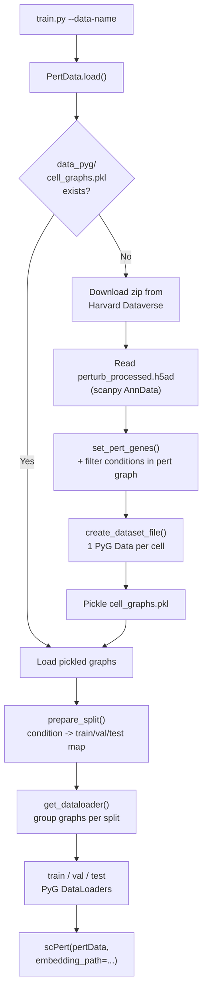

The GEARS-Format Data Pipeline is DyMoE-Pert's ingestion layer: it converts public perturbation-seq datasets — already serialized in the [GEARS](https://github.com/snap-stanford/GEARS) `h5ad` convention — into per-cell PyTorch Geometric (`torch_geometric.data.Data`) objects that the Dynamic MoE model consumes directly. This page explains the complete data path: dataset acquisition, AnnData preprocessing, cell-graph construction, caching, and DataLoader assembly, ending at the exact handoff point where model training begins. Split *semantics* (which perturbations land in train/val/test) are covered in [Perturbation Splits and Simulation Split](14-perturbation-splits-and-simulation-split), and the gene-embedding files attached to this pipeline are detailed in [Knowledge-Graph and scGPT Embeddings](13-knowledge-graph-and-scgpt-embeddings).

Sources: [ProcePertdata.py](/models/ProcePertdata.py#L23-L97), [train.py](/scripts/train.py#L119-L126)

## Pipeline at a Glance

The pipeline is orchestrated by a single class, `PertData` (in `models/ProcePertdata.py`), driven by three sequential calls from the training script: `load()` → `prepare_split()` → `get_dataloader()`. Each stage is cached to disk, so a dataset is only downloaded, graphified, or split once; subsequent runs short-circuit by detecting local artifacts. The full flow from remote download to a batch-ready PyG `DataLoader` looks like this:



Every arrow in this diagram maps to verifiable code: the three-call orchestration appears verbatim in the training entry point, and each internal stage is a named method on `PertData`.

Sources: [ProcePertdata.py](/models/ProcePertdata.py#L131-L215), [ProcePertdata.py](/models/ProcePertdata.py#L268-L417), [ProcePertdata.py](/models/ProcePertdata.py#L419-L491), [train.py](/scripts/train.py#L119-L126)

## The GEARS-Format Contract

"GEARS format" in this repository means a specific on-disk layout under your `--data-path` directory. For each dataset named `D`, the loader expects (or creates) the folder `data/D/` containing a `perturb_processed.h5ad` AnnData file plus a `data_pyg/` cache directory, and — after splitting — a `splits/` directory of pickle files. The AnnData must expose two conventions the code hard-depends on: `adata.obs['condition']` holding perturbation labels such as `ctrl`, ` gene1+ctrl`, or `gene1+gene2`, and `adata.var['gene_name']` holding the gene symbol per column.

Sources: [ProcePertdata.py](/models/ProcePertdata.py#L170-L180), [ProcePertdata.py](/models/ProcePertdata.py#L237-L241), [data_utils.py](/models/data_utils.py#L57-L60)

Condition strings are parsed uniformly via helpers in `models/utils.py`: `parse_any_pert` decomposes any condition into its constituent genes, treating `X+ctrl` as a single perturbation and `X+Y` as a combo of two. This string protocol is what allows one pipeline to serve single-gene and combinatorial perturbation datasets without format changes.

Sources: [utils.py](/models/utils.py#L16-L39)

## Loading Built-in Datasets

`PertData.load()` recognizes five canonical GEARS dataset names and resolves each to a Harvard Dataverse file ID. The five names are precisely the five `EMBEDDING_FILES` keys in `scripts/train.py`, which is why the `--data-name` CLI argument is constrained to that set — the pipeline guarantees that the dataset and its pre-computed 512-d gene embedding file stay aligned.

Sources: [ProcePertdata.py](/models/ProcePertdata.py#L150-L165), [train.py](/scripts/train.py#L12-L18)

| Dataset name | Organism / cell line focus | Dataverse artifact | Typical use |
|---|---|---|---|
| `norman` | Combined perturbation screen | datafile/6154020 | Combo-perturbation generalization |
| `adamson` | Single-gene perturbation screen | datafile/6154417 | Single-perturbation generalization |
| `dixit` | Single-gene perturbation screen | datafile/6154416 | Single-perturbation generalization |
| `replogle_k562_essential` | Filtered essential-gene subset | datafile/7458695 | Large-scale single-perturbation |
| `replogle_rpe1_essential` | Filtered essential-gene subset | datafile/7458694 | Large-scale single-perturbation |

Sources: [ProcePertdata.py](/models/ProcePertdata.py#L154-L165)

The download path is deliberately resilient: `dataverse_download` streams the file with a progress bar and writes to a `.part` suffix that is atomically `os.replace`d on success (so interrupted downloads never leave corrupt files), and `zip_data_download_wrapper` skips work entirely when a local copy exists. This mirrors the caching philosophy applied at every later stage of the pipeline.

Sources: [utils.py](/models/utils.py#L51-L77), [utils.py](/models/utils.py#L80-L97)

## From AnnData to Per-Cell PyG Graphs

This is the conceptual heart of the pipeline. GEARS reframes each cell as a *graph* whose nodes are genes; DyMoE-Pert inherits this framing so that its GNN backbone and MoE fusion modules can operate on gene-level features. For every unique condition in `adata.obs['condition']`, `create_dataset_file()` calls `create_cell_graph_dataset()`, which emits one `torch_geometric.data.Data` object per cell and stores the result as a dict: `condition → list[Data]`.

Sources: [ProcePertdata.py](/models/ProcePertdata.py#L618-L627), [ProcePertdata.py](/models/ProcePertdata.py#L549-L616)

Each `Data` object carries five fields, constructed inside `create_cell_graph`:

| Field | Construction | Meaning |
|---|---|---|
| `x` | `torch.Tensor(X).T` → shape `(num_genes, 1)` | Gene-node feature matrix; **genes are nodes**, each with one scalar expression feature |
| `pert_idx` | Indices of perturbed genes from `get_pert_idx()`; `[-1]` for ctrl | Which gene nodes were perturbed |
| `y` | `torch.Tensor(y)` | Post-perturbation expression vector (the prediction target) |
| `de_idx` | Indices of top-20 DE genes for the condition; `[-1]*20` if unavailable | Genes used for DE-focused evaluation |
| `pert` | The condition string itself | Human-readable label threaded through training/inference |

Sources: [ProcePertdata.py](/models/ProcePertdata.py#L519-L547), [ProcePertdata.py](/models/ProcePertdata.py#L583-L593)

> [!TIP]
> The input/target pairing is the subtle part: for a non-control condition, each perturbed cell's expression becomes the label `y`, while the input `x` is a *randomly sampled control cell* (with `num_samples=1` by default). The model therefore learns the mapping `control expression + perturbation identity → perturbed expression` — the perturbation signal enters only through `pert_idx`, never through `x`. For `ctrl` conditions, `x = y` is the same cell, teaching the identity function.

Sources: [ProcePertdata.py](/models/ProcePertdata.py#L594-L608)

The top-20 DE genes attached as `de_idx` come from `adata.uns['rank_genes_groups_cov_all']`, which the preprocessing stage computes per condition against its cell-type-matched control. If that key is absent (custom datasets that skip DE calculation), the pipeline degrades gracefully to a single dummy `-1` marker rather than failing.

Sources: [ProcePertdata.py](/models/ProcePertdata.py#L571-L593)

## Preprocessing Annotations Stored in `adata.uns`

When a dataset is loaded fresh, most of the evaluation-relevant metadata already lives inside the GEARS `h5ad`. But when you process a *new* dataset via `new_data_process()`, two functions in `models/data_utils.py` rebuild that metadata. `get_DE_genes` derives `dose_val`, `control`, and `condition_name` columns and runs a covariate-stratified differential expression scan (`rank_genes_groups_by_cov` with `n_genes = len(adata.var)`, i.e., ranking *all* genes), storing the full ranking in `adata.uns['rank_genes_groups_cov_all']`.

Sources: [data_utils.py](/models/data_utils.py#L15-L54), [data_utils.py](/models/data_utils.py#L57-L70), [ProcePertdata.py](/models/ProcePertdata.py#L250-L253)

`get_dropout_non_zero_genes` then computes per-condition mean expression versus control and derives four masks that downstream metric code depends on: genes that are non-zero post-perturbation, genes that are "true zeros" (zero in both perturbed and control, i.e., not dropouts), the union of those (`non_dropouts`), and the top-20 DE genes restricted to each mask. These land in `adata.uns` under four keys:

| `adata.uns` key | Content | Primary consumer |
|---|---|---|
| `rank_genes_groups_cov_all` | Full per-condition DE gene ranking | `de_idx` in cell graphs; metrics |
| `top_non_dropout_de_20` | Top-20 DE genes excluding dropout artifacts | DE gene analysis |
| `non_dropout_gene_idx` | All non-dropout gene indices | DE gene analysis |
| `non_zeros_gene_idx` / `top_non_zero_de_20` | Non-zero gene indices / top-20 | Loss filtering, metrics |

Sources: [data_utils.py](/models/data_utils.py#L72-L132)

Note the tight coupling: `scPert` later reads `non_zeros_gene_idx` to build its per-perturbation `dict_filter`, which the loss function uses to restrict directional and weighted losses to genes that are actually observable post-perturbation. This is a concrete example of how preprocessing metadata propagates all the way into the training objective.

Sources: [scpert.py](/models/scpert.py#L237-L244), [utils.py](/models/utils.py#L393-L407)

## Perturbation Gene Filtering (`set_pert_genes`)

Before graph construction, `load()` calls `set_pert_genes()` to decide which genes can legally appear in the perturbation graph, then drops every condition not fully representable in it. Three modes are supported: a custom essential-gene pickle passed via `gene_set_path`; a *small* graph limited to genes present in the dataset itself (`default_pert_graph=False`); or the *default* large GEARS gene universe downloaded from Dataverse (`essential_all_data_pert_genes.pkl`). Conditions failing the check are reported and filtered out of the AnnData before any graph is built.

Sources: [ProcePertdata.py](/models/ProcePertdata.py#L99-L129), [ProcePertdata.py](/models/ProcePertdata.py#L187-L196)

The method also registers `pert_names` (the unique perturbable genes) and `node_map_pert` (gene → perturbation-node index), which are distinct from the *expression* gene index `node_map` built later in `get_dataloader()`. Keeping these two index spaces separate is essential — perturbation identity and expression nodes must not be conflated when the model embeds perturbations via 512-d vectors.

Sources: [ProcePertdata.py](/models/ProcePertdata.py#L128-L129), [ProcePertdata.py](/models/ProcePertdata.py#L440-L441)

## On-Disk Artifact Layout and Caching

After a successful first run, your data directory encodes the pipeline's full state, and every artifact is a cache: delete one and only that stage recomputes.

```
data/                          # --data-path
├── <dataset_name>/            # e.g. norman/
│   ├── perturb_processed.h5ad     # AnnData: expression + obs/uns metadata
│   ├── data_pyg/
│   │   └── cell_graphs.pkl         # dict: condition -> list[torch_geometric Data]
│   └── splits/
│       ├── <ds>_<split>_<seed>_<frac>.pkl        # set2conditions
│       └── <ds>_simulation_<seed>_<frac>_subgroup.pkl
├── essential_all_data_pert_genes.pkl   # default perturbation gene universe
└── gene2go.pkl                          # GO annotations (graph construction)
```

Sources: [ProcePertdata.py](/models/ProcePertdata.py#L166-L172), [ProcePertdata.py](/models/ProcePertdata.py#L198-L215), [ProcePertdata.py](/models/ProcePertdata.py#L328-L346)

> [!TIP]
> The `cell_graphs.pkl` cache is a double-edged sword: it makes warm startup near-instant, but it is keyed only by file existence — not by dataset content. If you edit the `h5ad` (e.g., re-filter conditions) without deleting `data_pyg/cell_graphs.pkl`, the loader will silently serve stale graphs. Always clear `data_pyg/` after modifying an AnnData in place.

Sources: [ProcePertdata.py](/models/ProcePertdata.py#L202-L215)

## DataLoader Assembly (`get_dataloader`)

The final stage converts `set2conditions` (the split map produced by `prepare_split()`, detailed in [Perturbation Splits and Simulation Split](14-perturbation-splits-and-simulation-split)) into concrete loaders. It first rebuilds `node_map` — gene symbol → column index — then gathers each split's cell graphs by concatenating the per-condition graph lists, and wraps them in PyTorch Geometric loaders with deliberately asymmetric shuffle semantics:

| Split | Loader | shuffle | drop_last |
|---|---|---|---|
| train | `DataLoader` / `DataListLoader` | `True` | `True` |
| val | same class | `True` | `False` |
| test | same class | `False` | `False` |

Sources: [ProcePertdata.py](/models/ProcePertdata.py#L440-L490)

The loader class itself is conditional: `get_dataloader(..., use_data_list_loader=True)` selects `DataListLoader`, which yields *lists* of `Data` objects instead of a fused `Batch`. This is the exact mechanism behind `--multi-gpu` in the training script — per-GPU replica lists bypass PyG's single-process batching, as covered in [Multi-GPU Parallel Training](16-multi-gpu-parallel-training). The training-side consumer (`_prepare_train_batch`) accepts both shapes, re-fusing lists into a `Batch` only when not running under PyG `DataParallel`.

Sources: [ProcePertdata.py](/models/ProcePertdata.py#L436-L438), [train.py](/scripts/train.py#L122-L126), [scpert.py](/models/scpert.py#L44-L55)

Special split modes also alter the loader set: `no_split` returns only a `test_loader` (used for pure inference runs), and `no_test` returns `train_loader` + `val_loader` only. This is how the pipeline supports evaluation-only and test-free experimental configurations without special-casing the training loop.

Sources: [ProcePertdata.py](/models/ProcePertdata.py#L445-L463), [ProcePertdata.py](/models/ProcePertdata.py#L486-L490)

## Handoff to the Model

The pipeline terminates at the `scPert` constructor, which is the precise boundary between this page and [Training Loop Orchestration](15-training-loop-orchestration). `scPert.__init__` absorbs the entire `PertData` state machine: the dataloaders, the AnnData (with its `uns` metadata), both index maps (`node_map`, `node_map_pert`), the split bookkeeping (`set2conditions`, `subgroup`), and the derived lists `gene_list` / `pert_list`. It immediately computes `ctrl_expression` (mean control profile) and the per-perturbation `dict_filter` from the preprocessing metadata described above.

Sources: [scpert.py](/models/scpert.py#L177-L248)

In parallel, `scripts/train.py` resolves which 512-d gene-embedding file pairs with the loaded dataset via the `EMBEDDING_FILES` mapping and passes it as `embedding_path` — the entry point into the expert-fusion inputs described in [Knowledge-Graph and scGPT Embeddings](13-knowledge-graph-and-scgpt-embeddings). The invariant is structural: the row order of the embedding matrix must correspond to `pertData.gene_names`, which is why both artifacts must originate from the same dataset universe.

Sources: [train.py](/scripts/train.py#L101-L105), [scpert.py](/models/scpert.py#L228-L235)

## Bringing Your Own Data in GEARS Format

`PertData.new_data_process()` is the sanctioned entry point for custom datasets. The requirements are a strict superset check on the AnnData contract: `condition` must exist in `adata.obs` and `gene_name` in `adata.var` — violations raise immediately rather than producing silent corruption. The method then runs the full preprocessing chain (DE genes → dropout masks → `h5ad` write → pert-gene filtering → PyG graphification) and leaves the result in exactly the same on-disk layout as a built-in dataset, so a custom dataset becomes indistinguishable from `norman` or `adamson` to every downstream consumer.

Sources: [ProcePertdata.py](/models/ProcePertdata.py#L217-L266)

For custom datasets, note the DE-calculation escape hatch: `skip_calc_de=True` skips the expensive `rank_genes_groups_by_cov` scan and the dropout analysis, at the cost of placeholder `de_idx` values in cell graphs (which affects DE-focused metrics, see [Metrics and DE Gene Analysis](18-metrics-and-de-gene-analysis)) and an empty `dict_filter` (which weakens the direction-aware loss). Use it only for quick smoke tests, never for reported results.

Sources: [ProcePertdata.py](/models/ProcePertdata.py#L250-L252), [ProcePertdata.py](/models/ProcePertdata.py#L576-L593)

Once processed and split, your custom dataset flows through `load(data_path=...)`, which detects a local folder layout instead of a Dataverse name and follows the identical cache-first path — the pipeline never distinguishes built-in from custom data after load time.

Sources: [ProcePertdata.py](/models/ProcePertdata.py#L174-L180)

## Where to Go Next

The pipeline deliberately stops at the dataloader boundary. To understand what happens to these cell graphs next: the split *strategies* (simulation subgroups, combo seen/unseen) that `prepare_split()` invokes are unpacked in [Perturbation Splits and Simulation Split](14-perturbation-splits-and-simulation-split); the 512-d embedding files that pair with each dataset name are analyzed in [Knowledge-Graph and scGPT Embeddings](13-knowledge-graph-and-scgpt-embeddings); and the training loop that iterates the loaders — including the MoE balance loss computed on each batch — is detailed in [Training Loop Orchestration](15-training-loop-orchestration).
