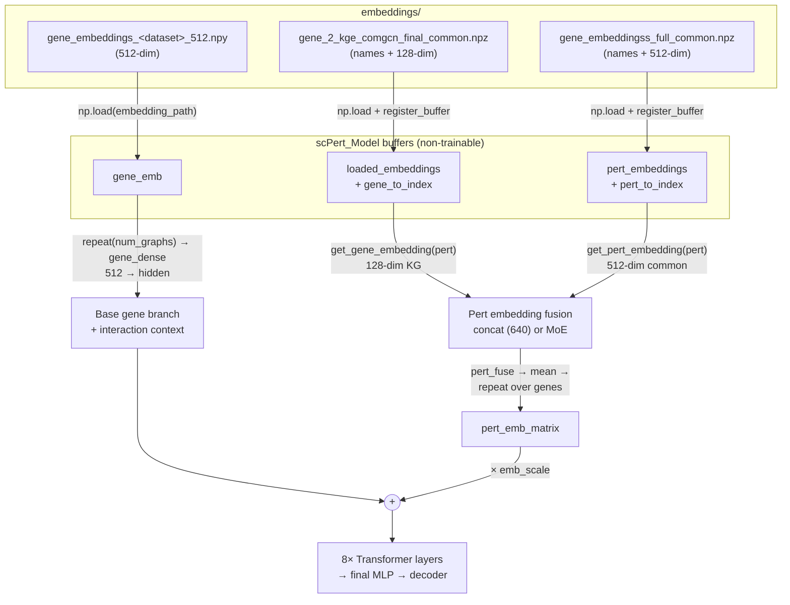

DyMoE-Pert does not learn gene representations from scratch. Instead, every forward pass is anchored by three externally precomputed embedding banks: **knowledge-graph (KG) embeddings** distilled from a ComGCN-trained biological knowledge graph, a **common perturbation embedding bank** aligned with the gene universe, and **dataset-specific scGPT embeddings** that provide a 512-dimensional functional prior for each gene. This page documents what these files contain, how they are loaded into `scPert_Model` as registered buffers, how per-gene lookups handle control and out-of-vocabulary names, and where each representation enters the network. The fusion *mechanics* (experts, router) are covered in [Expert Specialization: KG, scGPT, Interaction](7-expert-specialization-kg-scgpt-interaction); here we focus on the embedding assets themselves and their injection points.

Sources: [model.py](models/model.py#L370-L390), [train.py](scripts/train.py#L12-L18)

## Embedding Inventory: Three Banks, Two Formats

The `embeddings/` directory holds two formats. The `.npz` files are NumPy archives with two arrays — `gene_names` (the lookup keys) and `embeddings` (the matrix) — produced offline by ComGCN training on a knowledge graph. The `.npy` files are flat 512-dimensional scGPT matrices whose row order implicitly corresponds to the dataset's gene list. All three are loaded once in the model constructor and registered as PyTorch buffers so they travel with the model on `.to(device)` calls without being treated as trainable parameters.

| File | Format | Dim | Model buffer | Lookup key | Role |
|---|---|---|---|---|---|
| `gene_2_kge_comgcn_final_common.npz` | `.npz` (`gene_names` + `embeddings`) | 128 | `loaded_embeddings` | gene name (`gene_to_index`) | KG structural prior for the perturbed gene(s) |
| `gene_embeddingss_full_common.npz` | `.npz` (`gene_names` + `embeddings`) | 512 | `pert_embeddings` | pert gene name (`pert_to_index`) | common perturbation-side representation (note the double "s" in the filename) |
| `gene_embeddings_<dataset>_512.npy` | `.npy` | 512 | `gene_emb` | row position (gene index) | dataset-aligned scGPT base features for all genes |

Sources: [model.py](models/model.py#L370-L390), [train.py](scripts/train.py#L12-L18)

## Loading Paths: Parameterized vs Hardcoded

The two embedding families enter the model through different mechanisms. The **scGPT bank is fully parameterized**: `scripts/train.py` maps each supported dataset name to its embedding file via the `EMBEDDING_FILES` dictionary, resolves the final path from `--embedding-dir` (default `./embeddings`) and an optional `--embedding-file` override, and raises `FileNotFoundError` early if the file is missing. The resolved path is passed into `scPert`, stored as `self.embedding_path`, and finally handed to `scPert_Model(self.config, self.embedding_path)`, where it becomes the `gene_emb` buffer.

The **KG banks are hardcoded**: the constructor loads `./embeddings/gene_2_kge_comgcn_final_common.npz` and `./embeddings/gene_embeddingss_full_common.npz` with fixed relative paths, builds name→index dictionaries from the archived `gene_names`, and registers the matrices as float32 buffers. This means training must be launched from the repository root, and swapping KG banks requires editing `model.py` rather than passing a flag.

> [!TIP]
> The scGPT embedding dimension is enforced by config, not by inspection: `model_initialize` hardcodes `'embedding_size': 512` in the config dict, and `pert_dense`'s first layer expects exactly `640 = 128 + 512` inputs. Feeding a non-512-dim `.npy` will fail deep inside `nn.Linear` rather than at load time — validate your custom embedding file's shape before training.

Sources: [train.py](scripts/train.py#L12-L18), [train.py](scripts/train.py#L102-L105), [scpert.py](models/scpert.py#L235), [scpert.py](models/scpert.py#L327-L349), [scpert.py](models/scpert.py#L354-L355), [model.py](models/model.py#L370-L390)

## Concept Relationship Diagram: From Files to Forward Pass

The diagram below traces each embedding bank from disk to its consumption point inside `scPert_Model.forward`. Two independent gene streams exist: the scGPT `gene_emb` drives the **base gene branch** (identical for every cell in the batch), while the KG 128-dim vector and the common 512-dim perturbation vector are retrieved **per perturbed gene** and fused into a perturbation embedding that is broadcast across all gene positions.

Sources: [model.py](models/model.py#L370-L390), [model.py](models/model.py#L684-L693), [model.py](models/model.py#L697-L740)

## KG Embeddings: 128-Dim Structural Priors with Deterministic Fallbacks

The KG bank `gene_2_kge_comgcn_final_common.npz` is queried through `get_gene_embedding(gene_name)` for each single gene inside a perturbation condition (combo perturbations like `A+B` are split on `+` first). Three outcomes exist, and together they make the model total over any gene name:

1. **`'ctrl'`** returns a 128-dimensional zero vector on the runtime device — control conditions carry no perturbation signal.
2. **Known gene** performs a dictionary lookup into `loaded_embeddings` and returns the pretrained 128-dim ComGCN vector directly (zero gradient flow — it is a buffer).
3. **Unknown gene** (not in the KG vocabulary — possible for novel perturbation targets in unseen-perturbation evaluation) falls back to `get_random_embedding`, which derives a seed from the SHA-1 hash of the gene name, generates a deterministic 640-dim Gaussian vector scaled by `1/√640`, and slices the first 128 dims for the KG slot.

The hash-seeding is the subtle design choice here: the same gene name always produces the same pseudo-embedding across processes, GPUs, and runs, so unseen genes get a stable, reproducible identity rather than a random one re-sampled per epoch.

Sources: [model.py](models/model.py#L636-L648), [model.py](models/model.py#L651-L658), [model.py](models/model.py#L706-L711)

## scGPT Embeddings: Dataset Alignment and the Common Perturbation Bank

There are two scGPT-flavored assets, and they serve different branches. The **dataset-aligned bank** (`gene_embeddings_norman_512.npy`, `gene_embeddings_dixit_512.npy`, etc.) is selected by dataset name at training time and loaded as `gene_emb`. In `forward`, it is repeated once per cell graph in the batch, projected by `gene_dense` (512 → `hidden_size`), reshaped to `(num_graphs, num_genes, hidden)`, and enriched by a scaled dot-product interaction pass (`gene_interaction` softmax attention → `gene_context`) before residual addition. Because every row corresponds to a gene position, this bank encodes *what each gene is*, independent of which perturbation was applied.

The **common bank** (`gene_embeddingss_full_common.npz`) is queried per perturbed gene via `get_pert_embedding`. It mirrors the KG lookup pattern exactly — zeros(512) for `'ctrl'`, buffer lookup for known names — except its fallback slices `get_random_embedding(...)[128:]`, i.e., dims 128–640 of the same deterministic random vector used by the KG path. This guarantees that an unknown gene's KG fragment and scGPT fragment are complementary slices of one consistent vector rather than two unrelated samples.

| Scenario | KG path (`get_gene_embedding`) | scGPT/common path (`get_pert_embedding`) |
|---|---|---|
| Perturbed gene is `'ctrl'` | `zeros(128)` | `zeros(512)` |
| Name found in vocabulary | `loaded_embeddings[gene_to_index[name]]` | `pert_embeddings[pert_to_index[name]]` |
| Name unknown to both banks | `randn(640, seeded by SHA1(name))[:128]` | `randn(640, seeded by SHA1(name))[128:]` |

Sources: [train.py](scripts/train.py#L12-L18), [model.py](models/model.py#L387-L390), [model.py](models/model.py#L684-L693), [model.py](models/model.py#L660-L671)

## Consumption: Two Fusion Routes into `pert_emb_matrix`

For each perturbed condition, the 128-dim KG vector and the 512-dim common vector are combined through `_fuse_pert_embedding`, which implements two alternative routes depending on the `use_moe_fusion` flag:

| Route | Mechanism | Output dim | When used |
|---|---|---|---|
| Legacy concat | `torch.cat([kg, scgpt])` → `pert_dense` (640 → 2·hidden → hidden) | `hidden_size` | `use_moe_fusion=False` |
| Dynamic MoE | separate projectors (128→hidden, 512→hidden), 3 experts, softmax router | `hidden_size` | `use_moe_fusion=True` (default in `train.py`) |

The MoE route is the paper's contribution — its expert structure and router math are detailed in [Residual Fusion Design](6-residual-fusion-design) and [Soft Router and Balance Loss](8-soft-router-and-balance-loss). What matters at the embedding level is that both routes reduce the two heterogeneous sources to a common `hidden_size` vector. Combo conditions produce one fused vector per gene, stack them, average through `pert_fuse`, and broadcast the result across all `num_genes` positions, scaled by the learnable scalar `emb_scale` before being added to the gene branch. Multiple perturbations therefore share one averaged perturbation embedding rather than occupying separate token slots — a design contrast with GEARS, discussed in [Positioning vs GEARS and scPert](20-positioning-vs-gears-and-scpert).

> [!TIP]
> Because `gene_emb` (scGPT) is shared across the entire batch and only `pert_emb_matrix` varies per cell, the expensive base-gene interaction pass runs identically for every graph in a batch — the model batches by repetition, not by per-cell gene features. If you profile training, expect the per-perturbation Python loop (one iteration per graph for embedding lookup) to dominate for small batches.

Sources: [model.py](models/model.py#L478-L490), [model.py](models/model.py#L415-L427), [model.py](models/model.py#L719-L740), [train.py](scripts/train.py#L73)

## Dimension Contract Summary

The whole embedding system hangs together through a handful of fixed dimensional contracts. Memorize these numbers when extending the pipeline with your own banks:

| Contract | Value | Enforced by |
|---|---|---|
| KG embedding dim | 128 | `kg_input_dim=128` in `ResidualMoEFusion`; `zeros(128)` for ctrl |
| scGPT gene dim | 512 | `scgpt_input_dim=512`; config `'embedding_size': 512` |
| Random fallback dim | 640 (=128+512) | `random_embedding_dim = 640`; sliced `[:128]` / `[128:]` |
| Concat fusion input | 640 | `pert_dense` first `nn.Linear(640, ...)` |
| Fused perturbation output | `hidden_size` (default 64) | both fusion routes; `pert_emb_matrix` width |

Sources: [model.py](models/model.py#L96-L107), [model.py](models/model.py#L400-L414), [model.py](models/model.py#L467), [model.py](models/model.py#L415-L427)

## Practical Workflow and Next Steps

To train on a supported dataset, the correct scGPT file is picked automatically from `EMBEDDING_FILES` — for example, `--data-name adamson` resolves to `embeddings/gene_embeddings_adamson_512.npy` under `--embedding-dir ./embeddings`, and the KG banks are picked up by their hardcoded paths. To use a custom dataset, generate a 512-dim scGPT matrix whose row order matches your `perturb_processed.h5ad` gene list and point `--embedding-file` at it; custom KG banks additionally require editing the two `np.load` calls in `model.py`. The full asset setup (downloads, file placement) is covered in [Dataset and Embedding Setup](3-dataset-and-embedding-setup), and how these embeddings behave when a perturbation gene is absent from every bank is treated in [Unseen Perturbation Inference](17-unseen-perturbation-inference).

Recommended reading order from here: proceed to [GEARS-Format Data Pipeline](12-gears-format-data-pipeline) to see how the AnnData that defines gene ordering is produced, then [Perturbation Splits and Simulation Split](14-perturbation-splits-and-simulation-split) to understand which gene names will hit the KG vocabulary during evaluation.
