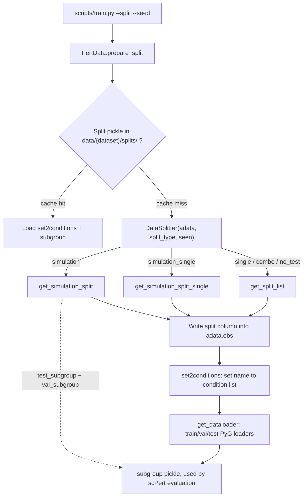
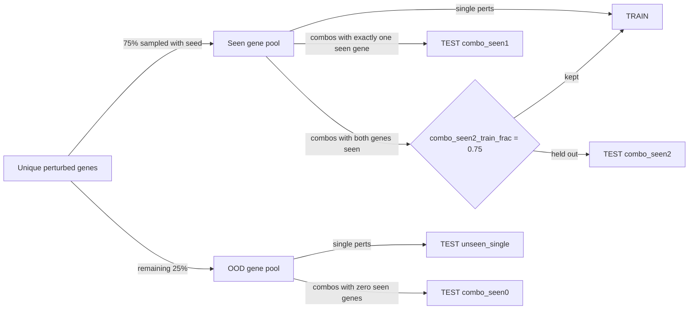

This page explains how DyMoE-Pert partitions perturbation conditions into train, validation, and test sets, with particular depth on the default **simulation split** — a gene-level partitioning scheme that carves the test set into four generalization subgroups. It covers the split engine, the full split taxonomy, the subgroup-aware evaluation path, and the caching mechanism that makes splits reproducible across runs.

Splits operate on two granularity levels simultaneously. A *condition* is a measured perturbation such as `CEBPA+ctrl` (single) or `CEBPA+MEIS2` (combo), while the simulation split assigns conditions to sets by first partitioning the underlying *genes* into seen and out-of-distribution (OOD) pools. This design is what lets the benchmark measure extrapolation to entirely unseen genes rather than merely unseen condition labels.

Sources: [ProcePertdata.py](models/ProcePertdata.py#L268-L317), [data_utils.py](models/data_utils.py#L135-L147)

## Split System Architecture

The split subsystem follows a three-layer separation of concerns. **Orchestration** lives in `PertData.prepare_split`, which validates the requested split name, manages the on-disk cache, and materializes results into two artifacts: a `set2conditions` dictionary mapping `train`/`val`/`test` to condition lists, and (for the simulation split) a `subgroup` dictionary. **Partitioning** lives in the `DataSplitter` class, which mutates `adata.obs` with a `split` column via gene-level or condition-level logic. **Consumption** happens in `get_dataloader`, which expands conditions into per-cell graph objects and feeds PyG loaders, and in `scPert`, which uses the subgroup dictionary for stratified test reporting.

Split results are persisted for reproducibility. The cache file is named `{dataset}_{split}_{seed}_{train_gene_set_size}.pkl` under `data/<dataset>/splits/`; if it exists, `prepare_split` loads it instead of recomputing, and for `simulation` it additionally restores the sibling `_subgroup.pkl`. This means identical `split + seed + train_gene_set_size` triples are byte-identical across runs, which is essential when comparing ablation modes or router configurations against the same partition.

Sources: [ProcePertdata.py](models/ProcePertdata.py#L310-L346), [ProcePertdata.py](models/ProcePertdata.py#L405-L417), [data_utils.py](models/data_utils.py#L135-L198)

## The Split Taxonomy

`prepare_split` enforces a closed vocabulary of nine split modes. The two `simulation*` modes operate at gene granularity through dedicated `DataSplitter` methods; the `combo_seenN` family and `single` route through `get_split_list` with condition-level logic; the remaining modes are utility splits for training-only or inference-only workflows.

| Split | Routing inside `DataSplitter` | Test-set composition |
|---|---|---|
| `simulation` (default) | `get_simulation_split` | Four gene-level subgroups: `combo_seen0`, `combo_seen1`, `combo_seen2`, `unseen_single` |
| `simulation_single` | `get_simulation_split_single` | `unseen_single` only |
| `single` | `get_split_list`, `split_type='single'` | Random fraction of single perturbations; combos sharing those genes are excluded from training |
| `combo_seen0` | `get_split_list`, `seen=0` | Singles plus combos where **both** genes are held out |
| `combo_seen1` | `get_split_list`, `seen=1` | Singles plus combos with exactly one held-out gene |
| `combo_seen2` | `get_split_list`, `seen=2` | Random fraction of combos (both genes seen in training) |
| `no_test` | `get_split_list`, `split_type='no_test'` | None — only train/val loaders are produced |
| `no_split` | Bypasses the splitter; every condition labeled `test` | Everything, for prediction-only loading |
| `custom` | Loads a user pickle `{'train': [...], 'val': [...], 'test': [...]}` | Fully user-defined |

The `custom` mode is useful for replicating published splits or cross-paper comparisons: pass `split_dict_path` pointing to a pickled dictionary, and `prepare_split` adopts it wholesale without invoking the splitter at all.

Sources: [ProcePertdata.py](models/ProcePertdata.py#L278-L325), [ProcePertdata.py](models/ProcePertdata.py#L353-L403)

## Inside the Simulation Split

The simulation split begins by collecting every distinct perturbed gene across all non-control conditions, then sampling `train_gene_set_size` (default 0.75) of them — seeded by `seed` — as the **seen gene pool**. The remainder become the **OOD gene pool**. Conditions are then assigned by composing these pools with the perturbation's arity:

Each test subgroup probes a different generalization capability. The four subgroups are returned in a dictionary and persisted alongside the split:

| Subgroup | Membership rule | Generalization demanded |
|---|---|---|
| `combo_seen0` | Combos whose **both** constituent genes are OOD | New gene pair, both genes never seen — hardest setting |
| `combo_seen1` | Combos with exactly one seen gene (fully excluded from training) | Pairwise composition across the seen/OOD boundary |
| `combo_seen2` | Combos with both genes seen; 25% randomly held out | Combinatorial novelty only — the pair is new, the genes are not |
| `unseen_single` | Single-gene perturbations of OOD genes | Node-level extrapolation to unseen perturbation targets |

Two structural details matter for correctness. First, splitting is **two-stage**: after the test partition is computed, the training set itself is re-partitioned by the same gene-level splitter with 0.9/0.9 fractions to yield the validation set, and `'ctrl'` is explicitly re-appended to train before the split column is written — control cells always train regardless of composition. Second, the method asserts a complete, non-overlapping partition: `combo_seen1 + combo_seen0 + unseen_single + train + combo_seen2` must equal the total condition count, and random number generation is re-seeded immediately before the `combo_seen2` draw so the partition is deterministic even though it involves two sampling steps.

> [!TIP]
> Within the simulation split, `combo_seen1` perturbations are *always* excluded from training — there is no sampling fraction for them — while `combo_seen2` retention is directly tunable via `combo_seen2_train_frac`. Raising that fraction trades test-set size for more compositional training signal.

Sources: [data_utils.py](models/data_utils.py#L156-L166), [data_utils.py](models/data_utils.py#L231-L289), [data_utils.py](models/data_utils.py#L185-L198)

## The simulation_single Variant

`simulation_single` is the single-gene analogue: it samples the seen gene pool identically, assigns seen-gene singles to train and OOD-gene singles to test, and returns a single subgroup `{'unseen_single': ...}`. No combo perturbations participate, and the validation stage re-applies the same single-gene splitter with a 0.9 fraction. It suits datasets like Replogle K562/RPE1 where screens are single-gene only, keeping the OOD evaluation philosophy while dropping combinatorial subgroups.

Sources: [data_utils.py](models/data_utils.py#L167-L173), [data_utils.py](models/data_utils.py#L200-L229)

## Perturbation-Level Splits: single and combo_seenN

When `prepare_split` receives `single` or any `combo_seenN` name, it constructs `DataSplitter` with `split_type='combo'` and `seen` parsed from the split name's last character, delegating to `get_split_list`. This family operates directly on conditions: held-out genes are chosen randomly (scaled by the single-perturbation count times `combo_single_split_test_set_fraction`, default 0.1), then mapped back to the perturbations containing them via `get_perts_from_genes`, which classifies conditions into singles (`GENE+ctrl`) and combos (`GENEA+GENEB`).

The `seen` parameter controls how much *gene-level* novelty the test combos carry, with a `hold_outs` mechanism enforcing purity:

| Split | Test combos contain | Held out from training | Trade-off noted in code |
|---|---|---|---|
| `combo_seen0` | Both genes unseen | Every combo with any seen gene | Can shrink the dataset; `hold_outs=False` relaxes purity |
| `combo_seen1` | Exactly one unseen gene | Combos with two unseen genes | Same dataset-size caveat applies |
| `combo_seen2` | Random fraction of all combos | Nothing (all other combos stay in train) | No gene-level constraint |

In the `single` split, combos containing any held-out gene are dropped from training entirely rather than being tested — they fall outside both sets. The `no_test` mode is the degenerate case: conditions are divided into train/val at the condition level only, and downstream `scPert.train` detects the missing `test_loader` and terminates after validation without test evaluation.

Sources: [data_utils.py](models/data_utils.py#L291-L375), [data_utils.py](models/data_utils.py#L377-L399), [ProcePertdata.py](models/ProcePertdata.py#L375-L398), [scpert.py](models/scpert.py#L660-L669)

## From Split Assignment to Dataloaders and Evaluation

Once the split column is written, `prepare_split` collapses it into `set2conditions` — a dictionary of unique condition lists per set — and `get_dataloader` expands each condition into its pre-built per-cell graph objects (one graph per cell, paired with random control cells as basal expression). Loader behavior differs by role, which is significant for reproducing benchmark numbers:

| Loader | Condition list | `shuffle` | `drop_last` | Purpose |
|---|---|---|---|---|
| `train_loader` | `set2conditions['train']` | `True` | `True` | Optimization epochs |
| `val_loader` | `set2conditions['val']` | `True` | `False` | Best-model selection (top-20 DE MSE) |
| `test_loader` | `set2conditions['test']` | `False` | `False` | Final deterministic evaluation |

The `no_split` mode is the exception: it labels every condition `test` and returns only a `test_loader`, which is the loading path used when running trained checkpoints on arbitrary conditions.

For `simulation` splits, evaluation becomes **stratified by generalization subgroup**. `scPert` copies the `subgroup` dictionary at construction, and after computing per-perturbation test metrics, iterates `test_subgroup` to average each metric within `combo_seen0`, `combo_seen1`, `combo_seen2`, and `unseen_single` — reported both to console and (optionally) wandb. The same stratification is applied to the deeper analysis metrics (Pearson on predicted deltas and non-dropout top-20 DE statistics). Before any of this, `prepare_split` prints the test composition per subgroup, giving an immediate sanity check on split size.

> [!TIP]
> The cache key includes `train_gene_set_size` and, when supplied, a joined string of `test_perts` — but *not* `combo_seen2_train_frac` or `combo_single_split_test_set_fraction`. Changing those latter parameters with the same seed can silently reuse a stale cache built with different fractions; clear `data/<dataset>/splits/` when experimenting with them.

Sources: [ProcePertdata.py](models/ProcePertdata.py#L400-L417), [ProcePertdata.py](models/ProcePertdata.py#L419-L491), [scpert.py](models/scpert.py#L217-L235), [scpert.py](models/scpert.py#L681-L743)

## Driving Splits from the CLI

The training entry point exposes exactly two split-related flags: `--split` (default `simulation`) and `--seed` (default `77`) — the seed documented as the main benchmark configuration. Since `--split` has no `choices` restriction, any of the nine taxonomy names passes through to `prepare_split`'s validation. However, `scripts/train.py` calls `prepare_split` with only `split` and `seed`, so `train_gene_set_size`, `combo_seen2_train_frac`, `combo_single_split_test_set_fraction`, `test_perts`, and `custom` splits require direct `PertData` usage in Python — the CLI pins the documented 0.75/0.75/0.1 defaults.

Sources: [train.py](scripts/train.py#L33-L34), [train.py](scripts/train.py#L119-L121), [README.md](README.md#L54)

## Where to Go Next

The split system consumes the condition annotations and DE gene annotations produced upstream — see [GEARS-Format Data Pipeline](12-gears-format-data-pipeline) for how `condition` and `condition_name` columns are constructed, and [Knowledge-Graph and scGPT Embeddings](13-knowledge-graph-and-scgpt-embeddings) for how the perturbed genes indexed by splits receive their expert inputs. For how the val loader drives best-model selection and how subgroup metrics feed the full test report, continue to [Training Loop Orchestration](15-training-loop-orchestration) and [Metrics and DE Gene Analysis](18-metrics-and-de-gene-analysis). To predict individual conditions outside any split (the `no_split` pathway's typical consumer), see [Unseen Perturbation Inference](17-unseen-perturbation-inference), and for the complete flag reference, [Configuration Reference](19-configuration-reference).