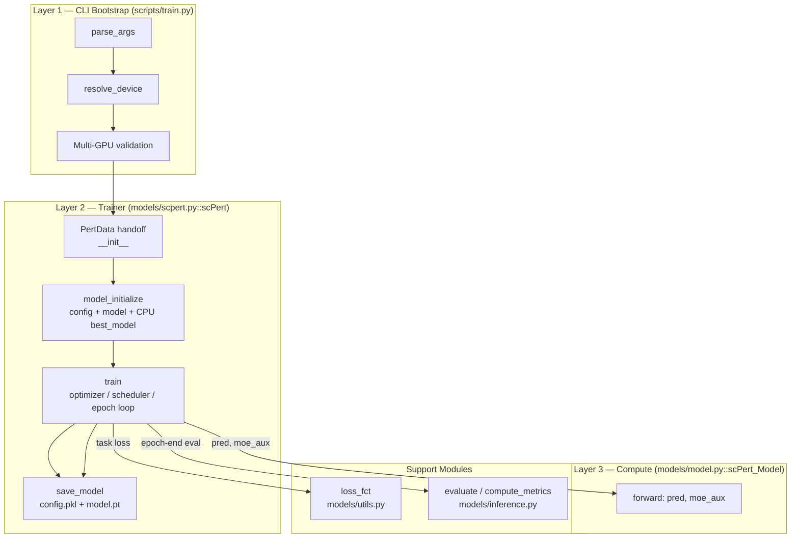
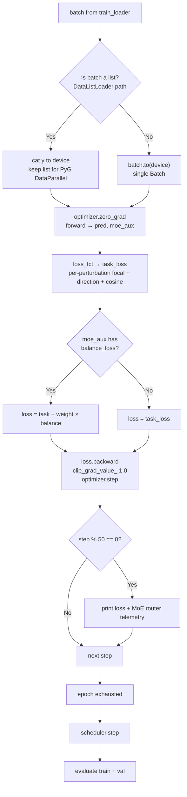
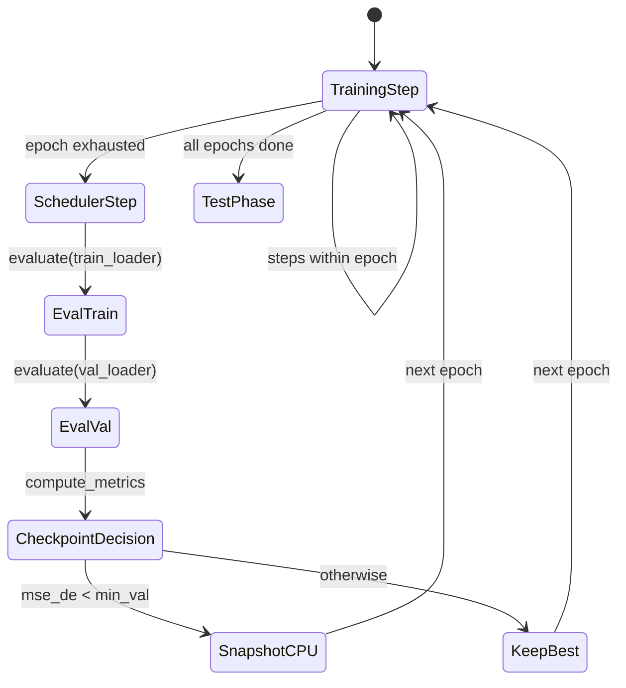

This page dissects how a DyMoE-Pert training run is wired end-to-end: the CLI bootstrap in `scripts/train.py`, the `scPert` trainer class that owns the epoch lifecycle, and the per-step mechanics that fuse task loss with MoE balance loss under a single-GPU or PyG-DataParallel regime. The focus is strictly on *orchestration* — who calls whom, in what order, and with what state. For the mathematical content of the loss terms themselves, see [Prediction Decoder and Loss](11-prediction-decoder-and-loss); for router internals, see [Soft Router and Balance Loss](8-soft-router-and-balance-loss).

## Orchestration Architecture: Three Layers of Control

The training system follows a deliberate three-layer separation: a **CLI bootstrap layer** that validates configuration and resolves hardware, a **trainer layer** (`scPert`) that owns all mutable training state (optimizer, scheduler, best-model snapshot), and a **compute layer** (`scPert_Model`) that remains a pure forward-pass graph emitting predictions plus an auxiliary MoE statistics dictionary. The trainer layer is the single source of truth — the model itself never adjusts its own learning rate, checkpoint state, or parallelism. This layering means the same `scPert.train()` method serves both interactive Python sessions and the CLI, and it is why `save_model` can serialize a consistent `(config.pkl, model.pt)` pair regardless of how the run was launched.

Note the direction of data flow in the diagram: the compute layer pushes `(pred, moe_aux)` upward, but all control signals (gradient clipping, LR stepping, best-model decisions) originate from the trainer. Supporting modules are stateless function libraries invoked *by* the trainer, never the reverse.

Sources: [train.py](/scripts/train.py#L70-L158), [scpert.py](/models/scpert.py#L162-L248), [scpert.py](/models/scpert.py#L533-L744)

## Bootstrap Phase: Configuration and Device Resolution

Execution begins in `main()`, which first normalizes the MoE configuration before any hardware decisions are made. Two CLI constraints are enforced eagerly: `--moe-router-mode fixed_uniform` or `--moe-ablation-mode base_only` forces `moe_balance_weight` to `0.0`, because both configurations make the balance term structurally meaningless. Device resolution then proceeds through `resolve_device`, which maps `auto` to `cuda:0` when CUDA is available and `cpu` otherwise; requesting a CUDA device that does not exist raises immediately rather than silently falling back. Multi-GPU requests are validated *before* data loading — the code requires `torch.cuda.is_available()`, at least two IDs in `--device-ids`, all IDs within range, and `--device` pinned to the first ID — so a misconfigured run fails in milliseconds instead of after dataset preprocessing. Finally, `PYTORCH_CUDA_ALLOC_CONF=expandable_segments:True` is set at module import time (before `torch` is imported) to reduce fragmentation on long training runs.

| Parameter | Default | Orchestration Role |
|---|---|---|
| `--epochs` | 25 | Total epoch count passed to `scPert.train()` |
| `--lr` | 0.001 | Base learning rate for AdamW |
| `--batch-size` / `--test-batch-size` | 64 / inherits train | Train vs. evaluation loader sizes |
| `--multi-gpu` / `--device-ids` | off / `0,1,2,3` | Triggers PyG DataParallel + DataListLoader path |
| `--moe-balance-weight` | 0.0 | Weight of router balance loss; zeroed for fixed-uniform/base-only |
| `--moe-ablation-mode` | `full` | Structural ablation; `base_only` also zeroes balance weight |
| `--seed` | 77 | Passed to `prepare_split`, controls perturbation split |

Sources: [train.py](/scripts/train.py#L28-L67), [train.py](/scripts/train.py#L70-L106), [train.py](/scripts/train.py#L8-L9)

## Trainer Construction: Data Handoff and Model Initialization

The CLI then performs a strict sequence: `PertData` loads the GEARS-format dataset, `prepare_split` applies the perturbation split, and `get_dataloader` materializes train/val/test loaders — with `use_data_list_loader=args.multi_gpu` switching the train loader to PyG's `DataListLoader` when parallelism is requested. The `scPert` constructor receives the loaded `pert_data` object and extracts everything the training loop will need at loss and evaluation time: precomputed **control expression** (`ctrl_expression`, the mean of control cells moved to device), the per-perturbation **non-zero gene filter** (`dict_filter`), gene/pert index maps, and the dataset identity (`split`, `seed`) that later gates subgroup analysis. This eager extraction means the training loop never touches `adata` for loss computation — it operates on tensors already resident on the target device.

`model_initialize` is deliberately separated from the constructor so the same trainer can be re-configured (e.g., `load_pretrained` calls it after parsing a saved config). It validates the MoE mode strings again defensively, freezes the full configuration into `self.config` (including `embedding_size=512`), instantiates `scPert_Model` onto the device, and — critically — creates `self.best_model` as a **CPU deepcopy** of the freshly initialized model. This snapshot slot is reused by the training loop's checkpoint rule and by `save_model`, guaranteeing that serialized weights never carry parallel-wrapper prefixes.

Sources: [train.py](/scripts/train.py#L108-L132), [scpert.py](/models/scpert.py#L217-L248), [scpert.py](/models/scpert.py#L271-L355)

## Training Setup: Optimizer, Scheduler, and Parallel Wrapping

The `train()` method begins by fetching the train/val loaders and deciding the parallelism mode in one expression: parallelism requires *both* `use_parallel=True` and at least two device IDs — a single-GPU `device_ids=[0]` request deliberately degrades to the plain path rather than wrapping in DataParallel. When parallel, the model is wrapped in `torch_geometric.nn.DataParallel` with `output_device` pinned to the first ID; this wrapper is what makes the DataListLoader batch format (a Python list of `Data` objects) valid. Two state objects are then created in fixed order: a CPU `best_model` deepcopy of the wrapped model's *unwrapped* parameters, and the trainable-parameter list filtered by `requires_grad` — which also serves as a guard rail, raising `RuntimeError` if the model exposes no gradients.

The optimizer is AdamW with the CLI-provided `lr` and a fixed `weight_decay=1e-5`. The scheduler is `OneCycleLR` constructed with `max_lr=0.01` and `steps_per_epoch=len(train_loader)`, and it is stepped **once per epoch** (line 633), not per batch — an important deviation from OneCycle's typical per-step contract. Gradient updates are bounded by `nn.utils.clip_grad_value_` at `clip_value=1.0`, applied to the pre-collected `trainable_parameters` list rather than re-scanning `model.parameters()` each step.

> [!TIP]
> `OneCycleLR` is constructed with a hard-coded `max_lr=0.01` while the CLI `--lr` only sets AdamW's initial learning rate. Because the scheduler is stepped per *epoch* rather than per batch, the effective LR trajectory decouples from both values' textbook behavior — when reproducing or tuning runs, treat `--lr` and the scheduler's 0.01 peak as two independent knobs.

Sources: [scpert.py](/models/scpert.py#L556-L578), [scpert.py](/models/scpert.py#L611-L612), [scpert.py](/models/scpert.py#L633)

## The Epoch Loop: Step Anatomy

Each epoch executes a fixed five-stage step pattern, visualized below. Stage ordering is invariant: batch preparation happens *before* `zero_grad` so that device transfers never overlap with gradient state; the forward pass returns a `(pred, moe_aux)` tuple that `_split_model_output` normalizes into a 2-tuple even when MoE telemetry is disabled; and the composite loss is formed by adding `balance_weight × balance_loss` to the task loss only when the model actually emitted a balance term.

The task loss itself is computed by `loss_fct`, which loops over the *set of perturbations in the batch* and accumulates four components per perturbation — focal MSE (scaled by a sigmoid of `|target − ctrl|`), optionally class-weighted MSE over `key_genes`, a direction loss penalizing sign disagreement with control, and cosine similarity loss — plus an optional L1 penalty over model parameters, finally normalizing by the number of distinct perturbations. The training loop supplies the precomputed `ctrl_expression` and `dict_filter` from constructor state, so the loss function requires no data access beyond the batch. The L1 term iterates `model.parameters()` via a generator passed by the loop — under DataParallel this traverses the replicated wrapper, which is acceptable since replicas share parameter storage with the primary module.

Sources: [scpert.py](/models/scpert.py#L597-L633), [utils.py](/models/utils.py#L343-L421), [scpert.py](/models/scpert.py#L62-L77)

## Batch Preparation: Single GPU vs Multi-GPU

The loop-level branching for batch handling is concentrated in one helper, `_prepare_train_batch`, keeping the epoch loop itself agnostic to parallelism. The two paths differ in both *data format* and *device strategy*, summarized below:

| Aspect | Single GPU Path | Multi-GPU Path (PyG DataParallel) |
|---|---|---|
| Loader type | PyG `DataLoader` (scatters into `Batch`) | `DataListLoader` (`use_data_list_loader=True`) |
| Batch object | `torch_geometric.data.Batch` | `list[Data]`, one per replica |
| Device transfer | `pyg_batch.to(device)` after `Batch.from_data_list` | Labels only (`torch.cat([data.y ...]).to(device)`); PyG DataParallel scatters graphs internally |
| Forward input | Batch | Raw list — wrapper distributes |
| Same helper used by `evaluate` | Yes (`_prepare_batch` in inference.py) | Yes |

The asymmetry in device transfer is the subtle part: on the multi-GPU path, graph data is *never* manually moved — PyG's DataParallel handles scattering to each replica — while targets `y` are concatenated and moved to the primary device once, so the loss can be computed on gathered outputs. Perturbation labels ride along as plain Python strings (one per `Data`), avoiding tensor scatter entirely. This is why the model output path `_split_model_output` and the loss path can both assume device-consistent tensors regardless of replica count.

Sources: [scpert.py](/models/scpert.py#L45-L55), [inference.py](/models/inference.py#L22-L41), [scpert.py](/models/scpert.py#L561-L571)

## Mid-Epoch Logging and MoE Telemetry

Every 50 steps, the loop prints total loss and — when a balance term is active — the decomposition into task loss and the weighted balance contribution. Immediately after, `_format_moe_stats` converts the raw `moe_aux` dictionary into a one-line telemetry string. This is the training loop's principal observability surface: it reports the active ablation mode (decoded from a tensor-safe integer lookup), the router mode (`dynamic` vs `fixed_uniform`), the active expert mask, per-expert **applied vs raw** router weight averages, min/max weight ranges, and the router weight entropy. All tensor values are explicitly detached and moved to CPU inside the formatter, so logging never retains graph references across steps — a quiet but deliberate memory-hygiene choice in a loop that runs thousands of iterations. When `--no-moe-router-stats` is passed, `moe_aux` arrives as `None` and both the balance-loss branch and telemetry branch are skipped, reducing the loop to a conventional PyTorch step.

Sources: [scpert.py](/models/scpert.py#L615-L631), [scpert.py](/models/scpert.py#L112-L159), [train.py](/scripts/train.py#L52-L53)

## Epoch End: Evaluation and Best-Model Selection

After the final `optimizer.step()` of an epoch, the scheduler steps once, and both train and validation loaders are passed through `evaluate` — a `torch.no_grad` inference sweep that collects predictions, ground truth, and per-sample DE-gene slices, then delegates to `compute_metrics` for per-perturbation MSE and Pearson correlation. The loop prints four headline numbers (overall and Top-20-DE MSE for both splits) and optionally logs MSE and Pearson (all-gene and DE variants) to W&B when tracking is enabled. The checkpoint rule is a strict improvement test on a single metric: **validation Top-20 DE MSE** (`val_metrics['mse_de']`). When it beats the running minimum, the *unwrapped* model is deep-copied to CPU, replacing the previous best snapshot. There is no early stopping — the loop always runs the full `--epochs` budget — so the best-model mechanism, not the loop terminator, is what protects against late-epoch overfitting.

Sources: [scpert.py](/models/scpert.py#L633-L663), [inference.py](/models/inference.py#L42-L87), [inference.py](/models/inference.py#L89-L120)

## Post-Training: Testing, Analysis, and Checkpointing

Once the epoch budget is exhausted, `self.best_model` is promoted from the snapshot and the test phase begins — *only if* a `test_loader` exists; otherwise the method returns early with an explicit notice. The test path re-applies the parallel pattern: the best (unwrapped, CPU-resident) model is moved to device and, when training ran parallel, re-wrapped in a fresh PyG DataParallel for the inference sweep. After `evaluate` and `compute_metrics`, the code runs two deeper passes — `deeper_analysis` and `non_dropout_analysis` — and, when `self.split == 'simulation'`, performs per-subgroup aggregation over the test subgroups defined by the split, logging each subgroup metric to W&B and stdout. Control finally returns to the CLI, where `save_model` writes `config.pkl` and `model.pt`; the state dict is taken from `_unwrap_parallel_model(self.best_model)`, so checkpoint files are always loadable by `load_pretrained` without prefix surgery (though `load_pretrained` retains a defensive `module.` strip for legacy checkpoints).

> [!TIP]
> The best-model snapshot lives on CPU for the entire training run — every improvement triggers a deepcopy off-device. This costs memory but buys two guarantees: checkpoint saving never interferes with the training device, and the test phase starts from a known-clean, prefix-free state rather than a live replica of a parallel wrapper.

Sources: [scpert.py](/models/scpert.py#L665-L744), [scpert.py](/models/scpert.py#L399-L422), [scpert.py](/models/scpert.py#L357-L397)

## Where to Go Next

The orchestration described here is the skeleton; the pages below fill in the organs. For the exact CLI invocations that trigger this loop, see [Training and Prediction Commands](4-training-and-prediction-commands). To understand what `moe_aux` carries and why balance loss exists, read [Soft Router and Balance Loss](8-soft-router-and-balance-loss) and [Ablation Modes Framework](9-ablation-modes-framework); the composition of `loss_fct`'s four terms is detailed in [Prediction Decoder and Loss](11-prediction-decoder-and-loss). The `evaluate`/`compute_metrics` contract and subgroup analysis reporting are expanded in [Metrics and DE Gene Analysis](18-metrics-and-de-gene-analysis), the DataListLoader mechanics in [Multi-GPU Parallel Training](16-multi-gpu-parallel-training), and how the `simulation` split populates `test_subgroup` in [Perturbation Splits and Simulation Split](14-perturbation-splits-and-simulation-split). For a consolidated table of every parameter mentioned above, consult [Configuration Reference](19-configuration-reference).