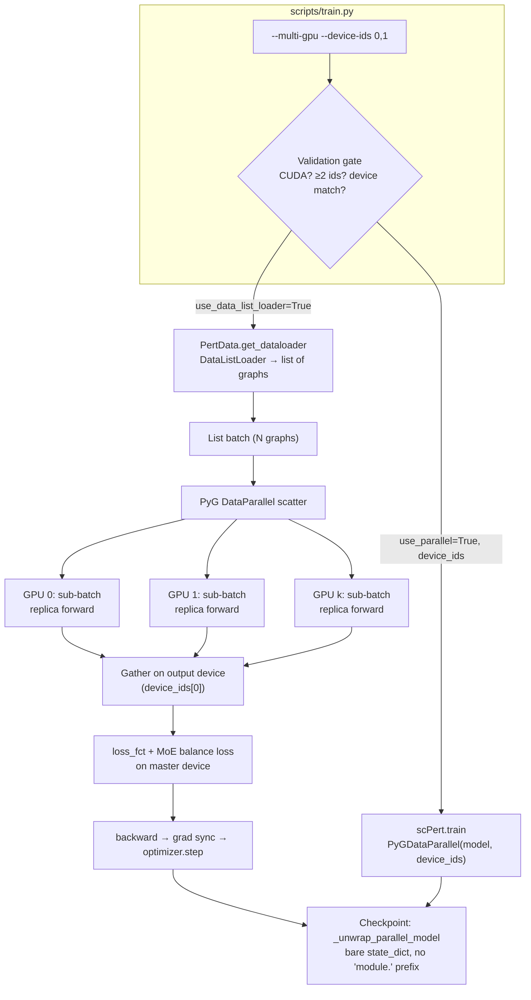

This page explains how DyMoE-Pert scales training across multiple GPUs. The implementation is built on **PyTorch Geometric (PyG) DataParallel** combined with PyG's **DataListLoader**, using a single-process data-parallel strategy rather than Distributed Data Parallel (DDP). You will learn how the CLI flags activate parallel mode, how batches change shape as they move through the data, model, and loss layers, and how checkpointing stays consistent whether you train on one GPU or many. This page assumes familiarity with the training loop described in [Training Loop Orchestration](15-training-loop-orchestration).

Sources: [scpert.py](models/scpert.py#L13-L16), [train.py](scripts/train.py#L36-L37)

## Why PyG DataParallel, Not Plain DataParallel or DDP

Every training sample in DyMoE-Pert is a **variable-size cell graph** (a `torch_geometric.data.Data` object), not a fixed-shape tensor. Standard `torch.nn.DataParallel` cannot scatter lists of graphs, and DDP adds multi-process complexity (rank management, process-group initialization) that is unnecessary for the moderate graph sizes here. The codebase therefore imports `torch_geometric.nn.DataParallel` — with a graceful fallback if the import fails — because PyG's wrapper knows how to scatter a *list* of graphs across replicas and gather their outputs back.

```python
try:
    from torch_geometric.nn import DataParallel as PyGDataParallel
except ImportError:
    PyGDataParallel = None
```

Sources: [scpert.py](models/scpert.py#L13-L16)

## Enabling Multi-GPU: CLI Flags and Validation

Multi-GPU mode is off by default and activated with a single flag. The training entry point defines two related arguments: `--multi-gpu` (store-true, described as "Use PyG DataParallel with DataListLoader") and `--device-ids`, which defaults to `"0,1,2,3"` and accepts either a comma-separated list of GPU indices or the special values `auto`/`all` to select every visible CUDA device.

| Flag | Default | Behavior |
|------|---------|----------|
| `--multi-gpu` | off (flag) | Enables PyG DataParallel + DataListLoader |
| `--device-ids` | `"0,1,2,3"` | GPU ids, e.g. `0,1`; `auto`/`all` uses all visible GPUs |
| `--device` | `auto` | Must match the **first** entry of `--device-ids` |
| `--batch-size` | `64` | Full-batch size, split across GPUs by DataParallel |

Sources: [train.py](scripts/train.py#L36-L38), [train.py](scripts/train.py#L65-L68)

Before any GPU work starts, `main()` runs a strict validation gate. It verifies that CUDA is available, requires **at least two** device ids (a single id falls back to the normal single-GPU path), checks every id against `torch.cuda.device_count()`, and enforces that `--device` equals `cuda:{device_ids[0]}` — because the first id becomes the master/output device. On success, the process calls `torch.cuda.set_device` and `torch.cuda.empty_cache()`, and the file pre-sets `PYTORCH_CUDA_ALLOC_CONF=expandable_segments:True` at import time to reduce fragmentation under multi-replica memory pressure.

Sources: [train.py](scripts/train.py#L79-L99), [train.py](scripts/train.py#L5)

## Architecture of the Parallel Stack

The parallel mechanism spans three layers that must stay mutually consistent: the **data layer** decides whether batches are merged `Batch` objects or raw lists; the **model layer** decides whether the model is a bare `scPert_Model` or a PyG-parallel wrapper; and the **checkpoint layer** always unwraps to the bare model before saving or deep-copying. Helper predicates (`_is_pyg_parallel`, `_is_parallel_model`, `_unwrap_parallel_model`) keep these decisions centralized.



Sources: [scpert.py](models/scpert.py#L32-L41), [train.py](scripts/train.py#L79-L126)

## Data Layer: DataListLoader vs DataLoader

The switch happens inside `PertData.get_dataloader` through one line: `Loader = DataListLoader if use_data_list_loader else DataLoader`. When `train.py` passes `use_data_list_loader=args.multi_gpu`, all three loaders (train/val/test) switch types together, so training and evaluation always see the same batch representation. The train loader additionally uses `shuffle=True, drop_last=True` — dropping the ragged final batch guarantees every step sees a full batch, which keeps per-replica sub-batch sizes balanced across the `len(device_ids)` splits.

| Aspect | Single GPU (`DataLoader`) | Multi-GPU (`DataListLoader`) |
|--------|---------------------------|------------------------------|
| Batch type | Merged `torch_geometric.data.Batch` | Python `list` of `Data` graphs |
| Graph merging | `Batch.from_data_list` (done manually) | Deferred to DataParallel's scatter |
| Train shuffling / drop_last | `True` / `True` | `True` / `True` (identical) |
| Per-GPU graphs per step | N/A | `batch_size / num_gpus` (approximately) |

Sources: [ProcePertdata.py](models/ProcePertdata.py#L419-L438), [ProcePertdata.py](models/ProcePertdata.py#L473-L480)

## One Training Step Under Parallelism

Each step flows through `_prepare_train_batch`, which is the junction point between the two batch worlds. If the batch is a **list** (parallel mode) it concatenates labels `y` onto the master device, collects `perts`, and — when the model is PyG-parallel — hands the raw list directly to the model so DataParallel performs the scatter. If the model is *not* parallel but the batch is a list, it defensively merges into a `Batch` first, so a saved parallel pipeline still runs on one GPU. The sequence below traces the parallel path for one optimizer step.

```mermaid
sequenceDiagram
    participant L as DataListLoader
    participant P as _prepare_train_batch
    participant M as PyGDataParallel (master GPU 0)
    participant R as Replicas (GPU 0..k)
    participant O as Optimizer (AdamW + OneCycleLR)

    L->>P: list of N cell graphs
    P->>P: y = cat(labels).to(cuda:0); perts = [data.pert]
    P->>M: pass list unmodified (is_pyg_parallel → True)
    M->>R: scatter graphs, replicate module
    R->>R: forward → (pred_i, moe_aux_i)
    R->>M: gather pred (concat on cuda:0), gather aux dict
    M->>O: pred, moe_aux returned to training loop
    O->>O: loss_fct(pred, y, perts) + balance_weight * balance_loss
    O->>O: loss.backward() → grads reduced to master module
    O->>O: clip_grad_value_(1.0); optimizer.step(); scheduler.step()
```

Sources: [scpert.py](models/scpert.py#L44-L56), [scpert.py](models/scpert.py#L597-L612)

> [!TIP]
> The `_prepare_train_batch` dual-path design means a checkpoint trained with `--multi-gpu` can be retrained or fine-tuned in single-GPU mode without any code change — the batch adapter detects the model type at runtime, not from saved configuration.

## Loss Computation and MoE Balance Loss Aggregation

Two loss terms are computed per step, both parallel-aware. The **task loss** (`loss_fct`) receives `pred` gathered on the master device plus the original `perts` list and full-batch labels `y`, and also receives `model_params` as a generator over `self.model.parameters()` — since DataParallel shares parameter objects with its replicas, this transparently covers the underlying model regardless of wrapping. The **MoE balance loss** is handled by `_moe_balance_loss`, which reads `moe_balance_weight` from the *unwrapped* model (weights are attributes of the bare module, not the wrapper) and calls `.mean()` on the gathered balance tensor — necessary because PyG's gather concatenates per-replica auxiliary values into one tensor spanning all replicas.

Sources: [scpert.py](models/scpert.py#L64-L77), [scpert.py](models/scpert.py#L604-L609)

The MoE router statistics logging follows the same defensive pattern: `_format_moe_stats` reshapes gathered router weights with `reshape(-1, last_dim)` before averaging, so the logged `applied_alpha_*` / `raw_alpha_*` values are correct whether one or four replicas contributed to the batch. Note that when `--moe-router-mode fixed_uniform` or `--moe-ablation-mode base_only` is set, `main()` forces `moe_balance_weight = 0.0`, disabling the auxiliary loss entirely in both modes.

Sources: [scpert.py](models/scpert.py#L112-L169), [train.py](scripts/train.py#L73-L75)

## Gradient Semantics and Effective Batch Size

Under PyG DataParallel, each optimizer step processes the **full** `--batch-size` worth of graphs: DataListLoader produces N-graph batches, the scatter divides them across `len(device_ids)` replicas, replica gradients are summed back onto the master module during `backward()`, and `AdamW` updates once. Consequently `steps_per_epoch=len(train_loader)` (used by `OneCycleLR`) is identical in single- and multi-GPU mode for the same batch size — the schedule does not shift when you add GPUs. Gradient clipping via `nn.utils.clip_grad_value_(trainable_parameters, 1.0)` is likewise applied to the unified master parameters after gradient reduction, so optimization dynamics match the single-GPU run modulo floating-point summation order.

Sources: [scpert.py](models/scpert.py#L574-L578), [scpert.py](models/scpert.py#L610-L612)

> [!TIP]
> Because DataParallel replicates the module every forward pass, multi-GPU speedups diminish for small models (default `hidden_size=64`). The feature pays off most on large datasets like `replogle_k562_essential`, where per-step wall time is dominated by the graph-parallel GNN forward rather than replication overhead.

## Checkpointing and `module.` Prefix Hygiene

The most common source of bugs in data-parallel training is saving the *wrapper's* state dict, whose keys carry a `module.` prefix. DyMoE-Pert eliminates this at three points: **best-model tracking** deep-copies the unwrapped model to CPU (`deepcopy(_unwrap_parallel_model(self.model)).cpu()`) whenever validation `mse_de` improves; **`save_model`** serializes `_unwrap_parallel_model(self.best_model).state_dict()`; and **`load_pretrained`** additionally strips a legacy `module.` prefix from old checkpoints (`k[7:]` for keys starting with `'module.'`) for backward compatibility with earlier data-parallel runs. The result: every saved `model.pt` is directly loadable into a bare `scPert_Model`.

Sources: [scpert.py](models/scpert.py#L660-L666), [scpert.py](models/scpert.py#L399-L422), [scpert.py](models/scpert.py#L385-L395)

## Evaluation and Test Phase Under Parallelism

Per-epoch evaluation reuses the wrapped parallel model as-is: `evaluate(train_loader, self.model, self.device)` is called with the PyG-parallel wrapper intact, and `inference.py` mirrors the training-side batch adapter in `_prepare_batch` — list batches are passed through when the model is PyG-parallel, otherwise merged into a `Batch` — with the extra responsibility of slicing per-cell `de_idx` differentially-expressed gene subsets from the gathered predictions. The `evaluate` function also skips a redundant `.to(device)` when it detects either `nn.DataParallel` or the PyG wrapper, avoiding accidental re-hosting of the distributed module.

Sources: [inference.py](models/inference.py#L18-L34), [inference.py](models/inference.py#L42-L51), [scpert.py](models/scpert.py#L635-L638)

After training completes, the best model is **re-wrapped** in a fresh `PyGDataParallel` for the final test evaluation, then immediately unwrapped before the results are returned (`self.best_model = _unwrap_parallel_model(test_model)`), so the object stored on `scPert` for downstream use by `predict()` and `GI_predict()` is always the bare model on `self.device`.

Sources: [scpert.py](models/scpert.py#L671-L682)

## Configuration Summary and Troubleshooting

The table below consolidates every validation guard and runtime failure mode specific to multi-GPU training, with the exact error the code raises.

| Condition | Raised error / behavior | Fix |
|-----------|------------------------|-----|
| No CUDA devices | `RuntimeError: --multi-gpu was requested but torch.cuda.is_available() is False` | Use `--device cpu` (multi-GPU unsupported on CPU) |
| Fewer than 2 ids | `ValueError: --multi-gpu needs at least two GPU ids` | Pass ≥2 ids, or drop `--multi-gpu` |
| Out-of-range ids | `ValueError: Invalid GPU ids [...]` | Check `torch.cuda.device_count()` |
| `--device` ≠ first id | `ValueError: --device must match the first --device-ids entry` | Set `--device cuda:0` for ids `0,1` |
| PyG wrapper unavailable | `RuntimeError: torch_geometric.nn.DataParallel is unavailable` | Upgrade/repair `torch_geometric` install |
| `no trainable parameters` | `RuntimeError: No trainable parameters available for optimizer.` | Verify model init completed |

Sources: [train.py](scripts/train.py#L79-L93), [scpert.py](models/scpert.py#L563-L566), [scpert.py](models/scpert.py#L574-L576)

Two practical notes complete the operational picture. First, `--test-batch-size` defaults to `--batch-size`; since evaluation gathers predictions to one device, a very large test batch can pressure master-GPU memory even though compute is distributed. Second, the printed training config at startup always reports `multi_gpu=... device_ids=...`, so you can confirm the parallel configuration before the (potentially long) dataset load begins.

Sources: [train.py](scripts/train.py#L101-L117)

## Where to Go Next

- To understand what the wrapped model actually computes per replica, start with [Architecture Overview](5-architecture-overview) and the fusion mechanics in [Residual Fusion Design](6-residual-fusion-design).
- For the loss terms summed in `loss_fct` under parallelism, see [Prediction Decoder and Loss](11-prediction-decoder-and-loss).
- To interpret the MoE balance-loss statistics logged during parallel training, see [Soft Router and Balance Loss](8-soft-router-and-balance-loss).
- For the full flag inventory including `--multi-gpu` and `--device-ids`, see [Training and Prediction Commands](4-training-and-prediction-commands) and [Configuration Reference](19-configuration-reference).