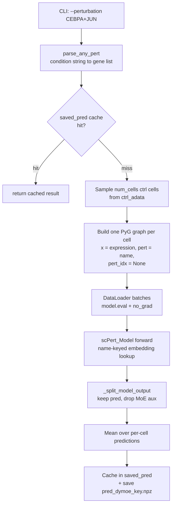
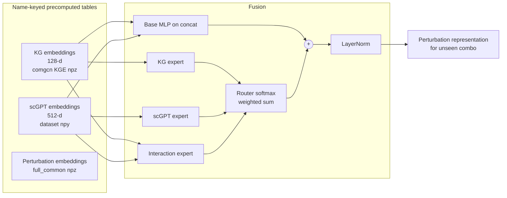

This page explains how DyMoE-Pert produces transcriptomic response predictions for perturbations that were **never observed during training** — a novel single gene, or a gene combination whose joint effect the model has no direct supervision for. The central design insight is that perturbation identity is carried by *gene names resolved against precomputed, name-keyed embedding tables*, not by learned row indices bound to the training perturbation set. This is what makes zero-shot generalization structurally possible. We cover the CLI entry point, the `predict()` pipeline, the embedding composition mechanism, checkpoint loading, interaction analysis, and batch evaluation on unseen splits.

Sources: [scripts/infer.py](scripts/infer.py#L1-L4), [models/model.py](models/model.py#L379-L386)

## What "Unseen" Means at Inference Time

An unseen perturbation is any condition string such as `CEBPA+ctrl` (a single perturbation) or `CEBPA+JUN` (a combination) that does not appear in the training split. The parsing utility `parse_any_pert` accepts *arbitrary* gene-name strings: single perturbations of the form `GENE+ctrl` reduce to `[GENE]`, while combinations reduce to `[GENE1, GENE2]`. Nothing in this path is restricted to genes or combinations seen during training — the condition is treated purely as data, not as a lookup into a fixed vocabulary. Similarly, when a prediction cell graph is constructed, the `pert_idx` field is explicitly set to `None` and the perturbation is attached as a name string (`pert=pert_gene`), meaning prediction inputs carry no dependency on the training-time perturbation index space.

Sources: [models/utils.py](models/utils.py#L34-L39), [models/utils.py](models/utils.py#L462-L472)

## Entry Point: `scripts/infer.py`

The dedicated inference script predicts one single-gene or double-gene perturbation from a trained checkpoint produced by `train.py`. After resolving the device and validating that the embedding file, `config.pkl`, and `model.pt` all exist, it loads the dataset with `data.prepare_split(split="no_test", seed=77)` — notably *without* a test split, since prediction here is user-directed rather than benchmark-driven. It then instantiates the `scPert` wrapper, restores the checkpoint via `load_pretrained`, and calls `model.predict([args.perturbation], num_samples=args.num_cells, batch_size=args.batch_size)`. The result is persisted as `pred_dymoe_{pert_key}.npz`, where `+` characters in the condition name are replaced with underscores.

| CLI Parameter | Default | Purpose |
|---|---|---|
| `--data-name` | `norman` | Dataset key; selects the matching scGPT embedding file |
| `--data-path` | `./data` | Location of GEARS-format data |
| `--embedding-dir` | `./embeddings` | Directory holding gene embedding `.npy` files |
| `--checkpoint` | *(required)* | Directory containing `config.pkl` and `model.pt` |
| `--perturbation` | *(required)* | Condition string, e.g. `CEBPA+ctrl` or `CEBPA+JUN` |
| `--device` | `auto` | `auto`, `cpu`, or `cuda:N` |
| `--num-cells` | `32` | Control cells sampled per perturbation |
| `--batch-size` | `8` | Cells per inference forward pass |

The `EMBEDDING_FILES` mapping hard-couples each dataset name to its 512-dimensional scGPT embedding file, guaranteeing the model is constructed with the same embedding table it was trained with.

Sources: [scripts/infer.py](scripts/infer.py#L16-L22), [scripts/infer.py](scripts/infer.py#L25-L37), [scripts/infer.py](scripts/infer.py#L47-L54), [scripts/infer.py](scripts/infer.py#L56-L72), [scripts/infer.py](scripts/infer.py#L73-L76)

## The `predict()` Pipeline

`scPert.predict(pert_list, num_samples, batch_size)` operates in five stages. First, the control population is isolated (`self.adata.obs['condition'] == 'ctrl'`) and the best model is moved to device and set to `eval()` mode. Second, each requested condition is normalized to a key (`+` → `_`) and checked against the in-memory `saved_pred` cache, so repeated queries for the same perturbation are free. Third, `create_cell_graph_dataset_for_prediction` samples `num_samples` random control cells and wraps each one in its own graph tagged with the target perturbation name. Fourth, graphs are streamed through a PyG `DataLoader` under `torch.no_grad()`, and the model output is split via `_split_model_output` — discarding the MoE auxiliary statistics (`router weights`, `balance loss`) that are only meaningful during training. Fifth, per-cell predictions are averaged into a single mean transcriptome, and both the mean and the full per-cell array (under an `all_{pert}` key) are cached and written to disk.

This per-cell sampling design matters: because control cells vary, the mean prediction is a Monte Carlo estimate over the control population rather than a single deterministic forward pass. A larger `--num-cells` therefore reduces sampling variance at linear cost.

Sources: [models/scpert.py](models/scpert.py#L424-L447), [models/scpert.py](models/scpert.py#L449-L452), [models/scpert.py](models/scpert.py#L456-L470), [models/scpert.py](models/scpert.py#L472-L485), [models/scpert.py](models/scpert.py#L487-L491), [models/inference.py](models/inference.py#L37-L40)

## Zero-Shot Embedding Composition

The mechanism that makes unseen perturbations addressable lives in `scPert_Model.__init__`. Instead of relying solely on `nn.Embedding` rows indexed by training-time perturbation IDs, the model registers two **precomputed, name-keyed lookup buffers**: KG gene embeddings from `gene_2_kge_comgcn_final_common.npz` (128-dimensional knowledge-graph embeddings) and perturbation embeddings from `gene_embeddingss_full_common.npz`, each accompanied by a `gene`-name → index dictionary built at load time. Because the dictionaries cover the perturbation gene space by name, a novel combination like `CEBPA+JUN` resolves through the same lookup path as a training perturbation — the model never needs to have "seen" the pair. The 512-dimensional scGPT gene embeddings (`gene_emb`) are loaded from the dataset-specific file supplied via `embedding_path`.

These two branches feed the fusion layer: with MoE fusion enabled, `ResidualMoEFusion` receives the KG and scGPT branches and blends a shared base MLP with three experts (KG, scGPT, interaction) through softmax router weights, producing `output_norm(h_base + expert_output)`; without MoE, the 128-dim KG and 512-dim scGPT vectors are simply concatenated into the 640-dimensional input expected by `pert_dense`. In both cases the fusion is *compositional over genes*, which is the property that transfers to unseen combinations.

> [!TIP]
> The critical enabler is the pair of facts verified in code: prediction graphs set `pert_idx=None` and carry only the perturbation *name* (models/utils.py#L462-L472), while the embedding tables are indexed by gene *name* dictionaries (models/model.py#L377-L386). Identity flows through strings end-to-end, so the index space learned during training never becomes a hard constraint at inference.

Sources: [models/model.py](models/model.py#L370-L390), [models/model.py](models/model.py#L408-L414), [models/model.py](models/model.py#L478-L490), [models/model.py](models/model.py#L285-L311)

## Loading Checkpoints Safely

`load_pretrained` reconstructs the exact training configuration before restoring weights. It reads `config.pkl`, strips keys that `model_initialize` does not accept or that must be re-derived from the freshly loaded data (`device`, `num_genes`, `num_perts`, `embedding_size`, `pert_names`, `pert_node_map`), and drops legacy uncertainty fields if present. The `model.pt` state dict is always loaded onto CPU first; if the checkpoint was saved from a DataParallel run, the `module.` prefix is removed from every key before `load_state_dict`. Finally the model is moved to the target device and aliased as `best_model`, which is the object `predict()` uses — meaning inference always runs against the best-validation checkpoint semantics, never the last-step weights.

Sources: [models/scpert.py](models/scpert.py#L357-L397), [models/scpert.py](models/scpert.py#L399-L422)

## From Prediction to Interaction Analysis: `GI_predict`

For combinatorial perturbations, `GI_predict(combo)` turns raw predictions into quantitative genetic-interaction parameters. It requests three conditions through the same unseen-perturbation pipeline: `G1+ctrl`, `G2+ctrl`, and `G1+G2` (reusing the `saved_pred` cache when available). Each predicted mean expression is control-centered by subtracting `get_mean_control`, optionally restricted to a curated set of high-expression GI genes, and then passed to `get_GI_params`, which fits a Theil–Sen regression of the double-perturbation response on the two single responses. The fitted coefficients yield epistasis-relevant quantities: interaction magnitudes (`mag`), dominance (`dominance`), equality of contribution (`eq_contr`), and distance correlations. In other words, the same zero-shot predictor that emits a transcriptome also composes into an interaction-score calculator for pairs the model never jointly observed.

Sources: [models/scpert.py](models/scpert.py#L494-L530), [models/utils.py](models/utils.py#L493-L526), [models/utils.py](models/utils.py#L528-L542), [models/utils.py](models/utils.py#L560-L565)

## Batch Evaluation on Unseen Splits

Where `predict()` serves targeted queries, `evaluate()` in `models/inference.py` scores the *test loader* — which, under the simulation split, contains held-out unseen combinations. It mirrors the prediction path's discipline: `model.eval()`, per-batch device transfer via `_prepare_batch` (which reassembles PyG batches from per-cell lists under parallel wrappers), and a `torch.no_grad()` forward. Alongside predictions and ground truth it captures `de_idx` per cell so differential-expression genes can be sliced out for focused metrics. `compute_metrics` then aggregates per-perturbation MSE and Pearson correlation — including the `_de` variants computed only on DE genes and only for non-control perturbations — over the mean of per-cell predictions, matching the aggregation used by `predict()`.

| Aspect | `predict()` | `evaluate()` |
|---|---|---|
| Input | Arbitrary condition strings | Pre-built test loader |
| Control cells | Randomly sampled at call time | Fixed test-set cells |
| Ground truth | Not required | Required for metrics |
| Output | Mean + per-cell predictions, npz artifact | `pert_cat` / `pred` / `truth` / DE slices |
| Typical split | Any (`no_test` in the CLI) | `simulation` with unseen-combination subgroups |

Subgroup analysis over unseen-combination categories is triggered automatically after training when `split == 'simulation'`, reporting per-subgroup test metrics — the split mechanics themselves are covered in [Perturbation Splits and Simulation Split](14-perturbation-splits-and-simulation-split), and the downstream DE-gene analysis in [Metrics and DE Gene Analysis](18-metrics-and-de-gene-analysis).

Sources: [models/inference.py](models/inference.py#L42-L87), [models/inference.py](models/inference.py#L89-L145), [models/inference.py](models/inference.py#L22-L34), [models/scpert.py](models/scpert.py#L697-L717)

## Practical Checklist

- **Always pass the same `--embedding-dir`** used at training time; `model.pt` assumes the scGPT table matches, and the KG/perturbation tables are loaded from fixed paths under `./embeddings` inside the model constructor.
- **Raise `--num-cells` for stable point estimates**; the mean prediction is a sample average over control cells, and `GI_predict` interactions inherit that variance.
- **Reuse `saved_pred` deliberately** — the cache keyed by condition string makes repeated singles/combo queries cheap, and `GI_predict` depends on it for its three-condition fetch.
- **Check the MoE stats before trusting a prediction** — `predict()` discards router auxiliaries, but the ablation mode and expert configuration embedded in `config.pkl` determine which branches contributed; see [Ablation Modes Framework](9-ablation-modes-framework) and [Configuration Reference](19-configuration-reference).

Sources: [scripts/infer.py](scripts/infer.py#L47-L54), [models/model.py](models/model.py#L371-L390), [models/scpert.py](models/scpert.py#L466-L470), [models/scpert.py](models/scpert.py#L511-L518)

## Where to Go Next

To understand how the test set is constructed so that specific combinations are guaranteed unseen, read [Perturbation Splits and Simulation Split](14-perturbation-splits-and-simulation-split). For the router and expert machinery referenced throughout this page, see [Residual Fusion Design](6-residual-fusion-design) and [Soft Router and Balance Loss](8-soft-router-and-balance-loss). To interpret evaluation numbers on unseen splits, continue to [Metrics and DE Gene Analysis](18-metrics-and-de-gene-analysis), and for runnable end-to-end commands, see [Training and Prediction Commands](4-training-and-prediction-commands).