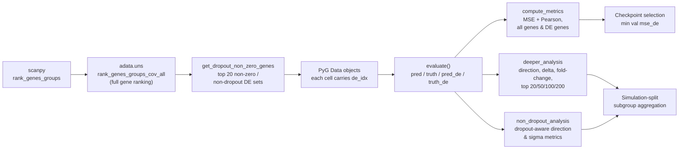

This page documents the evaluation system of DyMoE-Pert: how differentially expressed (DE) genes are computed and stored, how predictions are collected into comparable result structures, and how the layered metric suites — standard per-perturbation scores, deeper DE analyses, non-dropout / non-zero analyses, and simulation-split subgroup breakdowns — are orchestrated inside `scPert.train()`. If [Training Loop Orchestration](15-training-loop-orchestration) covers how the model learns, this page covers how the repository decides whether the learning was *biologically meaningful*: performance is measured primarily on the top-ranked DE genes for each perturbation, not on all genes uniformly.

## The Evaluation Architecture at a Glance

The metrics system follows a three-stage design that cleanly separates *data provenance*, *result collection*, and *metric computation*. DE gene identities are computed once during dataset processing and persisted inside the AnnData object; the evaluator harvests prediction slices per cell at batch time; and metric functions operate purely on those cached arrays. Understanding this flow first makes every subsequent function self-explanatory:



**Prerequisite note**: the diagram introduces one vocabulary item you will see everywhere — `adata.uns` is scanpy's "unstructured annotations" slot, and DyMoE-Pert uses it as the canonical registry for DE gene sets keyed by full condition names like `cell_type_pert_1+1`. Every metric function in `models/inference.py` re-derives gene indices by looking conditions up in this registry, so the registry must exist before evaluation runs.

The pipeline begins in the data layer, where `new_data_process` invokes `get_DE_genes` and then `get_dropout_non_zero_genes` before persisting `perturb_processed.h5ad`. This means the DE gene sets used at evaluation time are frozen into the dataset artifact itself, guaranteeing that train/val/test evaluation uses identical gene definitions.

Sources: [data_utils.py](models/data_utils.py#L15-L70), [ProcePertdata.py](models/ProcePertdata.py#L217-L266), [inference.py](models/inference.py#L42-L87)

## Stage 1: Computing and Registering DE Genes

DE gene identification lives in `models/data_utils.py` and is a two-pass process. The first pass, `rank_genes_groups_by_cov`, wraps scanpy's `sc.tl.rank_genes_groups` and runs it **per cell-type covariate**: for each `cell_type` category it subsets the AnnData, compares each perturbed condition against its matched control (`_'.join([cov_cat, 'ctrl'])`), and ranks genes by *absolute* score (`rankby_abs=True`) so that both up- and down-regulated genes compete on equal footing. The full ranking — not just the top slice — is written back into `adata.uns[key_added]` with `n_genes=len(adata.var)`, which later allows any cutoff depth (20/50/100/200) to be derived from the same registry.

The public entry point `get_DE_genes` prepares the grouping columns (`dose_val`, `control`, `condition_name`) and then calls this ranking with `key_added='rank_genes_groups_cov_all'`. The `skip_calc_de` flag bypasses recomputation when the h5ad already carries the annotation — a meaningful saving since ranking all genes for every condition is the most expensive step of preprocessing.

| Function | Role | Output location |
|---|---|---|
| `rank_genes_groups_by_cov` | Per-cell-type DE ranking vs matched control | `adata.uns['rank_genes_groups_cov_all']` |
| `get_DE_genes` | Column prep + full-gene ranking entry point | same, via `key_added` |
| `get_dropout_non_zero_genes` | Filters DE ranking through expression masks | `adata.uns['top_non_zero_de_20']`, `top_non_dropout_de_20`, `non_zeros_gene_idx`, `non_dropout_gene_idx` |

Sources: [data_utils.py](models/data_utils.py#L15-L70)

The second pass, `get_dropout_non_zero_genes`, addresses a scRNA-seq-specific pitfall: **dropout**. A gene observed as zero under perturbation may be a biological zero or a sequencing dropout, and evaluating on a dropout-contaminated DE set corrupts metrics. The function partitions genes per perturbation into `non_zero` (nonzero mean expression under the perturbation), `true_zeros` (zero in *both* perturbed and control means), and their union `non_dropouts`. It then intersects the top-ranked DE list with these masks to emit two 20-gene subsets — `top_non_zero_de_20` and `top_non_dropout_de_20` — plus the full index sets, all stored in `adata.uns`.

> [!TIP]
> The distinction between "observed zero" and "true zero" (zero in both perturbed *and* control means) is what makes `non_dropout_analysis` trustworthy: genes that are zero in the control cannot show a spurious direction change, so direction-accuracy metrics on the non-dropout set measure biology rather than measurement noise. When interpreting `frac_correct_direction_non_dropout`, remember its denominator is the union set, not the top-20 slice.

Sources: [data_utils.py](models/data_utils.py#L72-L132)

Finally, these annotations travel with the training data. Each PyG `Data` object exposes `pert`, `y`, and `de_idx` — the per-cell DE gene index slice — which is how the evaluator knows which genes matter for a given cell without re-querying the AnnData at batch time.

Sources: [ProcePertdata.py](models/ProcePertdata.py#L198-L215), [inference.py](models/inference.py#L22-L34)

## Stage 2: Collecting Predictions with `evaluate`

`evaluate(loader, model, device)` is the single ingestion point for all downstream metrics. It runs the model in `torch.no_grad()` mode over a loader and accumulates four aligned arrays: `pred` and `truth` over all genes, and `pred_de` / `truth_de` containing only the DE slice for each cell — extracted at line 72–74 as `p[idx, de_genes]` using the per-item `de_idx`. The returned dictionary is the contract every metric function depends on:

| Key | Shape | Content |
|---|---|---|
| `pert_cat` | `(N,)` | Perturbation label per cell |
| `pred` / `truth` | `(N, G)` | Predicted / true expression, all genes |
| `pred_de` / `truth_de` | `(N, 20)` | Predicted / true expression, top-20 DE genes only |

Two implementation details matter for developers extending this path. First, `_prepare_batch` normalizes both single-GPU batches and `DataListLoader` lists (PyG `DataParallel` setups), so `evaluate` is multi-GPU-transparent; second, `_split_model_output` strips the MoE auxiliary dictionary from the model's tuple output so the evaluator always sees the pure prediction tensor regardless of ablation mode.

Sources: [inference.py](models/inference.py#L42-L87)

## Stage 3: The Metric Suites

### Standard metrics: `compute_metrics`

`compute_metrics(results)` produces the headline numbers. For each unique perturbation it computes the **mean prediction vs. mean truth** across that perturbation's cells — evaluating on population-level profiles, which is the convention inherited from GEARS-style evaluation — and calculates MSE and Pearson correlation twice: once on all genes, once on the top-20 DE slice. Pearson failures from constant vectors are coerced to `0` to keep aggregation robust. The `ctrl` perturbation is excluded from DE-metric aggregation (a control has no meaningful DE set) but still receives all-gene scores.

| Metric key | Scope | Aggregation |
|---|---|---|
| `mse`, `pearson` | All genes | Mean over perturbations |
| `mse_de`, `pearson_de` | Top-20 DE genes | Mean over non-control perturbations |
| `metrics_pert[pert][...]` | Per-perturbation | Returned separately for subgroup analysis |

Sources: [inference.py](models/inference.py#L89-L145)

### The comprehensive suite: `deeper_analysis`

`deeper_analysis(adata, test_res)` is the workhorse for paper-grade reporting, computing roughly forty per-perturbation statistics. Its gene-set resolution strategy is the defining feature: instead of a single DE slice, it materializes the top **20, 50, 100, and 200** genes from `rank_genes_groups_cov_all` simultaneously, then reports metrics at every depth. This exposes the *scaling behavior* of model quality — a model can look strong at 20 genes while degrading rapidly at 200, or vice versa.

Its metric families are:

| Family | Example keys | Interpretation |
|---|---|---|
| Direction accuracy | `frac_correct_direction_20/50/100/200`, `frac_correct_direction_all` | Fraction of genes where `sign(pred − ctrl) == sign(truth − ctrl)` |
| Coverage intervals | `frac_in_range`, `frac_in_range_45_55`, `frac_in_range_40_60`, `frac_in_range_25_75` | Fraction of predicted DE means falling inside truth quantile bands (calibrated uncertainty) |
| Sigma statistics | `mean_sigma`, `std_sigma`, `frac_sigma_below_1/2` | Distance of prediction from truth mean in units of truth std |
| Delta correlation | `pearson_delta`, `pearson_delta_de`, `pearson_delta_top20/50/100/200_de` | Correlation on *change from control*, isolating perturbation response from baseline |
| Fold-change gaps | `fold_change_gap_upreg_3`, `_upreg_10`, `_downreg_0.33`, `_downreg_0.1` | Mean absolute gap between predicted and true fold-change ratios in strong-FC regimes |
| HVG metrics | `pearson_top200_hvg`, `pearson_delta_top200_hvg` | Same scores on the 200 most-variable genes (dataset-wide, perturbation-agnostic) |

The delta variants deserve emphasis: by subtracting `ctrl` from both prediction and truth before correlating, they remove the dominant shared baseline and reward the model specifically for capturing the perturbation-induced shift — the quantity that actually matters for `sensitivity` claims. Fold-change gaps are guarded by expression floors (`pert_mean < 0.5` entries are zeroed out of the ratio) to avoid meaningless divisions near zero.

Sources: [inference.py](models/inference.py#L384-L649)

### Dropout-aware suites: `non_dropout_analysis` and `non_zero_analysis`

These two functions apply the same metric machinery but over the dropout-filtered gene sets registered earlier. `non_dropout_analysis` computes direction accuracy at **three scopes** per perturbation — top-20 non-dropout DE genes, all non-zero genes, and all non-dropout genes — giving a coarse-to-fine view of directional fidelity, then adds the familiar in-range/sigma/delta families on the 20-gene slice. `non_zero_analysis` is its non-zero-only counterpart using `top_non_zero_de_20`.

| Function | Gene registry used | Distinct value |
|---|---|---|
| `non_dropout_analysis` | `top_non_dropout_de_20`, `non_zeros_gene_idx`, `non_dropout_gene_idx` | Direction accuracy over *all* non-dropout genes, not just top-20 |
| `non_zero_analysis` | `top_non_zero_de_20` | Direction and delta metrics on expression-confirmed genes only |

Both functions reconstruct the per-condition control mean directly from `adata.X` rather than from the results dictionary, so they require the full AnnData to be in scope — a deliberate coupling that keeps the control reference consistent with training-time `ctrl_expression`.

Sources: [inference.py](models/inference.py#L148-L382)

## Stage 4: Orchestration in `scPert.train()`

The evaluation stack is wired into the training loop, not bolted on afterwards. At the end of **every epoch**, `train()` runs `evaluate` over both train and val loaders and reduces them via `compute_metrics`, logging Overall MSE and Top-20 DE MSE for both splits (and the full metric set to W&B when enabled). Then comes the decision that shapes the whole experiment:

```python
if val_metrics['mse_de'] < min_val:
    min_val = val_metrics['mse_de']
    best_model = deepcopy(_unwrap_parallel_model(self.model)).cpu()
```

**Model selection is driven by validation top-20 DE MSE — not overall MSE.** This is a deliberate design stance: a model can minimize genome-wide reconstruction error by reproducing the control baseline while missing the actual perturbation response on the genes that respond. Selecting on `mse_de` optimizes exactly the axis the DE registry defines as biologically important.

> [!TIP]
> When reproducing ablation results, be aware that early-stopping behavior differs between metrics: two models with near-identical overall MSE can have materially different `mse_de` trajectories, especially in the first few epochs as the MoE router converges. Comparing runs requires holding the selection metric (`mse_de`) fixed, not the overall MSE.

After training, if a `test_loader` exists, the best model is re-wrapped for parallel inference, evaluated once, and the terminal metrics are printed. The post-hoc layer then runs `deeper_analysis` and `non_dropout_analysis` on the test results, and the code highlights a compact reporting set — `pearson_delta` plus three non-dropout statistics (`frac_opposite_direction_top20_non_dropout`, `frac_sigma_below_1_non_dropout`, `mse_top20_de_non_dropout`) — which mirrors the standard reporting table used to compare against GEARS and scPert baselines.

Sources: [scpert.py](models/scpert.py#L620-L695)

### Subgroup breakdown for simulation splits

When the split is `simulation` (see [Perturbation Splits and Simulation Split](14-perturbation-splits-and-simulation-split)), the test perturbations belong to named subgroups (e.g., unseen-single, unseen-combo). The training loop aggregates both `test_pert_res` (from `compute_metrics`) and the deeper/non-dropout outputs **per subgroup**, averaging each metric across its member perturbations and printing/logging results as `test_{subgroup}_{metric}`. This is the mechanism behind the headline generalization claims of the model: it separates performance on truly unseen genetic interactions from performance on combinations merely unseen as pairs.

Sources: [scpert.py](models/scpert.py#L697-L744)

## Producing Artifacts for Custom Analysis

The prediction path complements the metric path. `scripts/infer.py` loads a checkpoint via `model.load_pretrained`, runs `model.predict([perturbation])` over replicated control cells, and saves the output as `pred_dymoe_{pert}.npz` containing both the per-cell predictions (`all_*` key) and the cell-mean prediction. These artifacts are designed for downstream users who want to apply the same `deeper_analysis` machinery to their own perturbation lists without rerunning training — pair the saved arrays with an AnnData carrying the DE registry and the full metric suite is available offline.

Sources: [infer.py](scripts/infer.py#L56-L76)

## Practical Recipe: Running the Full Evaluation Stack

The minimal end-to-end sequence, mirroring what `scPert.train()` performs internally:

```python
from models.inference import evaluate, compute_metrics, deeper_analysis, non_dropout_analysis

test_res = evaluate(test_loader, best_model, device)       # collect pred/truth/pred_de/truth_de
metrics, per_pert = compute_metrics(test_res)              # headline MSE/Pearson, all + DE
out_deep = deeper_analysis(data.adata, test_res)           # direction/delta/fold-change at 20–200
out_ndrop = non_dropout_analysis(data.adata, test_res)     # dropout-robust direction + sigma
```

Requirements for this to work unchanged: the AnnData must have been processed through `new_data_process` (so `rank_genes_groups_cov_all` and the non-dropout keys exist in `adata.uns`), and the loader must yield items exposing `de_idx`. If you bring a custom dataset, the DE registry is built automatically — see [GEARS-Format Data Pipeline](12-gears-format-data-pipeline) for the ingestion contract.

| Step | Function | Mandatory input |
|---|---|---|
| 1 | `evaluate` | loader, model, device; items carry `de_idx` |
| 2 | `compute_metrics` | results dict from step 1 |
| 3 | `deeper_analysis` | results dict + AnnData with `rank_genes_groups_cov_all` |
| 4 | `non_dropout_analysis` | results dict + AnnData with non-dropout `uns` keys |

Sources: [inference.py](models/inference.py#L42-L87), [ProcePertdata.py](models/ProcePertdata.py#L250-L252)

## Where to Go Next

For the inference-side counterpart of this machinery — how `predict` replicates control cells and how unseen perturbations are scored outside the training loop — continue to [Unseen Perturbation Inference](17-unseen-perturbation-inference). To understand how the loss function mirrors this evaluation philosophy (focal reweighting of DE genes during training), see [Prediction Decoder and Loss](11-prediction-decoder-and-loss). For every hyperparameter referenced by the subgroup analysis and wandb logging, consult [Configuration Reference](19-configuration-reference).