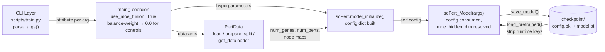
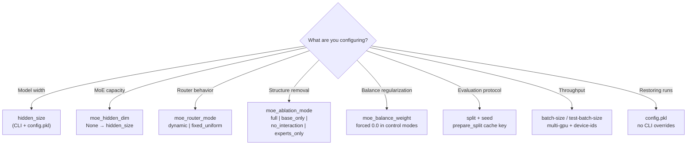

This page is the complete operational reference for every configurable knob in DyMoE-Pert: the command-line arguments of the two entry scripts, the `model_initialize` configuration dictionary that is persisted to checkpoints, the data-pipeline parameters that control dataset loading and splitting, and the set of deliberately hardcoded constants that shape the architecture. Configuration here is not a config file or YAML system — it is a layered chain of Python defaults, where CLI arguments override API defaults, and cross-layer validation rules silently coerce certain values before they ever reach the model. Understanding this precedence chain is the prerequisite for reproducing training runs and correctly restoring checkpoints.

Sources: [train.py](scripts/train.py#L21-L54), [scpert.py](models/scpert.py#L271-L354), [model.py](models/model.py#L349-L476)

## Configuration Architecture at a Glance

Configuration flows through four layers, each adding defaults, validation, or coercion. The CLI layer is the outermost; the `scPert_Model` constructor is the innermost consumer. Two properties of this chain matter in practice: first, the model configuration dictionary (`self.config`) is fully serialized with `pickle` into `config.pkl`, so inference never re-specifies model hyperparameters; second, several MoE-related values are coerced at multiple layers simultaneously, which means the *same* constraint appears in `scripts/train.py`, `models/scpert.py`, and `models/model.py` — defense in depth that guarantees an invalid combination cannot be constructed.



Sources: [train.py](scripts/train.py#L71-L76), [scpert.py](models/scpert.py#L327-L354), [model.py](models/model.py#L357-L368), [scpert.py](models/scpert.py#L399-L422)

## Training Script CLI Reference

`scripts/train.py` exposes the complete training configuration surface through `argparse`. The table below lists every argument, its default, and its downstream destination. Note the asymmetry between CLI defaults and API defaults documented later: the CLI tunes `--moe-balance-weight` to `0.0` while the API-level `model_initialize` defaults to `0.01`, and the CLI's `use_moe_fusion` is hardcoded to `True` at `main()` line 73 — there is no flag to disable MoE fusion through the script.

| Argument | Type | Default | Description / Destination |
|---|---|---|---|
| `--data-name` | choice | `norman` | One of the five `EMBEDDING_FILES` keys; selects dataset and default embedding file |
| `--data-path` | str | `./data` | Root directory for downloaded/processed datasets → `PertData` |
| `--embedding-dir` | str | `./embeddings` | Directory joined with the embedding filename |
| `--embedding-file` | str | `None` | Overrides the dataset-aligned embedding file from `EMBEDDING_FILES` |
| `--device` | str | `auto` | `auto`/`cpu`/`cuda`/`cuda:N`; resolved by `resolve_device()` |
| `--batch-size` | int | `64` | Train loader batch size |
| `--test-batch-size` | int | `None` | Falls back to `--batch-size` when unset |
| `--hidden-size` | int | `64` | Backbone hidden dimension; also MoE default when `--moe-hidden-dim` unset |
| `--epochs` | int | `25` | Passed to `scPert.train()` |
| `--lr` | float | `0.001` | Learning rate passed to `scPert.train()` |
| `--seed` | int | `77` | Passed to `prepare_split` |
| `--split` | str | `simulation` | Split strategy name → `prepare_split` |
| `--model-save-name` | str | `None` | Checkpoint directory; defaults to `{data_name}_model_FINAL` |
| `--multi-gpu` | flag | off | Enables PyG `DataParallel` with `DataListLoader` |
| `--device-ids` | str | `0,1,2,3` | Comma-separated GPU ids; `auto`/`all` selects all visible GPUs |
| `--moe-hidden-dim` | int | `None` | MoE fusion hidden dim; `None` resolves to `hidden_size` inside the model |
| `--moe-dropout` | float | `0.1` | Dropout inside MoE projectors, experts, router |
| `--moe-balance-weight` | float | `0.0` | Weight of router balance loss in total loss |
| `--moe-ablation-mode` | choice | `full` | `full`, `base_only`, `no_interaction`, `experts_only` |
| `--moe-router-mode` | choice | `dynamic` | `dynamic` or `fixed_uniform` (strict E3 control) |
| `--no-moe-router-stats` | flag | off | Disables returning/logging MoE router statistics |

Sources: [train.py](scripts/train.py#L21-L54), [train.py](scripts/train.py#L100-L105)

### Dataset–Embedding Binding

The `EMBEDDING_FILES` dictionary enforces a one-to-one pairing between dataset names and pre-computed scGPT embedding files. If `--embedding-file` is provided it overrides the pairing, which is the supported path for experimenting with alternative embeddings. Missing files raise `FileNotFoundError` before any training begins:

| `--data-name` | Bound embedding file |
|---|---|
| `norman` | `gene_embeddings_norman_512.npy` |
| `dixit` | `gene_embeddings_dixit_512.npy` |
| `adamson` | `gene_embeddings_adamson_512.npy` |
| `replogle_k562_essential` | `gene_embeddings_replogle_k562_essential_512.npy` |
| `replogle_rpe1_essential` | `gene_embeddings_replogle_rpe1_essential_512.npy` |

Sources: [train.py](scripts/train.py#L12-L18), [train.py](scripts/train.py#L102-L105), [infer.py](scripts/infer.py#L16-L22)

## Cross-Layer Constraint and Precedence Rules

This is the most consequential section of the reference. Three rules are enforced at multiple layers, and knowing them prevents silent behavioral surprises:

1. **MoE fusion is always on via CLI.** `main()` sets `args.use_moe_fusion = True` unconditionally; the API-level default in `model_initialize` is `False`, so only direct API users can train without the fusion module.
2. **Balance loss is forced to zero for control modes.** When `--moe-router-mode fixed_uniform` or `--moe-ablation-mode base_only` is active, the balance loss is meaningless (no routing entropy to regularize), so `moe_balance_weight` is coerced to `0.0` — first in `train.py main()`, again in `model_initialize`, and a third time in `scPert_Model.__init__`.
3. **Router/ablation mode whitelisting.** Both `model_initialize` and `ResidualMoEFusion` raise `ValueError` for modes outside the accepted sets, so invalid values fail fast at construction.

A precedence table summarizes who wins when values conflict across layers:

| Configuration aspect | Precedence order (highest first) | Evidence |
|---|---|---|
| MoE hidden dim | CLI `--moe-hidden-dim` → `hidden_size` (resolved in model) | [model.py](models/model.py#L415) |
| Balance weight | Coercion rule (fixed_uniform / base_only → 0.0) → CLI/API explicit value → layer default | [train.py](scripts/train.py#L74-L75), [scpert.py](models/scpert.py#L324-L325), [model.py](models/model.py#L365-L366) |
| Test batch size | `--test-batch-size` → `--batch-size` | [train.py](scripts/train.py#L101) |
| Embedding file | `--embedding-file` → `EMBEDDING_FILES[data_name]` | [train.py](scripts/train.py#L102) |
| Checkpoint device placement | `--device`/`--device-ids` at load time → whatever was serialized in `config.pkl` is *ignored* | [scpert.py](models/scpert.py#L370-L396) |
| Model hyperparameters at inference | All restored from `config.pkl`; CLI offers no overrides | [infer.py](scripts/infer.py#L61-L69) |

> [!TIP]
> The triple-layered coercion of `moe_balance_weight` is deliberate redundancy: even if a caller bypasses `scripts/train.py` and invokes `model_initialize` directly with a nonzero balance weight plus a control mode, `scPert_Model.__init__` (model.py#L365-L366) zeroes it again before the loss is ever computed in `_moe_balance_loss`.

Sources: [train.py](scripts/train.py#L71-L76), [scpert.py](models/scpert.py#L320-L325), [model.py](models/model.py#L357-L368), [scpert.py](models/scpert.py#L64-L77)

## Model Configuration Dictionary (`model_initialize`)

`scPert.model_initialize()` is the authoritative model configuration interface. Every key listed here enters the `self.config` dictionary, which is passed verbatim to `scPert_Model` and pickled to disk at save time. The first eight keys form the GEARS-inherited backbone configuration; the remaining MoE keys are the DyMoE-Pert additions. For a conceptual treatment of the fusion design itself, see [Residual Fusion Design](6-residual-fusion-design).

| Config key | API default | Serialized | Consumed by |
|---|---|---|---|
| `hidden_size` | 64 | Yes | Backbone width, MoE `output_dim`, embeddings, decoder |
| `embedding_size` | 512 (fixed) | Yes | scGPT embedding projection input |
| `num_go_gnn_layers` | 1 | Yes | GO graph GNN depth |
| `num_gene_gnn_layers` | 1 | Yes | Co-expression graph GNN depth |
| `decoder_hidden_size` | 16 | Yes | Gene-specific decoder width |
| `num_similar_genes_go_graph` | 20 | Yes | K in GO similarity graph |
| `num_similar_genes_co_express_graph` | 20 | Yes | K in co-expression similarity graph |
| `coexpress_threshold` | 0.4 | Yes | Pearson threshold for co-expression graph |
| `direction_lambda` | `1e-1` | Yes | Direction-loss regularization weight |
| `no_perturb` | `False` | Yes | Baseline no-perturbation mode |
| `use_moe_fusion` | `False` (CLI: `True`) | Yes | Builds `ResidualMoEFusion` when true |
| `moe_hidden_dim` | `None` → `hidden_size` | Yes | MoE hidden width |
| `moe_dropout` | 0.1 | Yes | Dropout in MoE submodules |
| `moe_balance_weight` | 0.01 (CLI: 0.0) | Yes | Balance-loss coefficient |
| `moe_router_mode` | `dynamic` | Yes | `dynamic` or `fixed_uniform` |
| `moe_ablation_mode` | `full` | Yes | Structural ablation selection |
| `moe_return_router_stats` | `True` | Yes | Emits `aux` router statistics dict |

Beyond these keys, the config dict also embeds runtime-derived values at initialization: `num_genes`, `num_perts`, the perturbation vocabulary (`pert_names`, `pert_node_map`), and `device`. These are derived from the loaded `PertData` and are therefore a function of your dataset, not free parameters. The class also exposes `tunable_parameters()`, a documentation method returning a dictionary describing the tunable backbone keys.

Sources: [scpert.py](models/scpert.py#L250-L269), [scpert.py](models/scpert.py#L271-L354), [scpert.py](models/scpert.py#L327-L349)

## Checkpoint Configuration: `config.pkl` Round-Trip

The save/load pair is the reason inference is so spartan. `save_model` writes the *entire* config dictionary (including runtime-derived fields) to `config.pkl` alongside the state dict `model.pt`. On load, `load_pretrained` pops six keys that must be re-derived from the *current* data context rather than trusted from disk: `device`, `num_genes`, `num_perts`, `embedding_size`, `pert_names`, `pert_node_map`. It also defensively deletes legacy `uncertainty`/`uncertainty_reg` keys inherited from earlier scPert variants. Data-parallel state dicts are normalized by stripping the `module.` prefix, so checkpoints saved under `--multi-gpu` load identically on single GPU.

| Round-trip behavior | Detail |
|---|---|
| Saved artifact | `config.pkl` (full dict) + `model.pt` (unwrapped `best_model` state) |
| Restored keys | All `model_initialize` parameters (backbone + MoE) |
| Excluded on load | `device`, `num_genes`, `num_perts`, `embedding_size`, `pert_names`, `pert_node_map` |
| Legacy cleanup | `uncertainty`, `uncertainty_reg` deleted if present |
| Parallel prefix | `module.` stripped from state-dict keys |
| Device handling | Model moved to current `self.device`, not the saved one |

Sources: [scpert.py](models/scpert.py#L357-L397), [scpert.py](models/scpert.py#L399-L422)

> [!TIP]
> Because `load_pretrained` calls `model_initialize(**config)` internally, the checkpoint's `config.pkl` — not your CLI at inference time — is the single source of truth for architecture. Editing a checkpoint's `config.pkl` is the only way to alter a loaded model's structure; there are no inference-time CLI overrides.

## Data Pipeline Configuration

The `PertData` class carries its own small configuration surface, set at construction and at three method calls from `train.py` / `infer.py`.

**Constructor** — `PertData(data_path, gene_set_path=None, default_pert_graph=True)`: `data_path` is created if missing; `gene_set_path` overrides the default perturbation gene set (and implicitly disables the default graph); `default_pert_graph=True` triggers download of the full essential-gene list from Harvard Dataverse on first use.

Sources: [ProcePertdata.py](models/ProcePertdata.py#L60-L96), [ProcePertdata.py](models/ProcePertdata.py#L107-L126)

**Split configuration** — `prepare_split` accepts nine split strategies; `train.py` exposes only `--split` and `--seed` (77), leaving the remaining fraction parameters at their API defaults:

| Parameter | Default | Applies to |
|---|---|---|
| `split` | `'simulation'` | Any of: `simulation`, `simulation_single`, `combo_seen0/1/2`, `single`, `no_test`, `no_split`, `custom` |
| `seed` | API 1 / CLI 77 | Deterministic split file naming and shuffling |
| `train_gene_set_size` | 0.75 | Fraction of gene set used for training (simulation splits) |
| `combo_seen2_train_frac` | 0.75 | Seen2 combo fraction for training |
| `combo_single_split_test_set_fraction` | 0.1 | Test fraction in combo/single splits |
| `test_perts` / `test_pert_genes` | `None` | Explicit test perturbation/gene lists |
| `only_test_set_perts` | `False` | Restrict testing to the given perts |
| `split_dict_path` | `None` | Required pickled dict for `split='custom'` |

Splits are cached as `{dataset}_{split}_{seed}_{train_gene_set_size}.pkl` under `<dataset_path>/splits/` — re-running with identical parameters reloads the cache instead of regenerating. The strategy semantics are covered in depth in [Perturbation Splits and Simulation Split](14-perturbation-splits-and-simulation-split).

Sources: [ProcePertdata.py](models/ProcePertdata.py#L268-L334), [ProcePertdata.py](models/ProcePertdata.py#L310-L314)

**Loader configuration** — `get_dataloader(batch_size, test_batch_size=None, use_data_list_loader=False)` selects `DataListLoader` when `use_data_list_loader` is true, which `train.py` ties to the `--multi-gpu` flag. Train loaders shuffle with `drop_last=True`; validation loaders shuffle without dropping; test loaders preserve order.

Sources: [ProcePertdata.py](models/ProcePertdata.py#L419-L491), [train.py](scripts/train.py#L119-L126)

## Inference Script CLI Reference

`scripts/infer.py` deliberately exposes only seven arguments. Model hyperparameters come exclusively from the checkpoint's `config.pkl`; the script always calls `prepare_split(split="no_test", seed=77)` because prediction needs only the control-cell pool, not the evaluation split.

| Argument | Required | Default | Description |
|---|---|---|---|
| `--checkpoint` | Yes | — | Directory containing `config.pkl` and `model.pt` |
| `--perturbation` | Yes | — | Format `GENE+ctrl` or `GENEA+GENEB` (e.g. `CEBPA+JUN`) |
| `--data-name` | No | `norman` | Selects dataset and embedding file via `EMBEDDING_FILES` |
| `--data-path` | No | `./data` | Dataset root |
| `--embedding-dir` | No | `./embeddings` | scGPT embedding directory |
| `--device` | No | `auto` | `auto` resolves to `cuda:0` if available, else `cpu` |
| `--num-cells` | No | 32 | Control cells sampled per prediction |
| `--batch-size` | No | 8 | Cells per inference forward pass |

Pre-flight validation checks positivity of `--num-cells`/`--batch-size`, CUDA availability when requested, and existence of all three required files (embedding, `config.pkl`, `model.pt`) — failing with a parser error rather than a mid-run traceback. Predictions are written as `pred_dymoe_{pert}.npz` in the working directory.

Sources: [infer.py](scripts/infer.py#L25-L54), [infer.py](scripts/infer.py#L56-L76), [scpert.py](models/scpert.py#L424-L491)

## Hardcoded Architecture Constants

Not everything is configurable, and the fixed values are as important to reproducibility as the tunable ones. These constants are baked into `model.py` and cannot be changed via any documented argument:

| Constant | Value | Location / Role |
|---|---|---|
| `embedding_size` | 512 | scGPT embedding dimension; fixed in config dict |
| `kg_input_dim` | 128 | KG expert input width (from ComGCN KGE file) |
| `scgpt_input_dim` | 512 | scGPT expert input width |
| `num_experts` | 3 | Enforced; any other value raises in `ResidualMoEFusion` |
| Transformer depth / heads | 8 layers, `nhead=8` | Perturbation token transformer stack |
| Backbone dropout | 0.1 | Gene/pert dense blocks, transformer, final MLP |
| KG embedding file | `./embeddings/gene_2_kge_comgcn_final_common.npz` | Loaded by relative path in `scPert_Model` |
| Perturbation KGE file | `./embeddings/gene_embeddingss_full_common.npz` | Loaded by relative path in `scPert_Model` |
| Pert input concat dim | 640 (128 KG + 512 scGPT) | Width of `pert_dense` in non-MoE fallback path |

The relative-path loading of the two `.npz` files means the working directory must be the repository root when constructing `scPert_Model` — a hard constraint inherited from the embedding layout described in [Knowledge-Graph and scGPT Embeddings](13-knowledge-graph-and-scgpt-embeddings).

Sources: [model.py](models/model.py#L96-L110), [model.py](models/model.py#L371-L390), [model.py](models/model.py#L400-L445), [model.py](models/model.py#L467-L475)

## Training-Loop Configuration

The `train()` API signature sits between the CLI and the optimizer. Its defaults (`epochs=20`, `lr=0.002`, `weight_decay=1e-5`) differ from the CLI defaults (`25`, `0.001`) — when you run `scripts/train.py`, the CLI values always win because they are passed explicitly. Direct API users get the API defaults. The remaining two parameters, `use_parallel` and `device_ids`, are fully controlled by the `--multi-gpu`/`--device-ids` flags; the validation rules (minimum two GPUs, ids within range, first id must match `--device`) are enforced before training starts. GPU orchestration mechanics belong to [Multi-GPU Parallel Training](16-multi-gpu-parallel-training).

| `train()` parameter | API default | CLI-driven value |
|---|---|---|
| `epochs` | 20 | `--epochs` (25) |
| `lr` | 0.002 | `--lr` (0.001) |
| `weight_decay` | `1e-5` | Not exposed via CLI |
| `use_parallel` | `True` | `--multi-gpu` |
| `device_ids` | `None` | `--device-ids` |
| `key_genes` | `None` | Not exposed via CLI |

Sources: [scpert.py](models/scpert.py#L533-L559), [train.py](scripts/train.py#L147)

## Quick-Start Configuration Recipes

The following canonical invocations illustrate how the precedence rules compose in practice. The default recipe trains on Norman with everything at defaults; the ablation recipes activate the control modes whose balance-weight coercion was described above; the multi-GPU recipe shows device-id pinning.

```bash
# Default: full MoE, dynamic router, simulation split, seed 77
python scripts/train.py

# Router ablation (fixed_uniform E3 control):
#   --moe-balance-weight is coerced to 0.0 regardless of what you pass
python scripts/train.py --moe-router-mode fixed_uniform --moe-balance-weight 0.05

# Structural ablation: experts without the residual base path
python scripts/train.py --moe-ablation-mode experts_only

# Custom embedding experiment (overrides dataset-aligned file)
python scripts/train.py --data-name adamson \
    --embedding-file gene_embeddings_norman_512.npy

# Multi-GPU on devices 0 and 1 (device must match first id)
python scripts/train.py --multi-gpu --device-ids 0,1 --device cuda:0

# Single-perturbation prediction from a trained checkpoint
python scripts/infer.py --checkpoint norman_model_FINAL \
    --perturbation CEBPA+JUN --num-cells 32
```

Sources: [train.py](scripts/train.py#L71-L93), [infer.py](scripts/infer.py#L61-L76)

## Configuration Decision Map

For quick diagnosis during experimentation, this map links each tuning goal to the authoritative parameter and its constraint:



Sources: [train.py](scripts/train.py#L21-L54), [scpert.py](models/scpert.py#L271-L354), [model.py](models/model.py#L415-L427)

## Summary and Next Steps

The configuration system of DyMoE-Pert follows a deliberate philosophy: a single serialized source of truth (`config.pkl`) for architecture, explicit CLI surface for training-time control, and triple-enforced invariants for the scientifically sensitive MoE control modes. The parameters you will touch most often — `hidden_size`, the four MoE switches, split/seed — flow through the chain unchanged; the ones you cannot touch (expert count, embedding dimensions, transformer depth) are fixed to keep checkpoints compatible and ablations comparable.

To go deeper from here:

- Understand what the MoE switches structurally change: [Ablation Modes Framework](9-ablation-modes-framework) and [Soft Router and Balance Loss](8-soft-router-and-balance-loss)
- Trace how `hidden_size` and `moe_hidden_dim` manifest in the fusion module: [Residual Fusion Design](6-residual-fusion-design)
- See how `--split` choices map to evaluation scenarios: [Perturbation Splits and Simulation Split](14-perturbation-splits-and-simulation-split)
- Follow a full command end-to-end: [Training and Prediction Commands](4-training-and-prediction-commands)