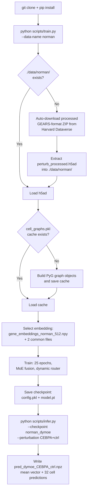
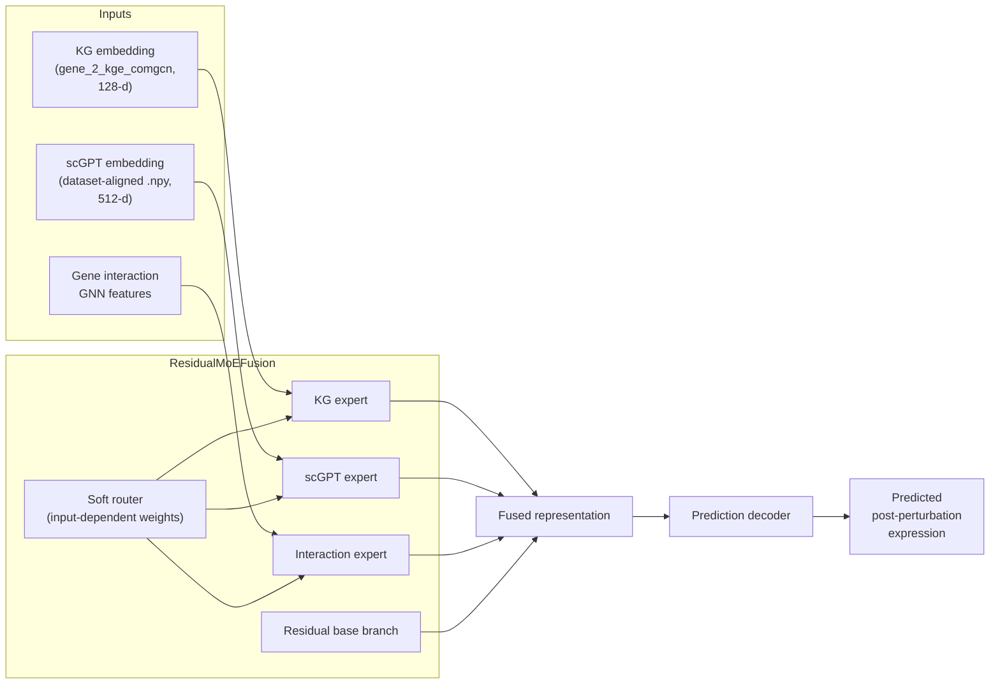

This page walks you through running DyMoE-Pert end to end for the first time: installing the dependencies, letting the loader fetch a processed dataset automatically, training the model, and predicting the effect of a perturbation that the model never saw during training. Everything here uses the repository's default settings, so you can go from `git clone` to your first prediction in three commands.

## Before You Begin: What DyMoE-Pert Does

DyMoE-Pert predicts how genetic perturbations (knocking out or activating one or two genes) change single-cell gene expression — including for perturbations that were never measured during training. The model fuses two complementary views of each perturbed gene — **knowledge-graph (KG) embeddings** and **scGPT foundation-model embeddings** — through a **dynamic residual mixture-of-experts (MoE) fusion module** with three experts (KG expert, scGPT expert, cross-modal interaction expert) plus a residual base branch. A soft router assigns input-dependent weights to expert outputs.


You do not need to understand these internals to get started — the training and prediction scripts expose sane defaults. When you are ready to look under the hood, see [Architecture Overview](5-architecture-overview).

Sources: [README.md](/README.md#L3-L13), [model.py](/models/model.py#L96-L114)

## System Requirements

The code was validated with **Python 3.8.20, PyTorch 2.3.0, and PyTorch Geometric 2.6.1 on Linux**. A CUDA-capable GPU is strongly recommended; CPU works but training and inference will be much slower.

| Component | Requirement | Notes |
| --- | --- | --- |
| OS | Linux (validated) | Other OSes untested |
| Python | 3.8.20 | |
| PyTorch | 2.3.0 | Install a build matching your CUDA driver first |
| PyTorch Geometric | 2.6.1 | Required for graph data loading |
| Other dependencies | see `requirements.txt` | anndata, scanpy, networkx, etc. |

Sources: [README.md](/README.md#L28-L32), [requirements.txt](/requirements.txt#L1-L12)

## Project Structure at a Glance

Everything you need is included except expression datasets and trained checkpoints — those are fetched or produced by the commands below.

```text
DyMoE-Pert/
├── models/                  # Core library: data loader, model, training logic
│   ├── ProcePertdata.py     # PertData: dataset download + GEARS-format loading
│   ├── scpert.py            # scPert wrapper: train / predict / save_model
│   ├── model.py             # ResidualMoEFusion and network components
│   ├── inference.py         # Prediction helpers
│   ├── data_utils.py        # DE genes, splitting, filtering
│   └── utils.py             # Download helpers, printing
├── scripts/
│   ├── train.py             # CLI entry point for training
│   └── infer.py             # CLI entry point for prediction
├── embeddings/              # Fixed gene-embedding files (shipped in repo)
│   ├── gene_2_kge_comgcn_final_common.npz   # Common KG embeddings
│   ├── gene_embeddingss_full_common.npz     # Common scGPT embeddings
│   └── gene_embeddings_<dataset>_512.npy    # Dataset-aligned scGPT embeddings
├── figures/                 # Architecture figure
└── requirements.txt
```

Sources: [README.md](/README.md#L34-L50)

## Step 0: Clone and Install

Install a PyTorch 2.3.0 build suitable for your CUDA driver first (see the [official PyTorch installation guide](https://pytorch.org/get-started/previous-versions/)), then install the remaining pinned dependencies. **Run all commands from the repository root** — the model reads embedding files by paths relative to the working directory.

```bash
git clone https://github.com/zhyzhy12512/DyMoE-Pert.git
cd DyMoE-Pert
python -m pip install -r requirements.txt
```

Sources: [README.md](/README.md#L21-L34)

## Step 1: Understand Your Data Sources

Two kinds of inputs are involved, and they behave differently:

1. **Expression data** — *not included in the repo*. On the first run, the `PertData` loader automatically downloads and extracts the processed GEARS-format data into `./data/<dataset-name>/` and builds a graph cache (`cell_graphs.pkl`). Later runs reuse the cache.
2. **Gene embeddings** — *already shipped in `embeddings/`*. The training script automatically picks the dataset-aligned 512-dimensional scGPT file for your `--data-name`; the two common embedding files must simply remain in `./embeddings/`.

The table below lists the five supported datasets. The Replogle entries are filtered essential-gene subsets.

| `--data-name` | Processed data source |
| --- | --- |
| `norman` | Harvard Dataverse file 6154020 |
| `adamson` | Harvard Dataverse file 6154417 |
| `dixit` | Harvard Dataverse file 6154416 |
| `replogle_k562_essential` | Harvard Dataverse file 7458695 |
| `replogle_rpe1_essential` | Harvard Dataverse file 7458694 |

The loader also retrieves the essential perturbation gene list and GO similarity graph when needed. For manual downloads and embedding provenance details, see [Dataset and Embedding Setup](3-dataset-and-embedding-setup).

Sources: [README.md](/README.md#L36-L50), [ProcePertdata.py](/models/ProcePertdata.py#L150-L215), [train.py](/scripts/train.py#L12-L18)

## Step 2: Train Your First Model

The defaults correspond to the main DyMoE-Pert configuration: simulation split seed 77, 25 epochs, batch size 64, hidden size 64, dynamic routing, dropout 0.1, and balance weight 0.0. For a memory-conscious **single-GPU run on Norman**:

```bash
python scripts/train.py --data-name norman --device cuda:0 --batch-size 4 --test-batch-size 4 --model-save-name norman_dymoe
```

To use **four GPUs**, as in the reported benchmark runs:

```bash
python scripts/train.py --data-name norman --multi-gpu --device-ids 0,1,2,3 --model-save-name norman_dymoe
```

Key training parameters:

| Flag | Default | Meaning |
| --- | --- | --- |
| `--data-name` | `norman` | Dataset key; selects the matching embedding file automatically |
| `--device` | `auto` | `auto`, `cpu`, `cuda`, or `cuda:N` |
| `--batch-size` / `--test-batch-size` | `64` / same as train | Reduce if you hit GPU memory limits |
| `--epochs` | `25` | Training epochs |
| `--hidden-size` | `64` | Model hidden dimension |
| `--lr` | `0.001` | Learning rate (AdamW + OneCycleLR) |
| `--seed` | `77` | Simulation split seed |
| `--model-save-name` | `<data>_model_FINAL` | Checkpoint directory name |
| `--multi-gpu` / `--device-ids` | off / `0,1,2,3` | PyG DataParallel across GPUs |

When training finishes, the script calls `save_model`, which writes two files into the checkpoint directory: **`config.pkl`** (the model configuration) and **`model.pt`** (the best model weights). Training also prints test metrics, including subgroup analysis for the simulation split.

Sources: [README.md](/README.md#L52-L66), [train.py](/scripts/train.py#L21-L54), [train.py](/scripts/train.py#L119-L153), [scpert.py](/models/scpert.py#L420-L422)

## Step 3: Predict an Unseen Perturbation

Use a checkpoint produced by `train.py` to predict the expression response for a perturbation given as `GENE+GENE` (use `ctrl` for the unperturbed partner). Both gene names must occur in the selected dataset's perturbation vocabulary.

```bash
python scripts/infer.py --data-name norman --checkpoint norman_dymoe --perturbation CEBPA+ctrl --device cuda:0
```

The script writes **`pred_dymoe_<perturbation>.npz`** to the current directory. The file contains a mean predicted expression vector plus individual predictions for 32 sampled control cells (tune with `--num-cells`; cells are processed in forward passes of `--batch-size`, default 8). Running on CPU works via `--device cpu`, but is much slower.

| Flag | Default | Meaning |
| --- | --- | --- |
| `--checkpoint` | *(required)* | Directory containing `config.pkl` and `model.pt` |
| `--perturbation` | *(required)* | e.g. `CEBPA+ctrl` or `CEBPA+JUN` |
| `--num-cells` | `32` | Number of control cells to predict for |
| `--batch-size` | `8` | Inference cells per forward pass |
| `--device` | `auto` | `auto`, `cpu`, `cuda:N` |

Sources: [README.md](/README.md#L68-L78), [infer.py](/scripts/infer.py#L25-L77), [scpert.py](/models/scpert.py#L424-L491)

## The Complete First-Run Pipeline

The following flow shows everything that happens from a fresh clone to your first prediction file. Notice that the only network downloads are the expression dataset (once) — embeddings are already in the repo, and the graph cache makes subsequent runs fast.



Sources: [README.md](/README.md#L36-L78), [ProcePertdata.py](/models/ProcePertdata.py#L150-L215), [scpert.py](/models/scpert.py#L420-L422), [scpert.py](/models/scpert.py#L488-L490)

## How the Data Flows Through the Model at a High Level

During every forward pass, each perturbed cell-graph sample receives three embedding streams, which are fused and decoded into a predicted expression profile:



The Quick Start commands never touch these internals — the defaults (`use_moe_fusion=True`, `router_mode="dynamic"`, `ablation_mode="full"`) are applied automatically. To learn how each piece works, follow the Deep Dive links below.

Sources: [model.py](/models/model.py#L96-L114), [README.md](/README.md#L7-L15), [train.py](/scripts/train.py#L73-L146)

## Troubleshooting Common First-Run Issues

| Symptom | Likely Cause | Fix |
| --- | --- | --- |
| `Embedding file not found: ./embeddings/...` | Running from a directory other than the repo root, or embeddings deleted | `cd DyMoE-Pert` before running; keep all files in `./embeddings/` |
| `CUDA was requested but is unavailable` / `torch.cuda.is_available() is False` | CPU-only PyTorch build installed | Reinstall PyTorch 2.3.0 with the CUDA build matching your driver |
| `--multi-gpu needs at least two GPU ids` | Fewer than 2 valid IDs passed | Pass at least two IDs, e.g. `--device-ids 0,1` |
| First run is slow / uses lots of disk | Dataset downloading + graph cache construction (one-time) | Expected behavior; subsequent runs load `cell_graphs.pkl` from cache |
| `Required file not found: <checkpoint>/config.pkl` | Checkpoint directory name wrong, or training did not finish | Confirm training printed "checkpoint saving completed"; pass the exact `--model-save-name` |
| Gene name rejected in `--perturbation` | Gene not in the dataset's perturbation vocabulary | Use genes present in the selected dataset (e.g. Norman genes like `CEBPA`, `JUN`) |

Sources: [train.py](/scripts/train.py#L79-L105), [infer.py](/scripts/infer.py#L47-L54), [ProcePertdata.py](/models/ProcePertdata.py#L198-L215), [scpert.py](/models/scpert.py#L150-L153)

## Suggested Reading Path

Once you have a working training run, continue with the Get Started track in order — then dive into the internals that the defaults configured for you:

1. [Dataset and Embedding Setup](3-dataset-and-embedding-setup) — manual data downloads, embedding provenance, and directory layout in depth
2. [Training and Prediction Commands](4-training-and-prediction-commands) — every CLI flag, multi-GPU recipes, and output artifacts
3. [Architecture Overview](5-architecture-overview) — the full model at a conceptual level
4. [Residual Fusion Design](6-residual-fusion-design) and [Soft Router and Balance Loss](8-soft-router-and-balance-loss) — the MoE mechanism you just trained
5. [Perturbation Splits and Simulation Split](14-perturbation-splits-and-simulation-split) — what the seed-77 simulation split means for your results
