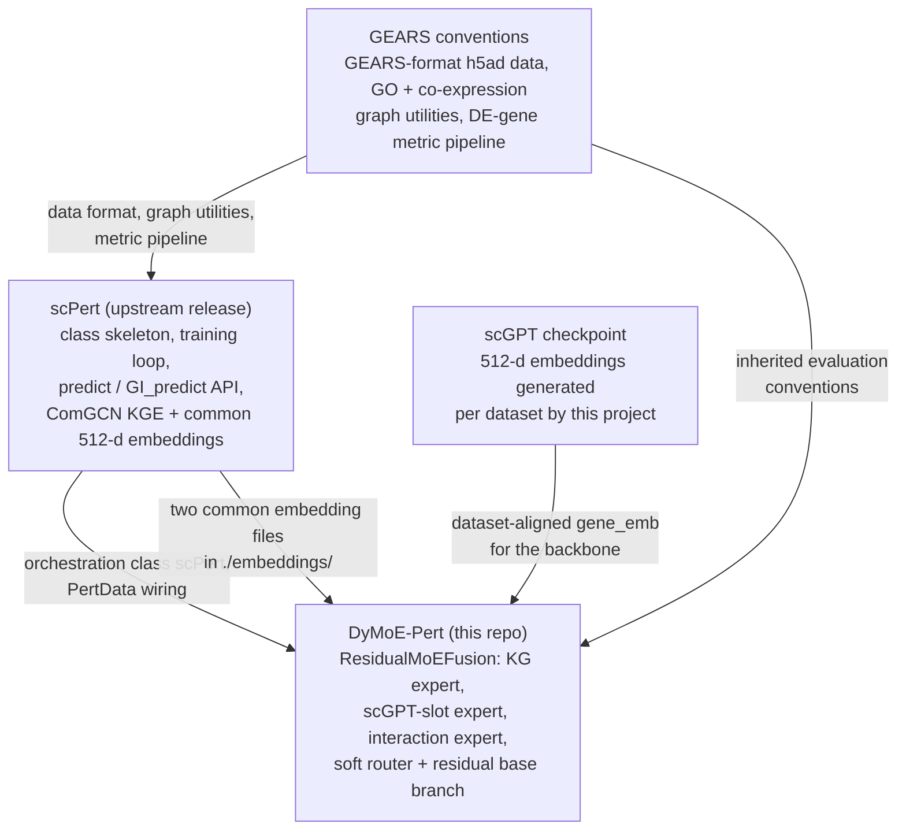
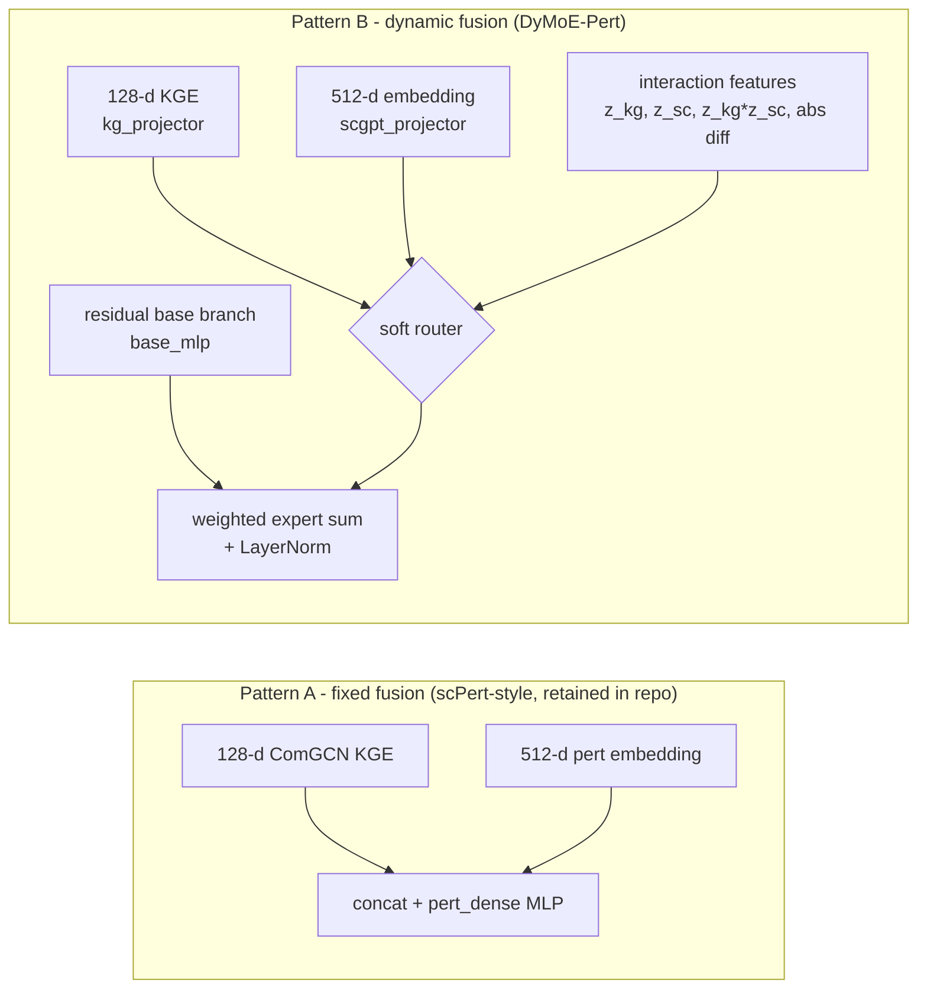
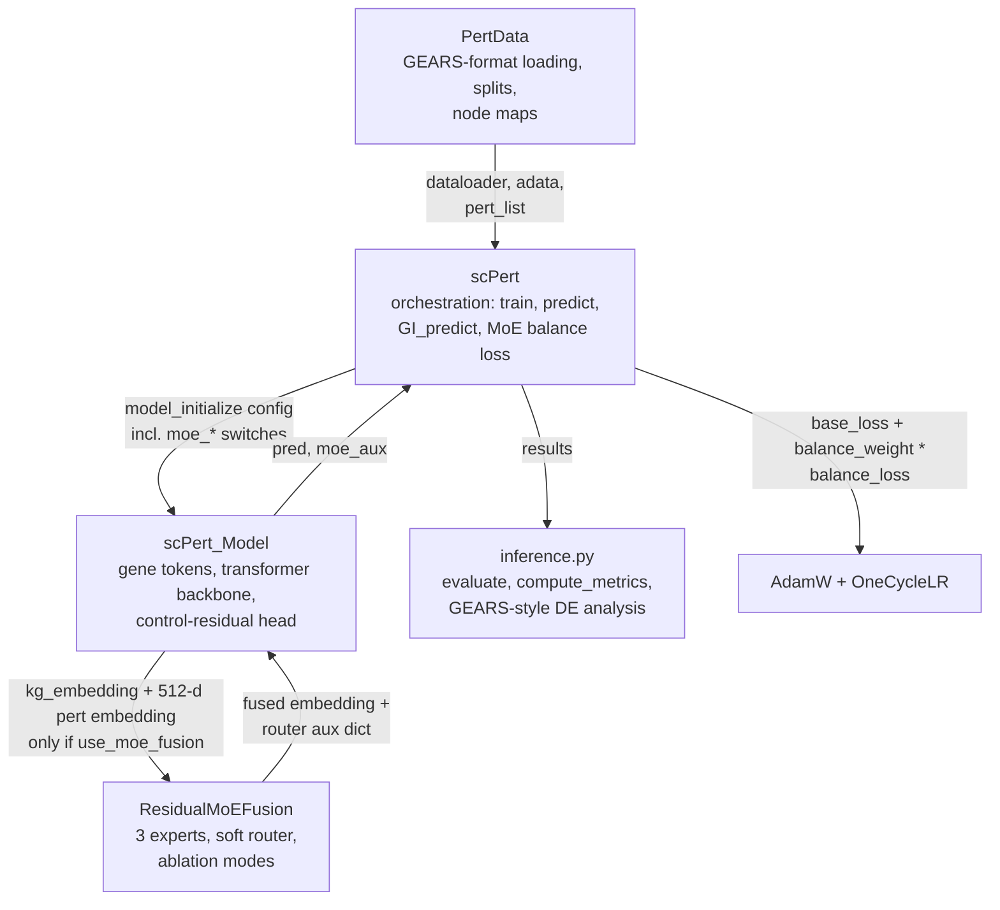

This page establishes where **DyMoE-Pert** sits relative to the two methodological ancestors it is measured against: **GEARS** (the graph-based perturbation modeling framework whose data ecosystem this repo adopts) and **scPert** (the knowledge-graph-embedding predecessor whose codebase this repository directly descends from). The positioning is built on three verifiable claims: the *data-and-metrics skeleton is inherited*, the *fusion layer is replaced with a dynamic residual MoE*, and *comparability with both baselines is preserved by construction* — same data files, same splits, same metric code. Throughout, we distinguish what the code proves from what the manuscript claims.

Sources: [README.md](/README.md#L5-L15), [scpert.py](/models/scpert.py#L172-L175)

## A Three-Stage Methodological Lineage

The lineage is visible directly in the code, not inferred from papers. The training orchestration class is literally named `scPert` and self-describes as the "scPert base model class" ([scpert.py](/models/scpert.py#L172-L175)); the neural network it drives is `scPert_Model` ([model.py](/models/model.py#L348-L350)). Meanwhile, the data layer speaks GEARS: `PertData` loads the GEARS-format `perturb_processed.h5ad` archives from Dataverse ([ProcePertdata.py](/models/ProcePertdata.py#L23-L58), [README.md](/README.md#L38-L46)), and `models/utils.py` carries the GEARS gene-graph machinery — `GeneSimNetwork`, GO-similarity edge construction via Jaccard overlap, and GO/co-expression network selection ([utils.py](/models/utils.py#L180-L208), [utils.py](/models/utils.py#L241-L265)). DyMoE-Pert is therefore not a from-scratch system: it is a fusion-layer intervention on top of an inherited scPert/GEARS skeleton.

The embedding provenance in the README makes the lineage explicit: `./embeddings/` contains "two common gene representations from the **upstream scPert repository**" (`gene_2_kge_comgcn_final_common.npz` and `gene_embeddingss_full_common.npz`) alongside "five dataset-aligned 512-dimensional arrays generated **for this project** from an scGPT checkpoint" ([README.md](/README.md#L50)). Inside `scPert_Model`, the ComGCN knowledge-graph file feeds the 128-dimensional KG slot and the common npz file feeds the 512-dimensional perturbation slot, while the project-generated scGPT arrays are loaded via `embedding_path` into `gene_emb`, the gene-token matrix consumed by the backbone ([model.py](/models/model.py#L370-L390), [model.py](/models/model.py#L651-L671)). Modality sourcing is covered in depth in [Knowledge-Graph and scGPT Embeddings](13-knowledge-graph-and-scgpt-embeddings).

Sources: [scpert.py](/models/scpert.py#L172-L175), [model.py](/models/model.py#L348-L390), [ProcePertdata.py](/models/ProcePertdata.py#L23-L58), [utils.py](/models/utils.py#L180-L265), [README.md](/README.md#L38-L50)

## What Is Inherited: Data, Splits, and Metrics Infrastructure

Comparability with GEARS and scPert is not an aspiration — it is enforced by shared infrastructure. Every component needed to claim "we evaluated under identical conditions" already exists in the repo and is reused unchanged:

| Infrastructure component | In-repo location | Lineage role |
| --- | --- | --- |
| GEARS-format `perturb_processed.h5ad` loader | `PertData` in [ProcePertdata.py](/models/ProcePertdata.py#L23-L58) | Identical processed archives as GEARS benchmarks (Norman, Adamson, Dixit, Replogle) |
| Simulation split machinery | `DataSplitter` via [data_utils.py](/models/data_utils.py#L1-L19), default seed 77 ([README.md](/README.md#L52-L54)) | Same unseen-perturbation protocol |
| DE-gene identification | `rank_genes_groups_by_cov`, `get_DE_genes` ([data_utils.py](/models/data_utils.py#L15-L70)) | GEARS differential-expression pipeline, unchanged |
| Evaluation metrics | `evaluate` / `compute_metrics` (MSE, Pearson on all genes and DE genes) in [inference.py](/models/inference.py#L42-L120) | GEARS-style metric definitions |
| Prediction API | `predict` / `GI_predict` on the `scPert` class ([scpert.py](/models/scpert.py#L424-L530)) | Same programmatic surface an scPert user already knows |

This shared skeleton means the only experimental variable between an scPert-style run and a DyMoE-Pert run is the model configuration — principally the `use_moe_fusion` switch and its router/ablation parameters ([model.py](/models/model.py#L357-L368), [scpert.py](/models/scpert.py#L271-L349)). Determinism is also anchored identically: `torch.manual_seed(0)` is set at module import in `scpert.py` ([scpert.py](/models/scpert.py#L26-L26)), matching the fixed-seed convention documented for benchmark runs ([README.md](/README.md#L52-L54)). Split semantics themselves are detailed in [Perturbation Splits and Simulation Split](14-perturbation-splits-and-simulation-split), and the metrics in [Metrics and DE Gene Analysis](18-metrics-and-de-gene-analysis).

Sources: [ProcePertdata.py](/models/ProcePertdata.py#L23-L58), [data_utils.py](/models/data_utils.py#L15-L70), [inference.py](/models/inference.py#L42-L120), [scpert.py](/models/scpert.py#L26-L26), [scpert.py](/models/scpert.py#L271-L349), [README.md](/README.md#L52-L54)

## What Is Replaced: From Fixed Fusion to Dynamic Residual MoE

The decisive architectural break with both ancestors is *how modalities are combined*. The lineage offers three fusion patterns, and all three are inspectable in this repository:

Pattern A is not hypothetical: it is the live code path taken when `use_moe_fusion=False`, where `_fuse_pert_embedding` simply concatenates the two embeddings and passes them through the static `pert_dense` MLP ([model.py](/models/model.py#L478-L481)). Pattern B instantiates `ResidualMoEFusion` with exactly three experts — KG, scGPT-slot, and cross-modal interaction — a learned soft router over the projected base input, and a residual base branch carrying shared multimodal information ([model.py](/models/model.py#L96-L167), [model.py](/models/model.py#L418-L429)). This is precisely the README's positioning statement made concrete: "Rather than applying one fixed fusion rule to every perturbation, DyMoE-Pert learns how much to use each" source per input ([README.md](/README.md#L9-L11)).

> [!TIP]
> The fixed-fusion baseline used to justify the MoE does not require an external scPert implementation — flipping `use_moe_fusion` to `False` runs the scPert-style concatenation path inside the *same* model, data loader, and metric harness, eliminating harness-induced confounds from the comparison.

| Dimension | GEARS conventions (inherited data layer) | scPert-style path (`use_moe_fusion=False`) | DyMoE-Pert (`use_moe_fusion=True`) |
| --- | --- | --- | --- |
| Perturbation identity | Effect propagated over GO/co-expression gene graphs | Fixed embedding per perturbed gene | Fixed embedding per perturbed gene |
| External knowledge | GO + co-expression network construction ([utils.py](/models/utils.py#L241-L265)) | ComGCN KGE (128-d) as a static feature | ComGCN KGE (128-d) — but routed, not concatenated |
| Second modality | None | 512-d common perturbation embedding, concat-fused | 512-d embedding + learned cross-modal interaction expert |
| Fusion rule | Graph message passing | Static concat + MLP | Input-dependent soft-router weights + residual base branch |
| Prediction target | Delta over control expression | Delta over control expression ([model.py](/models/model.py#L754-L755)) | Delta over control expression ([model.py](/models/model.py#L754-L755)) |

The GEARS-heritage claim for the first column rests on what the code retains: GEARS pert-string parsing (`GENE1+GENE2`, `ctrl` handling), GO-graph edge lists with Jaccard scores above 0.1, and K-nearest-neighbor pruning of similarity networks are all live utilities ([utils.py](/models/utils.py#L16-L39), [utils.py](/models/utils.py#L197-L208)). Fusion internals are the territory of [Residual Fusion Design](6-residual-fusion-design) and [Expert Specialization: KG, scGPT, Interaction](7-expert-specialization-kg-scgpt-interaction); router mechanics belong to [Soft Router and Balance Loss](8-soft-router-and-balance-loss).

Sources: [model.py](/models/model.py#L96-L167), [model.py](/models/model.py#L418-L429), [model.py](/models/model.py#L478-L481), [model.py](/models/model.py#L651-L671), [utils.py](/models/utils.py#L16-L39), [utils.py](/models/utils.py#L197-L265), [README.md](/README.md#L9-L11)

## What the Backbone Does Instead of GEARS-Style GNN Propagation

GEARS-derived configuration knobs survive in the API surface — `tunable_parameters` still advertises `num_go_gnn_layers`, `num_gene_gnn_layers`, `decoder_hidden_size`, `num_similar_genes_go_graph`, `coexpress_threshold`, and `direction_lambda` ([scpert.py](/models/scpert.py#L250-L269)), and `model_initialize` accepts them into the config dict ([scpert.py](/models/scpert.py#L271-L349)). However, the module that actually consumes `config` — `scPert_Model.__init__` — builds none of them. No GO-GNN, no co-expression-GNN, and no gene-specific decoder are constructed; instead the forward path builds a shared transformer stack of eight `ImprovedTransformerLayer` blocks ([model.py](/models/model.py#L442-L445)), computes gene-gene interaction as scaled-dot-product attention over projected gene tokens with a softmax-weighted context aggregation ([model.py](/models/model.py#L684-L693)), and predicts through a global `final_mlp` + `output_layer` head with a half-scaled residual per transformer block ([model.py](/models/model.py#L743-L754)).

> [!TIP]
> The legacy GEARS hyperparameters (`num_go_gnn_layers`, `decoder_hidden_size`, `direction_lambda`, …) are stored in `config.pkl` but are dead settings in this codebase — `scPert_Model.__init__` never reads them. Tuning them will change nothing; the effective control surface is the `moe_*` parameters and `hidden_size`.

The class-level interaction below shows the full inheritance-and-extension wiring at runtime — useful when tracing where a comparison run diverges from its scPert equivalent:

One GEARS convention survives in the *output contract* rather than the architecture: like GEARS, the model predicts a correction on top of measured control expression rather than absolute expression — the final reshape adds the input control vector `x` to the network output ([model.py](/models/model.py#L754-L757)). This keeps the semantic of "perturbation effect" consistent across all three methods and is what makes the downstream DE-gene comparisons directly interpretable.

Sources: [scpert.py](/models/scpert.py#L250-L269), [scpert.py](/models/scpert.py#L271-L349), [model.py](/models/model.py#L442-L445), [model.py](/models/model.py#L684-L693), [model.py](/models/model.py#L743-L757), [scpert.py](/models/scpert.py#L64-L77)

## Claim Boundaries: What This Repository Does and Does Not Establish

An honest positioning statement requires boundaries, and the README supplies them explicitly. This repository provides "the **core runnable implementation**" — model, loader, train/predict commands, and runtime embedding files — but "does not include expression datasets, trained checkpoints, experiment logs, or scripts for reproducing every manuscript table" ([README.md](/README.md#L13-L15)). Consequently, this codebase lets you *replicate the comparison protocol* (shared data, splits, metrics), but the published GEARS/scPert baseline numbers come from the accompanying manuscript, not from runnable baseline scripts shipped here.

The manuscript's own positioning is deliberately conservative: performance "varies by dataset and metric," with "the clearest reported advantage ... for the challenging combinations in which neither constituent gene was" seen during training ([README.md](/README.md#L13-L13)). For intermediate developers, the practical reading is: DyMoE-Pert is positioned as a *fusion-strategy upgrade with the strongest expected gain in the unseen-combination regime*, not as a universal winner across every dataset–metric cell. The ablation framework (`full`, `base_only`, `no_interaction`, `experts_only`) exists precisely to attribute gains to specific experts rather than to the MoE wrapper generically ([model.py](/models/model.py#L109-L117), [scpert.py](/models/scpert.py#L86-L99)) — see [Ablation Modes Framework](9-ablation-modes-framework). To run predictions yourself, start from [Quick Start](2-quick-start) and [Training and Prediction Commands](4-training-and-prediction-commands), and consult [Configuration Reference](19-configuration-reference) for the `moe_*` switches.

Sources: [README.md](/README.md#L13-L15), [model.py](/models/model.py#L109-L117), [scpert.py](/models/scpert.py#L86-L99)

## Where to Go Next

This page closes the Deep Dive. To go deeper into the mechanism summaries referenced above, the recommended progression is:

- [Architecture Overview](5-architecture-overview) — the full forward pass in context of everything discussed here.
- [Residual Fusion Design](6-residual-fusion-design) and [Soft Router and Balance Loss](8-soft-router-and-balance-loss) — the exact mechanics replacing scPert's fixed fusion.
- [GEARS-Format Data Pipeline](12-gears-format-data-pipeline) and [Perturbation Splits and Simulation Split](14-perturbation-splits-and-simulation-split) — the inherited infrastructure that guarantees apples-to-apples evaluation.
- [Unseen Perturbation Inference](17-unseen-perturbation-inference) and [Metrics and DE Gene Analysis](18-metrics-and-de-gene-analysis) — where the GEARS-comparable numbers are actually produced.
