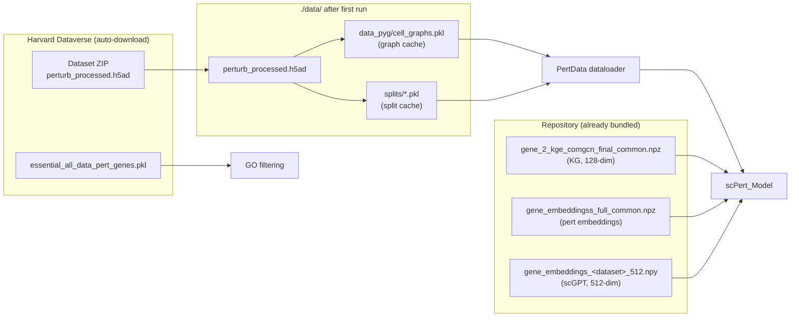
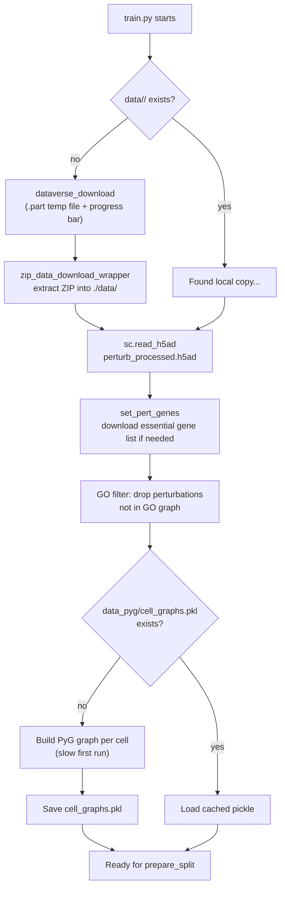
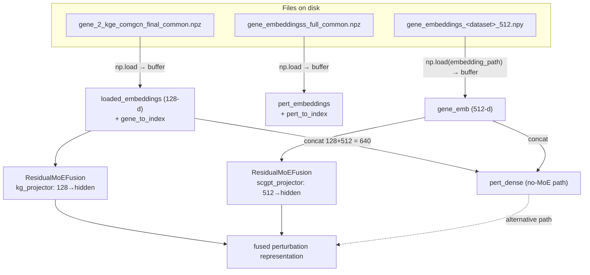

This page explains everything DyMoE-Pert needs on disk before training can start: the perturbation **expression datasets** (downloaded automatically in GEARS format) and the **gene embedding files** shipped in the `embeddings/` directory. You will learn what each file is, where it must live, how the first run downloads and caches data, and how the training script wires these files into the model. No expression dataset is committed to the repository — only the fixed gene embeddings are bundled — so understanding this page is the prerequisite for your first successful `train.py` run.

## The Three Inputs at a Glance

A DyMoE-Pert training run consumes exactly three kinds of inputs, and they live in two places: a `./data/` directory that gets populated on first use, and the pre-shipped `./embeddings/` directory. The expression data describes *what happened to each cell* (which genes were perturbed and how expression changed), while the embeddings describe *who the perturbed genes are* in two complementary mathematical spaces: a biological knowledge-graph space (128-dimensional) and an scGPT foundation-model space (512-dimensional).


The following diagram shows how these inputs flow from their sources into the model at training time:



Sources: [README.md](README.md#L36-L50), [scripts/train.py](scripts/train.py#L119-L135)

## Supported Datasets and Their Download Sources

The loader recognizes exactly five dataset names, matching the five benchmark datasets from the manuscript (Norman, Dixit, Adamson, and the filtered essential-gene subsets of Replogle K562 and RPE1). Each name maps to a processed GEARS-format ZIP hosted on Harvard Dataverse; the Replogle ZIPs are explicitly noted in code as *filtered subsets*, not the complete screens. You never need to call a download function yourself — the loader fetches and extracts them the first time you train.

| `--data-name` | Processed data ZIP (Harvard Dataverse) | Dataset-aligned scGPT embedding |
| --- | --- | --- |
| `norman` | dataverse.harvard.edu/api/access/datafile/6154020 | `gene_embeddings_norman_512.npy` |
| `adamson` | dataverse.harvard.edu/api/access/datafile/6154417 | `gene_embeddings_adamson_512.npy` |
| `dixit` | dataverse.harvard.edu/api/access/datafile/6154416 | `gene_embeddings_dixit_512.npy` |
| `replogle_k562_essential` | dataverse.harvard.edu/api/access/datafile/7458695 | `gene_embeddings_replogle_k562_essential_512.npy` |
| `replogle_rpe1_essential` | dataverse.harvard.edu/api/access/datafile/7458694 | `gene_embeddings_replogle_rpe1_essential_512.npy` |

The mapping in the left column is enforced twice: once as the `choices` of the `--data-name` CLI argument, and once inside `PertData.load`, which raises a `ValueError` for any other name unless you supply a custom data path. The two replogle entries carry code comments stating "This is not the complete dataset and has been filtered," so do not expect them to reproduce full-screen analyses.

Sources: [scripts/train.py](scripts/train.py#L12-L23), [models/ProcePertdata.py](models/ProcePertdata.py#L150-L171), [README.md](README.md#L40-L48)

## The Bundled Embedding Files

Unlike the expression data, the embedding files are committed to the repository, so a fresh clone already contains everything embedding-related. There are two categories. The **two common files** are shared across all datasets: a knowledge-graph embedding table produced upstream with a ComGCN-style encoder (its arrays are 128-dimensional, which you can verify against `kg_input_dim=128` in the model), and a perturbation-gene embedding table. The **five dataset-aligned files** are per-dataset scGPT gene embeddings of fixed dimension 512, generated from an scGPT checkpoint for this project.

| File in `embeddings/` | Type | Dimension | Consumed by |
| --- | --- | --- | --- |
| `gene_2_kge_comgcn_final_common.npz` | Common, knowledge-graph (keys: `gene_names`, `embeddings`) | 128 | KG expert input |
| `gene_embeddingss_full_common.npz` | Common, perturbation gene embeddings | 512 | Perturbation embedding lookup |
| `gene_embeddings_norman_512.npy` | Dataset-aligned scGPT | 512 | scGPT expert input |
| `gene_embeddings_adamson_512.npy` | Dataset-aligned scGPT | 512 | scGPT expert input |
| `gene_embeddings_dixit_512.npy` | Dataset-aligned scGPT | 512 | scGPT expert input |
| `gene_embeddings_replogle_k562_essential_512.npy` | Dataset-aligned scGPT | 512 | scGPT expert input |
| `gene_embeddings_replogle_rpe1_essential_512.npy` | Dataset-aligned scGPT | 512 | scGPT expert input |

For genes that are absent from the scGPT checkpoint vocabulary, the generation process substituted deterministic random fallback vectors, so every gene in a dataset has a usable 512-dim row — no missing-value handling is needed at training time. The fixed 512 dimension is hard-coded as `'embedding_size': 512` in the model config and as `scgpt_input_dim=512` in the fusion module, so you cannot swap in embeddings of a different width without code changes.

> [!TIP]
> The two common embedding files are opened with **hard-coded relative paths** (`"./embeddings/..."`) inside the model constructor, not via the CLI. This is exactly why the README instructs you to run all commands from the repository root — launching `train.py` from another directory will fail with a `FileNotFoundError` even though `--embedding-dir` is set correctly.

Sources: [models/model.py](models/model.py#L370-L390), [models/model.py](models/model.py#L96-L107), [models/scpert.py](models/scpert.py#L327-L335), [README.md](README.md#L50-L50)

## First-Run Data Download, Extraction, and Caching

When you call `PertData.load(DataName="norman")`, the loader resolves the Dataverse URL, downloads the ZIP with a progress bar, and extracts it under `./data/norman/`. The download helper writes to a `.part` temporary file first and only renames it into place after a complete transfer, which prevents corrupt partial files from poisoning later runs. Once extracted, the loader reads `perturb_processed.h5ad` with scanpy — this single AnnData file is the canonical expression dataset.



After this step the local layout looks like the tree below — the caches mean your **second** run of the same dataset is dramatically faster, because graph construction and splitting are the expensive parts:

```
data/
├── norman/                          # extracted dataset
│   ├── perturb_processed.h5ad       # expression + condition labels
│   ├── data_pyg/
│   │   └── cell_graphs.pkl          # one PyG graph object per cell
│   └── splits/
│       ├── norman_simulation_77_0.75.pkl        # condition->set assignment
│       └── norman_simulation_77_0.75_subgroup.pkl
└── essential_all_data_pert_genes.pkl  # shared perturbation-gene universe
```

Sources: [models/ProcePertdata.py](models/ProcePertdata.py#L131-L215), [models/utils.py](models/utils.py#L51-L97), [models/ProcePertdata.py](models/ProcePertdata.py#L198-L215)

## Supporting Files: Essential Gene List and GO Filtering

Two auxiliary downloads round out the data setup. First, `set_pert_genes` fetches the **essential perturbation gene list** (`essential_all_data_pert_genes.pkl`, Dataverse file 6934320) to define the universe of perturbable genes and builds the perturbation-to-index mapping `node_map_pert` used throughout training and inference. Second, during `load`, every perturbation condition is checked with `filter_pert_in_go`; conditions whose constituent genes are absent from the GO-derived perturbation graph are **dropped from the AnnData object entirely** before any graphs are built, and the dropped names are printed so you can see exactly what was removed.

A third helper, `get_go_auto`, exists in the utilities and downloads `gene2go.pkl` (Dataverse file 6153417) to compute GO similarity edges when a dataset needs its own gene-similarity network built. You will not interact with these files directly, but knowing they arrive lazily explains why the very first run also downloads small `.pkl` files alongside the main dataset ZIP.

Sources: [models/ProcePertdata.py](models/ProcePertdata.py#L99-L129), [models/ProcePertdata.py](models/ProcePertdata.py#L187-L196), [models/utils.py](models/utils.py#L119-L150)

## Wiring It Together: CLI Arguments for Data and Embeddings

`scripts/train.py` exposes four arguments that control the data and embedding setup, and it applies a simple but important resolution chain: the dataset name selects the embedding file automatically, `--embedding-dir` provides the directory, and `--embedding-file` can override the automatic choice entirely. Before any model work begins, the script validates the resolved embedding path with `os.path.exists` and raises a descriptive `FileNotFoundError` if it is missing — a deliberate early-failure design so you never lose training time to a typo.

| Argument | Default | What it controls |
| --- | --- | --- |
| `--data-name` | `norman` | Which of the five datasets to download/load and which embedding file is auto-selected |
| `--data-path` | `./data` | Root directory for downloads, caches, and splits |
| `--embedding-dir` | `./embeddings` | Directory searched for the dataset-aligned scGPT file |
| `--embedding-file` | `None` | Optional override of the automatic `<dataset>_512.npy` mapping |

After validation, `train.py` constructs `PertData(args.data_path)`, calls `load` and `prepare_split` (default seed 77), builds the dataloaders, and finally passes the resolved `embedding_path` into the `scPert` wrapper, which stores it for model construction. The split options (`--split`, `--seed`) cache their results on disk as shown earlier, so changing the seed creates a *new* cached split file rather than overwriting the old one.

> [!TIP]
> The `--embedding-file` override only replaces the **dataset-aligned scGPT array**. The two common `.npz` files are unaffected by any CLI flag because they are read from fixed paths inside `scPert_Model.__init__` — treat them as immovable infrastructure.

Sources: [scripts/train.py](scripts/train.py#L21-L54), [scripts/train.py](scripts/train.py#L101-L105), [scripts/train.py](scripts/train.py#L119-L135)

## How the Model Loads the Embedding Tensors

Inside `scPert_Model.__init__`, three `np.load` calls convert your files into registered PyTorch buffers (non-trainable tensors that move with the model). The KG file provides `loaded_embeddings` plus a `gene_to_index` dictionary mapping gene symbols to rows; the common perturbation file provides `pert_embeddings` plus `pert_to_index`; and your dataset-aligned scGPT file becomes `gene_emb`, looked up via the CLI-resolved `embedding_path`. Together they feed two downstream consumers: the `pert_dense` layer, which expects a **640-dimensional** concatenated vector (128 + 512) when MoE fusion is disabled, and the `ResidualMoEFusion` module, which receives the two modalities *separately* through its 128-dim KG projector and 512-dim scGPT projector.



This layout is the reason the configuration pins `'embedding_size': 512` and why the fusion module rejects any `kg_input_dim` other than 128 at construction time — the embedding files and the architecture dimensions are contractually locked together. The internal fusion behavior (how the router weighs the KG expert against the scGPT expert) is covered in [Residual Fusion Design](6-residual-fusion-design).

Sources: [models/model.py](models/model.py#L348-L414), [models/model.py](models/model.py#L96-L130), [models/scpert.py](models/scpert.py#L327-L354)

## Troubleshooting Your First Setup

Most setup failures fall into four patterns, all with unambiguous fixes. The table below maps each symptom you are likely to see to its root cause in the code and the corrective action.

| Symptom | Root cause | Fix |
| --- | --- | --- |
| `FileNotFoundError: Embedding file not found: ./embeddings/...` | `--embedding-dir` changed or dataset-aligned `.npy` missing | Restore the file under `embeddings/` or pass `--embedding-file` with a valid path |
| `FileNotFoundError` mentioning `gene_2_kge_comgcn_final_common.npz` despite correct CLI flags | Model reads the two common files via hard-coded relative paths | Run `python scripts/train.py` from the repository root |
| Run stalls at start with a progress bar and no model output | First run downloads + extracts the dataset ZIP, builds per-cell graph cache | Wait; re-runs hit `cell_graphs.pkl` and the split cache and start quickly |
| `ValueError: data attribute is either norman, adamson, dixit...` | `--data-name` not among the five supported keys | Use exactly one of the names in the dataset table |
| Training runs but very slowly on laptop | No GPU detected, fell back to CPU | Pass `--device cuda:0` if available; README warns CPU mode is much slower |

Note that disk space matters on the first run as well: the README explicitly cautions that the first run takes time and disk space to download, process the dataset, and build graph caches — the Replogle essential subsets are the smallest, while Norman/Dixit/Adamson are moderate, full processed screens.

Sources: [scripts/train.py](scripts/train.py#L102-L105), [models/model.py](models/model.py#L370-L390), [models/ProcePertdata.py](models/ProcePertdata.py#L182-L185), [README.md](README.md#L78-L79)

## Where to Go Next

With data and embeddings in place, your natural next steps follow the catalog. To actually launch a run — including the memory-conscious Norman command and the four-GPU benchmark configuration — continue to [Training and Prediction Commands](4-training-and-prediction-commands). To understand *why* the loader builds one graph per cell and what `cell_graphs.pkl` contains, read [GEARS-Format Data Pipeline](12-gears-format-data-pipeline). For a deep dive into how the KG (128-d) and scGPT (512-d) tables were produced and how the MoE consumes them, see [Knowledge-Graph and scGPT Embeddings](13-knowledge-graph-and-scgpt-embeddings). Finally, to control exactly which perturbations a model is allowed to see (the seed-77 simulation split cached in `splits/`), continue to [Perturbation Splits and Simulation Split](14-perturbation-splits-and-simulation-split).
