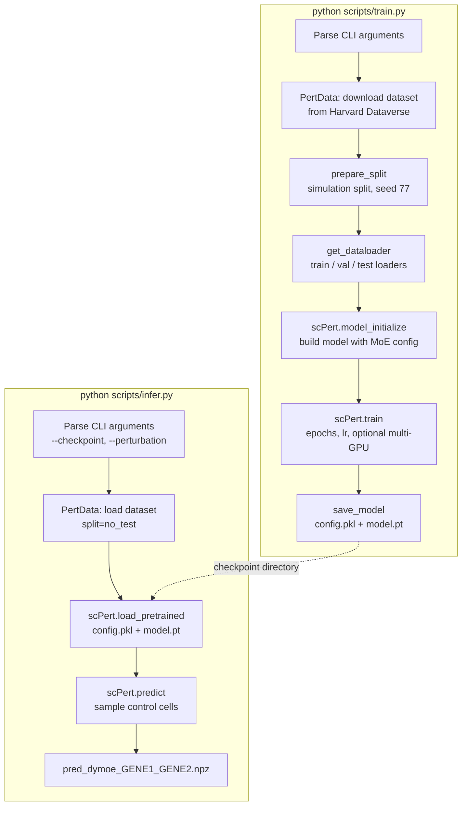

This page is your operational guide for running DyMoE-Pert end to end. The repository exposes exactly **two command-line entry points**: `scripts/train.py`, which trains a model and saves a checkpoint, and `scripts/infer.py`, which loads that checkpoint and predicts the expression outcome of a perturbation you name. Everything else — the data loader, the model class, and the training loop — lives in the `models/` package and is invoked *by* these scripts, not run directly. By the end of this page you will be able to launch a single-GPU or four-GPU training run and turn its checkpoint into per-perturbation predictions.


> [!TIP]
> Always run both commands from the repository root directory. `scripts/train.py` appends the current directory to `sys.path` to import the `models` package, and the two common embedding files are read from relative paths under `./embeddings/` — running from elsewhere breaks imports and file lookup.

## How the Two Commands Fit Together

Both scripts follow the same three-phase lifecycle, differing only in whether phase two is *learning* or *loading*. The diagram below traces the full journey from command invocation to output files:



The checkpoint directory is the only contract between the two commands: `train.py` writes it, `infer.py` consumes it. Notably, both scripts share an identical `EMBEDDING_FILES` mapping that ties each `--data-name` to its dataset-aligned embedding file, so you never specify embedding paths manually for supported datasets.

Sources: [train.py](scripts/train.py#L71-L153), [infer.py](infer.py#L25-L76), [README.md](README.md#L52-L79)

## Training a Model

### Canonical Commands

The README documents two production-ready invocations. For a **memory-conscious single-GPU run on Norman** — the recommended starting point for beginners:

```bash
python scripts/train.py --data-name norman --device cuda:0 --batch-size 4 --test-batch-size 4 --model-save-name norman_dymoe
```

For the **four-GPU configuration used in the reported benchmark runs**:

```bash
python scripts/train.py --data-name norman --multi-gpu --device-ids 0,1,2,3 --model-save-name norman_dymoe
```

To train on a different dataset, change `--data-name` to any of: `norman`, `adamson`, `dixit`, `replogle_k562_essential`, or `replogle_rpe1_essential`. The script automatically selects the matching embedding file from its internal mapping.

| Scenario | Command pattern | Key difference |
| --- | --- | --- |
| Single GPU (low memory) | `--device cuda:0 --batch-size 4 --test-batch-size 4` | Small explicit batch sizes |
| Multi-GPU benchmark | `--multi-gpu --device-ids 0,1,2,3` | PyG DataParallel with DataListLoader |
| Other dataset | `--data-name adamson` | Embedding file auto-resolved |
| Quick experiment | No flags beyond `--data-name` | 25 epochs, batch size 64 defaults |

Sources: [README.md](README.md#L54-L66), [train.py](scripts/train.py#L12-L18)

### Step-by-Step: What Happens When You Run train.py

Each numbered step below corresponds to verified code paths in the scripts:

1. **Environment setup** — The script enables expandable CUDA memory segments to reduce fragmentation, then imports the `models` package from the repository root.
2. **Dataset acquisition** — `PertData.load()` downloads the processed GEARS-format ZIP from Harvard Dataverse into `./data/<dataset-name>/` on first run, then reuses the local copy afterward. Expression datasets are *not* shipped with the repository.
3. **Graph caching** — On the first run, cell-level PyTorch Geometric graph objects are built and cached to `data_pyg/cell_graphs.pkl`; subsequent runs load this cache directly.
4. **Split preparation** — `prepare_split(split="simulation", seed=77)` by default partitions perturbations into train/val/test sets, caching the split as a pickle file.
5. **Dataloader construction** — Three loaders are created (train/val/test); with `--multi-gpu`, a `DataListLoader` replaces the standard loader.
6. **Model initialization** — `scPert` is constructed with the embedding path, then `model_initialize()` builds the model with MoE fusion always enabled (`use_moe_fusion=True` is forced).
7. **Training loop** — `scPert.train()` runs the optimizer, tracks the best model by validation top-20 DE MSE, and evaluates on the test set afterward.
8. **Checkpoint saving** — `save_model()` writes `config.pkl` (full configuration) and `model.pt` (weights of the best model) into your `--model-save-name` directory.


Sources: [ProcePertdata.py](models/ProcePertdata.py#L150-L215), [train.py](train.py#L119-L153), [scpert.py](models/scpert.py#L533-L744)

### Training Parameter Reference

All flags below are parsed by `scripts/train.py`. Defaults match the main DyMoE-Pert configuration reported in the manuscript.

| Parameter | Default | Purpose |
| --- | --- | --- |
| `--data-name` | `norman` | Dataset key; choices are the five supported names |
| `--data-path` | `./data` | Where datasets are downloaded/cached |
| `--embedding-dir` | `./embeddings` | Directory containing gene embedding files |
| `--embedding-file` | *(auto)* | Override the dataset-aligned `.npy` embedding |
| `--device` | `auto` | `auto`, `cpu`, `cuda`, or `cuda:N` |
| `--batch-size` | `64` | Training cells per step |
| `--test-batch-size` | *(= batch size)* | Eval-time batch size; lower it to save memory |
| `--hidden-size` | `64` | Model hidden dimension |
| `--epochs` | `25` | Training epochs |
| `--lr` | `0.001` | Learning rate for AdamW |
| `--seed` | `77` | Split seed (model weights are seeded at 0 internally) |
| `--split` | `simulation` | Perturbation split strategy |
| `--model-save-name` | `<data-name>_model_FINAL` | Output checkpoint directory |
| `--multi-gpu` | off | Enable PyG DataParallel training |
| `--device-ids` | `0,1,2,3` | Comma-separated GPU ids for `--multi-gpu` |
| `--moe-hidden-dim` | *(follows hidden-size)* | Inner dimension of the MoE fusion module |
| `--moe-dropout` | `0.1` | Dropout inside the MoE fusion |
| `--moe-balance-weight` | `0.0` | Weight of the router balance loss |
| `--moe-ablation-mode` | `full` | `full`, `base_only`, `no_interaction`, `experts_only` |
| `--moe-router-mode` | `dynamic` | `dynamic` or `fixed_uniform` (E3 control) |
| `--no-moe-router-stats` | off | Suppress router statistics logging |

> [!TIP]
> Two flags interact in a non-obvious way: if you select `--moe-router-mode fixed_uniform` **or** `--moe-ablation-mode base_only`, the script silently forces `--moe-balance-weight` to `0.0` regardless of what you passed, because a fixed router and a base-only configuration make the balance loss meaningless.

Sources: [train.py](scripts/train.py#L21-L54), [train.py](train.py#L73-L75), [scpert.py](models/scpert.py#L320-L325)

## Predicting a Perturbation

### The Prediction Command

Prediction requires a checkpoint directory produced by training. A single-gene perturbation on Norman:

```bash
python scripts/infer.py --data-name norman --checkpoint norman_dymoe --perturbation CEBPA+ctrl --device cuda:0
```

A **double-gene perturbation** uses the `GENE1+GENE2` form, for example `--perturbation CEBPA+JUN`. Both gene names must exist in the selected dataset's perturbation vocabulary — you cannot invent gene combinations that the dataset loader has never seen.

The script writes `pred_dymoe_<perturbation>.npz` to your current directory (with `+` replaced by `_`). The archive contains both the **mean predicted expression vector** across sampled cells and the **individual predictions for all 32 sampled control cells**, so you can compute uncertainty yourself.

### Prediction Parameters

| Parameter | Default | Purpose |
| --- | --- | --- |
| `--checkpoint` | *(required)* | Directory containing `config.pkl` and `model.pt` |
| `--perturbation` | *(required)* | Format `GENE+ctrl` or `GENE1+GENE2` |
| `--data-name` | `norman` | Dataset key, must match the checkpoint's training data |
| `--data-path` | `./data` | Dataset cache location |
| `--embedding-dir` | `./embeddings` | Embedding file location |
| `--device` | `auto` | Falls back to `cpu` if no CUDA device |
| `--num-cells` | `32` | Control cells sampled for the prediction |
| `--batch-size` | `8` | Cells per inference forward pass |

Sources: [infer.py](scripts/infer.py#L25-L35), [README.md](README.md#L68-L79)

### How Prediction Works Internally

Before predicting, `infer.py` validates three paths (embedding file, `config.pkl`, `model.pt`) and fails fast with a clear error if any is missing. It then loads the dataset with `split="no_test"` — this split creates only train/val loaders and skips test-set construction, because inference needs the dataset purely for its gene vocabulary and control-cell pool, not for evaluation. The `load_pretrained` method rebuilds the model from the saved configuration and restores the weights, automatically stripping any `module.` prefix that DataParallel training added to parameter names.

The `predict()` call samples `--num-cells` control cells, constructs one input graph per cell with your chosen perturbation attached, runs batched forward passes under `torch.no_grad()`, and averages the outputs into the mean prediction.

Sources: [infer.py](infer.py#L47-L72), [ProcePertdata.py](models/ProcePertdata.py#L460-L461), [scpert.py](scpert.py#L357-L397), [scpert.py](scpert.py#L424-L491)

## Checkpoint Anatomy

The checkpoint directory is intentionally minimal — two files capture everything needed to reproduce the model:

| File | Written by | Contents |
| --- | --- | --- |
| `config.pkl` | `save_model()` | Full model configuration: hidden sizes, MoE flags, perturbation vocabulary, gene/node mappings |
| `model.pt` | `save_model()` | State dict of the **best** model (selected by validation top-20 DE MSE), with parallel-wrapping removed |

A critical subtlety for beginners: the saved weights are not necessarily from the final epoch. During training, a deep copy of the model is updated only when validation top-20 DE MSE improves, so `model.pt` always holds the best-validation checkpoint.

> [!TIP]
> Checkpoints saved from multi-GPU runs store **unwrapped** parameter names — `save_model` explicitly removes the DataParallel `module.` prefix before saving. This means a checkpoint trained on four GPUs loads seamlessly into a single-GPU or CPU inference session with no manual state-dict surgery.

Sources: [scpert.py](models/scpert.py#L399-L422), [scpert.py](scpert.py#L660-L666), [scpert.py](scpert.py#L386-L393)

## Multi-GPU Training Constraints

The `--multi-gpu` flag activates PyTorch Geometric's `DataParallel` wrapper across your listed GPUs. Three validation rules are enforced *before* training starts, so misconfigurations fail immediately with explicit errors rather than mid-run:

| Rule | Failure message trigger |
| --- | --- |
| CUDA must be available | `--multi-gpu` with no CUDA devices raises immediately |
| At least two GPU ids required | A single id in `--device-ids` is rejected |
| `--device` must equal first `--device-ids` entry | e.g. `--device cuda:1 --device-ids 0,1` raises |

GPU ids are validated against `torch.cuda.device_count()`, so requesting `cuda:3` on a two-GPU machine fails at argument-checking time. The underlying distributed mechanics (batch splitting, gradient synchronization) are handled inside `scPert.train()` and are covered in detail in [Multi-GPU Parallel Training](16-multi-gpu-parallel-training).

Sources: [train.py](scripts/train.py#L79-L101), [scpert.py](scpert.py#L560-L573)

## Troubleshooting Common Command Failures

Errors you are most likely to hit as a first-time user, mapped to their verified causes and fixes:

| Symptom | Root cause | Fix |
| --- | --- | --- |
| `Embedding file not found: ./embeddings/...` | Missing or misplaced `.npy` embedding file | Verify `embeddings/` directory contents; check `--embedding-dir` |
| `Required file not found: .../config.pkl` | `--checkpoint` points to an empty or wrong directory | Point to the directory `train.py` created via `--model-save-name` |
| `CUDA was requested but is unavailable` | No CUDA-capable driver or CPU-only PyTorch build | Install a CUDA-matched PyTorch 2.3.0 build, or use `--device cpu` |
| `--multi-gpu needs at least two GPU ids` | Only one id passed to `--device-ids` | List two or more ids, e.g. `--device-ids 0,1` |
| `--device must match the first --device-ids entry` | Mismatched device arguments | Set `--device cuda:0` when using `--device-ids 0,...` |
| Prediction fails on a gene name | Perturbation absent from the dataset's perturbation vocabulary | Use genes from the chosen dataset; check dataset docs |
| First run seems to hang | Dataset ZIP download + graph cache construction in progress | Expected on first run; subsequent runs load local caches |

Sources: [train.py](scripts/train.py#L79-L105), [infer.py](infer.py#L47-L54), [ProcePertdata.py](models/ProcePertdata.py#L198-L215)

## Where to Go Next

You now know how to drive both commands. The natural progression through this documentation:

- **Before training**: confirm your dataset and embedding files are in place with [Dataset and Embedding Setup](3-dataset-and-embedding-setup), and try the end-to-end install path in [Quick Start](2-quick-start).
- **Understanding what you trained**: the flags `--moe-ablation-mode`, `--moe-router-mode`, and `--moe-balance-weight` manipulate the fusion architecture — see [Residual Fusion Design](6-residual-fusion-design) and [Ablation Modes Framework](9-ablation-modes-framework) for what each mode structurally removes.
- **Interpreting the training log**: the epoch metrics (Overall MSE, Top 20 DE MSE) and the simulation-split subgroup analysis printed after testing are explained in [Metrics and DE Gene Analysis](18-metrics-and-de-gene-analysis).
- **Going deeper on what the commands invoke**: [Training Loop Orchestration](15-training-loop-orchestration), [Unseen Perturbation Inference](17-unseen-perturbation-inference), and the exhaustive flag semantics in [Configuration Reference](19-configuration-reference).