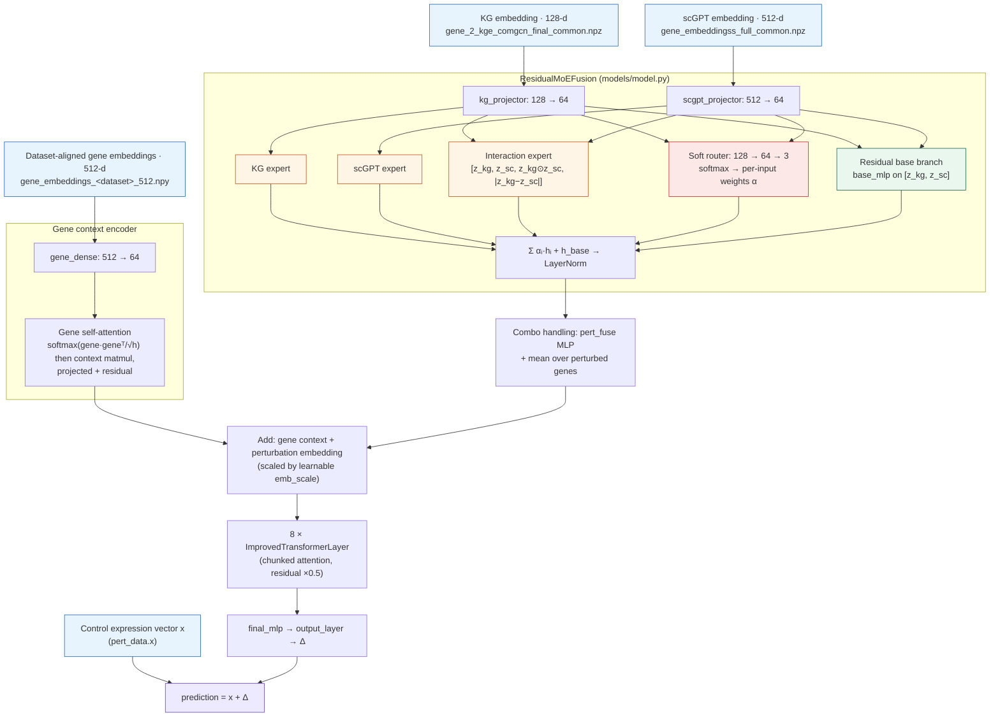

DyMoE-Pert predicts how genetic perturbations reshape single-cell expression profiles — including perturbations never observed during training. Its defining architectural idea is that the representation of a perturbed gene should not be fused from biological knowledge-graph (KG) and scGPT foundation-model sources by one fixed rule. Instead, a **dynamic residual mixture-of-experts (MoE)** block learns, per input, how to weight three complementary experts on top of a shared residual base branch. This page gives a end-to-end map of the system: the major components, how data and embeddings flow through them, and where each deep-dive continues. All behavior described here is verified against the code in `models/` and `scripts/`.

Sources: [README.md](README.md#L11-L19), [model.py](models/model.py#L96-L110)

## The System in One Picture

The published architecture figure summarizes the three-stage design: multimodal perturbation embedding, dynamic MoE fusion, and expression prediction on top of a control-expression baseline.


The following diagram translates that figure into the concrete modules you will find in the code. A prediction is produced per cell-graph sample: gene context is built from dataset-aligned embeddings, the perturbation condition string is resolved into per-gene fused embeddings by the MoE block, both signals are combined and refined by a transformer stack, and the decoder outputs a **delta** that is added to the control expression vector.



Every arrow above corresponds to a specific line range in `models/model.py`, which is the single file containing all trainable architecture. The orchestration wrapper (`models/scpert.py`) and the entry points (`scripts/train.py`, `scripts/infer.py`) configure and drive these modules rather than adding new computation.

Sources: [model.py](models/model.py#L678-L760), [README.md](README.md#L34-L37)

## Repository Layout and Module Responsibilities

The codebase is deliberately flat: two Python packages, three fixed embedding assets, and one architecture figure. `models/` holds the entire model and data stack, while `scripts/` contains only thin command-line wrappers.

```
DyMoE-Pert/
├── embeddings/            # fixed runtime gene representations (KG + scGPT)
├── figures/
│   └── dymoe_architecture.png
├── models/
│   ├── model.py           # ResidualMoEFusion + scPert_Model (all trainable modules)
│   ├── scpert.py          # scPert wrapper: init, train/eval loop, save/load, MoE stats
│   ├── ProcePertdata.py   # PertData: GEARS-format loading, splits, cell graphs
│   ├── data_utils.py      # DataSplitter, DE-gene helpers
│   ├── inference.py       # evaluate, metrics, deeper/non-dropout analyses
│   ├── utils.py           # downloads, GeneSimNetwork, co-expression graph, loss_fct
│   └── __init__.py
├── scripts/
│   ├── train.py           # CLI: dataset → PertData → scPert training
│   └── infer.py           # CLI: checkpoint + perturbation → predicted expression
└── requirements.txt
```

| Module | Responsibility | Key symbols |
| --- | --- | --- |
| `models/model.py` | All trainable architecture: MoE fusion, gene context, transformer backbone, decoder | `ResidualMoEFusion`, `scPert_Model`, `ImprovedTransformerLayer`, `MemoryEfficientMultiheadAttention` |
| `models/scpert.py` | Experiment wrapper: model lifecycle, parallelism unwrapping, MoE aux-loss injection, stats logging | `scPert`, `_moe_balance_loss`, `_format_moe_stats` |
| `models/ProcePertdata.py` | Dataset download, GEARS-format loading, split assignment, PyG `Data` construction | `PertData` |
| `models/utils.py` | Downloads, GO-similarity and co-expression graph construction, composite loss | `GeneSimNetwork`, `get_similarity_network`, `loss_fct` |
| `scripts/train.py` | CLI that wires dataset, dataset-aligned embedding file, and MoE configuration | `EMBEDDING_FILES`, `parse_args` |

Sources: [ProcePertdata.py](models/ProcePertdata.py#L23-L58), [utils.py](models/utils.py#L343-L400), [train.py](scripts/train.py#L12-L54)

## Three Embedding Sources Feed the Model

`scPert_Model.__init__` registers three distinct embedding assets as buffers, and the forward pass treats them with different roles. The KG and scGPT files are **condition-independent** and shared across all datasets; the third file is **dataset-aligned** and supplies the base representation for every gene in the dataset's feature space.

| Source | File | Dimension | Role in the model |
| --- | --- | --- | --- |
| Knowledge-graph embeddings | `embeddings/gene_2_kge_comgcn_final_common.npz` | 128 | Per-perturbed-gene biological prior, routed through the KG expert |
| scGPT-derived perturbation embeddings | `embeddings/gene_embeddingss_full_common.npz` | 512 | Foundation-model prior per perturbed gene, routed through the scGPT expert |
| Dataset-aligned gene embeddings | `embeddings/gene_embeddings_<dataset>_512.npy` | 512 | Base gene features for the whole transcriptomic context (`gene_emb`) |

Lookup is name-based with graceful fallback: `'ctrl'` maps to zero vectors (128-d for KG, 512-d for scGPT), known genes index into the registered buffers, and unknown gene names receive **deterministic random embeddings** generated from a SHA1-seeded generator — a 640-dim random vector where the first 128 dims serve KG and the remaining 512 serve scGPT. This determinism means unseen perturbations always produce identical embeddings across runs and machines, which is essential for reproducible inference on unseen combinations.

> [!TIP]
> Because lookup falls back to deterministic random vectors instead of raising errors, a typo in a gene name silently produces a plausible prediction instead of a crash — always validate perturbation names against the dataset vocabulary before interpreting results.

Sources: [model.py](models/model.py#L371-L390), [model.py](models/model.py#L636-L671), [README.md](README.md#L64-L68)

## The Forward Pass: From Perturbation String to Predicted Expression

`scPert_Model.forward` processes a batch of PyG cell graphs in five stages. Each stage is small and independently verifiable, and the whole pass is contained in fewer than 90 lines.

| Stage | Operation | Where |
| --- | --- | --- |
| 1. Gene context | Dataset-aligned 512-d embeddings → `gene_dense` (512→64) → softmax gene-gene attention → context aggregation → residual add | `model.py` L684-L693 |
| 2. Perturbation embedding | For each perturbed gene: KG + scGPT lookup → MoE fusion; single-gene conditions duplicate the fused vector so both "slots" of a combo are symmetric; combos pass through `pert_fuse` and are averaged before broadcasting to all `num_genes` positions | `model.py` L695-L730 |
| 3. Control handling | `'ctrl'` conditions receive a learned `control_emb`; a sum-based mask also substitutes `control_emb` wherever the perturbation matrix is all-zero; the result is scaled by the learnable `emb_scale` | `model.py` L700-L736 |
| 4. Refinement | `layer_norm1(gene_emb + pert_emb)` → dropout → 8 transformer layers, each applied with a **scaled residual** (`×0.5`) → `layer_norm2` | `model.py` L739-L747 |
| 5. Delta decoding | `final_mlp` (64→256→128→64) → `output_layer` (→1) → **residual add of control expression `x`** → reshape per sample | `model.py` L748-L757 |

Two design decisions deserve emphasis. First, the model is a **residual predictor**: the decoder learns a per-gene correction on top of the measured control expression rather than absolute expression, which anchors predictions to realistic baselines. Second, the interaction expert consumes an explicitly crafted cross-modal feature — the concatenation of the two projected embeddings, their elementwise product, and their absolute difference — giving the router a candidate expert that is specialized for nonlinear cross-source structure rather than either source alone.

> [!TIP]
> The 0.5 scaling on each transformer residual (`combined_emb = combined_emb + layer_output * 0.5`) halves the effective learning-rate of the attention stack; when tuning training hyperparameters, treat the backbone as intrinsically conservative rather than raising the global LR to compensate.

Sources: [model.py](models/model.py#L684-L757), [model.py](models/model.py#L296-L297)

## The Dynamic Residual MoE Fusion Block

`ResidualMoEFusion` is the conceptual core of DyMoE-Pert, and it is intentionally rigid in structure — it hard-codes exactly three experts — while remaining flexible in behavior through two orthogonal switches: `router_mode` (`dynamic` vs `fixed_uniform`) and `ablation_mode` (`full`, `base_only`, `no_interaction`, `experts_only`). Ablation switches are implemented as parameter freezing plus masked routing rather than separate model classes, so every variant shares one code path and one checkpoint format.

The forward flow is compact: project both inputs to `hidden_dim`, run the base MLP on their concatenation, run each expert, compute router logits from the same concatenated input, softmax into weights, take the weighted sum of expert outputs, and add the base branch before a final `LayerNorm`. When `return_aux=True` — the default path in this fork — the module also returns a dictionary carrying router logits, raw and applied weights, the balance loss, the active-expert mask, and per-expert outputs, which the wrapper aggregates and logs.

| Component | Input → Output | Purpose |
| --- | --- | --- |
| Projectors | 128→64 and 512→64, GELU + LayerNorm | Bring heterogeneous modalities to a shared space |
| Base branch | `base_mlp` on `[z_kg, z_sc]` (128→64) | Always-available shared multimodal representation (the "residual" in the name) |
| Three experts | 64→64 each; interaction expert 256→64 | Specialized transformations: KG prior, scGPT prior, cross-modal interactions |
| Soft router | `[z_kg, z_sc]` → 3 logits → softmax | Input-dependent fusion weights; initialized near-uniform via tiny-weight init |
| Balance loss | MSE of mean applied weights vs uniform 1/3 | Optional regularizer against expert collapse; weight forced to 0 for fixed-uniform or `base_only` modes |

The near-zero initialization of the router's final linear layer (weights ~ N(0, 10⁻³), bias zero) means that at the start of training, softmax over logits near zero yields weights close to 1/3 each — the model begins as a uniform mixture and learns to specialize. The internals of routing, balance loss, and the ablation framework each have dedicated pages: [Residual Fusion Design](6-residual-fusion-design), [Expert Specialization: KG, scGPT, Interaction](7-expert-specialization-kg-scgpt-interaction), [Soft Router and Balance Loss](8-soft-router-and-balance-loss), and [Ablation Modes Framework](9-ablation-modes-framework).

Sources: [model.py](models/model.py#L96-L167), [model.py](models/model.py#L239-L271), [model.py](models/model.py#L273-L345)

## The Backbone: Gene Context, Chunked Attention, and the Decoder

Upstream of the MoE block, the gene context encoder applies a lightweight attention-like operation over all genes in the dataset: gene embeddings are normalized via scaled dot-product (`/√hidden_size`), softmaxed into a gene-gene interaction matrix, multiplied back onto the embeddings to produce a context vector, projected through `gene_interaction_layer`, and residually added. This gives every gene's representation awareness of the rest of the transcriptome before any perturbation signal arrives.

The refinement stack uses eight custom `ImprovedTransformerLayer`s whose attention is **chunked** (`MemoryEfficientMultiheadAttention`, chunk size 256): queries, keys, and values are processed in fixed-size slices along the sequence dimension and concatenated, bounding peak memory for large gene panels at the cost of extra kernel launches. Each layer is a standard pre/post-norm transformer block — LayerNorm around a multi-head attention sublayer and a 4×-expansion GELU feed-forward — applied with the scaled residual described above.

Sources: [model.py](models/model.py#L26-L93), [model.py](models/model.py#L393-L445), [model.py](models/model.py#L689-L693)

## Orchestration: The `scPert` Wrapper and the Training Entry Point

The `scPert` class in `models/scpert.py` is the stateful experiment manager. `model_initialize` assembles the config dictionary — including all `moe_*` switches — instantiates `scPert_Model`, and keeps a CPU deepcopy as `best_model`. Checkpoints are two files: `config.pkl` (the full keyword config) and `model.pt` (the unwrapped state dict, so checkpoints saved under `DataParallel` remain portable; `load_pretrained` conversely strips any `module.` prefix when loading). Module-level `torch.manual_seed(0)` in `scpert.py` pins model initialization deterministically.

Training-time integration of the MoE happens in three places. The wrapper's `_moe_balance_loss` adds `moe_balance_weight × balance_loss` to the base prediction loss (returning the balance term separately for logging) and skips it entirely when the weight is ≤ 0. `_format_moe_stats` renders a rich single-line diagnostic — applied and raw per-expert alphas, their min/max, routing entropy, active experts, and resolved ablation/router modes — from the merged aux dictionary that `scPert_Model` produces via `_merge_moe_aux`. Finally, `scripts/train.py` hard-sets `use_moe_fusion = True` and maps `--data-name` to its dataset-aligned embedding file, so every run through the CLI trains the full DyMoE configuration; the README's default config additionally sets `moe_balance_weight` to 0.0, making the balance term diagnostics-only unless explicitly raised.

Sources: [scpert.py](models/scpert.py#L271-L355), [scpert.py](models/scpert.py#L357-L422), [scpert.py](models/scpert.py#L64-L77), [scpert.py](models/scpert.py#L112-L169), [model.py](models/model.py#L492-L631), [train.py](scripts/train.py#L71-L117)

## Where to Go Next

This page deliberately stayed at the map level; each region of the diagram now has a dedicated exploration path within the Deep Dive catalog. To follow the data flow in code order, proceed to [Residual Fusion Design](6-residual-fusion-design) for the fusion block's structure, then [Expert Specialization: KG, scGPT, Interaction](7-expert-specialization-kg-scgpt-interaction) and [Soft Router and Balance Loss](8-soft-router-and-balance-loss) for the dynamic-routing machinery, and [Ablation Modes Framework](9-ablation-modes-framework) for the experimental variants. For the backbone and output path, continue with [Gene Interaction GNN Layers](10-gene-interaction-gnn-layers) and [Prediction Decoder and Loss](11-prediction-decoder-and-loss). If you instead want the upstream story — how GEARS-format data, the GO similarity graph, and the perturbation splits are produced before anything reaches `scPert_Model.forward` — jump to [GEARS-Format Data Pipeline](12-gears-format-data-pipeline), [Knowledge-Graph and scGPT Embeddings](13-knowledge-graph-and-scgpt-embeddings), and [Perturbation Splits and Simulation Split](14-perturbation-splits-and-simulation-split). For operational concerns, [Training Loop Orchestration](15-training-loop-orchestration), [Multi-GPU Parallel Training](16-multi-gpu-parallel-training), and [Unseen Perturbation Inference](17-unseen-perturbation-inference) cover the lifecycle beyond this page.
