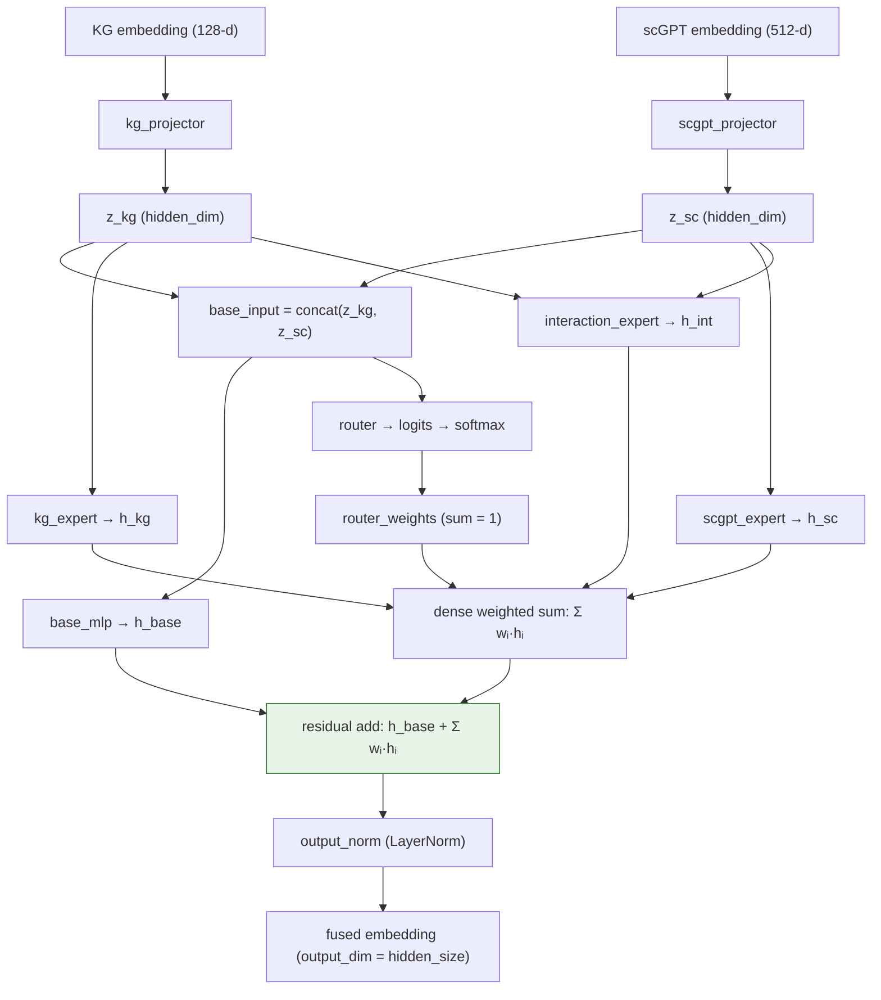
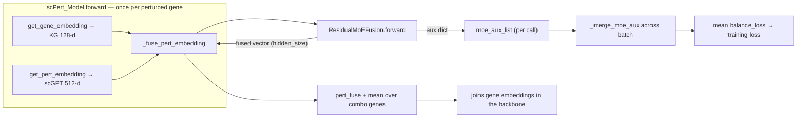

This page explains the **residual mixture-of-experts fusion** that DyMoE-Pert uses to merge two heterogeneous perturbation representations — a 128-dimensional knowledge-graph embedding and a 512-dimensional scGPT embedding — into a single vector consumed by the prediction backbone. The core object is `ResidualMoEFusion` in `models/model.py`: a base MLP trunk, three expert branches, and a soft router, combined through an explicit residual add followed by layer normalization. We cover the fusion equation, the role of the base branch, the dense weighted-sum aggregation, the structural ablation variants, and how the module plugs into `scPert_Model` and the training loop. Router mechanics and expert internals are covered by their own pages and only summarized here.

Sources: [model.py](models/model.py#L96-L110), [README.md](README.md#L9-L13)

## The Fusion Contract: Trunk Plus Routed Deltas

The entire design reduces to one line executed in `ResidualMoEFusion.forward`:

```python
output = self.output_norm(h_base + expert_output)   # model.py L311
```

where `expert_output` is a router-weighted sum of the three expert outputs (`model.py#L305-L306`) and `h_base` is the output of a dedicated base MLP. Expressed as a pipeline:

```text
z_kg   = kg_projector(kg_embedding)               # 128-d → hidden_dim
z_sc   = scgpt_projector(scgpt_embedding)         # 512-d → hidden_dim
h_base = base_mlp(concat(z_kg, z_sc))             # 2·hidden_dim → output_dim
h_kg   = kg_expert(z_kg)                          # hidden_dim → output_dim
h_sc   = scgpt_expert(z_sc)                       # hidden_dim → output_dim
h_int  = interaction_expert([z_kg, z_sc, z_kg⊙z_sc, |z_kg−z_sc|])
w      = softmax(router(concat(z_kg, z_sc)))      # 3 weights, sum to 1
output = LayerNorm(h_base + w_kg·h_kg + w_sc·h_sc + w_int·h_int)
```

Three properties of this contract matter architecturally. First, it is a **dense** mixture: all three experts are evaluated for every input and their outputs are blended by weights that sum to 1 — there is no top-k sparsity or hard dispatch. Second, the trunk `h_base` carries no router weight and cannot be scaled down; it is either fully present or structurally removed (the `experts_only` ablation). Third, the experts act as **modulation deltas** on top of the trunk, mirroring the identity-shortcut logic of residual networks: even if every expert output were zero, a valid representation still flows to the output through `h_base`.

Sources: [model.py](models/model.py#L273-L312), [model.py](models/model.py#L299-L306), [README.md](README.md#L11)

## Stage One: Reconciling Heterogeneous Modalities

Before any fusion can happen, the two input modalities must be made commensurable. The raw inputs are asymmetric — 128 dimensions from the ComGCN-trained knowledge-graph embeddings versus 512 dimensions from scGPT — so concatenating them directly (as the non-MoE fallback does, producing a 640-dimensional vector) would force the downstream network to cope with unbalanced scale and information density. `ResidualMoEFusion` instead runs each modality through its own projector: a `Linear → GELU → Dropout → LayerNorm` stack that maps both inputs to a shared `hidden_dim` space (`kg_projector` and `scgpt_projector`).

The terminal `LayerNorm` in each projector is significant for the fusion contract: it bounds the scale of `z_kg` and `z_sc` before they enter both the router (whose softmax is scale-sensitive) and the interaction expert (whose elementwise product `z_kg ⊙ z_sc` grows quadratically with input magnitude). The shared `hidden_dim` defaults to the backbone's `hidden_size` (64) unless `moe_hidden_dim` overrides it, and the expert/base final layers project from `hidden_dim` to `output_dim`, which is pinned to `self.hidden_size` so the fused vector drops directly into the perturbation pipeline.

| Stage | Module | Input → Output | Role in the fusion |
| --- | --- | --- | --- |
| Projector | `kg_projector` (Linear→GELU→Dropout→LayerNorm) | 128 → `hidden_dim` | Normalize KG modality into shared space |
| Projector | `scgpt_projector` (Linear→GELU→Dropout→LayerNorm) | 512 → `hidden_dim` | Normalize scGPT modality into shared space |
| Trunk | `base_mlp` (Linear→GELU→Dropout→Linear) | 2·`hidden_dim` → `output_dim` | Residual base `h_base` |
| Expert | `kg_expert` | `hidden_dim` → `output_dim` | KG-specific delta |
| Expert | `scgpt_expert` | `hidden_dim` → `output_dim` | scGPT-specific delta |
| Expert | `interaction_expert` | 4·`hidden_dim` → `output_dim` | Cross-modal, non-additive delta |
| Router | `router` (2·`hidden_dim` → `hidden_dim` → 3) | 2·`hidden_dim` → 3 logits | Input-dependent mixture weights |
| Output | `output_norm` (LayerNorm) | `output_dim` → `output_dim` | Stabilize the fused result |

Sources: [model.py](models/model.py#L119-L130), [model.py](models/model.py#L296), [model.py](models/model.py#L408-L414), [model.py](models/model.py#L415-L429)

## The Base Branch: A Trunk, Not a Fourth Expert

A subtle but deliberate design decision is that `base_mlp` is architecturally separated from the experts. It consumes exactly the same input as the router — `base_input = concat(z_kg, z_sc)` — so it has access to the full multimodal signal, but unlike the experts it is **outside** the routing mixture. There is no learnable weight that can attenuate `h_base`; the only ways to remove it are the coarse, structural ones: freezing (via the ablation framework, which disables gradients) or full bypass (`experts_only`, where the forward path skips the base MLP entirely and computes `LayerNorm(expert_output)`).

This asymmetry encodes an inductive bias: shared multimodal information should always reach the output, while expert contributions should be *earned* through routing. In practice the trunk also functions as the model's fallback behavior — the `base_only` ablation, which freezes experts and router, reduces the whole module to `LayerNorm(h_base)` and is used as the control condition demonstrating what the routed deltas add. The contrast between `base_only` and `full` is therefore a direct measurement of the experts' marginal value over the residual trunk.

Sources: [model.py](models/model.py#L132-L137), [model.py](models/model.py#L278-L288), [model.py](models/model.py#L307-L312), [model.py](models/model.py#L178-L187)

## End-to-End Data Flow

The diagram below shows one forward pass through `ResidualMoEFusion`. Prerequisites for reading it: `z_kg`/`z_sc` are the projected modality vectors from the previous section; `h_base` is the trunk output; the router's softmax produces weights over exactly three experts; and the residual add plus final LayerNorm produce the fused embedding whose width equals the backbone's `hidden_size`.



The forward method also builds an auxiliary dictionary (`return_aux=True`) exposing the router logits, the pre- and post-ablation routing weights, the per-expert outputs, the balance loss, and boolean flags describing which structural components were active. This aux payload is the sole interface through which training-time regularization and router diagnostics observe the fusion internals — the fused tensor itself is otherwise opaque to the rest of the model.

Sources: [model.py](models/model.py#L273-L345), [model.py](models/model.py#L317-L344)

## Expert Stack: The Inputs to the Weighted Sum

For the fusion equation to be meaningful, every term in the weighted sum must share the output dimension — and they do: all three experts emit `output_dim`-wide vectors, which is what makes `torch.stack([h_kg, h_sc, h_interaction], dim=-2)` followed by a weighted sum well-formed. The experts differ in their *inputs*, not their widths. `kg_expert` sees only the projected KG vector, `scgpt_expert` sees only the projected scGPT vector, and `interaction_expert` sees an explicitly engineered 4·`hidden_dim` feature vector combining both projections, their elementwise product, and their absolute difference — the only place in the fusion module where non-additive cross-modal interactions are computed explicitly.

| Expert | Input features | Transformation | Signal captured |
| --- | --- | --- | --- |
| `kg_expert` | `z_kg` | Linear→GELU→Dropout→Linear | Relation-structure knowledge from the KG embedding |
| `scgpt_expert` | `z_sc` | Linear→GELU→Dropout→Linear | Foundation-model expression priors |
| `interaction_expert` | `[z_kg, z_sc, z_kg⊙z_sc, \|z_kg−z_sc\|]` | Linear(4h→h)→GELU→Dropout→Linear | Multiplicative and asymmetry effects between modalities |

The depth of each expert's specialization — what each branch actually learns on real perturbation data — is the subject of [Expert Specialization: KG, scGPT, Interaction](7-expert-specialization-kg-scgpt-interaction); here we only note the interface contract that the fusion depends on: homogeneous outputs, heterogeneous inputs.

Sources: [model.py](models/model.py#L138-L155), [model.py](models/model.py#L290-L297), [model.py](models/model.py#L305-L306)

## Soft, Dense Aggregation and Its Initialization

The aggregation step — stack, broadcast weights, sum — implements what the code calls the "dynamic" router mode. Because it is soft and dense, gradient flow reaches every expert on every sample; the router learns a per-perturbation blend rather than a discrete assignment. A second mode, `fixed_uniform`, replaces the softmax output with constant 1/3 weights, converting the module into a strict control where the only learned specialization lives in the expert weights themselves; additionally, a trained dynamic model can be evaluated with uniform routing at inference time via `set_inference_router_mode("fixed_uniform")`, a lever used to disentangle routing contributions from expert contributions without retraining.

> [!TIP]
> The router's final linear layer is initialized with weight std = 1e-3 and zero bias (model.py#L164-L166). Softmax over near-zero logits is almost exactly uniform, so **training begins at h_base + (1/3)(h_kg + h_sc + h_int)** — the residual trunk dominates early optimization and expert specialization emerges gradually as the router's logits grow. This is the initialization counterpart of the residual contract.

| Property | Soft dense mixture (this design) | Hard top-k routing (not used) | Fixed uniform (control mode) |
| --- | --- | --- | --- |
| Gradient reach | All experts per sample | Only selected experts | All experts, no routing signal |
| Compute cost | Always 3 expert evaluations | Lower (~k evaluations) | Always 3 evaluations |
| Failure mode | Weight collapse to one expert | Unstable expert switching | None (no collapse possible) |
| Interpretability | Continuous per-sample weights | Discrete assignments | Weights are constants |

The balance loss that guards against weight collapse — a mean-squared penalty pulling per-expert average routing weights toward uniformity — is computed inside the module but its optimization role belongs to [Soft Router and Balance Loss](8-soft-router-and-balance-loss).

Sources: [model.py](models/model.py#L156-L166), [model.py](models/model.py#L239-L262), [model.py](models/model.py#L264-L271), [model.py](models/model.py#L169-L172)

## Ablation Geometry: How Each Variant Rewrites the Residual Equation

The `ablation_mode` constructor argument defines four structural variants, each of which is a different reading of the fusion equation. Crucially, these are not just flag checks in the forward pass — the constructor also **freezes parameters** (`requires_grad = False`) for components that are bypassed, so optimizers built over `requires_grad`-filtered parameters skip them entirely.

| Mode | Base trunk | Expert stack | Router behavior | Effective equation |
| --- | --- | --- | --- | --- |
| `full` | Active, trained | All 3, trained | Softmax over 3 | `LN(h_base + Σ₃ wᵢhᵢ)` |
| `base_only` | Active, trained | Frozen, bypassed | Bypassed | `LN(h_base)` |
| `no_interaction` | Active, trained | KG + scGPT only | Softmax over 2 active experts, renormalized to sum 1 | `LN(h_base + w₁h_kg + w₂h_sc)` |
| `experts_only` | Disabled | All 3, trained | Softmax over 3 | `LN(Σ₃ wᵢhᵢ)` |

Two implementation details deserve attention. In `no_interaction`, the interaction expert's output is replaced with a **zero tensor that is detached** (`torch.zeros_like(h_kg).detach()`), so stale gradients can never flow into the frozen expert even if its parameters were later unfrozen; the router then softmaxes over only the active slice of its logits and scatters the renormalized weights back into a 3-wide vector, preserving the stack shape of the weighted sum. In `experts_only`, the residual add is removed rather than the base weighted to zero — meaning the fused output loses its trunk anchor entirely, which is the harshest test of whether routed deltas alone can carry the representation. The experimental purpose of these variants is documented in [Ablation Modes Framework](9-ablation-modes-framework).

Sources: [model.py](models/model.py#L178-L204), [model.py](models/model.py#L243-L253), [model.py](models/model.py#L293-L294), [model.py](models/model.py#L285-L312)

## Integration: Where Fusion Sits in `scPert_Model`

`scPert_Model` owns one `ResidualMoEFusion` instance, built only when `use_moe_fusion` is true (the training CLI sets it unconditionally). The integration point is `_fuse_pert_embedding`, which is called **once per perturbed gene** inside the forward loop: for a combination like `GENE1+GENE2`, each gene's 128-d KG embedding and 512-d scGPT embedding are fused independently, and the resulting per-gene vectors are then stacked, passed through `pert_fuse`, and averaged into the graph-level perturbation embedding. When `use_moe_fusion` is false, the same call site falls back to raw concatenation plus the `pert_dense` MLP (accepting the 128+512 = 640-d vector directly) — which is precisely the baseline the residual MoE design replaces.

> [!TIP]
> The residual design is a failure-containment mechanism at the system level: if routing weights collapse toward a degenerate state during training, the fused output degrades gracefully toward trunk-only behavior (essentially `base_only`) rather than toward garbage. The downstream pipeline never needs a special case for a broken router.



The merged aux statistics (router weight tensors stacked across every fusion call in the batch, plus a batch-level routing entropy) are returned alongside predictions whenever `moe_return_router_stats` is enabled, and the trainer unwraps them through `_split_model_output` — a small compatibility shim that lets the same code path serve both the `(output, aux)` tuple and the plain-tensor legacy return.

Sources: [model.py](models/model.py#L415-L429), [model.py](models/model.py#L478-L490), [model.py](models/model.py#L697-L730), [model.py](models/model.py#L758-L760), [scpert.py](models/scpert.py#L58-L61)

## Training-Time Coupling

The fusion module does not add its own loss; it *reports* one. Each forward returns `balance_loss` inside the aux dict, `_merge_moe_aux` averages it across all fusion calls in the batch, and the trainer's `_moe_balance_loss` helper adds `λ · balance_loss` to the task loss before backward. λ (`moe_balance_weight`) defaults to 0.0 in the training CLI — matching the manuscript's main configuration — while the model-level default is 0.01; in either case λ is **forced to 0.0** when the router is `fixed_uniform` or the ablation is `base_only`, because in those regimes the routing distribution contains no learnable degree of freedom to regularize. Note also that the optimizer is constructed over `requires_grad`-filtered parameters only, which is how the ablation freezing described earlier removes bypassed components from training at zero runtime cost.

The full optimization treatment of the balance term — its gradient dynamics and interaction with the task loss — is covered in [Soft Router and Balance Loss](8-soft-router-and-balance-loss); the surrounding loop mechanics are in [Training Loop Orchestration](15-training-loop-orchestration).

Sources: [model.py](models/model.py#L317-L321), [model.py](models/model.py#L364-L367), [scpert.py](models/scpert.py#L64-L77), [scpert.py](models/scpert.py#L573-L611), [train.py](scripts/train.py#L40-L41), [train.py](scripts/train.py#L73-L75)

## Design Rationale: Residual Fusion vs. the Alternatives

Placing the design in context clarifies why each element exists. The module's true baseline is the non-MoE fallback (`pert_dense` over the raw 640-d concatenation), and its theoretical alternative is a pure MoE without a trunk. The residual middle ground buys gradient stability and graceful degradation at the cost of a permanently active trunk that experts can only modulate, never replace.

| Dimension | Residual MoE (this design) | Plain concat + MLP (fallback) | Pure MoE, no trunk |
| --- | --- | --- | --- |
| Gradient path at initialization | Trunk + near-uniform expert mix (well-conditioned) | Single path | Only routed path, random specialization |
| Router collapse consequence | Degrades toward trunk-only behavior | N/A | Output collapses to one expert |
| Non-additive combinatorial signal | Explicit (interaction expert features) | Implicit, learned late (if at all) | Only if an expert models it |
| Input-dim asymmetry (128 vs 512) | Explicit normalization before fusion | Raw concat, scale imbalance | Requires projectors regardless |
| Parameter overhead | Trunk + 3 experts + router | One MLP | Experts + router only |

The manuscript-level claim attached to this architecture — that its clearest advantage appears on combinatorial perturbations whose single-gene effects were never observed — depends on both the interaction expert's explicit cross-modal features and the residual trunk keeping training stable while those features are learned.

Sources: [model.py](models/model.py#L408-L414), [model.py](models/model.py#L478-L481), [README.md](README.md#L9-L13)

## Summary and Reading Path

The residual fusion design in DyMoE-Pert is best understood as a **contract**: a fixed, always-on multimodal trunk (`h_base`) plus three homogeneous expert deltas blended by a near-uniformly-initialized soft router, summed and normalized as `LayerNorm(h_base + Σ wᵢhᵢ)`. The projectors reconcile 128-d and 512-d inputs into a common scale-normalized space; the dense mixture keeps every expert in the gradient path; the structural ablations (`base_only`, `no_interaction`, `experts_only`) each rewrite a specific part of the equation for controlled comparison; and the aux dictionary cleanly separates the fused tensor from the routing diagnostics consumed by training.

To continue through the Deep Dive catalog in dependency order: the experts themselves are dissected in [Expert Specialization: KG, scGPT, Interaction](7-expert-specialization-kg-scgpt-interaction); the router's dynamics and the balance loss are treated in [Soft Router and Balance Loss](8-soft-router-and-balance-loss); the ablation experiments built on the variants above are in [Ablation Modes Framework](9-ablation-modes-framework); and how the fused embedding is consumed downstream is covered in [Prediction Decoder and Loss](11-prediction-decoder-and-loss).
