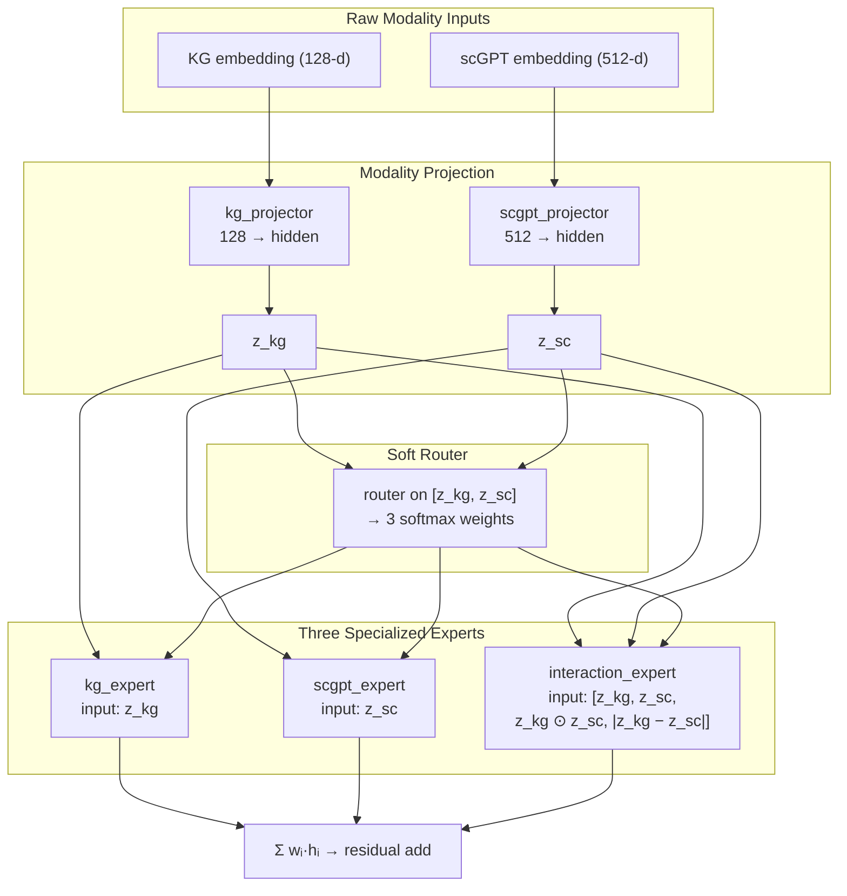

This page dissects the three specialized experts inside DyMoE-Pert's `ResidualMoEFusion` module: the **KG expert**, the **scGPT expert**, and the **Interaction expert**. Each expert processes a distinct view of the perturbation representation, and their division of labor is the mechanism by which the model fuses knowledge-graph priors with foundation-model gene embeddings. We cover expert construction, modality-specific input sourcing, the interaction expert's feature-crossing design, and how specialization is shaped to remain a *soft mixture* rather than a hard gate. Routing mechanics and the balance loss formulation are treated in depth in [Soft Router and Balance Loss](8-soft-router-and-balance-loss); the residual summation structure is covered in [Residual Fusion Design](6-residual-fusion-design).

## Architectural Position of the Experts

The experts live in `ResidualMoEFusion`, instantiated inside `scPert_Model` only when `use_moe_fusion` is enabled. The constructor enforces exactly three experts and validates the router and ablation modes up front, establishing the fixed expert topology this page describes. The fusion module receives two heterogeneous tensors — a 128-dim knowledge-graph embedding and a 512-dim scGPT embedding — and returns a single `hidden_size`-dim vector that replaces the naive concatenation pathway.

Two modality projectors normalize this dimensional asymmetry *before* expert computation: `kg_projector` maps 128 → `hidden_dim` and `scgpt_projector` maps 512 → `hidden_dim`, each via Linear → GELU → Dropout → LayerNorm. This design decision matters for expert specialization: every expert — including the cross-modal one — operates on a shared latent geometry rather than raw, differently-scaled embedding spaces.

Sources: [model.py](models/model.py#L96-L130), [model.py](models/model.py#L415-L427)

## Expert Comparison: Inputs, Capacity, and Roles

All three experts share the same *output* contract — a `Linear(hidden_dim → hidden_dim) → GELU → Dropout → Linear(hidden_dim → output_dim)` trunk — so the router can treat them as interchangeable contributors to a weighted sum. Their differentiation is entirely in the **input feature space** and the **input width**. The interaction expert is the only expert that sees both modalities and the only one whose first layer is 4× wider, reflecting its four concatenated feature blocks.

| Expert | Input features | Input width | Cross-modal? | Architectural role |
|---|---|---|---|---|
| `kg_expert` | `z_kg` | `hidden_dim` | No | Unimodal KG pathway |
| `scgpt_expert` | `z_sc` | `hidden_dim` | No | Unimodal scGPT pathway |
| `interaction_expert` | `[z_kg, z_sc, z_kg ⊙ z_sc, \|z_kg − z_sc\|]` | `4 × hidden_dim` | Yes | Explicit feature crossing |

The interaction expert's feature construction at forward time is `[z_kg, z_sc, z_kg * z_sc, |z_kg - z_sc|]` — concatenation, Hadamard product, and absolute difference. The product term supplies a bilinear coupling (coordinates that co-activate across modalities), while the absolute-difference term supplies a disagreement signal (coordinates where the knowledge-graph prior and the scGPT prior diverge). This is the standard NLI/decomposition-style feature-crossing recipe applied to embedding fusion, and it is why this expert can model *relationships between* sources rather than either source alone.

Sources: [model.py](models/model.py#L138-L155), [model.py](models/model.py#L296-L297)

## KG Expert: Input Sourcing and Edge Cases

The KG expert's input originates in `get_gene_embedding`, backed by the buffer loaded from `embeddings/gene_2_kge_comgcn_final_common.npz` at model construction. Lookup follows a strict three-tier policy: control perturbations receive a 128-dim zero vector; genes present in the KG vocabulary receive their stored ComGCN knowledge-graph embedding; out-of-vocabulary genes receive the first 128 dims of a deterministic fallback vector.

The fallback is worth understanding precisely. `get_random_embedding` derives a seed from the SHA-1 hash of the gene name, generating a seeded 640-dim Gaussian vector scaled by `1/√640`. The KG pathway slices `[:128]` and the scGPT pathway (below) slices `[128:]` of the *same* vector — so an unseen gene still produces two coherent, deterministic modality inputs without any file dependency. Determinism via name-hashed seeding guarantees the same gene always maps to the same embedding across processes and multi-GPU workers, which is essential for reproducible inference on unseen perturbations.

> [!TIP]
> The two OOV slices `[:128]` and `[128:]` come from one seeded 640-dim vector. This means unseen genes have *correlated* KG and scGPT fallback embeddings by construction — the interaction expert's product term will see consistent structure even for out-of-vocabulary genes, rather than independent noise per modality.

Sources: [model.py](models/model.py#L370-L377), [model.py](models/model.py#L636-L648), [model.py](models/model.py#L651-L658)

## scGPT Expert: Input Sourcing and Edge Cases

The scGPT expert's input comes from `get_pert_embedding`, backed by `embeddings/gene_embeddingss_full_common.npz` loaded as the `pert_embeddings` buffer. Its policy mirrors the KG expert's tiered lookup — `ctrl` maps to a 512-dim zero vector, known genes index directly into the buffer, and unknown genes slice `[128:]` of the shared deterministic fallback. Both controls and fallbacks preserve the contract that `scgpt_projector` always receives a valid 512-dim tensor.

At training/inference time, the forward loop resolves *one fused embedding per perturbation gene* in a combo (e.g., both genes of `GENE_A+GENE_B`), calling `get_gene_embedding` and `get_pert_embedding` per gene and passing them to `_fuse_pert_embedding`. With MoE enabled, `_fuse_pert_embedding` delegates to `ResidualMoEFusion` and appends the returned aux dict to a batch-level list; with MoE disabled, it degrades to plain concatenation through `pert_dense` — the exact ablation baseline the experts replace. Single-gene perturbations duplicate their fused embedding so the subsequent `pert_fuse` averaging step sees a pair.

Sources: [model.py](models/model.py#L379-L390), [model.py](models/model.py#L660-L671), [model.py](models/model.py#L697-L730), [model.py](models/model.py#L478-L490)

## How Specialization Emerges: Soft Mixture by Design

The experts are not hard-gated; the router computes softmax weights over all three and the fused output is the weighted sum `Σ wᵢ·hᵢ`, added residually to the base pathway. Specialization therefore manifests as *learned weight distribution*, not expert selection. Three mechanisms shape this distribution toward a healthy soft mixture:

1. **Near-uniform router initialization.** The router's final layer is initialized with weight std `1e-3` and zero bias, so at step zero every expert receives an approximately equal weight — no expert is privileged from birth.
2. **Balance loss pressure.** Per batch, the mean router weight per expert is pulled toward `1/N` via MSE. This term enters training through `_moe_balance_loss` as `base_loss + moe_balance_weight × balance_loss`, with a default weight of `0.01` — zeroed automatically when the router is `fixed_uniform` or the ablation is `base_only`, since uniform weighting needs no regularization. The loss is computed **only over active experts**, so ablations renormalize rather than penalize.
3. **Mask-aware renormalization.** In `no_interaction` mode, the interaction expert's output is replaced with detached zeros and softmax is recomputed over the two remaining active experts, redistributing the full weight budget instead of leaving orphaned mass.

This is a deliberate anti-collapse design: the combination of near-uniform init, small balance weight, and soft summation keeps all three experts contributing, with specialization emerging gradually as gradient pressure shifts weights per input. The cost is that per-sample routing is *dense* — no expert is ever fully skipped — trading compute efficiency for stability.

> [!TIP]
> Because `no_interaction` zeroes the interaction expert *inside the weighted sum*, the frozen expert contributes exactly nothing while its router slot remains valid — this is cleaner than masking the expert output post-hoc, since the router's renormalized weights preserve a proper probability simplex over active experts.

Sources: [model.py](models/model.py#L156-L166), [model.py](models/model.py#L264-L271), [model.py](models/model.py#L239-L262), [model.py](models/model.py#L293-L294), [model.py](models/model.py#L305-L311), [scpert.py](models/scpert.py#L64-L77), [model.py](models/model.py#L364-L366)

## Observing Specialization: Expert Telemetry

The training wrapper surfaces empirical specialization through `_format_moe_stats`, which emits per-epoch router diagnostics: `applied_alpha_*` (post-mask, post-inference-mode weights averaged over the batch), `raw_alpha_*` (pre-ablation softmax weights), per-expert `alpha_min`/`alpha_max`, and router **entropy**. Reading these logs is the practical way to verify expert behavior: a `full` run should show all three alphas near `0.333` early (uniform init) and diverging as specialization develops, while entropy below `ln(3) ≈ 1.0986` quantifies the departure from uniform routing.

| Telemetry field | Meaning | Healthy signal |
|---|---|---|
| `applied_alpha_{kg,scgpt,interaction}` | Batch-mean weight actually applied | Non-degenerate; not collapsed to one expert |
| `raw_alpha_*` | Weights before ablation masking | Divergence from uniform = learned routing |
| `alpha_min` / `alpha_max` | Weight range per expert across batch | Wide range = input-dependent routing |
| `entropy` | Mean routing entropy | Between ~0.5 and 1.1 nats — neither collapsed nor frozen |
| `balance` | Balance loss value | Trending down without hitting zero |

The aux dict that feeds these logs is assembled in `ResidualMoEFusion.forward` with `return_aux=True`, carrying per-forward `expert_outputs` for each expert plus router logits, weights, and balance loss; the model-level `_merge_moe_aux` then stacks these across all pert-genes in the batch. This telemetry loop is how you empirically validate that the KG expert, scGPT expert, and interaction expert are each earning their share of the mixture.

Sources: [scpert.py](models/scpert.py#L112-L169), [model.py](models/model.py#L318-L344), [model.py](models/model.py#L492-L631)

## Interplay with Ablation Modes

Expert participation is governed by the ablation framework, which freezes parameters and zeroes outputs rather than deleting modules — keeping checkpoints structurally comparable across configurations. In `base_only`, all three experts and the router are frozen and the fusion collapses to the base MLP; in `no_interaction`, only the interaction expert is disabled (the direct ablation of this page's cross-modal hypothesis); in `experts_only`, the base MLP is disabled and the output is the experts' weighted sum alone. Each mode also stamps an integer ID and an `active_expert_mask` into the aux dict so downstream logs and loss computation stay consistent. Full parameter-freezing semantics and the experimental rationale for each mode are documented in [Ablation Modes Framework](9-ablation-modes-framework).

Sources: [model.py](models/model.py#L178-L204), [model.py](models/model.py#L189-L237)

## Summary and Reading Path

Expert specialization in DyMoE-Pert follows a precise contract: **shared output shape, differentiated inputs, soft routing**. The KG and scGPT experts are structurally identical unimodal pathways over projected 128-d and 512-d embeddings respectively; the interaction expert is the sole cross-modal component, distinguished by its 4×-wide first layer over concatenated, element-wise-product, and absolute-difference features. Specialization is cultivated — not imposed — through near-uniform router init, a small balance loss on active experts, and dense soft weighting.

To continue the Deep Dive into the Dynamic MoE Fusion Core:

- [Residual Fusion Design](6-residual-fusion-design) — how the expert mixture integrates with the base pathway
- [Soft Router and Balance Loss](8-soft-router-and-balance-loss) — full routing math and regularization analysis
- [Ablation Modes Framework](9-ablation-modes-framework) — experimental configurations isolating each expert's contribution
- [Knowledge-Graph and scGPT Embeddings](13-knowledge-graph-and-scgpt-embeddings) — provenance and construction of the expert inputs
