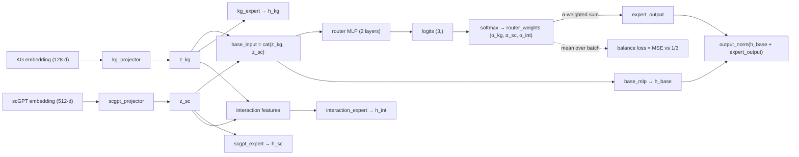
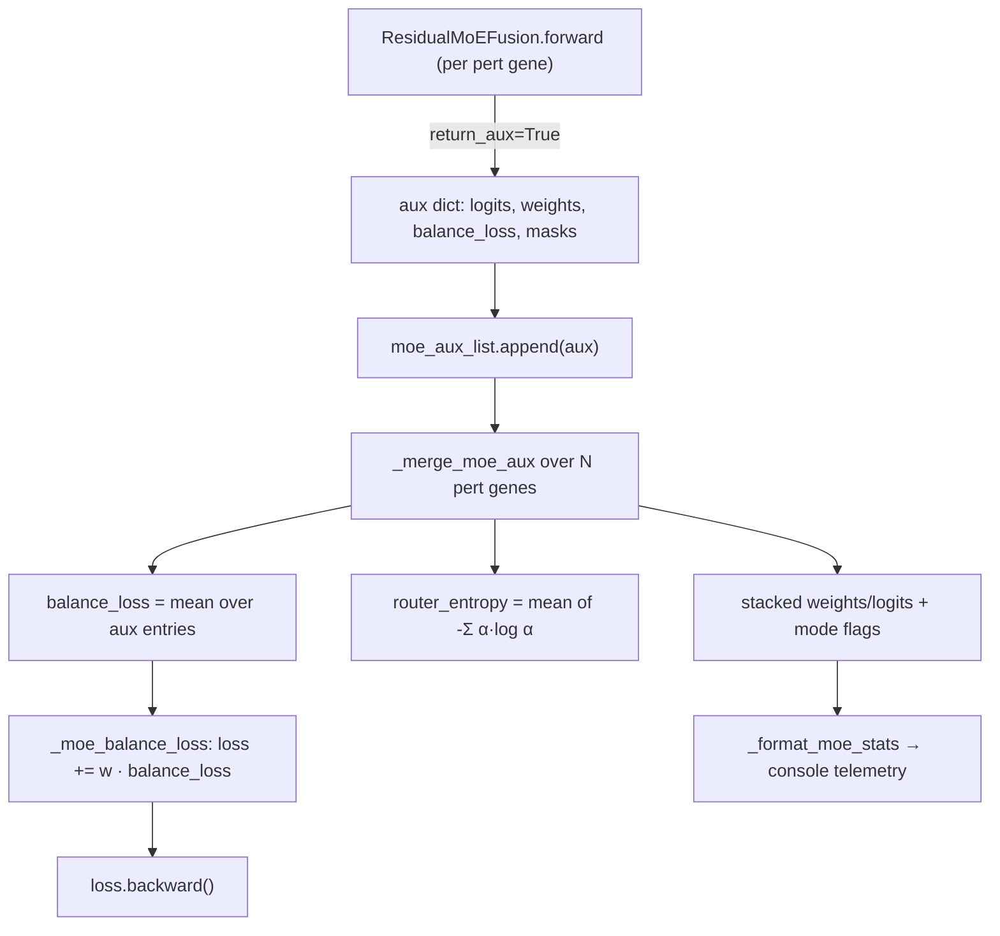

This page documents the soft routing mechanism and the auxiliary balance loss inside DyMoE-Pert's `ResidualMoEFusion` module. While [Residual Fusion Design](6-residual-fusion-design) explains *why* a base MLP is additive with expert outputs and [Expert Specialization](7-expert-specialization-kg-scgpt-interaction) explains *what* each expert computes, this page focuses on the third pillar: *how mixing coefficients are produced, constrained, and monitored*. We cover the router topology, the dense soft-max weighting scheme, the two routing modes (`dynamic` and `fixed_uniform`), the mean-squared deviation balance loss, its activation guards, and the telemetry pipeline that surfaces router behavior during training.

## Router Architecture: Input, Topology, and Cold-Start Initialization

The router is a two-layer MLP defined as `Linear(2·hidden_dim → hidden_dim) → GELU → Dropout → Linear(hidden_dim → 3)`. Its input is deliberately restricted to the **base branch representation**: `base_input = cat([z_kg, z_sc], dim=-1)`, the concatenation of the KG-projected (128→hidden) and scGPT-projected (512→hidden) embeddings. The interaction features (`z_kg * z_sc`, `|z_kg - z_sc|`) feed the interaction expert but are **excluded from router input**, keeping the gating decision a function of source-magnitude evidence rather than of the interaction construct itself.

Sources: [model.py](/models/model.py#L156-L161), [model.py](/models/model.py#L274-L276), [model.py](/models/model.py#L296-L299)

The final linear layer is initialized with `normal_(mean=0, std=1e-3)` and zero bias. Because softmax over near-zero logits yields weights ≈ 1/3 per expert, training **cold-starts at uniform mixing** and must learn any deviation from the data gradient. This initialization is complementary to the balance loss: the loss penalizes drift *away* from uniform, while the init guarantees the drift starts at zero rather than at an arbitrary random split.

Sources: [model.py](/models/model.py#L163-L167)

## Soft Weight Computation: Dense Mixing over Three Experts

Weight computation is **dense and soft**: `raw_router_weights = softmax(router_logits, dim=-1)` produces a probability vector over all three experts, and the expert outputs are fused via `sum(router_weights.unsqueeze(-1) * expert_stack, dim=-2)` where `expert_stack = stack([h_kg, h_sc, h_interaction], dim=-2)`. There is **no top-k sparsification, no capacity factor, and no token dropping** — all three experts execute on every perturbation token, and the router selects only the mixture ratio. This makes the compute cost constant per token and eliminates the load-balancing failure mode specific to hard routing (expert overflow), reducing the balance loss's role from "load distribution enforcement" to "specialization regularization."

Sources: [model.py](/models/model.py#L299-L306)

The module enforces exactly three experts (`num_experts != 3` raises), so the softmax support is fixed. Validation also restricts `router_mode` to the two supported values at construction time, and `scPert_Model` mirrors the same validation when reading `moe_router_mode` from args.

Sources: [model.py](/models/model.py#L109-L112), [model.py](/models/model.py#L358-L363)

## Routing Modes: Dynamic vs Fixed-Uniform Controls

`_compute_router_weights` is the single decision point that maps logits to applied weights, and it resolves four scenarios in priority order. In `dynamic` training mode the raw softmax is used directly. In `fixed_uniform` mode — described in `--moe-router-mode` help as a "strict fixed-uniform E3 control" — the router is numerically bypassed with constant `1/num_experts` weights, making the MoE degenerate into a fixed average of the three experts while keeping parameters otherwise identical. The third scenario applies `fixed_uniform` **only at inference** (`inference_router_mode`), toggled post-training via `set_inference_router_mode`, enabling an ablation where training used learned routing but evaluation uses uniform mixing. The fourth scenario handles the `no_interaction` ablation: softmax is computed over only the *active* experts' logits (KG, scGPT), then re-scattered into the full 3-slot vector with the interaction slot zero-filled, guaranteeing the masked expert contributes exactly zero to the mixture.

Sources: [model.py](/models/model.py#L239-L262), [model.py](/models/model.py#L169-L172), [train.py](/scripts/train.py#L47-L53)

| Scenario | Condition | Applied weights | Router gradients | Balance loss |
|---|---|---|---|---|
| Dynamic training | `router_mode="dynamic"`, training | `softmax(logits)` | Flows | Active |
| Fixed-uniform control | `router_mode="fixed_uniform"` | Constant `1/3` | N/A (bypassed) | Force-zeroed |
| Inference fixed-uniform | `not training` + `inference_router_mode="fixed_uniform"` | Constant `1/3` | N/A | N/A (eval only) |
| No-interaction ablation | `ablation_mode="no_interaction"` | `softmax` over active subset, zero-filled | Flows to active slots | Active over 2 experts |

Sources: [model.py](/models/model.py#L243-L262)

## The Balance Loss: Formulation and Semantics

`_compute_balance_loss` computes the **mean squared deviation of batch-average routing weights from the uniform target**:

1. Slice the applied `router_weights` to active experts: `active_weights = router_weights[..., active_expert_mask]`.
2. Reduce over all non-expert dimensions (the per-perturbation batch axis): `mean_router_weight = active_weights.mean(...)`, a vector of length = number of active experts.
3. Target is `full_like(mean, 1/K)` where `K = active_weights.shape[-1]`.
4. Return `mean((mean_router_weight - target)²)` — a scalar.

This is a direct uniformity regularizer on **soft mixture coefficients**, not the Switch-Transformer-style importance×load product. Two semantic consequences follow. First, because the reduction is over the mean of weights (not the mean of argmax assignments), the loss penalizes *aggregate* expert under-use even when individual tokens are highly specialized — a router that sends every token entirely to one expert but alternates experts across the batch can still satisfy it. Second, because it operates on `router_weights` (post-mask, post-mode resolution) rather than `raw_router_weights`, the loss automatically degrades to the correct target when `no_interaction` re-normalizes over two experts (target becomes 1/2, not 1/3), and returns exactly zero when the expert mask is empty (`base_only`).

Sources: [model.py](/models/model.py#L264-L271), [model.py](/models/model.py#L197-L204)

> [!TIP]
> The balance loss consumes **applied** weights, not raw logits. This is why fixed-uniform mode can zero the loss safely: with constant 1/3 weights the MSE is identically zero anyway, and `_empty_router_aux` returns a detached zero tensor for `base_only` where no router exists at all.

## Balance Loss Activation Guards and Weighting

The loss participates in training only when explicitly weighted, and three independent guards enforce its deactivation in configurations where it would be meaningless. `scPert_Model.__init__` stores `moe_balance_weight` (default `0.01`) from args, then force-zeroes it when `router_mode == "fixed_uniform"` or `ablation_mode == "base_only"`. The CLI parser defaults `--moe-balance-weight` to `0.0` (opt-in at the script level) and re-applies the same guard. `scPert.model_initialize` performs the identical guard a third time before writing the value into the serialized config — so a saved checkpoint's config never contains an active balance weight for a uniform-router or base-only model, keeping [Configuration Reference](19-configuration-reference) semantics reproducible across `load_pretrained`.

Sources: [model.py](/models/model.py#L364-L366), [train.py](/scripts/train.py#L40), [train.py](/scripts/train.py#L74-L75), [scpert.py](/models/scpert.py#L320-L325)

## Router Telemetry: Aux Metadata Aggregation

When `return_aux=True`, `ResidualMoEFusion.forward` returns a metadata dictionary alongside the fused embedding: `router_logits`, `raw_router_weights` (pre-mask softmax), `router_weights` (post-mask applied), `balance_loss`, mode flags (`router_mode_fixed_uniform`, `inference_router_mode_fixed_uniform`), integer-coded ablation mode, `active_expert_mask`, `active_expert_names`, `base_enabled`, `router_enabled`, and the raw per-expert outputs. Because `scPert_Model.forward` may invoke the fusion module once **per perturbation gene** in a combo perturbation (via `_fuse_pert_embedding`, appending each aux dict to `moe_aux_list`), the per-sample aux dicts are merged by `_merge_moe_aux`: weights stack along a new leading dimension, `balance_loss` is averaged across the per-gene calls, and a companion diagnostic — **router entropy** `−Σ α·log(α)` averaged over tokens — is computed to measure how peaked the routing distribution is.

Sources: [model.py](/models/model.py#L317-L345), [model.py](/models/model.py#L478-L490), [model.py](/models/model.py#L578-L631), [model.py](/models/model.py#L610-L616)

Degenerate configurations get structurally valid empty telemetry rather than `None`: `_empty_router_aux` (for `base_only`) and the two early-exit branches of `_merge_moe_aux` produce zero-shaped tensors and scalar zeros, with `router_enabled=False`. This invariant lets downstream logging and multi-GPU code treat aux as always-a-dict.

Sources: [model.py](/models/model.py#L212-L237), [model.py](/models/model.py#L492-L577)

## Training-Time Integration: Loss Composition and Logging

Inside the training loop, `pred, moe_aux = _split_model_output(model(model_batch))` separates predictions from telemetry. The task loss is computed by `loss_fct` (the prediction objective detailed in [Prediction Decoder and Loss](11-prediction-decoder-and-loss)), then `_moe_balance_loss(task_loss, moe_aux, self.model)` composes the final objective: it unwraps any `PyGDataParallel` wrapper to read `moe_balance_weight` from the underlying module (essential because attribute lookups on a DataParallel shell fail), converts the aux balance value to the base loss's dtype/device, and returns `base_loss + balance_weight · balance_loss` together with the raw balance scalar for logging. Gradients then flow through a single `backward()` with `clip_grad_value_(1.0)`.

Sources: [scpert.py](/models/scpert.py#L64-L77), [scpert.py](/models/scpert.py#L597-L612)

Every 50 steps, the loop logs three things: the combined loss with the task-loss and weighted-balance breakdown, and a formatted router-statistics line from `_format_moe_stats`. The stats line distinguishes **applied** alphas (post-mask/post-mode, what actually weighted the experts: `applied_alpha_kg/scgpt/interaction`) from **raw** alphas (the unmasked softmax), and reports per-expert min/max ranges plus entropy — the minimal observable set needed to diagnose expert collapse (min/max compressing toward a one-hot pattern) versus healthy specialization. The formatted string also echoes the effective ablation mode, router mode, active expert names, and the numeric balance value.

Sources: [scpert.py](/models/scpert.py#L615-L631), [scpert.py](/models/scpert.py#L112-L169)

| Telemetry field | Source | Diagnostic question it answers |
|---|---|---|
| `applied_alpha_{kg,scgpt,interaction}` | mean of post-mask `router_weights` | Which experts does the model actually use? |
| `raw_alpha_{...}` | mean of pre-mask softmax | How would routing look without ablation masking? |
| `alpha_min` / `alpha_max` | per-expert extremes over batch | Is routing degenerate (min≈0, max≈1) or soft? |
| `entropy` | `−Σ α·log(α+1e-8)` | How peaked is the routing distribution? |
| `balance` | averaged `_compute_balance_loss` | How far is batch-average usage from uniform? |

Sources: [scpert.py](/models/scpert.py#L130-L168), [model.py](/models/model.py#L610-L616)

## Design Trade-offs

The soft-dense design trades compute for stability and observability. The comparison below positions this router against the two hard-routing failure modes it avoids, and clarifies what the balance loss can and cannot enforce.

| Property | DyMoE soft router | Top-k hard router (typical MoE) |
|---|---|---|
| Experts executed per token | All 3 | k of N |
| Load-balance failure mode | Weight collapse (α → one-hot) only | Weight collapse **and** capacity overflow / token dropping |
| Balance loss role | Regularize mean mixture toward uniform | Enforce expert invocation counts (load) |
| Router gradient | Dense through softmax and all experts | Sparse through selected experts only |
| Ablation masking | Zero-fill weight slot + renormalize softmax | Expert simply never dispatched |

Sources: [model.py](/models/model.py#L299-L306), [model.py](/models/model.py#L264-L271)

Three costs are worth noting for advanced users. **(1) Expressivity ceiling:** a soft router cannot realize exclusive expert routing — every perturbation embedding always receives contributions from all three experts, so specialization manifests as weight ratios, not selection. **(2) Balance-loss granularity:** the MSE-on-batch-mean formulation constrains only the *first moment* of the weight distribution; it cannot prevent individual tokens from being one-hot as long as the batch averages to uniform. **(3) Guard redundancy is a feature:** the balance weight is zeroed at three layers (model init, CLI, `model_initialize`) — an intentional belt-and-suspenders pattern ensuring the serialized config, the runtime attribute, and the effective training objective always agree, which matters when reproducing `fixed_uniform` control experiments from checkpoints. For how these controls feed the ablation study, continue to [Ablation Modes Framework](9-ablation-modes-framework); for the wiring of these arguments into the training entry point, see [Training Loop Orchestration](15-training-loop-orchestration) and [Multi-GPU Parallel Training](16-multi-gpu-parallel-training); for eval-time routing behavior, see [Unseen Perturbation Inference](17-unseen-perturbation-inference).

> [!TIP]
> When running a `dynamic` training followed by `set_inference_router_mode("fixed_uniform")`, the balance loss has already done its job during training; the eval-time uniform override is a *post-hoc* control that isolates the router's learned contribution — the `_format_moe_stats` `applied_alpha_*` fields will all read exactly 0.333333, confirming the override took effect.
