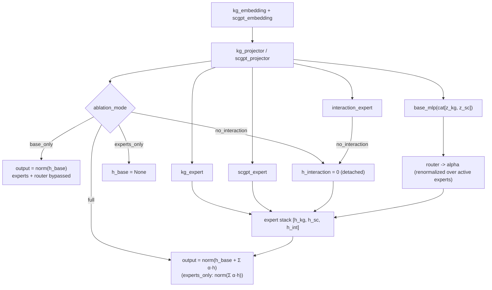
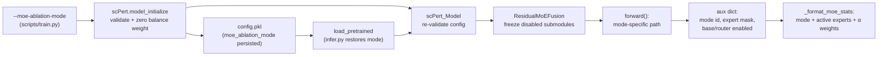

The Ablation Modes Framework is the mechanism that lets a single `ResidualMoEFusion` module be trained and evaluated as four structurally different models: the complete DyMoE-Pert fusion, a baseline-only variant, an experts-without-interaction variant, and an experts-without-base-branch variant. Rather than maintaining four separate model classes, the framework encodes the structural decision as one validated string (`ablation_mode`) and propagates its consequences through parameter freezing, forward-path branching, router weight renormalization, balance-loss computation, and runtime observability metadata. This page explains how those pieces work together; the design of the experts themselves is covered in [Expert Specialization: KG, scGPT, Interaction](7-expert-specialization-kg-scgpt-interaction) and the fusion arithmetic in [Residual Fusion Design](6-residual-fusion-design).

The single source of truth is the `ablation_mode` argument of `ResidualMoEFusion`, which is validated at construction time against the closed set `("full", "base_only", "no_interaction", "experts_only")`. Any other value raises a `ValueError` immediately, so an invalid ablation study can never start silently training the wrong architecture.

Sources: [model.py](models/model.py#L96-L117)

## The Four Structural Variants

Each mode removes exactly one architectural hypothesis from the full model, which is what makes the resulting comparisons interpretable. `full` is the complete residual MoE: a base MLP branch plus three weighted expert outputs. `base_only` disables all experts and the router, reducing the fusion to the base MLP over concatenated projected KG and scGPT features. `no_interaction` keeps the base branch and the KG/scGPT experts but cuts the cross-modal interaction expert, testing whether explicit KG×scGPT interaction features matter. `experts_only` keeps the router and all three experts but removes the base MLP, testing whether the residual base branch is necessary.

| Mode | Base branch | KG expert | scGPT expert | Interaction expert | Router | What it isolates |
| --- | --- | --- | --- | --- | --- | --- |
| `full` | ✅ | ✅ | ✅ | ✅ | ✅ | — (reference model) |
| `base_only` | ✅ | ❌ | ❌ | ❌ | ❌ | Value of the entire MoE path |
| `no_interaction` | ✅ | ✅ | ✅ | ❌ | ✅ (renormalized) | Value of the cross-modal interaction expert |
| `experts_only` | ❌ | ✅ | ✅ | ✅ | ✅ | Value of the residual base branch |

Sources: [model.py](models/model.py#L113-L117), [model.py](models/model.py#L278-L312)

## Structural Enforcement: Freezing and Active-Expert Masking

The framework's first design decision is that a mode is enforced structurally, not by runtime `if` checks scattered through training code. During `__init__`, `_apply_ablation_freezing()` walks the submodules that the mode disables and sets `requires_grad=False` on every parameter. `base_only` freezes the three experts and the router; `no_interaction` freezes only the interaction expert; `experts_only` freezes only the base MLP. The training loop then builds its optimizer exclusively from parameters with `requires_grad=True`, and raises a `RuntimeError` if a mode left nothing trainable — so frozen components receive neither gradient updates nor optimizer state, rather than merely being multiplied by zero.

Sources: [model.py](models/model.py#L167), [model.py](models/model.py#L174-L187), [scpert.py](models/scpert.py#L573-L576)

The second enforcement mechanism is the active-expert mask, produced by `_active_expert_mask_tensor()`. It encodes the mode as a boolean triple over `(kg, scgpt, interaction)`: `[False, False, False]` for `base_only`, `[True, True, False]` for `no_interaction`, and `[True, True, True]` otherwise (`experts_only` keeps all three experts active even though the base is frozen). Every downstream consumer — router renormalization, balance loss, and the aux metadata dict — derives its behavior from this one mask instead of re-testing the mode string, which is the pattern that keeps the four variants consistent.

Sources: [model.py](models/model.py#L197-L204)

> [!TIP]
> Because freezing happens in `__init__` and the optimizer is built from `requires_grad` afterwards, an ablated checkpoint contains optimizer state only for active components. When you load such a checkpoint with `load_pretrained`, the `config.pkl` restores `moe_ablation_mode` and re-instantiates the same frozen structure — you cannot accidentally run a `base_only` checkpoint through the full architecture.

## Forward-Path Divergence per Mode

Inside `forward()`, the mode selects among three distinct computation paths. For `base_only`, the method short-circuits after the base MLP and returns `output_norm(h_base)` immediately; if `return_aux=True`, it attaches a synthesized "empty router" aux dict (`_empty_router_aux`) with zero-length router-weight tensors and zero balance loss, so callers always see a uniform aux interface regardless of mode. For `experts_only`, `h_base` is set to `None` and the final fusion is `output_norm(expert_output)` with `base_enabled=False`. For `full` and `no_interaction`, the standard residual path runs: `output = output_norm(h_base + expert_output)`.

Sources: [model.py](models/model.py#L273-L312)

The `no_interaction` mode has one subtle behavior worth noting explicitly: it does not delete the interaction expert from the expert stack. Instead, `h_interaction` is replaced by `torch.zeros_like(h_kg).detach()` — a detached zero tensor — and the stack of three expert outputs is still assembled. This keeps tensor shapes identical across modes (a property that matters for the multi-GPU data-parallel path, where replicas must produce matching output structures) while guaranteeing the interaction branch contributes exactly nothing to the weighted sum.



Sources: [model.py](models/model.py#L285-L311), [model.py](models/model.py#L293-L297)

## Router Renormalization and Balance Loss under Ablation

The router softmax is mode-aware in exactly one place. For `no_interaction`, `_compute_router_weights()` slices the router logits down to the two active experts (`router_logits[..., active_expert_mask]`), applies softmax (or uniform 0.5/0.5 weights under `fixed_uniform` routing), and then scatters the result back into a length-3 tensor with zeros in the interaction slot. This means the two surviving experts compete for weights that sum to 1 across the active set only — the interaction expert never receives stray probability mass. All other router-mode interactions (`fixed_uniform`, inference-time uniform routing) are orthogonal to the ablation framework and are detailed in [Soft Router and Balance Loss](8-soft-router-and-balance-loss).

Sources: [model.py](models/model.py#L239-L262)

Balance loss is likewise computed over the active expert subset only: `_compute_balance_loss()` selects `router_weights[..., active_expert_mask]` and penalizes deviation of the per-expert mean weight from `1 / num_active`. For `no_interaction` the target is therefore 0.5 per surviving expert; for `full` and `experts_only` it is 1/3. For `base_only` — where there are no active experts — the method returns a zero scalar, and the aux dict for that mode reports `router_enabled=False`. One deliberate safety rule ties the loss together: whenever the mode is `base_only` (or the router mode is `fixed_uniform`), `moe_balance_weight` is forcibly zeroed in both `scPert_Model.__init__` and `scPert.model_initialize`, so a meaningless balance penalty can never enter the total loss.

Sources: [model.py](models/model.py#L264-L271), [model.py](models/model.py#L364-L366), [scpert.py](models/scpert.py#L320-L325)

## Observability: Aux Metadata and Log Stats

Every forward pass under MoE fusion emits an auxiliary dictionary, and the ablation framework populates it with self-describing metadata rather than leaving the caller to infer the variant. The aux dict carries `moe_ablation_mode` as a stable integer id (`full=0, base_only=1, no_interaction=2, experts_only=3`), the `active_expert_mask` boolean triple, `active_expert_names` (inactive slots encoded as `-1`), and the boolean flags `base_enabled` and `router_enabled`. In multi-GPU training, `_merge_moe_aux()` aggregates these tensors across per-replica aux lists — stacking mode ids and masks, OR-ing the `base_enabled`/`router_enabled` flags — so the merged stats remain valid under PyG `DataParallel`.

Sources: [model.py](models/model.py#L212-L237), [model.py](models/model.py#L318-L344), [model.py](models/model.py#L590-L631)

The training loop turns this metadata into human-readable ablation diagnostics. `_mode_from_aux()` decodes the integer id back to its name, `_active_expert_names_from_aux()` extracts the surviving expert list, and `_format_moe_stats()` prints a periodic log line containing the mode, active experts, base/router enablement flags, the applied vs. raw per-expert router weights (`applied_alpha_*` / `raw_alpha_*`), their min/max ranges, and router entropy. Under `base_only` this collapses to a compact `router_status=disabled` line, since the router-weight tensors are empty. These logs are the practical tool for confirming that an ablation run is really running the intended structure.

Sources: [scpert.py](models/scpert.py#L86-L109), [scpert.py](models/scpert.py#L112-L169), [scpert.py](models/scpert.py#L629-L631)

> [!TIP]
> The `moe_ablation_mode` id travels through the aux dict as a *tensor*, not a Python string. That is what allows `_merge_moe_aux` to verify consistency across data-parallel replicas (`ablation_modes.stack(...)`), and it means custom tooling that inspects aux dicts should decode via `_mode_from_aux` rather than comparing raw values.

## Configuring Modes: From CLI to Checkpoint

The configuration surface is deliberately small — one CLI flag, one config key, one constructor argument — with validation duplicated at each layer. `scripts/train.py` exposes `--moe-ablation-mode` with the four allowed choices (default `full`) and always forces `use_moe_fusion=True`, so the ablation framework is exercised on every training run of the provided scripts. The value flows into `scPert.model_initialize` (which re-validates and persists it into `config.pkl`) and finally into `scPert_Model`, which passes it to `ResidualMoEFusion`. At inference time there is no override: `scripts/infer.py` calls `load_pretrained`, and the checkpoint's stored mode silently reconstructs the same architecture.

Sources: [train.py](scripts/train.py#L41-L52), [train.py](scripts/train.py#L73-L75), [scpert.py](models/scpert.py#L320-L349), [infer.py](scripts/infer.py#L69)

A typical ablation comparison therefore consists of four training runs differing in exactly one flag:

```bash
python scripts/train.py --data-name norman --model-save-name norman_full            # full
python scripts/train.py --data-name norman --model-save-name norman_base            # base_only
python scripts/train.py --data-name norman --model-save-name norman_nointer         # no_interaction
python scripts/train.py --data-name norman --model-save-name norman_expertsonly     # experts_only
```

| Layer | Key / flag | Allowed values | Default | Enforcement point |
| --- | --- | --- | --- | --- |
| CLI (`train.py`) | `--moe-ablation-mode` | `full`, `base_only`, `no_interaction`, `experts_only` | `full` | argparse `choices` |
| Wrapper (`scPert.model_initialize`) | `moe_ablation_mode` | same set | `full` | `ValueError` + balance-weight zeroing |
| Model (`scPert_Model`) | `moe_ablation_mode` (config) | same set | `full` | `ValueError` in `__init__` |
| Fusion (`ResidualMoEFusion`) | `ablation_mode` | same set | `full` | `ValueError` + `_apply_ablation_freezing()` |
| Checkpoint (`config.pkl`) | `moe_ablation_mode` | persisted value | — | restored by `load_pretrained` |

Sources: [train.py](scripts/train.py#L137-L146), [scpert.py](models/scpert.py#L357-L397)

The following diagram summarizes how one string propagates through the system, from CLI to frozen parameters to logged diagnostics:



Sources: [train.py](scripts/train.py#L21-L54), [scpert.py](models/scpert.py#L586-L594), [model.py](models/model.py#L348-L368)

## Interpreting the Ablation Study

Because each mode deletes exactly one hypothesis, the resulting metric deltas have direct architectural interpretations. Comparing `full` against `base_only` quantifies the entire MoE contribution; `full` vs. `no_interaction` isolates the cross-modal interaction expert's value on KG×scGPT features; `full` vs. `experts_only` quantifies how much the residual base branch stabilizes fusion. Note that `experts_only` and `base_only` change the trainable parameter count as well as the architecture, so differences in absolute MSE partly reflect capacity — the log lines described above (`base_enabled`, `router_enabled`, per-expert α statistics) let you distinguish "the expert received no weight" from "the component was absent." For the evaluation settings that make these comparisons meaningful (simulation split subgroups, unseen-perturbation regimes), see [Perturbation Splits and Simulation Split](14-perturbation-splits-and-simulation-split) and [Unseen Perturbation Inference](17-unseen-perturbation-inference).

Sources: [model.py](models/model.py#L132-L161), [scpert.py](models/scpert.py#L153-L169)

Natural next steps in this Deep Dive sequence: [Residual Fusion Design](6-residual-fusion-design) for the `h_base + Σ α·h` arithmetic being ablated, [Soft Router and Balance Loss](8-soft-router-and-balance-loss) for the routing modes that interact with `no_interaction`, and [Training Loop Orchestration](15-training-loop-orchestration) for how the loss-weighting hooks shown here fit into the full epoch cycle.